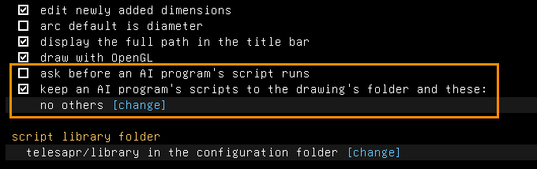

# Drawing with an AI model

TeleSAPR can be driven by an AI model. You say in plain English what to draw, and the model
draws it in the window you have open. TeleSAPR has no model of its own and needs no API key. It
offers the drawing to any program that speaks the Model Context Protocol (MCP), such as Claude
Code or Claude Desktop, and that program brings the model.

## Setting up

1. In TeleSAPR, turn on **Script > Allow AI Connections**. The setting is kept. To allow
   connections for one run only, start it as `telesapr --agent`.
2. Tell your MCP client to start `telesapr-cli mcp`. You never run that command yourself.

   Claude Code:

   ```bash
   claude mcp add telesapr -- telesapr-cli mcp
   ```

   Claude Desktop, and most other clients, in their MCP configuration file:

   ```json
   {
     "mcpServers": {
       "telesapr": { "command": "telesapr-cli", "args": ["mcp"] }
     }
   }
   ```

   Give the full path of `telesapr-cli` if it is not on the `PATH`.
3. Ask for something: "draw a 60 by 20 mm plate, 4 mm thick, with three 5 mm holes in a row".

The order of starting does not matter. TeleSAPR may be started after the client, or closed and
opened again in the middle of a conversation.

## What you see

- Each script the model runs shows in the script console (**Script > Show Console**) after an
  `ai>` prompt, with what it printed.
- Each script is one step of undo. Ctrl+Z takes back the model's work a script at a time.
- A script that fails changes nothing: what it did before the error is taken back. The model is
  told the line, what went wrong and the statement that failed, so it can correct the script.
- **Script > Stop** stops a running script. The model is told, and that the variables it had
  defined are gone.
- You can go on working while the model works. If you change the drawing between two of its
  calls (draw, delete, undo, change a dimension, open another file), its next script,
  description, picture, measurement, export or open starts with a line telling it so, and
  whether it is another drawing. A change by a second AI program on the same window counts too.
  Selecting, turning the view and activating a group don't.
- A script that reads a solid (its volume, check, problem, faces or edges) waits until the
  window has made it, so it never reads the solid from before a change.
- A long script reports how far it has got, in clients that show progress: the group being
  regenerated ("regenerating g007-plate, 3 of 12") and the last line printed.
- With **ask before an AI program's script runs** ticked on the configuration screen, TeleSAPR
  shows you each script and runs it only if you agree. Most clients also ask before they call a
  tool.

## What the model can do

The model gets eight tools:

| Tool | What it does |
|---|---|
| `run_script` | Runs Go on the drawing, as the console does. Returns what the script printed, the value of its last expression, and how the drawing solved: the active group, any group that failed, and groups after the active one marked "old". `form` fills in the script's form ([Scripts](scripts.md#forms)). |
| `get_drawing` | Describes the drawing: the unit, parameters, groups with how they solved and the volume and bounds of the solid, the active group's requests and constraints, what you have selected and what your mouse is over, so "this" can be pointed at. `group` lists another group's requests and constraints. `script` returns the drawing as the Go script that builds it. `solid` lists the solid's faces and edges by the names a script uses ([`Group.DescribeSolid`](scripts.md#a-model-in-words)), so the model can pick what to fillet or sketch on. |
| `render` | A picture of the drawing, 800 by 600 unless `width` and `height` say otherwise. `view` is `isometric` (the default), `front`, `back`, `top`, `bottom`, `left`, `right`, or `window` for what your window shows. `group` draws up to that group. `section` (`XY`, `YZ` or `ZX`) cuts the solid open by a plane parallel to that workplane, moved by `section_offset`, flipped by `section_flip`; your own section view is left alone. A line of text gives the view, size, group, section and the solid's bounds. |
| `api_help` | The scripting interface's documentation: a primer, or one menu, type, field or method, or what a script calls for a menu entry ("Features > Fillet Edges"). `examples` lists the example scripts; `example bolt` returns one. |
| `measure` | As Analyze > Check Solid: volume, centre of mass, bounding box, and whether the solid is sound, up to the active group or `group`. `selected` measures your selection, as Analyze > Measure Selection does. `gaps` and `walls` list gaps between parts and walls thinner than those many mm, as Analyze > Clearance and Walls does ([Clearance and walls](clearance.md)); `within_parts` takes a part of several solids by its solids. |
| `export` | Writes the drawing to `path`, in the format its extension names: `.stl`, `.3mf`, `.glb`, `.obj`, `.wrl`, `.step`, `.svg`, `.dxf`, `.pdf`, `.eps`, `.png`, or `.go` for the script that builds it. A 2d file is the model as the window looks at it, not the drawing sheet (a script writes that with `doc.Drawing.Export`). Says where it wrote, how many bytes, and gives a link to the file. |
| `open` | Opens the `.tlspr` drawing `path` names in place of the one on screen, and describes it. It never replaces a drawing with unsaved changes. |
| `list_files` | Lists a directory (`dir`), so the model can find the file you name or where to export. |

`get_drawing` and `measure` also return their answer as data a program can read.

`get_drawing`, `render`, `api_help`, `measure` and `list_files` only read. `export` and `open`
show in the console as the script that would do the same, and with the confirmation setting on
you are asked first, as for a script.

## Prompts

The server offers five prompts: tasks you start from the client's list of commands, in clients
that support them. Each comes with the drawing as it is, so the model can start at once.

In Claude Code a prompt is a command, shown as `/telesapr:draw (MCP)`; you can also type
`/mcp__telesapr__draw`. Say what it is about after the command, or in your next message.

| Prompt | What you give | What the model does |
|---|---|---|
| `draw` | what to draw, with its sizes | Draws it with sketches held to 0 degrees of freedom and the features on them, then checks a picture. It draws no more than you asked and leaves the rest of the drawing alone. |
| `check` | a group to look at closely, if you want | Reports what is wrong: sketches that can still move, constraints that conflict or repeat, groups that made no solid, a solid that isn't sound, and what would mend each. Changes nothing. |
| `explain` | nothing | Says how the drawing is built, group by group. Changes nothing. |
| `parametrize` | nothing | Names the sizes that matter as parameters and puts the dimensions on them ([Parameters and units](parameters-and-units.md)), keeping the shape. It gives the volume before and after. |
| `sheet` | the paper (A4 to A0, Letter or Tabloid), if not the one that fits | Makes a drawing sheet of the solid ([Drawings](drawings.md)): views, a section where it helps, and the main dimensions. |

With no TeleSAPR window running, a prompt still comes up and tells the model why it can't see
the drawing.

## Resources

Resources are things you attach to a message, so the model reads them with what you write. In
Claude Code, type `@` and pick one, or type it whole, as `@telesapr:telesapr://drawing`. A
resource holds the drawing as it is when you attach it.

| Resource | What it holds |
|---|---|
| `telesapr://drawing` | The drawing in words, as `get_drawing` gives it. |
| `telesapr://drawing/script` | The drawing as the Go script that builds it. |
| `telesapr://drawing/picture` | An isometric picture of the drawing, 800 by 600. |
| `telesapr://drawing/group/g003` | One group's requests and constraints; put its name or number in place of `g003`. |
| `telesapr://help/primer` | The scripting primer, as `api_help` gives it. |
| `telesapr://examples/bolt` | One example script, with its library if it has one. Each example is listed. |

With no TeleSAPR window running, the drawing's resources give an error that says why. The primer
and examples can still be read.

## Files

A script reads and writes files with your permissions, so the model's scripts are kept to:

- the folder of the open drawing (none until it is saved);
- the folders listed on the configuration screen under **keep an AI program's scripts to the
  drawing's folder and these**;
- a temporary folder of their own (where `os.CreateTemp` puts files);
- the [script library](scripts.md#the-script-library), for reading.

Anything else is refused with an error naming the allowed folders, whatever call names the file
(`doc.File.Save`, `os.ReadFile`, `filepath.Glob`, ...). A symbolic link out of a folder is out,
and a path with `..` is refused. The scripts don't see your environment variables, and can't
change the working directory or start programs.

The guard is on by default. Unticking it lets the model's scripts use any file you may, and run
in the console's own interpreter, so the variables they define are there for you to use. Either
way, the model is told not to save, export or open files unless you ask.

Both settings are on the configuration screen (Edit > Preferences, or **configuration** on the
home screen of the property browser), near its end:



**ask before an AI program's script runs** is the confirmation setting. The box below it is the
guard, and `[change]` under it edits the list of other folders, "no others" to begin with.
**script library folder** is the library the scripts may read. This picture is made by
[`scenarios/ai.scenario`](scenarios/ai.scenario).

The guard does not cover two things: files a drawing links (other parts, STEP files, images),
read where they are when the drawing regenerates, and files a menu command reads or writes
(`doc.Edit.RunCommand`), which you choose in its dialog.

Only programs running as you can connect. TeleSAPR listens on a socket file in a directory that
is yours alone: `$XDG_RUNTIME_DIR/telesapr` on Linux, `$TMPDIR/telesapr` on macOS,
`%LOCALAPPDATA%\telesapr` on Windows. Nothing listens on the network.

## Without a window

```bash
telesapr-cli mcp --headless [--lib <dir>] [--allow <dir>...] [--unguarded] [sketch.tlspr]
```

This serves a drawing of its own: the sketch file, or a new sketch. The model works as above,
with pictures drawn in software. Nothing is saved unless the model is asked to save.

- Scripts are kept to the sketch's folder (for a new sketch, the folder the command started
  in), each `--allow` folder, and a temporary folder.
- `--unguarded` lets them use any file.
- `--lib` names the script library, as for `telesapr-cli run`.

These three flags are for `--headless` only; the window has the same settings on its
configuration screen.

## In a browser

The browser version (Try in browser) has no socket, so an MCP client such as Claude Code works
with the installed program, not the page. A program in the browser can reach the page through
`window.postMessage`: a script of the page's own site, or a page of another site that has the
editor in a frame. Script > Allow AI Connections turns this on and off, and the confirmation
setting works as in the window.

- A program of the page's own site is let in.
- A program of another site is let in only if you allow it: a dialog names the site, and the
  answer holds until AI connections are turned off. Don't Allow is the default.
- Turning AI connections off ends every connection.

The site serves `agent-client.js`, the program's end of the connection:

```js
const tele = await telesaprAgent(frame.contentWindow, "https://example.org");
const out = await tele.run("fmt.Println(len(doc.Groups()))"); // {output, value, error, ...}
await tele.run(code, (p) => show(p.message, p.done, p.total, p.output)); // told how far it is
const text = await tele.describe("");
const { data } = await tele.described(""); // the same as data: {unit, groups, requests, ...}
tele.close();
```

`tele.call(op, fields)` sends any request (run, describe, render, help, measure, export, open,
files; see `pkg/script/agent/wire.go`) and returns the whole answer. Each answer that read or
changed the drawing has a `revision`: compare it with the last to see whether someone else
changed the drawing in between.

## If it does not work

- **"TeleSAPR isn't running, or Script > Allow AI Connections is off"**: start TeleSAPR and
  check the menu entry. With several TeleSAPR windows open, the one started last is used;
  `telesapr-cli mcp --socket <path>` names another.
- **"another script is running"**: a script of yours is running in the console. Wait, or stop
  it.
- **The client shows no TeleSAPR tools**: check that the client can find `telesapr-cli`. Run
  `telesapr-cli mcp --headless` in a terminal: it should start and wait for a client on
  standard input.
- **"install the same version of both"**: `telesapr` and `telesapr-cli` come from different
  builds. Install them together.
- **Sending a session to the developers**: add `--record <file>` to the command
  (`telesapr-cli mcp --record session.jsonl`, with or without `--headless`). Every message the
  client sends is appended to the file, which replays as a test.

## How it is built

```
MCP client ──stdin/stdout, MCP──> telesapr-cli mcp ──socket file──> telesapr
```

`telesapr-cli mcp` speaks MCP and passes each call to the window over the socket. The model's
scripts use the same `pkg/script/api` as your scripts and the console, so every feature with a
scripting call is open to it.

## Not yet

- TeleSAPR has no chat window of its own and no network connection for a model: it is an MCP
  server, and the client brings the model.
- An attached resource is not updated when the drawing changes: attach it again.
