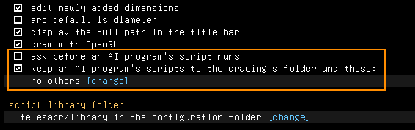

# Drawing with an AI model

TeleSAPR can be driven by an AI model. You say in plain English what to draw, and the model
draws it in the window you have open. TeleSAPR has no model of its own and needs no API key. It
offers the drawing to any program that speaks the Model Context Protocol (MCP), such as Claude
Code or Claude Desktop, and that program brings the model.

## Setting up

1. In TeleSAPR, turn on **Script > Allow AI Connections**. The setting is kept. To allow
   connections for one run only, start it as `telesapr --agent`.
2. Tell your MCP client to start `telesapr-cli mcp`. You never run that command yourself.

   Claude Code:

   ```bash
   claude mcp add telesapr -- telesapr-cli mcp
   ```

   Claude Desktop, and most other clients, in their MCP configuration file:

   ```json
   {
     "mcpServers": {
       "telesapr": { "command": "telesapr-cli", "args": ["mcp"] }
     }
   }
   ```

   Give the full path of `telesapr-cli` if it is not on the `PATH`.
3. Ask for something: "draw a 60 by 20 mm plate, 4 mm thick, with three 5 mm holes in a row".

The order of starting does not matter. The client may be started before TeleSAPR, and TeleSAPR
may be closed and opened again in the middle of a conversation.

## What you see

- Each script the model runs is shown in the script console (**Script > Show Console**) after
  an `ai>` prompt, with what it printed. The model's scripts run in an interpreter of their own,
  kept to the files listed below. With that guard turned off, they run in the console's
  interpreter, and the variables they define are there for you to use.
- Each script is one step of undo. Ctrl+Z takes back what one request to the model did, a
  script at a time.
- A script that fails changes nothing. What it did before the error is taken back, and the
  model is told, so that it can correct the script.
- **Script > Stop** stops a script that is running.
- With **ask before an AI program's script runs** ticked on the configuration screen, TeleSAPR
  shows you each script and runs it only if you agree. Most clients also ask before they call a
  tool.

## What the model can do

The model gets eight tools.

| Tool | What it does |
|---|---|
| `run_script` | Runs Go on the drawing, as the script console does. It returns what the script printed, the value of its last expression, and how the drawing solved afterwards. With `form`, it fills in the fields of the form the script declares, as the window's dialog does ([Scripts](scripts.md#forms)). |
| `get_drawing` | Describes the drawing in words: the unit, the parameters, the groups with how they solved and the volume and bounds of the solid up to each, the active group's requests with their positions and its constraints, what you have selected, and what your mouse is over, so that "this" can be pointed at. With `group`, it lists that group's requests and constraints instead of the active one's. |
| `render` | Returns a picture of the drawing, so the model can check its work. It is 800 by 600 pixels unless `width` and `height` say otherwise, from a named view (`isometric`, `front`, `back`, `top`, `bottom`, `left` or `right`), fitted, or as your window shows it (`window`). With `group`, it draws the drawing up to that group. With `section`, it cuts the solid open by a plane parallel to the XY, YZ or ZX workplane, moved along its normal by `section_offset`, with the other side taken away by `section_flip`. Your own section view is left as it was. |
| `api_help` | Returns the documentation of the scripting interface: a primer, or one menu, type or method, or what a script calls in place of an entry of the window's menu ("Features > Fillet Edges"). |
| `measure` | Reports the solid as Analyze > Check Solid does: volume, surface area, centre of mass, bounding box, and whether it is sound. It measures the model up to the active group, or up to the one `group` names. With `selected`, it measures what you have selected, as Analyze > Measure Selection does. With `gaps` and `walls` it also lists the gaps between parts and the walls thinner than those many mm, as Analyze > Clearance and Walls does ([Clearance and walls](clearance.md)). `within_parts` takes a part made of several solids by its solids. |
| `export` | Writes the drawing to the file `path` names, in the format its extension names (`.stl`, `.3mf`, `.glb`, `.obj`, `.wrl`, `.step`, `.svg`, `.dxf`, `.pdf`, `.eps`, `.png`), and says where. To `.go` it writes the program that builds the model again, as File > Export > Script does, and lists what it couldn't write. |
| `open` | Opens the `.tlspr` drawing `path` names in place of the one on screen, and describes it. It never replaces a drawing with changes that aren't saved. |
| `list_files` | Lists a directory (`dir`), so the model can find the drawing you name or where to export. |

`measure`, `render` and `list_files` only read. `export` and `open` are shown in the console as
the script that would do the same. With the confirmation setting on, you are asked before each,
as for a script.

## Files

A script reads and writes files with your permissions. So the model's scripts are kept to a few
folders:

- the folder of the drawing that is open (none while it has never been saved);
- the folders you list on the configuration screen under **keep an AI program's scripts to the
  drawing's folder and these**;
- a temporary folder of their own (where `os.CreateTemp` puts files).

They may also read the [script library](scripts.md#the-script-library). Anything else is refused
with an error that names the allowed folders. This holds whether the script names the file to
`doc.File.Save`, `os.ReadFile`, `filepath.Glob` or any other call. A symbolic link that leads out
of a folder leads out of what is allowed, and a path with `..` is refused. The scripts don't see
your environment variables, and can't change the working directory or start programs.

The guard is on by default. Unticking the box lets the model's scripts use any file you may, as
your own scripts in the console do. Either way, the model is told not to save, export or load
unless you ask for it. Turn on the confirmation setting if you want to read every script first.

Both settings are on the configuration screen (Edit > Preferences, or **configuration** on the
home screen of the property browser), near its end:



**ask before an AI program's script runs** is the confirmation setting. The box below it is the
guard, and `[change]` under it edits the list of other folders, which is "no others" to begin
with. The **script library folder** is the folder the scripts may also read. This picture is
made by [`scenarios/ai.scenario`](scenarios/ai.scenario). The rest of this page has no
pictures: Script > Allow AI Connections is a menu entry, and what the model runs shows in the
script console, a window of its own.

The guard does not cover two things. The files a drawing links (other parts, STEP files, images)
are read where they are when the drawing regenerates. And the files a menu command reads or
writes (`doc.Edit.RunCommand`) are the ones you choose in its dialog.

Only programs running as you can connect. The application listens on a socket file in a
directory that is yours alone: `$XDG_RUNTIME_DIR/telesapr` on Linux, `$TMPDIR/telesapr` on
macOS, `%LOCALAPPDATA%\telesapr` on Windows. Nothing listens on the network.

## Without a window

```bash
telesapr-cli mcp --headless [--lib <dir>] [--allow <dir>...] [--unguarded] [sketch.tlspr]
```

This serves a drawing of its own instead of the application's: the sketch file, or a new
sketch. The model works as above, with the pictures drawn in software. Nothing is saved unless
you ask the model to save. Its scripts are kept to the sketch's folder (for a new sketch, the
directory the client started the command in), each folder `--allow` names, and a temporary
folder. `--unguarded` lets them use any file. `--lib` names the script library they may read, as
for `telesapr-cli run`; without it, the default one. `--lib`, `--allow` and `--unguarded` are
for `--headless` only: the window has the same settings on its configuration screen.

## In a browser

The browser version (Try in browser) has no socket for `telesapr-cli mcp` to reach, so an MCP
client such as Claude Code works with the window, not the page. A program in the browser reaches
the page through `window.postMessage`: a script of the page's own site, or a page of another
site that has the editor in a frame. Script >
Allow AI Connections turns it on and off as in the window, and the same settings ask before each
script runs.

- A program of the page's own site is let in.
- A program of another site is let in only if you allow it: a dialog names the site, and the
  answer holds until AI connections are turned off. Don't Allow is the default.
- Turning AI connections off ends every connection.

The site serves `agent-client.js`, the program's end of the connection:

```js
const tele = await telesaprAgent(frame.contentWindow, "https://example.org");
const out = await tele.run("fmt.Println(len(doc.Groups()))"); // {output, value, error, ...}
const text = await tele.describe("");
tele.close();
```

What goes through is the protocol between `telesapr-cli mcp` and the window (requests to run,
describe, render, help, measure, export, open and list files), not MCP itself. The messages are
described in `pkg/script/agent/socket_js.go`.

## If it does not work

- **"TeleSAPR isn't running, or Script > Allow AI Connections is off"**: start TeleSAPR and
  check the menu item. With several TeleSAPR windows open, the one started last is used.
  `telesapr-cli mcp --socket <path>` names another.
- **"another script is running"**: a script of yours is running in the console. Wait, or stop
  it.
- **The client shows no TeleSAPR tools**: check that the client can find `telesapr-cli`. Run
  `telesapr-cli mcp --headless` in a terminal to see whether it starts. It then waits for a
  client on standard input, which is what it should do.
- **"install the same version of both"**: `telesapr` and `telesapr-cli` come from different
  builds. Build or install them together.

## How it is built

```
MCP client ──stdin/stdout, MCP──> telesapr-cli mcp ──socket file, JSON lines──> telesapr
```

`telesapr-cli mcp` speaks MCP (`pkg/mcpserver`, on the official Go SDK) and passes each call to
the application over the socket (`pkg/script/agent`). There it runs in an interpreter of its own,
kept to the allowed files, or in the script console's when that guard is off (`pkg/ui/agent.go`).
The model writes scripts against the same `pkg/script/api` that scripts and the console use, so
every feature with a scripting method is available to it with nothing added.
