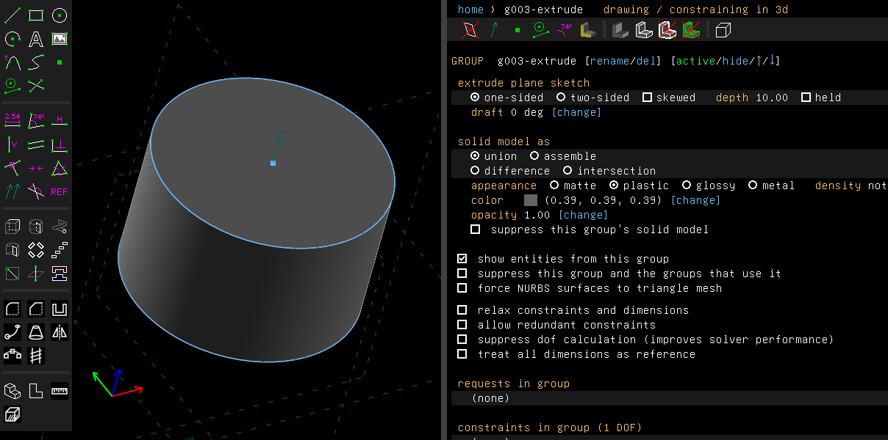
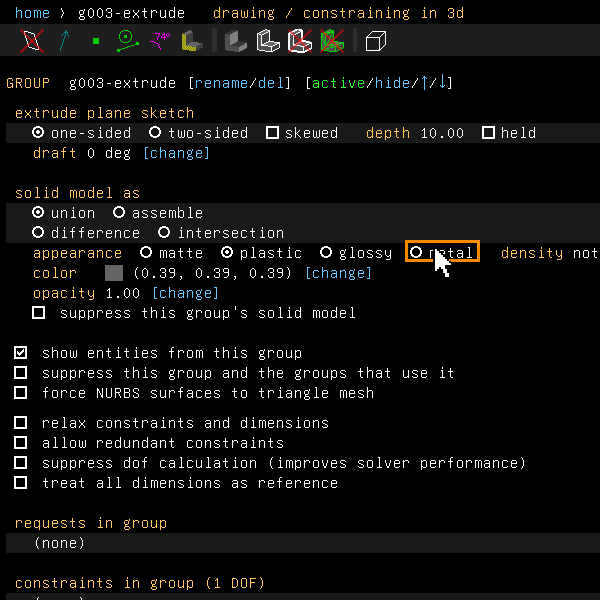
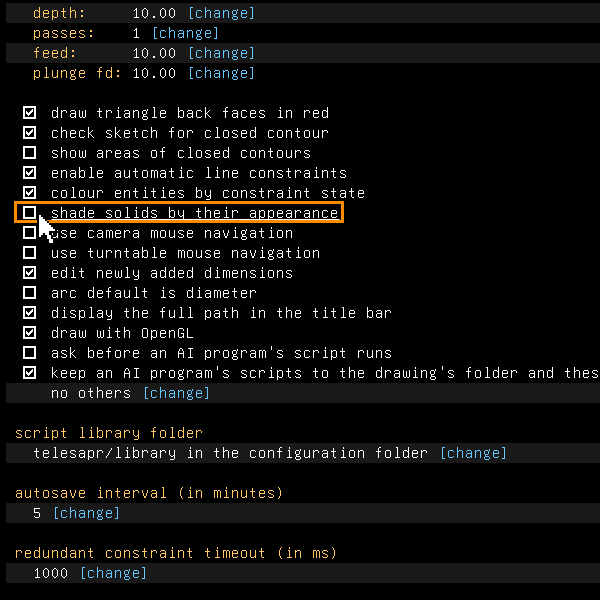
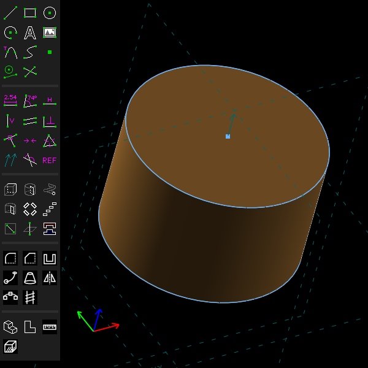

# Appearance and shading

Example: [`examples/scripts/appearance`](../../examples/scripts/appearance/appearance.go). A
shaft sits in a housing. The shaft is metal, the housing is plastic, and the housing's top face
is matte.

## Step by step

Make a cylinder metal and see it shaded:

1. Press C for a circle, click its centre and a point on it, then press Esc and Shift+X to
   extrude it.

   

2. On the group's screen, click **metal** on the appearance row. Here the colour row's
   [change] was also given `0.8, 0.55, 0.25`, a bronze, so that the highlight shows.

   

3. Choose Edit > Preferences and tick **shade solids by their appearance**, near the end of
   the screen.

   

4. The cylinder is now lit as metal: less diffuse light, and a highlight in its own colour.

   

To give one face an appearance of its own, right-click it and choose one from the
**Appearance** menu.

These pictures are made by [`scenarios/appearance.scenario`](scenarios/appearance.scenario).

## What it does

Every solid has an appearance as well as a colour. The appearance says how light falls on it.
There are four:

- **matte**: no highlight;
- **plastic**: a soft white highlight. This is the default;
- **glossy**: a sharp, strong white highlight;
- **metal**: less diffuse light, and a highlight in the face's own colour.

The window uses the appearance only when **shade solids by their appearance** is ticked on the
preferences screen (Edit > Preferences, or configuration on the home screen). Then each face is lit by two lights,
one from the sky above and a weaker one from the ground below, plus a highlight toward the
viewer. The GL renderer works this out for every pixel, in a shader. The software renderer,
which draws without GL and makes the pictures, works it out at the corners of each triangle.
With the box off, the window lights the model the way SolveSpace does.

## In the window

- A group's screen has an **appearance** row with the four choices. It sets the appearance of
  the group's solid. The colour and opacity rows are below it.
- One face can have an appearance of its own. Right-click the face and choose **Appearance**
  from the menu: one of the four, or **The group's own** to take it off again.

A face's own appearance is remembered by the face's identity in the group that made it, so it
stays on that face when the model changes. It is saved with the model.

## From a script

```go
shaft.SetAppearance("metal")
doc.View.SetFaceAppearance(housing.Solid().FaceAt(api.V(15, 15, 15)), "matte")
```

`Group.Appearance()` and `doc.View.FaceAppearance(face)` read them back.

## glTF

Example: [`examples/scripts/gltf`](../../examples/scripts/gltf/gltf.go), a see-through block
with a pin beside it, each in its own colour.

File > Export > Triangle Mesh writes binary glTF 2.0 when the file name ends in `.glb`. Blender,
a three.js viewer or a web page can open it. The file holds:

- the mesh of the solid up to the active group;
- one material for each colour;
- a see-through colour (a group with opacity below 1) as a blended material;
- lengths in metres, which is what glTF asks for.

Without a window, `telesapr-cli export-mesh --output %.glb model.tlspr` writes the same file.
From a script, call `doc.File.Export("model.glb")`. A motion study can save its frames as
`.glb` too.

## Not yet

- No textures, no reflections of an environment, and no appearances of your own beyond the
  four.
- Drawings and exports use the plain colours, not the appearances.
- A glTF file is one mesh. Its materials are plain colours, not matte, glossy or metal, and
  the parts of an assembly are not nodes of their own.
