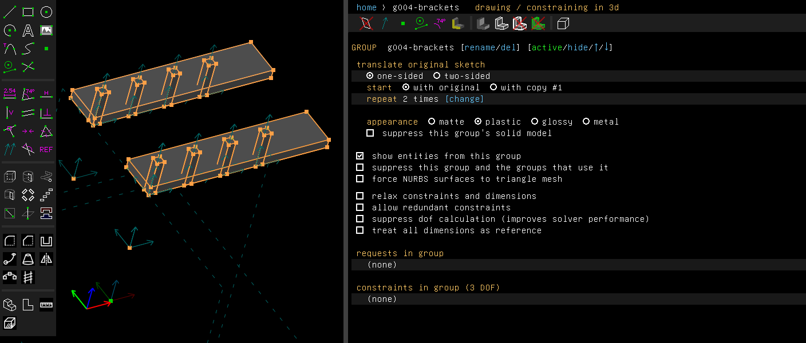
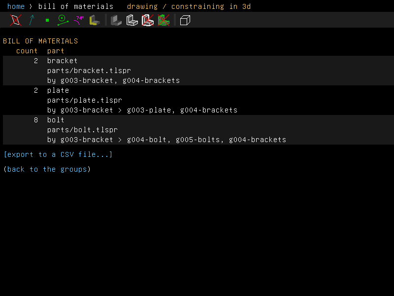
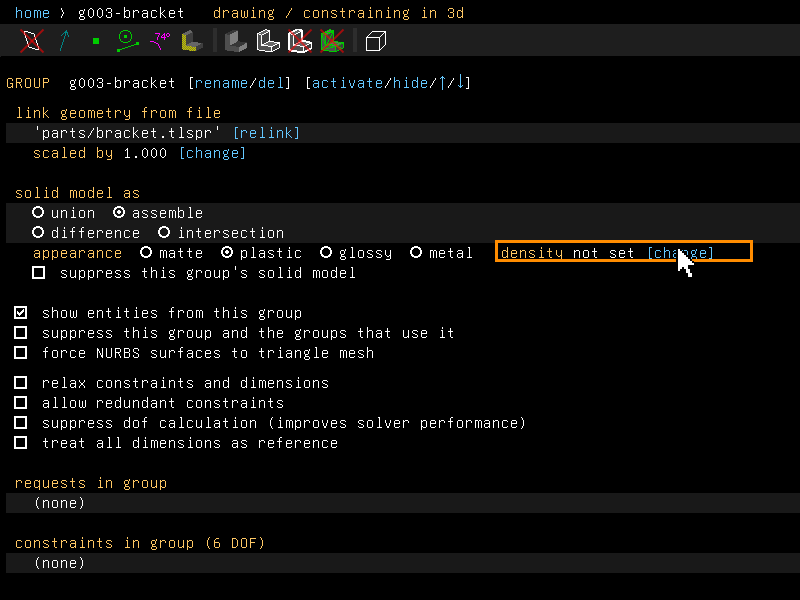
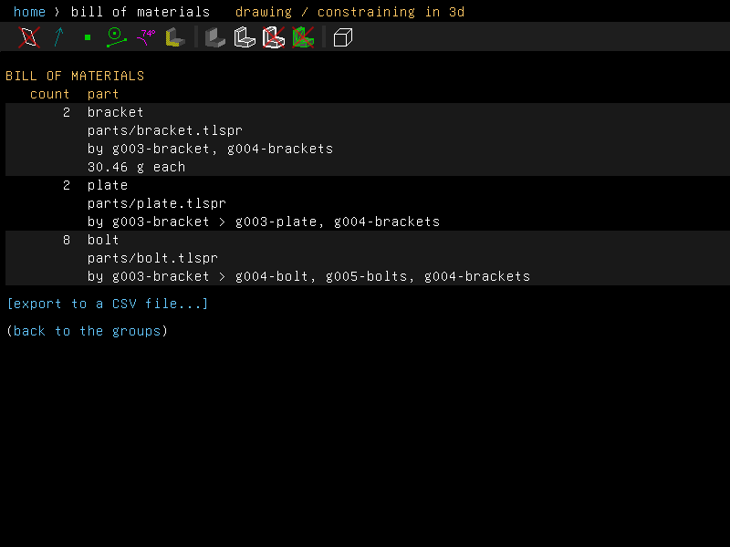

# Assemblies

An assembly is a model made of parts. The parts are files linked into it (Assembly > Link /
Assemble), or groups that combine as an assembly. This page is about linking parts, putting
them together, checking them against each other, and counting them.

## Step by step

Count the parts of the [`bom`](../../examples/scripts/bom/bom.go) example's model:

1. Choose Script > Run File and pick `bom.go`. It saves a plate and a bolt as part files, links
   them into a bracket with the bolt repeated four times, and links the bracket into the model,
   repeated once more. Each part comes in by Assembly > Link / Assemble... (Shift+I), as you
   would link it in the window. Save the model with File > Save As, beside the `parts` folder.

   

2. Choose Assembly > Bill of Materials. It lists 2 brackets, 2 plates and 8 bolts, each with
   its file and the groups that place it. A file is given relative to the saved model, here
   `parts/bracket.tlspr`, and a long path wraps onto the next line. The groups in the
   bracket's own file read as `g003-bracket > g004-bolt`.

   

3. To have the bill give masses, open a link group's screen from the home screen, here
   g003-bracket, and click [change] at the end of its appearance row to set its
   [density](mass.md), here 2.7 g/cm³.

   

4. The bill now gives the bracket's mass: "30.46 g each". [export to a CSV file...] writes the
   list to a file.

   

These pictures are made by
[`scenarios/bill-of-materials.scenario`](scenarios/bill-of-materials.scenario).

## Linked parts

Example: [`examples/scripts/partsizes`](../../examples/scripts/partsizes/partsizes.go), one
plate file linked three times in three sizes, and a fourth link pointed at another file.

A link group's screen names the file it links, with `[relink]` beside it. Choose another file
there, and the link reads the new file in place of the old one. The part keeps its place, its
scale and the values the link passes into it. Use this for a newer revision of a part saved
under another name, or for a STEP file in place of a model. If later groups used something of
the old part that the new one lacks, they are removed with it, as when a linked file is
missing.

A link to a model can pass it a configuration and values for its parameters (see
[configurations](parameters-and-units.md#configurations)). The model is then regenerated with
those values instead of being read as it was saved. So one part file placed twice can come in
two sizes. The link's screen lists:

- **configuration**: `as saved`, or one of the model's configurations, when the model has
  any;
- each of the model's **parameters** with its value. While the model's own value stands, the
  row says `in the model [pass a value]`. Once a value is passed, the row shows it with
  `[change]` and `[model's]`, which gives the model its own value back.

A value passed can be a number or an expression in this model's parameters, such as `W*2`.
When those parameters change, the linked model is regenerated again. So an assembly can drive
its parts from its own parameter table. Each change is one step of undo.

From a script:

```go
long, err := doc.Assembly.Link("parts/plate.tlspr", "long")
long.AsLink().SetConfiguration("long") // "" reads it as saved
driven, err := doc.Assembly.Link("parts/plate.tlspr", "driven")
driven.AsLink().SetParam("L", "W*2")   // "" lets the model's own stand
swapped, err := doc.Assembly.Link("parts/plate.tlspr", "swapped")
swapped.AsLink().SetFile("parts/block.tlspr") // relink
fmt.Println(driven.AsLink().ModelParams(), driven.AsLink().ModelConfigurations())
```

`File`, `Configuration` and `Param` read back what the link has.

## Mates

Example: [`examples/scripts/mates`](../../examples/scripts/mates/mates.go), a plate stacked
on a copy of itself, flush and with the holes on one axis.

A mate is a shortcut for the constraints that put two parts together. Select something on the
part that stays first, then something on the part the active group places (a link group
places the part it links). Then choose from the Assembly menu:

- **Mate Concentric**, with two circles or arcs. Their axes are made parallel, and the second
  circle's centre is put on the first's axis. The part can still turn about the axis and slide
  along it. Inside a workplane, the centres are put on each other.
- **Mate Flush**, with two faces. The faces are made parallel, with a point of the first lying
  on the second. The part can still slide and turn on the face.
- **Mate Hinge**, with two line segments. The starts are put on each other, and the second's
  end on the first's line. The part can only turn about the line.
- **Mate Screw**, with two circles or arcs. They are put on one axis, as Mate Concentric does,
  and the second part's turn about the axis is tied to its travel along it, like a nut on a
  screw. Two new parameters drive it: `turn`, in degrees from where the part was, starting at
  0, and `lead`, how far one whole turn moves the part along the first circle's normal. A
  negative lead is a left-hand screw. A second screw mate gets `turn2` and `lead2`, and so on.

  When the circles carry no screw threads, the window takes the lead as the coarse metric
  pitch for the first circle's diameter, or 1 where there is none. Edit `lead` in the
  parameter table (Edit > Parameters). Assembly > Motion Study on `turn` screws the part in
  ([motion study](parameters-and-units.md#motion-study)). The mate is made in 3d, and the
  second part needs a point off the axis.

  When the two circles carry screw threads, a bolt's and its nut's, the lead is the threads'
  own, and the part is first moved to where the threads fit
  ([fitting a nut to its bolt](threads.md#fitting-a-nut-to-its-bolt)). From a script, a lead of
  0 means the threads' lead. Example:
  [`examples/scripts/screw`](../../examples/scripts/screw/screw.go), a nut run two turns up
  another's thread.

Each mate makes ordinary constraints, in one step of undo. They are listed, edited and deleted
like any other. A constraint that would be redundant with what is already there is left out.

```go
doc.Assembly.Flush(top, bottom)
doc.Assembly.Concentric(holeA, holeB)
mate := doc.Assembly.Screw(holeA, holeB, 1.25) // lead in mm
frames, err := doc.Assembly.MotionStudy(mate.Turn, 0, 720, 8, "")
```

## Bill of materials

Example: [`examples/scripts/bom`](../../examples/scripts/bom/bom.go). It saves a plate and a
bolt as part files, links them into a bracket with the bolt repeated, links the bracket twice
into the model, and writes the bill.

Assembly > Bill of Materials lists the parts the model places by linking files, one line per
file: how many, the part's name (the file's name without folder and extension), the file, and
the groups that place them. The file is given relative to the model's own folder once the model
is saved, and in full before.

How parts are counted:

- Each link group places one part.
- A step and repeat, a mirror or a pattern along a path of a link group places its copies too,
  except for a copy at the place of the part it copies. A mirror that leaves the original out
  places no more. A repeat of a repeat counts the copies of what it repeats.
- Groups left out of the model place none.
- A linked model is a part, a sub-assembly. The parts it links in turn count too, once for each
  place the model is, at any depth. Their groups read as `g003-bracket > g004-bolt`: the group
  here, then the group in the linked file.
- A file that links itself, by way of other files, is followed once.

Where a link group placing the part has a [density](mass.md) set, the screen gives one part's
mass under it ("12.4 g each").

`[export to a CSV file...]` on the screen writes the list with the columns `part`, `count`,
`file`, `groups` and `mass_g`. The last column is empty where no density is set.

From a script:

```go
for _, it := range doc.Assembly.BillOfMaterials() {
	fmt.Println(it.Count, it.Part, it.File, it.Mass)
}
must(doc.Assembly.ExportBOM("bom.csv"))
```

## Interfering parts

Assembly > Show Interfering Parts (Ctrl+Shift+I) checks the parts of an assembly against each
other by their shells. A shell is the exact surfaces of a solid, as opposed to its triangle
mesh. Each group that combines as an assembly is a part, and so is the solid made before the
first of them.

Two parts interfere where they share volume. Parts that only touch don't. The message lists
each pair with the volume they share, and the shared solid is outlined on the model.

- A group that cuts the assembly after a part cuts the part too. So a hole cut after a bracket
  is a hole in the bracket, and the screw through it doesn't interfere.
- A part that is itself an assembly, such as a linked model of parts, is checked solid by
  solid.
- Where the Boolean of two parts fails, as for a shank lying on its nut's hole or a screw's
  flanks on its nut's, their meshes are intersected instead, and the volume is marked "about".
  What the meshes share counts as touching when it is on average no thicker than the chord
  tolerance, as where faces lie on each other. A screw and a nut with no clearance, moved half
  a pitch out of their fit, collide by tens of mm³ and are listed.
- A volume summed over several solids of one part is marked "about" too, since it counts twice
  what they share.
- A pair that can't be checked either way is listed as failed.
- A part linked from a mesh or a STEP file has no shell. With one such part in the model, the
  check falls back to the triangles of the whole model, as SolveSpace's does.

```go
found, meshOnly := doc.Assembly.Interferences()
for _, f := range found {
	fmt.Println(f.A, f.B, f.Volume, f.Approximate, f.Failed)
}
```

## STEP export of an assembly

File > Export > Surfaces... writes a model with parts as an assembly. The model is the top
product. Each part is a product of its own, written once in its own coordinates, with its faces
in their colours. Each place a part goes is an occurrence of it, with the rotation and offset
that put it there. A file linked twice is one product used twice. The parts are the ones the
interference check takes. A model with no assembled parts is written as one solid, as before.

## Not yet

- A part linked from two different paths to one file counts as two parts.
- A copy made by a group whose source is not a link group, such as a translate of the whole
  model, is not counted.
- One file linked in two sizes, by configuration or by values passed, is one line of the bill,
  with the mass of the first link that has a density.
- A part placed only inside a linked sub-assembly has no mass in the bill.
