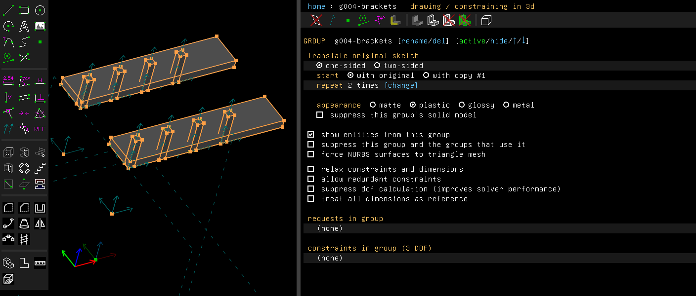
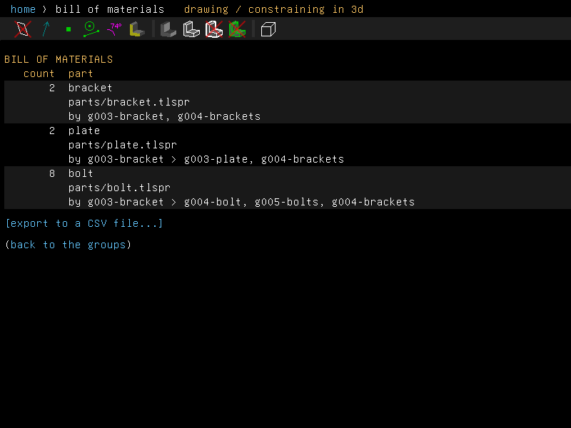
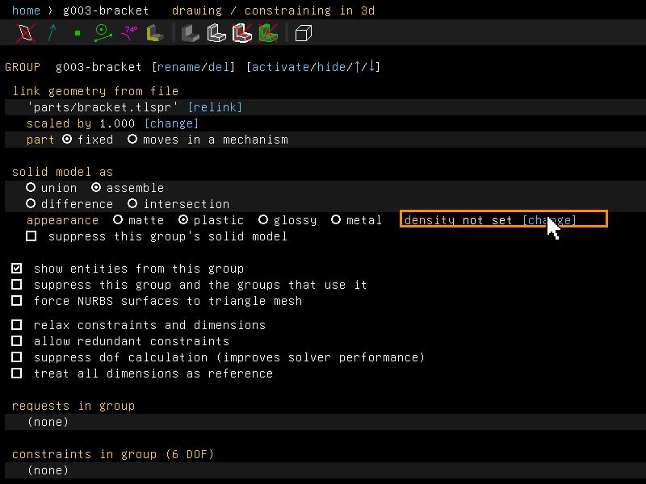
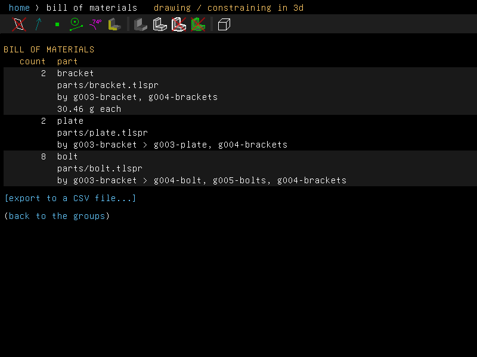

# Assemblies

An assembly is a model made of parts. A part is a file linked into the model (Assembly > Link /
Assemble), or a group whose solid is set to **assemble**. This page is about linking parts,
putting them together, checking them against each other, and counting them.

## Step by step

Count the parts of the [`bom`](../../examples/scripts/bom/bom.go) example's model:

1. Choose Script > Run File... and pick `bom.go`. It saves a plate and a bolt as part files,
   links them into a bracket with the bolt repeated four times, and links the bracket into the
   model, repeated once more. Each part comes in by Assembly > Link / Assemble... (Shift+I), as
   in the window. Save the model with File > Save As, beside the `parts` folder.

   

2. Choose Assembly > Bill of Materials. It lists 2 brackets, 2 plates and 8 bolts, each with
   its file and the groups that place it. The file is named relative to the saved model, here
   `parts/bracket.tlspr`. A group inside the bracket's own file reads as
   `g003-bracket > g004-bolt`.

   

3. To have the bill give masses, open a link group's screen from the home screen, here
   g003-bracket. Click [change] at the end of its appearance row and set its
   [density](mass.md), here 2.7 g/cm³.

   

4. The bill now gives the bracket's mass: "30.46 g each". [export to a CSV file...] writes the
   list to a file.

   

These pictures are made by
[`scenarios/bill-of-materials.scenario`](scenarios/bill-of-materials.scenario).

## Linked parts

Example: [`examples/scripts/partsizes`](../../examples/scripts/partsizes/partsizes.go), one
plate file linked three times in three sizes, and a fourth link pointed at another file.

Which files can be linked, and what each gives, is on the [STEP links](step-links.md) page.
To turn a linked part a quarter turn, choose Edit > Rotate Imported 90° (9).

A link group's screen names the file it links, with `[relink]` beside it. Pick another file
there, and the link reads it in place of the old one. The part keeps its place, its scale and
the values passed into it. Use this for a newer revision of a part, or for a STEP file in place
of a model. Later groups that used something the new file lacks are removed with it, as when a
linked file is missing.

A link to a model can pass it a configuration and parameter values (see
[configurations](parameters-and-units.md#configurations)). The model is then regenerated with
those values. So one part file can come in at two sizes. The link's screen lists:

- **configuration**: `as saved`, or one of the model's configurations;
- each of the model's **parameters**. While the model's own value stands, the row says
  `in the model [pass a value]`. A passed value shows with `[change]`, and `[model's]` gives the
  model's own value back.

A passed value can be a number or an expression in this model's parameters, such as `W*2`.
When those change, the linked model is regenerated. So an assembly can drive its parts from its
own parameter table. Each change is one step of undo.

From a script:

```go
long, err := doc.Assembly.Link("parts/plate.tlspr", "long")
long.AsLink().SetConfiguration("long") // "" reads it as saved
driven, err := doc.Assembly.Link("parts/plate.tlspr", "driven")
driven.AsLink().SetParam("L", "W*2")   // "" lets the model's own stand
swapped, err := doc.Assembly.Link("parts/plate.tlspr", "swapped")
swapped.AsLink().SetFile("parts/block.tlspr") // relink
fmt.Println(driven.AsLink().ModelParams(), driven.AsLink().ModelConfigurations())
```

`File`, `Configuration` and `Param` read back what the link has. `Move`, `Rotate`, `Rotate90`
and `SetOrientation` place the part.

## Mates

Example: [`examples/scripts/mates`](../../examples/scripts/mates/mates.go), a plate stacked
on a copy of itself, flush and with the holes on one axis.

A mate is a shortcut for the constraints that put two parts together. Select something on the
part that stays first, then something on the part the active group places (a link group places
the part it links). Then choose from the Assembly menu:

| Mate | Select | What it does | The part can still |
|---|---|---|---|
| Mate Concentric | two circles or arcs | puts the second circle's centre on the first's axis, axes parallel; in a workplane, centre on centre | turn about the axis and slide along it |
| Mate Flush | two faces | makes the faces parallel and puts a point of the first on the second | slide and turn on the face |
| Mate Hinge | two line segments | puts the starts together and the second's end on the first's line | turn about the line |
| Mate Screw | two circles or arcs | as Concentric, and ties the turn to the travel along the axis, like a nut on a screw | turn, by the parameter `turn` |
| Mate Ball | two points, or circles or arcs for their centres | puts the second point on the first | turn every way about the point |
| Mate Cylindrical | two line segments, circles, arcs or datum axes | makes the axes parallel and puts a point of one on the other | turn about the axis and slide along it |
| Mate Planar | two faces | as Flush | slide and turn on the face |
| Mate Slot | a line segment and a point, or a circle or arc for its centre | puts the point on the line | slide along the line, turn every way |

Mate Ball, Cylindrical and Slot are made in 3d. [Mechanisms](mechanisms.md#joints) says what each
mate is made of.

Each mate makes ordinary constraints, in one step of undo. They are listed, edited and deleted
like any other. A constraint that would repeat what is already there is left out.

### Screw mates

Mate Screw makes two parameters:

- `turn`: the turn in degrees from where the part was, starting at 0;
- `lead`: how far one whole turn moves the part along the first circle's normal. A negative
  lead is a left-hand screw.

A second screw mate gets `turn2` and `lead2`, and so on. Edit `lead` in Edit > Parameters.
Assembly > Motion Study on `turn` screws the part in
([motion study](parameters-and-units.md#motion-study)). The mate is made in 3d, and the second
part needs a point off the axis.

Where the circles carry no screw threads, the lead starts as the coarse metric pitch for the
first circle's diameter, or 1 where there is none. Where both carry threads, a bolt's and its
nut's, the lead is the threads' own, and the part is first moved to where the threads fit
([fitting a nut to its bolt](threads.md#fitting-a-nut-to-its-bolt)). From a script, a lead of 0
means the threads' lead. Example: [`examples/scripts/screw`](../../examples/scripts/screw/screw.go),
a nut run two turns up another's thread.

```go
doc.Assembly.Flush(top, bottom)
doc.Assembly.Concentric(holeA, holeB)
doc.Assembly.Hinge(edgeA, edgeB)
mate := doc.Assembly.Screw(holeA, holeB, 1.25) // lead in mm
frames, err := doc.Assembly.MotionStudy(mate.Turn, 0, 720, 8, "")
```

## Mechanisms

Parts that move together, such as a lid on its hinge or an engine's crank and piston, pulled in
the window or driven by a parameter: see [mechanisms](mechanisms.md), an experimental feature.

## Bill of materials

Example: [`examples/scripts/bom`](../../examples/scripts/bom/bom.go). It saves a plate and a
bolt as part files, links them into a bracket with the bolt repeated, links the bracket twice
into the model, and writes the bill.

Assembly > Bill of Materials lists the parts the model places by linking files, one line per
file: how many, the part's name (the file's name without folder and extension), the file, and
the groups that place them. The file is named relative to the model's folder once the model is
saved, and in full before. A long name wraps onto the next line.

How parts are counted:

- Each link group places one part.
- A step and repeat, a mirror or a pattern along a path of a link group places its copies too.
  A copy in the same place as the part it copies does not count. A repeat of a repeat counts
  every copy.
- Groups left out of the model (suppressed) place none.
- A linked model is a sub-assembly. The parts it links count too, once for each place the model
  is, at any depth. Their groups read as `g003-bracket > g004-bolt`: the group here, then the
  group in the linked file.
- A file that links itself, through other files, is followed once.

Where a link group placing the part has a [density](mass.md), the bill gives one part's mass
("12.4 g each").

`[export to a CSV file...]` writes the list with the columns `part`, `count`, `file`, `groups`
and `mass_g`. `mass_g` is empty where no density is set.

From a script:

```go
for _, it := range doc.Assembly.BillOfMaterials() {
	fmt.Println(it.Count, it.Part, it.File, it.Mass)
}
must(doc.Assembly.ExportBOM("bom.csv"))
```

## Interfering parts

Assembly > Show Interfering Parts (Ctrl+Shift+I) checks the parts of an assembly against each
other. The parts are each group set to **assemble**, and the solid made before the first of
them. A linked model of parts is checked solid by solid.

Two parts interfere where they share volume; parts that only touch don't. The message lists each
pair with the volume they share ("Two parts interfere, bad: ... share 455 mm³"), and the shared
solid is outlined on the model.

- A group that cuts the assembly after a part cuts that part too. So a screw through a hole cut
  after the bracket doesn't interfere with the bracket.
- Where the exact check of two parts fails, as for a screw's flanks on its nut's, their meshes
  are compared instead and the volume is marked "about". Meshes that only lie on each other
  count as touching.
- A volume summed over several solids of one part is marked "about" too.
- A pair that can't be checked either way is listed as failed.
- A part linked from a mesh or a STEP file read as a mesh has no exact surfaces. With such a part
  in the model, the whole model's triangles are checked instead.

```go
found, meshOnly := doc.Assembly.Interferences()
for _, f := range found {
	fmt.Println(f.A, f.B, f.Volume, f.Approximate, f.Failed)
}
```

## STEP export of an assembly

File > Export > Surfaces (.step)... writes a model with parts as a STEP assembly. Each part is written
once, in its own coordinates and colours, and placed by a rotation and offset at each place it
goes. A file linked twice is one part used twice. The parts are the ones the interference check
takes. A model with no assembled parts is written as one solid.

## Not yet

- One file reached by two different paths, as through a symbolic link, counts as two parts.
- A copy made by a group whose source is not a link group, such as a step and repeat of the
  whole model, is not counted in the bill.
- One file linked in two sizes, by configuration or passed values, is one line of the bill, with
  the mass of the first link that has a density.
- A part placed only inside a linked sub-assembly has no mass in the bill.
