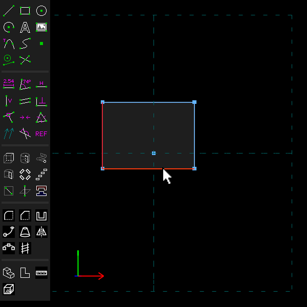
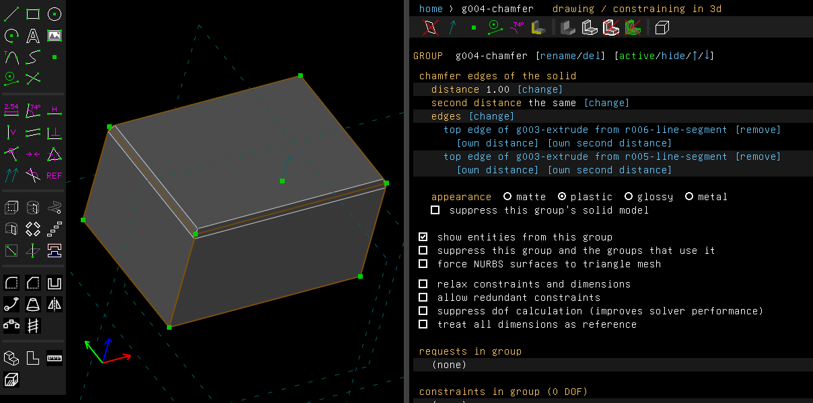
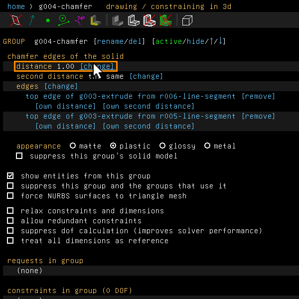
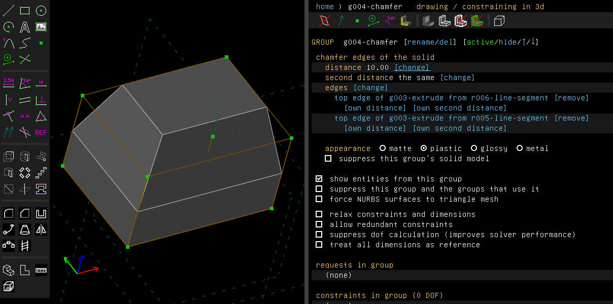
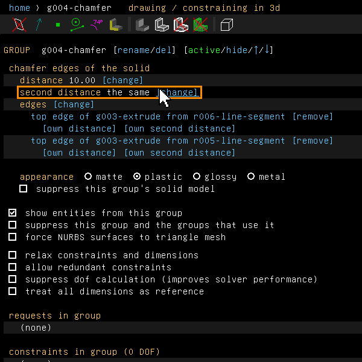
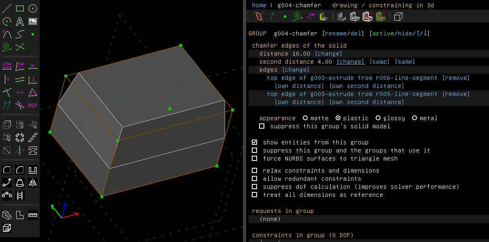
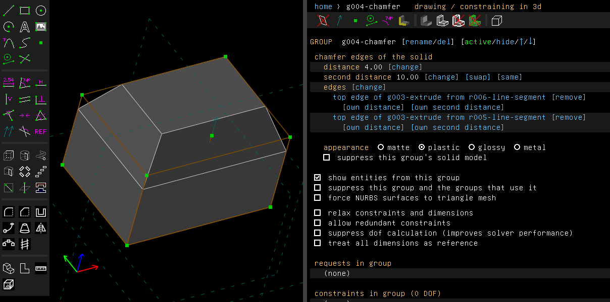
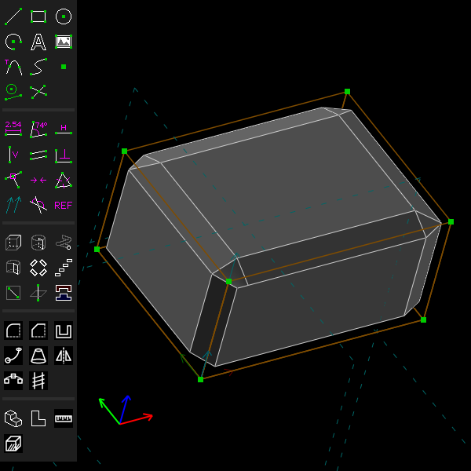

# Chamfer

A chamfer cuts an edge off flat, at a set distance back from the edge on each face.

Examples:

- [`examples/scripts/chamfer`](../../examples/scripts/chamfer/chamfer.go): a block with its
  top edges cut.
- [`examples/scripts/edges`](../../examples/scripts/edges/edges.go): an edge that no sketch
  entity draws, chamfered by its name.
- [`examples/scripts/bevel`](../../examples/scripts/bevel/bevel.go): a bevel of two distances.

## Step by step

Cut two top edges of a block:

1. Press R for a rectangle and click two corners. Press Esc, then Shift+X to extrude it.
   Click the two edges to cut, as seen from above. They are drawn in red when selected.

   

2. Choose Features > Chamfer Edges. The edges are cut at 1 mm, and the property browser lists
   them.

   

3. Click "[change]" beside the distance and type a new one, here 10.

   

   

4. To cut further back on one face than on the other, click "[change]" beside the second
   distance and type it, here 4. The cut now goes 10 mm down the sides and 4 mm across the top.

   

   

5. Click "[swap]" to exchange the two distances: 4 mm down the sides, 10 mm across the top.

   

These pictures are made by [`scenarios/chamfer.scenario`](scenarios/chamfer.scenario), which
replays the same clicks on the program (`scripts/regen-doc-images.sh`).

## In the window

Select the edges, then choose Features > Chamfer Edges (Shift+Q), or right-click an edge and
choose Chamfer Edges. It cuts edges of the solid built so far. A convex edge (one that sticks out) is cut away. A concave edge (one that goes in,
like the floor of a pocket) is filled instead. A chamfer carries on round edges that meet it
smoothly, as round the corners of a rounded rectangle. You can select:

- line segments along edges between two flat faces, such as the edges an extrusion makes;
- circles where a flat face meets a cylinder or a cone, such as the rims of an extruded circle;
- edges of the solid itself, picked on the model, including edges no entity draws (where a
  pocket's wall meets the block's face) and edges between curved faces.

To take every edge round a face at once, right-click the face and choose Select Face Edges
([`examples/scripts/face_edges`](../../examples/scripts/face_edges/face_edges.go);
`Edit.SelectFaceEdges` in a script).

The group's screen:

- The distance starts at 1 mm. "[change]" takes a number or an expression.
- Each edge has a row. Hovering it shows the edge on the model; clicking it selects the edge.
  "[remove]" takes the edge out of the chamfer.
- "[change]" beside the edges takes the current selection as the edges instead. With nothing
  suitable selected, it activates the group before the chamfer, says what to pick, and the link
  reads "[take the selection]" until you do.

A chamfer that can't be cut is a problem on the group that says why, and the solid passes
through uncut. A result that would not be a closed solid says to make it a little smaller or
larger.

Edges between curved faces, and edges that end on a curved face, are chamfered the way they are
filleted: see [Fillet](fillet.md#between-two-curved-faces).

## Two distances

A chamfer can cut further back on one face than on the other. The screen's *second distance*
row says "the same" to begin with. Give it a distance, and that is how far the cut goes back on
each edge's second face.

The first face is the one the edge's name gives first. If that turns out the wrong way round,
*[swap]* exchanges the two distances. *[same]* makes it a chamfer of one distance again.

From a script:

```go
c := doc.Features.Chamfer([]api.Entity{edge}, 2, "")
c.AsChamfer().SetDistance(1.5)
c.AsChamfer().SetSecondDistance(3) // 1.5 on the first face, 3 on the second; 0 for one distance
c.AsChamfer().SwapDistances()      // 3 on the first, 1.5 on the second
s := block.Solid()
doc.Features.ChamferSolid([]api.SolidEdge{s.EdgeAt(api.V(15, 2, 10))}, 1, "")
```

`SetEdges(entities, solidEdges)` changes which edges are cut.

## A distance of an edge's own

One edge can have a distance of its own, and a second distance of its own, while the others
keep the chamfer's. Under each edge on the group's screen, *[own distance]* and *[own second
distance]* take a number or an expression. The row then shows the value with *[change]* and
*[the chamfer's]*, which takes it off again.

*[swap]* swaps the edges' own distances too. *[same]* takes off their own second distances.

In a script, edges are counted as the screen lists them, from 0: the line segments first, then
the edges of the solid. Example:
[`examples/scripts/chamferedges`](../../examples/scripts/chamferedges/chamferedges.go), a block
whose front top edge is cut wider than the others.

```go
c := doc.Features.ChamferSolid(edges, 2, "")
c.AsChamfer().SetEdgeDistance(0, 4)          // the first edge at 4, the rest at 2
c.AsChamfer().SetEdgeSecondDistance(0, 1)    // and 1 on its second face
must(c.AsChamfer().SetEdgeDistanceExpr(1, "w/2"))
c.AsChamfer().SetEdgeDistance(0, 0)          // the chamfer's distance again
```

## Corners

**Every edge at the corner chamfered.** Three chamfers of one distance at a square corner cut
the corner to a triangle. Otherwise (different distances, two distances, faces not square, four
or more edges as at a pyramid's apex) the chamfers end where their lines cross, and the hole
left is filled by a flat or a twisted face.

Example: [`examples/scripts/chamfercorner`](../../examples/scripts/chamfercorner/chamfercorner.go),
a block with every edge chamfered at two distances.



**Some edges left sharp.**

- Two chamfered edges over a sharp edge meet along the line where their planes cross, whatever
  their distances. At the foot of a block on a plate, the side face grows out to meet them.
- A convex and a concave chamfer (a ledge's top edge over the inside upright) meet in a
  three-sided face.
- At a saddle (two ridges and two valleys), one, two opposite, three, or a ridge and a valley
  side by side can be chamfered with the rest left sharp, as [Fillet](fillet.md#corners) rounds
  them.
- At a pocket's inside corner, two chamfers of its rim meet in a mitre, in a flat or a curved
  face, at one distance or two.

Where the chamfer can't make a corner, as where a concave edge meets the cut, it falls back to
cutting each straight edge by a wedge. That takes convex edges between flat faces only.

## Edge names

An edge of the solid is saved by name, not by where it is. The name holds the two faces the
edge lies between and its place among their edges. If an edit upstream splits or joins those
edges, the group reports it rather than moving the chamfer to another piece. The `edges` example
shows this by moving a notch through a parameter.

In a script, `Solid` gives a group's faces, edges and vertices. `Edge(name)`, `EdgeAt(point)`,
`EdgesBetween(a, b)` and `EdgesAlong(dir)` find edges.

## Not yet

- A chamfer by a distance and an angle.
- A chamfer of two distances on circular edges that meet other chamfered edges at a corner.
- Where the wedge fallback can't cut an edge either (a concave edge, or one on a curved face),
  the group gives the reason the normal cut failed.
- Chamfers meeting above a sharp edge that they would cut at two points, or at a corner where
  their distances are too unlike for a face to close it, are refused.
