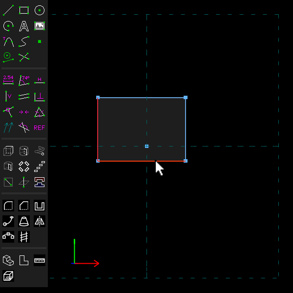
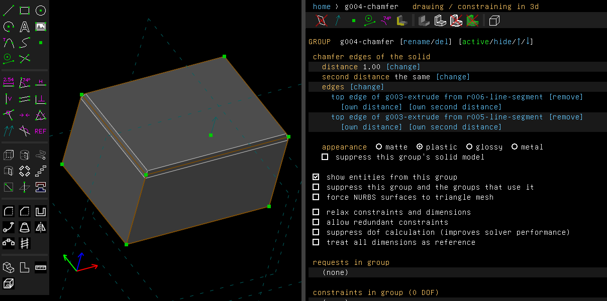
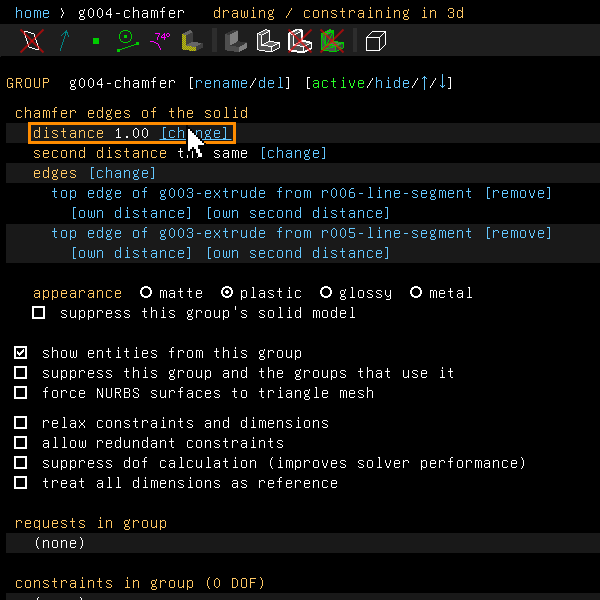
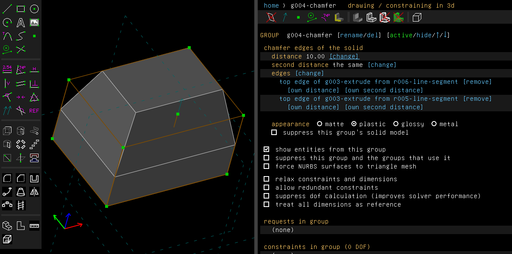
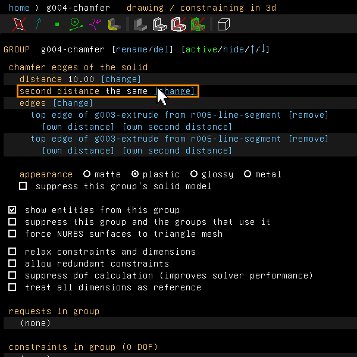
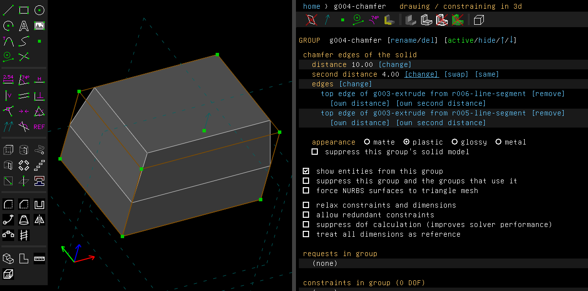
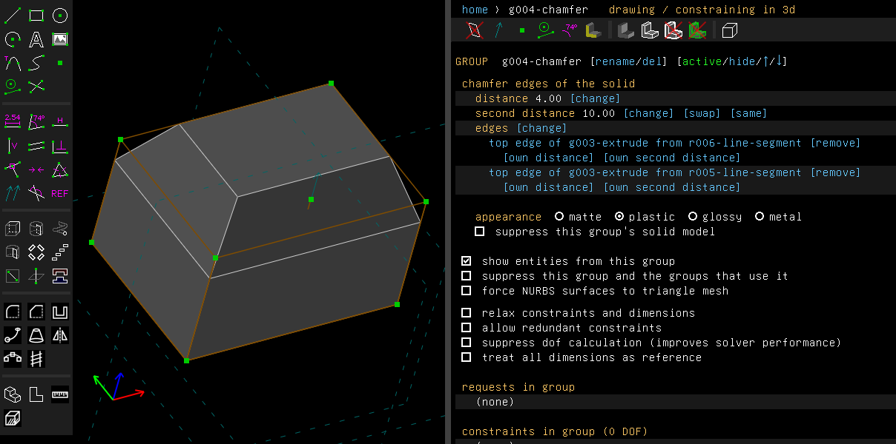
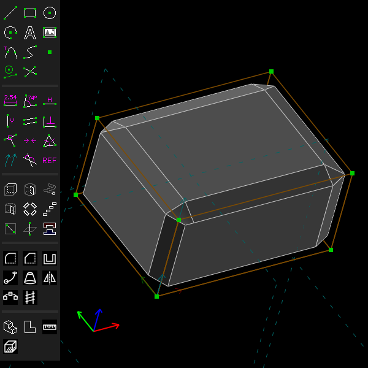

# Chamfer

A chamfer cuts an edge off flat, at a set distance back from the edge on each face.

Examples:

- [`examples/scripts/chamfer`](../../examples/scripts/chamfer/chamfer.go): a block with its
  top edges cut.
- [`examples/scripts/edges`](../../examples/scripts/edges/edges.go): an edge that no sketch
  entity draws, chamfered by its name.
- [`examples/scripts/bevel`](../../examples/scripts/bevel/bevel.go): a bevel of two distances.

## Step by step

Cut two top edges of a block:

1. Press R for a rectangle and click two corners. Press Esc, then Shift+X to extrude it.
   Click the two edges to cut, as seen from above. They are drawn in red when selected.

   

2. Choose Features > Chamfer Edges. The edges are cut at 1 mm, and the property browser lists
   them.

   

3. Click "[change]" beside the distance and type a new one, here 10.

   

   

4. To cut further back on one face than on the other, click "[change]" beside the second
   distance and type it, here 4. The cut now goes 10 mm down the sides and 4 mm across the top.

   

   

5. Click "[swap]" to exchange the two distances: 4 mm down the sides, 10 mm across the top.

   

These pictures are made by [`scenarios/chamfer.scenario`](scenarios/chamfer.scenario), which
replays the same clicks on the program (`scripts/regen-doc-images.sh`).

## In the window

Choose Features > Chamfer Edges (Shift+Q). It cuts edges of the solid built so far. The
distance starts at 1 mm. A convex edge (one that sticks out) is cut away. A concave edge (one
that goes in, like the floor of a pocket) is filled instead. Where a chamfered edge runs
smoothly into the next edge, the chamfer carries on round it. Round the corners of a rounded
rectangle it goes by cones.

Before choosing the menu entry, select one or more of these:

- line segments that lie along edges between two flat faces, such as the edges an extrusion
  makes;
- circles where a flat face meets a cylinder or a cone, such as the rims of an extruded circle;
- straight or circular edges of the solid itself, picked on the model. These include edges that
  no entity draws, such as where a pocket's wall meets the block's face.

To take every edge round a face at once, right-click the face and choose Select Face Edges
([`examples/scripts/face_edges`](../../examples/scripts/face_edges/face_edges.go);
`Edit.SelectFaceEdges` in a script).

The group's screen lists the edges and takes a new distance, as a number or an expression.
An edge that is named by the two faces it lies between is hovered and selected on the model
from its row, as a line's row does. The links on the screen:

- "[change]" beside the edges takes the current selection as the chamfer's edges instead. With
  nothing suitable selected, it activates the group before the chamfer, whose solid the edges
  are picked on, says what to pick, and the link reads "[take the selection]" until you do.
- "[remove]" on an edge's row takes that edge out of the chamfer.

Edges between curved faces, and edges that end on a curved face, are chamfered the same way
they are filleted. See [Fillet](fillet.md#between-two-curved-faces).

## Two distances

A chamfer can cut further back on one face than on the other. The screen's *second distance*
row says "the same" to begin with. Give it a distance, and that is how far the cut goes back on
each edge's second face.

Which face is the first? The one with the lower identity, the one the edge's name gives first.
If that turns out the wrong way round, *[swap]* exchanges the two distances. *[same]* makes the
chamfer one of a single distance again.

From a script:

```go
c := doc.Features.Chamfer([]api.Entity{edge}, 2, "")
c.AsChamfer().SetDistance(1.5)
c.AsChamfer().SetSecondDistance(3) // 1.5 on the first face, 3 on the second
c.AsChamfer().SwapDistances()      // 3 on the first, 1.5 on the second
s := doc.Active().Solid()
doc.Features.ChamferSolid([]api.SolidEdge{s.EdgeAt(api.V(15, 2, 10))}, 1, "")
```

## A distance of an edge's own

One edge can be cut at a distance of its own, and at a second distance of its own, while the
other edges keep the chamfer's. Under each edge on the group's screen, *[own distance]* and
*[own second distance]* take a number or an expression. The row then shows the value with
*[change]* and *[the chamfer's]*, which takes the own distance off again.

In a script, edges are counted as the screen lists them: the line segments first, then the
edges of the solid, starting from 0. Example:
[`examples/scripts/chamferedges`](../../examples/scripts/chamferedges/chamferedges.go), a block
whose front top edge is cut wider than the others.

```go
c := doc.Features.ChamferSolid(edges, 2, "")
c.AsChamfer().SetEdgeDistance(0, 4)          // the first edge at 4, the rest at 2
c.AsChamfer().SetEdgeSecondDistance(0, 1)    // and 1 on its second face
must(c.AsChamfer().SetEdgeDistanceExpr(1, "w/2"))
c.AsChamfer().SetEdgeDistance(0, 0)          // the chamfer's distance again
```

Swapping the chamfer's distances swaps each edge's own distances as well. *[same]* takes off
the edges' own second distances along with the chamfer's.

Where edges of different distances meet above an edge that stays sharp, they meet in a mitre
(see Corners, below). At a corner of three chamfered edges of different distances that the
chamfer can't make by its normal edit, each straight edge is cut by a plain wedge instead.

## Corners

**Every edge at the corner chamfered.** Where three or more straight edges between flat faces
meet at a corner and all of them are chamfered, the chamfers' lines on each face cross, and the
corner is cut the way OpenCASCADE cuts it:

- Three chamfers of one distance at a square corner: the corner becomes the triangle between
  the three points where their lines cross.
- Otherwise (different distances, an edge with two distances, or faces that don't all meet
  square): one chamfer, the one with the largest distance whose lines cross the others' furthest
  out, ends in a straight line between its two crossing points. The other two are cut square to
  their edges where their lines cross the first one's. The face between them takes a line from
  one cut to the other. The hole that is left is filled by a plane, or by a twisted four-sided
  patch with straight sides when its corners don't lie in one plane.
- Four or more edges at a corner, such as a pyramid's apex: the chamfers end between the points
  where their lines cross, and the hole is filled the same way, or by triangles about its middle
  when it has more than four sides.

Example: [`examples/scripts/chamfercorner`](../../examples/scripts/chamfercorner/chamfercorner.go),
a block with every edge chamfered at two distances.



**Two chamfered edges meet, the third edge left sharp.** The two chamfers meet along the line
where their planes cross, whatever their distances. The one that reaches further down the sharp
edge goes on past that line to the sharp edge, along the line where it cuts the other chamfer's
side face. Where the chamfers fill rather than cut, as at the foot of a block standing on a
plate, the side face grows out to meet them.

**One convex and one concave.** Take a ledge's top edge with the inside upright below it, or a
block's upright edge with one of its foot edges. The two chamfers meet in a three-sided face. On
the face they share, their lines cross. One chamfer runs from there to the sharp edge; the other
is cut square to its edge. The face the sharp edge bounds takes a curve from that cut, along its
chamfer's line, round onto the sharp edge. The corner's face fills between that curve and the two
ends, as OpenCASCADE's makeChamfer fills it. Our face bulges a little less, by about a tenth of a
cubic millimetre at distances of 1 mm.

OpenCASCADE differs from this in two places. At a corner of three where one crossing point lies
close to the line between the other two, it makes the triangle of the three points, where
TeleSAPR cuts the chamfers as above (a few tenths of a cubic millimetre apart at distances of 1
to 3 mm). At a corner of four or more, it fills the hole with a plate that bulges out past the
plane of its corners, where TeleSAPR uses that plane.

## Edge names

An edge of the solid is saved by name, not by where it is. The name holds the two faces the
edge lies between, its place among their edges, and how many edges they had. If an edit splits or
joins the edges between those two faces, the group reports it rather than moving the chamfer to
another piece. So a chamfer on a named edge stays on that edge when the model upstream changes.
The `edges` example shows this by moving a notch through a parameter.

In a script, `Solid` gives a group's faces, edges and vertices. `Edge(name)`, `EdgeAt(point)`,
`EdgesBetween(a, b)` and `EdgesAlong(dir)` find edges.

## Not yet

- A chamfer by a distance and an angle is not done.
- A chamfer of two distances can't take circular edges that meet other chamfered edges at a
  corner.
- Where the edit that cuts a chamfer can't make a corner, as where a concave edge meets the cut,
  the chamfer falls back to a wedge and a Boolean. That fallback takes convex edges only.
