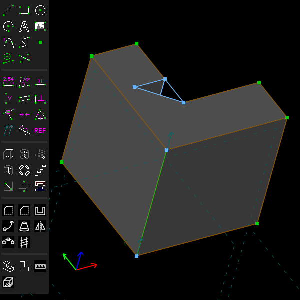
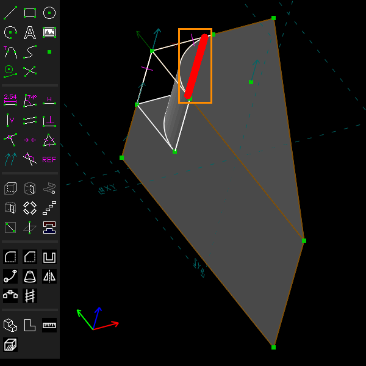

# Check Solid

Every example script calls this check. See
[`examples/scripts/plate`](../../examples/scripts/plate/plate.go) for one that stops with an
error when the solid is not sound.

## Step by step

1. Make the group whose solid you want to check active. Here it is an L-shaped block.

   

2. Choose Analyze > Check Solid (Ctrl+Shift+O). For this block the message reads "The solid is
   sound. It is closed, it does not intersect itself, and its Boolean succeeded." Below that
   it gives the faces (10), the triangles (28), the volume (296 cm³), the centre of mass and
   the extent (80.00 x 80.00 x 80.00).

3. On a solid that is not sound, the message reads "The solid is NOT sound.", says what is
   wrong ("7 naked edges, so it is not closed") and that "The problem edges are marked". They
   are drawn in red on the model.

   

These pictures are made by [`scenarios/check-solid.scenario`](scenarios/check-solid.scenario).

## What it does

Analyze > Check Solid (Ctrl+Shift+O) checks the active group's solid and reports:

- **Sound or not.** A solid is sound when:
  - its mesh is closed: no naked edges (a naked edge has a triangle on one side only);
  - no edge of the mesh passes through a triangle;
  - the Boolean that made it succeeded;
  - its faces, edges and vertices fit together: each edge between two faces, each loop closed.
- **Faces and patches.** A face can be several surface patches joined smoothly, such as a
  cylinder's wall. The message gives "Faces: 7, of 11 patches" when they differ.
- **Volume, centre of mass and extent**, in the document's unit.

When something is wrong, the message lists it by kind:

| The message says | Meaning |
|---|---|
| `n naked edges, so it is not closed` | the mesh has holes |
| `n self-intersecting edges` | the solid passes through itself |
| `the Boolean failed; see the group's page` | the group's Boolean did not finish |
| `n problems with its topology, the first: ...` | faces and edges don't fit together |
| `its parts touch only at a point or along a line, as at (x, y, z) mm, so it is not closed there: move them apart or into one another` | the group's part meets the solid before it at a point or line only, as a ball resting on a plate |

The edges at fault are drawn on the model, as Analyze > Show Naked Edges (Ctrl+Shift+N) draws
naked ones.

### Faces made to meet

Round faces closer to the solid's than the chord tolerance, such as a pin drawn 0.03 mm over a
bore's size at a tolerance of 0.1 mm, are closer than the mesh can show. Where their Boolean
fails as drawn, the round faces are moved onto the solid's, and the group says so in a note on
its screen and "(note)" in the list of groups: "round faces 0.03 mm off the solid's, under the
chord tolerance, were made to meet them". Within a tenth of the chord tolerance they are moved
without a note. To keep such a gap, set the chord tolerance finer than it.

### About the volume

The volume is the mesh's. The mesh follows curved faces with straight chords, within the chord
tolerance (Edit > Preferences). That tolerance is a share of the whole model's size, so a
group's volume can change a little when a later group makes the model larger. When the last
digits matter, set the chord tolerance smaller, or use the [ray-cast check](#ray-cast-check).

## From a script

```go
r := group.Analyze().Check()
if !r.Sound() {
	fmt.Println(r.Summary())
}
fmt.Println(r.Faces, r.Volume, r.CenterOfMass, r.Touches, r.TouchAt)
fmt.Println(group.Note())
```

`group.Solid().Problems()` lists the topology's problems, face by face and edge by edge.

## Ray-cast check

Example: [`examples/scripts/raycheck`](../../examples/scripts/raycheck/raycheck.go), a plate
with a turned spindle through it, four bolt holes repeated round it and a slot cut across.

Analyze > Ray-Cast Check checks the solid a second, independent way. It rebuilds the model from
the groups' definitions alone (each extrusion's profile and depth, each lathe's axis, each
copy's move), casts rays through it, and compares with the mesh. It reports:

- **Volume, centre of mass and principal moments of inertia**, at a density of one, in the
  view's unit (the moments to the fifth power). The rays are made denser until the result is
  within 0.1%. The mesh's volume is given beside them.
- **Rays that disagree** with the mesh: inside one and not the other, further than twice the
  chord tolerance from the mesh. They are drawn on the model.
- **The mesh's edges**: edges used by one triangle only, by more than two, or twice the same way,
  and degenerate triangles.

From a script, `group.Analyze().RayCheck()` gives the same report; its `Measure.Inertia` is the
whole inertia tensor about the centre of mass, in mm⁵. `group.Analyze().Probe(from, dir)` gives
the stretches of a line that lie inside the solid.

The rebuilt model takes:

- extrusions, with or without a draft;
- lathes, revolves and helices, of a profile in a plane through the axis or leaning to it;
- sweeps along a path, mitred or with a corner radius, along a cubic, twisted, held to a
  direction, or round a closed path out of a plane;
- the copies of all of these made by step and repeat, pattern along a path and mirror.

Any other solid group is refused, and the message names the group.

## Not yet

- The ray-cast check refuses fillets, chamfers, lofts, shells, wraps and STEP links.
- It also refuses a corner beside an arc or a cubic in a sweep's path.
