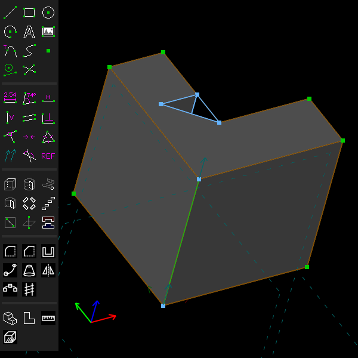
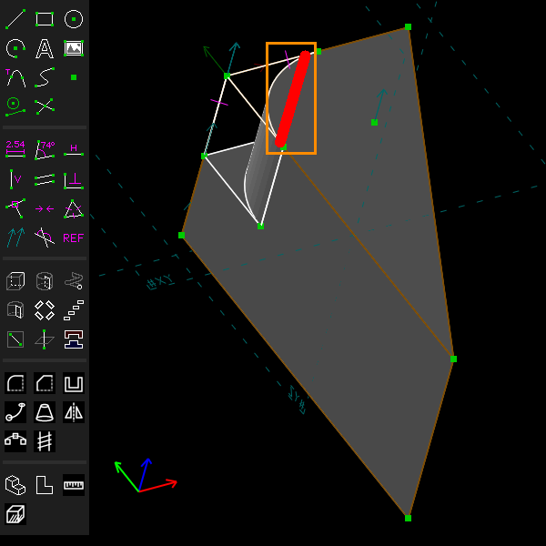

# Check Solid

Every example script calls this check. See
[`examples/scripts/plate`](../../examples/scripts/plate/plate.go) for one that stops with an
error when the solid is not sound.

## Step by step

1. Make the group whose solid you want to check active. Here it is an L-shaped block.

   

2. Choose Analyze > Check Solid (Ctrl+Shift+O). For this block the message reads "The solid is
   sound. It is closed, it does not intersect itself, and its Boolean succeeded." Below that
   it gives the faces (10), the triangles (28), the volume (296 cm³), the centre of mass and
   the extent (80.00 x 80.00 x 80.00).

3. On a solid that is not sound, the message reads "The solid is NOT sound.", says what is
   wrong ("3 naked edges, so it is not closed") and that "The problem edges are marked". They
   are drawn in red on the model.

   

These pictures are made by [`scenarios/check-solid.scenario`](scenarios/check-solid.scenario).

## What it does

Analyze > Check Solid (Ctrl+Shift+O) looks at the active group's solid and reports:

- **Sound or not.** A solid is sound when all of these hold:
  - its mesh has no naked edges. A naked edge is a mesh edge with no triangle on its other
    side, so the mesh is open there;
  - no edge of the mesh passes through a triangle;
  - the Boolean that made the solid could classify every edge;
  - its faces, edges and vertices fit together: every edge lies between exactly two faces,
    every loop closes, and the Euler characteristic of the shell agrees with the mesh's. (The
    shell is the exact surfaces of the solid, as opposed to its triangle mesh.)
- **Faces and patches.** A face may be several surface patches joined smoothly. A cylinder's
  wall is one face of several patches, for example.
- **Volume, centre of mass and bounding box**, in the document's unit.

When something is wrong, the message lists what by kind, and the edges at fault are drawn on
the model, the way Analyze > Show Naked Edges draws naked ones.

Where the only fault is that the group's part and the solid before it touch at a point or along
a line, as a ball resting on a plate or a rod lying on one, the message says so: "its parts touch
only at a point or along a line, as at (x, y, z) mm, so it is not closed there: move them apart
or into one another". Such a union is the right shape, but it is not a closed solid where they
touch, and the naked or self-intersecting edges there are where the mesh meets itself. In a
script, `Report.Touches` is set and `Report.TouchAt` is a point of the contact.

Round faces that lie closer to the solid's than the chord tolerance, as a pin drawn 0.03 mm over a
bore's size at a tolerance of 0.1 mm, or a cone a little off a countersink of its angle, are
closer than the mesh can show. Where their Boolean as drawn fails or leaves the mesh open, the
group's round faces are moved onto the solid's (the pin made the bore's size, a ball resting on
a plate moved to touch it) and the group says so in a note on its screen and in the list of
groups ("(note)"): "round faces 0.03 mm off the solid's, under the chord tolerance, were made to
meet them". In a script, `Group.Note()` gives it. Within a tenth of the chord tolerance they are
moved without a note, as are planes. To keep such a gap, set the chord tolerance finer than it.

### About the volume

The volume is the mesh's. The mesh follows the curved faces with straight chords, within the
chord tolerance (how far the mesh may stray from the true surface, set on the configuration
screen). That tolerance is a share of the whole model's size. So a group's volume can change a
little when a later group makes the model larger: the curved faces get coarser chords. When the
last digits matter, set the chord tolerance smaller, or compare volumes once the model is
complete.

## From a script

```go
r := group.Analyze().Check()
if !r.Sound() {
	fmt.Println(r.Summary())
}
fmt.Println(r.Faces, r.Volume, r.CenterOfMass)
```

`group.Solid().Problems()` lists the problems of the topology, face by face and edge by edge.

Every solid feature is tested by checking many variants of it this way, in sweeps. The tests
and their failure rates are in the developers' table,
[`doc/dev-notes/done-audit.md`](../dev-notes/done-audit.md).

## Ray-cast check

Example: [`examples/scripts/raycheck`](../../examples/scripts/raycheck/raycheck.go), a plate
with a turned spindle through it, four bolt holes repeated round it and a slot cut across.

Check Solid judges the kernel's solid by the kernel's own mesh. Analyze > Ray-Cast Check judges
it against a second, independent account of the solid. It rebuilds the model from the groups'
definitions alone: each extrusion's profile and depth, each lathe's or revolve's profile, axis
and angle, the moves that place the copies of a step and repeat, a pattern along a path or a
mirror, joined, cut or intersected as the groups say. No surfaces are intersected. Then it casts
rays through that rebuilt model and reports:

- **The volume, centre of mass and principal moments of inertia**, for a density of one, in the
  view's unit to the fifth power. They come from three grids of rays, one along each axis. The
  grids are made finer until the three volumes agree within 0.1% and with the grids of half as
  many rays, or until there are 256 rays a side. The mesh's volume is given beside them.
- **The rays that disagree** with the mesh. A ray disagrees where it is inside one account and
  not the other over a stretch further than twice the chord tolerance from the mesh. These
  rays are drawn on the model.
- **The mesh's edges**, taken vertex to vertex. Each should be used by two triangles, once each
  way. The check counts edges used once, edges used more than twice, edges used twice the same
  way, and degenerate triangles.

From a script, `group.Analyze().RayCheck()` gives the same report. Its `Measure.Inertia` is the
whole inertia tensor about the centre of mass, in mm⁵. `group.Analyze().Probe(from, dir)` gives
the stretches of a line that lie inside the solid.

### What the rebuilt model can hold

The rebuilt model takes:

- extrusions, with or without a draft;
- lathes and revolves;
- helices of a profile drawn in a plane through their axis;
- sweeps along line segments and arcs, mitred or with a corner radius, with the profile square
  to an arc's axis;
- sweeps the kernel fits along their path: along a cubic, twisted, held to a direction, or
  round a closed path out of a plane;
- the copies that step and repeats, patterns along a path and mirrors make of all of these.

A model with any other solid group (a fillet, a chamfer, a loft, a shell, a STEP link) is
refused, and the message names the group.

A fitted sweep is rebuilt by placing the profile along the path with frames of the check's own.
The frames turn with the path and no more, or are held to the direction, and a twist turns them
evenly by length. The kernel fits its surfaces between sections of the same sweep, so the rays
show where that fit strays. Where a ray meets the swept sides, the rebuilt model samples the
crossing, as it does for a helix.

A helix's rays agree with the mesh as a lathe's do, within the chord tolerance: the kernel's
patches follow the true helix within a few millionths of each quarter turn's rise. A ray that
grazes a helix's inner wall can still disagree by a few hundredths of a millimetre, because the
rebuilt model samples the crossing there.

## Not yet

- The ray-cast check refuses fillets, chamfers, lofts, shells and STEP links, as above.
