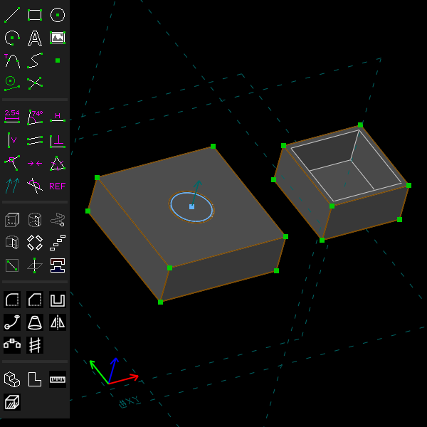
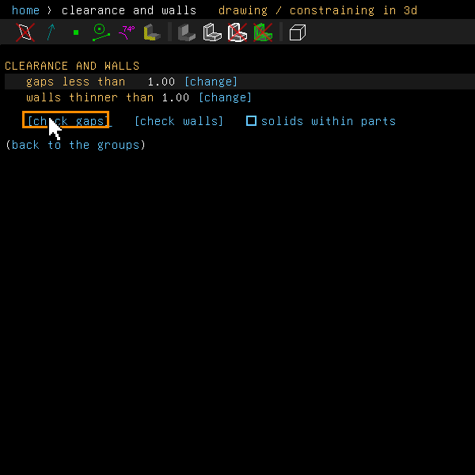
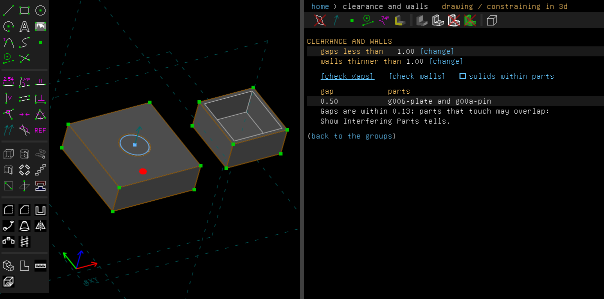
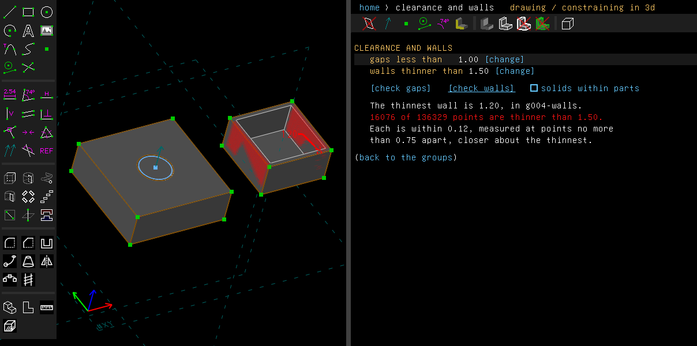

# Clearance and walls

Example: [`examples/scripts/clearance`](../../examples/scripts/clearance/clearance.go), a pin
9 mm across in a plate's bore 10 mm across, and a box hollowed to walls 1.2 mm thick.

## Step by step

1. Open the model. Here it is the one the example saves: a pin in a plate's bore, and a box
   hollowed to thin walls.

   

2. Choose Analyze > Clearance and Walls... Its screen opens in the property browser. Click
   [check gaps].

   

3. The screen lists the pair of parts nearer than 1 mm: the plate and the pin, 0.50 apart. A
   short red line across the gap, with a leader to its size, shows where it is. Here it is at
   the bottom of the bore, behind the plate, so it and its leader are dashed.

   

4. Click [change] beside walls thinner than, type 1.5, and click [check walls]. The screen says
   "The thinnest wall is 1.20, in g004-walls." It is marked as a gap is, with its thickness. Thin
   red lines cross every point of the walls thinner than 1.5 mm, fainter where the wall hides
   them, so the thin walls show shaded red.

   

These pictures are made by [`scenarios/clearance.scenario`](scenarios/clearance.scenario).

## What it does

Before a model is printed or machined, two things are worth checking: are two parts too close,
and is a wall too thin? Analyze > Clearance and Walls... checks both, on the model up to the
active group.

The parts are the ones Show Interfering Parts checks: each group set to **assemble**, and the
solid made before the first of them. A group that cuts the assembly after them cuts each part
it reaches. Parts made of triangles (linked as a mesh, or with **force NURBS surfaces to
triangle mesh** ticked) are taken too.

### Gaps between parts

The first row is **gaps less than** a distance, 1 mm to start with; [change] sets it.

[check gaps] lists every pair of parts nearer than that, the nearest first. Each gap is marked
on the model: a red line between the two nearest points, a tick across each end and a leader to
its size. Where a solid hides the gap, the line and leader are dashed. A gap that is the same
along a length, as round a pin in its bore, is marked at one place.

Parts that touch or overlap have a gap of 0. Show Interfering Parts tells which of them overlap.

With **solids within parts** ticked, a part made of several solids, such as a linked assembly,
is taken solid by solid. The gaps between its own solids are listed too, as
"g004-tile solid 2". A part linked as a mesh is taken by its pieces: triangles joined by shared
corners.

The screen says how far the gaps may be off. A gap is found on the meshes, then measured again
on the exact surfaces, so a pin in its bore comes out at its true gap.

### Walls thinner than a thickness

The second row is **walls thinner than** a thickness, also 1 mm to start with.

[check walls] measures each part's walls at many points: from each point a ray goes straight
into the solid, to where it leaves again. The screen says:

- the thinnest wall and the part it is in, marked on the model with its thickness;
- how many points are thinner than asked, each crossed by a thin red line;
- how exact the measure is, and how far apart the points were.

The points are no further apart than half the thickness asked about, and closer around the
thinnest spots. A sharp edge, as where a thread's ridge runs out of an end face, has a
thickness of nothing there, and is listed so. Each solid of a part is measured on its own.

When the last hundredths matter, set the chord tolerance smaller in Edit > Preferences.

## From a script

```go
for _, c := range doc.Assembly.Clearances(1) { // gaps under 1 mm; 0 lists every pair
	fmt.Println(c.A.Name(), c.B.Name(), c.Gap, c.Tolerance)
}
for _, c := range doc.Assembly.ClearancesWithin(1) { // and between the solids of a part
	fmt.Println(c.A.Name(), c.SolidA, c.B.Name(), c.SolidB, c.Gap)
}
r := group.Analyze().WallThickness(1.5) // points thinner than 1.5 mm
fmt.Println(r.Thinnest.Thickness, len(r.Thin), r.Samples)
```

The MCP `measure` tool reports both when asked with `gaps` and `walls`
([Drawing with an AI model](ai.md)).

## Not yet

- A part with very many triangles facing each other within its thinnest wall (over 4 million
  pairs) is not measured everywhere, and a thinner wall can be missed. The screen says so.
