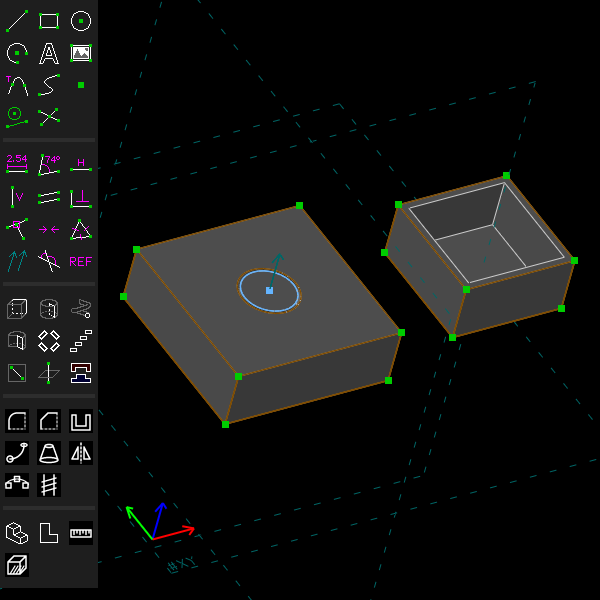
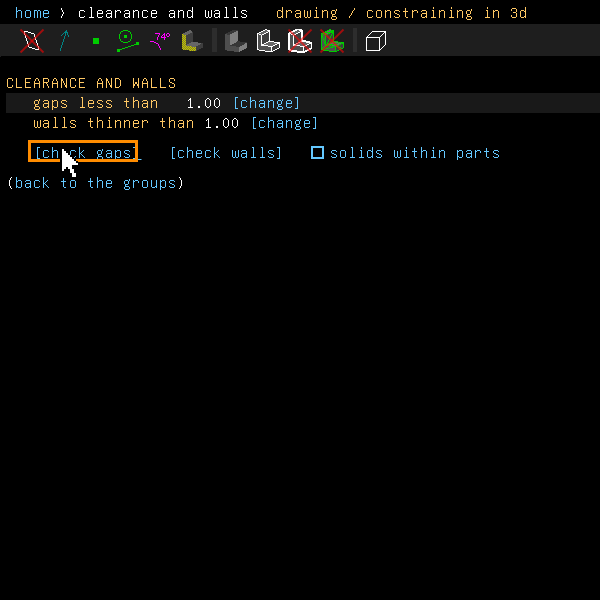
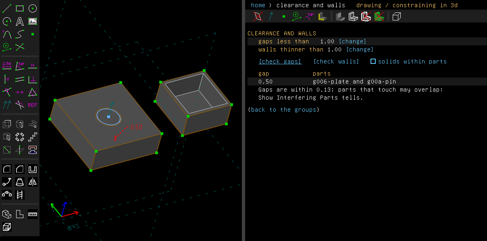
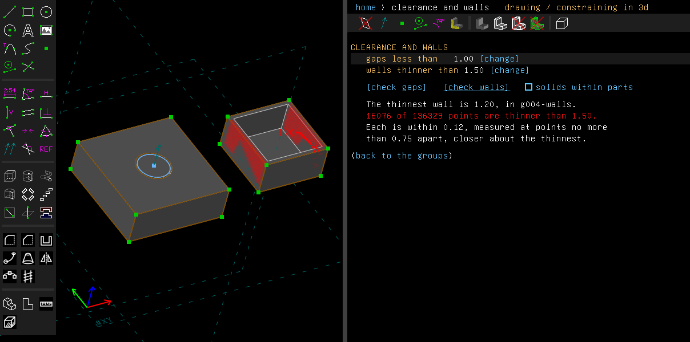

# Clearance and walls

Example: [`examples/scripts/clearance`](../../examples/scripts/clearance/clearance.go), a pin
9 mm across in a plate's bore 10 mm across, and a box hollowed to walls 1.2 mm thick.

## Step by step

1. Open the model. Here it is the one the example saves: a pin in a plate's bore, and a box
   hollowed to thin walls.

   

2. Choose Analyze > Clearance and Walls. Its screen opens in the property browser. Click
   [check gaps].

   

3. The screen lists the pair of parts nearer than 1 mm: the plate and the pin, 0.50 apart. A
   short red line across the gap, with a leader to its size, shows where it is. Here it is at
   the bottom of the bore, behind the plate, so it and its leader are dashed.

   

4. Click [change] beside walls thinner than, type 1.5, and click [check walls]. The thinnest
   wall is 1.20, in the hollowed box, marked as a gap is, with its thickness. Thin red lines
   cross every point of the walls thinner than 1.5 mm, fainter where the wall hides them, so
   the thin walls show shaded red.

   

These pictures are made by [`scenarios/clearance.scenario`](scenarios/clearance.scenario).

## What it does

Before a model is printed or machined, two things are worth checking: are any two parts too
close together, and is any wall too thin? Analyze > Clearance and Walls opens a screen in the
property browser that checks both, on the model up to the active group.

### Gaps between parts

The screen's first row is **gaps less than** a distance, 1 mm to start with. [change] sets it.

The parts are the same ones Show Interfering Parts checks: each group assembled into the model,
and the solid made before the first of them, even when that solid was made as triangles
(**force NURBS surfaces to triangle mesh**). A group that cuts the assembly after them cuts each
part it reaches, a part made of triangles too (forced to a triangle mesh, or linked as a mesh).
A cutting group with no surfaces of its own, as a linked mesh, cuts the parts it reaches as
triangles, which are then parts of triangles: Show Interfering Parts can't check those.

[check gaps] lists every pair of parts nearer than the distance, the nearest first, and marks
each gap on the model: a red line between its two nearest points, a tick across each end and a
leader to its size. Where a solid hides the gap, the line and the leader are dashed. A gap that
is as narrow along a length, as round a pin in its bore, is marked at one place along it. Parts that touch or overlap have a gap of 0. Which of those
overlap, Show Interfering Parts tells.

With **solids within parts** ticked, a part made of several solids, such as a linked assembly,
is taken solid by solid, and the gaps between its own solids are listed too, as
"g004-tile solid 2". A part linked as a mesh is taken by its pieces: the triangles that are
joined by shared corners.

### Walls thinner than a thickness

The second row is **walls thinner than** a thickness, also 1 mm to start with.

[check walls] measures the walls of each part. From points on each triangle of the part's mesh,
it casts a ray straight into the solid, square to the triangle, to where the ray leaves the
part again. The screen says what the thinnest wall is and where. On the model the thinnest wall
is marked as a gap is, with a line across it, a tick at each end and a leader to its thickness,
and a thin line crosses each point thinner than asked, faint where the wall hides it.

How the points are chosen:

- They are no further apart than half the thickness asked about, or a fiftieth of the model's
  size. So a thin spot narrower than the triangles around it, such as near the tip of a cone,
  is not missed between their middles.
- Around the thinnest spots the points are placed closer again.
- Between two points a wall can be thinner still, as under the tip of a narrow groove. A ray
  from one flat triangle to the one it leaves through grows or shrinks evenly as it moves, so
  the corners of where the two triangles overlap are measured too. The thinnest spot is among
  them.
- So that no such spot is missed where no ray happened to land, as under a dimple narrower than
  the points are apart, every pair of triangles that face each other closer than the thinnest
  wall found is measured the same way.
- A sharp edge, as where a thread's ridge runs out of an end face, has a thickness of nothing
  there, and is listed so.

The screen says how far apart the points were.

Each solid of a part is measured on its own. A hollow's inside is measured together with the
solid around it, so a ray from one solid does not stop on another standing on it.

### How exact it is

Gaps are first found on the parts' meshes. Then the nearest points are followed onto the exact
surfaces the triangles stand for. So a pin in a bore comes out at its true gap, even though the
meshes' chords are a little nearer. A part linked as a mesh has no exact surfaces: its
triangles are its geometry, so the gap is followed on them and onto the other part's surfaces.

The screen says how far the gaps may be off: the chord tolerances of the two meshes (how far
each mesh may stray from its true surface), plus more where the points were followed onto the
surfaces and moved.

A wall is measured between two points of the mesh, each within the chord tolerance of the
surface. The thinnest points are then followed onto the two surfaces of the wall.

When the last hundredths matter, set the chord tolerance smaller on the configuration screen.

## From a script

```go
for _, c := range doc.Assembly.Clearances(1) { // gaps under 1 mm; 0 lists every pair
	fmt.Println(c.A.Name(), c.B.Name(), c.Gap, c.Tolerance)
}
for _, c := range doc.Assembly.ClearancesWithin(1) { // and between the solids of a part
	fmt.Println(c.A.Name(), c.SolidA, c.B.Name(), c.SolidB, c.Gap)
}
r := group.Analyze().WallThickness(1.5) // points thinner than 1.5 mm
fmt.Println(r.Thinnest.Thickness, len(r.Thin), r.Samples)
```

The MCP `measure` tool reports both when asked with `gaps` and `walls`
([Drawing with an AI model](ai.md)).

## Not yet

- A part can have more pairs of triangles facing each other within its thinnest wall than are
  measured (4 million a part, each pair covering some of the other). Past them a wall can still
  be missed, and the screen says so. No part has come near: a ball of 159,000 triangles has a
  few.
