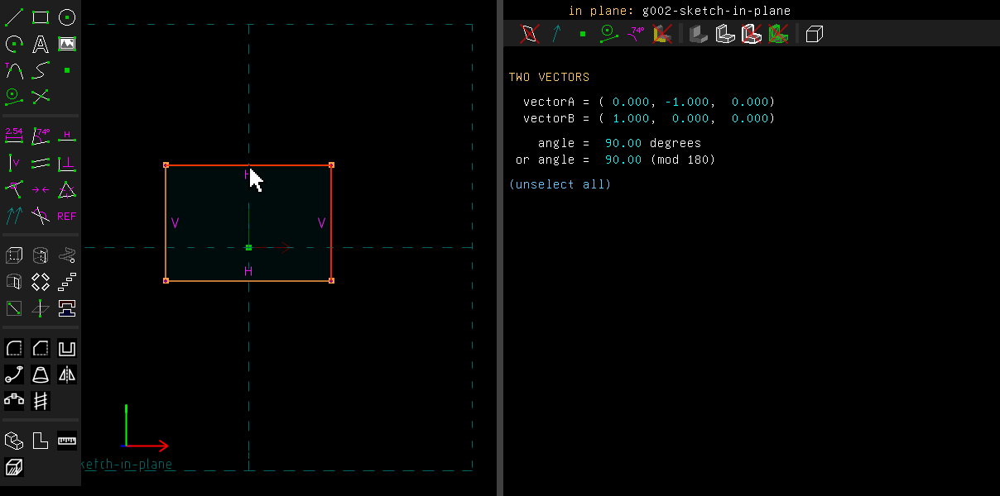
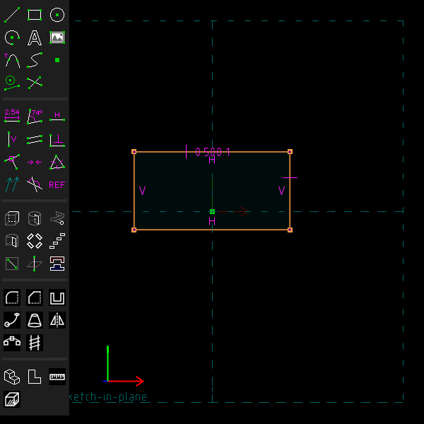
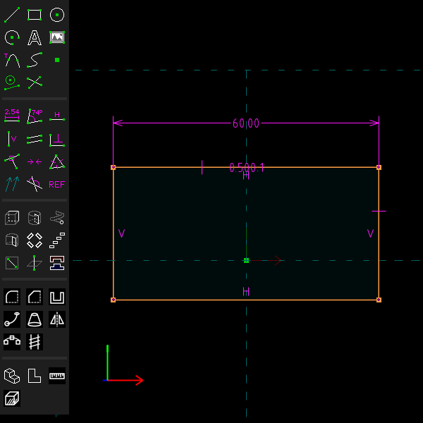

# Constraints

Examples: [`examples/scripts/ratio`](../../examples/scripts/ratio/ratio.go), a tray whose
depth is held to its width by a ratio and whose pocket is held to the outline by a difference,
so that one dimension sizes the whole tray; [`equal`](../../examples/scripts/equal),
[`text`](../../examples/scripts/text) and [`overlap`](../../examples/scripts/overlap) for the
other features on this page.

All of SolveSpace's constraints are here, under the Constrain menu. TeleSAPR adds the ones
below. Each is one undo step, and each has a script call on `doc.Constrain`.

## Step by step

Hold a rectangle's depth to half its width, so that one dimension sizes both:

1. Draw a rectangle (R) and press Esc. Click its right side, then its top side. The first one
   picked is the length that is set as a multiple of the second.

   

2. Press Z for Constrain > Length / Arc Ratio. Its editor opens: type 0.5 and press Enter. The
   rectangle's depth becomes half its width, and the label reads "0.500:1".

   

3. Click the top side and press D for a dimension. Type 60. The width becomes 60 mm, and the
   depth follows to 30 mm.

   

These pictures are made by [`scenarios/constraints.scenario`](scenarios/constraints.scenario).

## Ratios and differences of lengths

Constrain > Length / Arc Ratio (Z) makes one length a multiple of another. Length / Arc
Difference (J) makes one length longer than another by an amount.

Each takes two line segments, two arcs (measured along the arc), or a line segment and an arc.
With a line and an arc, the ratio or difference is the line's length over the arc's. A
difference is a size, taken without its sign. If you want a shorter than b, select them the
other way round.

```go
constrain.Ratio(outer[1], outer[0], 0.5)       // depth is half the width
constrain.Difference(outer[0], pocket[0], 8)   // the pocket 8 mm narrower
```

## Equal distances and angles

Constrain > Equal Length / Radius (Q) also takes:

- a point and two line segments: the point is as far from the first line as the second line is
  long;
- a line segment and two points, or two line segments with a point each: the points are as far
  from their line as each other.

Constrain > Angle / Equal Angle (N) with three line segments or normals makes the two angles
that share the middle one equal. With four, the angle of the first pair equals the angle of the
second pair.

```go
doc.Constrain.Equal(line, p, q)          // p and q equally far from line
doc.Constrain.EqualAngle(a, b, c)        // angle(a,b) == angle(b,c)
```

## Distance along a direction

Distance / Diameter with two points and a line segment or a normal measures the distance along
that direction, with its sign. Use it for the distance between two parallel faces, or a point's
height over a plane. In a script: `Constrain.ProjectedDistance(a, b, along, v)`.

## Faces, tangents, midpoints, symmetry, comments

- **Parallel / Tangent** and **Perpendicular** take two flat faces of the solid, as well as line
  segments and normals (`Constrain.Parallel`, `Constrain.Perpendicular`).
- **Tangent** for two curves that don't share an end: select the end points to make tangent too.
  In a script, `Constrain.Tangent(arc, line, arcEnd)`; for two curves, give an end of each.
- **At Midpoint** works inside a workplane.
- **Symmetric** with only a line segment selected makes its two ends symmetric about the
  workplane's axis. The line's horizontal or vertical constraint is dropped, since it is no
  longer needed (`Constrain.Symmetric(line, Entity{}, Entity{})`).
- **Comment** with a point selected writes the text beside that point, and the text follows the
  point (`Constrain.CommentOn`). Drag the label to move it, or call
  `Constraint.SetLabelOffset`.
- A diameter can be shown as a radius, from its screen (`Constraint.SetShowAsRadius(true)`).

## What lies at a point

When the property browser describes a point, ALSO HERE lists the other points at the same place
and the curves that pass through it. Pick from that list what a click can't reach. From a
script, `Entity.Overlap()` returns them, and `Edit.Select` selects one.

## Text

A text's screen changes its string, its font and its kerning. The text keeps its corner,
direction, height and constraints. In a script: `Entity.SetText`, `Entity.SetFont` (a name
from `Sketch.Fonts()`, or "" for the built-in font) and `Entity.SetKerning`.

## Not yet

A ratio or difference takes the lengths of lines and arcs only. It does not take cubics, or the
radii of circles.
