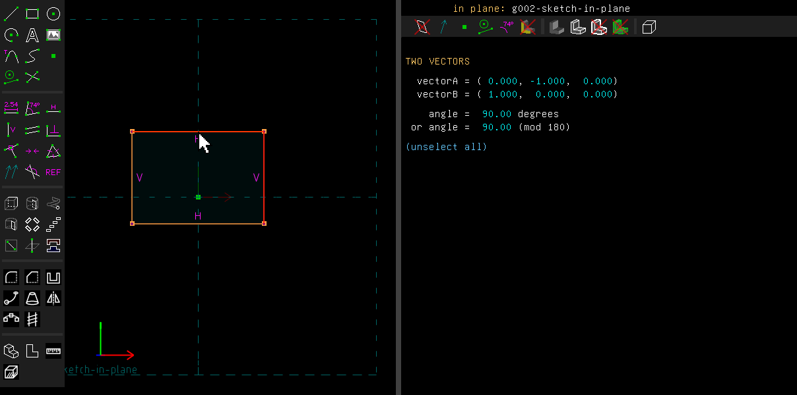
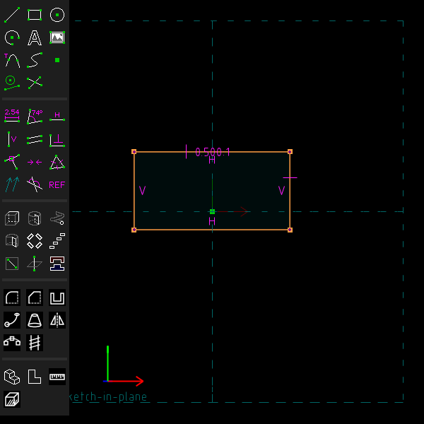
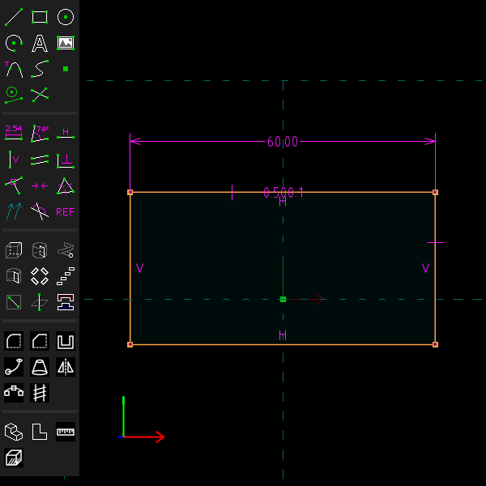

# Constraints

Examples: [`examples/scripts/ratio`](../../examples/scripts/ratio/ratio.go), a tray whose
depth is held to its width by a ratio and whose pocket is held to the outline by a difference,
so that one dimension sizes the whole tray; [`equal`](../../examples/scripts/equal),
[`text`](../../examples/scripts/text) and [`overlap`](../../examples/scripts/overlap) for the
other features on this page.

All of SolveSpace's constraints are here, under the Constrain menu. TeleSAPR adds the ones
below. Each is one undo step, and each has a script call on `doc.Constrain`. Minimum and maximum
dimensions have [a page of their own](limits.md).

## Step by step

Hold a rectangle's depth to half its width, so that one dimension sizes both:

1. Draw a rectangle (R) and press Esc. Click its right side, then its top side. The first one
   picked is the length that is set as a multiple of the second.

   

2. Press Z for Constrain > Length / Arc Ratio. Its editor opens: type 0.5 and press Enter. The
   rectangle's depth becomes half its width, and the label reads "0.500:1".

   

3. Click the top side and press D for a dimension. Type 60. The width becomes 60 mm, and the
   depth follows to 30 mm.

   

These pictures are made by [`scenarios/constraints.scenario`](scenarios/constraints.scenario).

## Ratios and differences of lengths

- **Constrain > Length / Arc Ratio** (Z) makes one length a multiple of another.
- **Constrain > Length / Arc Difference** (J) makes one length longer than another by an amount.

Each takes two line segments, two arcs (measured along the arc), or a line segment and an arc.
With two of a kind, the first picked is the one set from the second. With a line and an arc,
the line is the one set from the arc. A difference has no sign: if you want a shorter than b,
pick them the other way round.

```go
constrain.Ratio(outer[1], outer[0], 0.5)       // depth is half the width
constrain.Difference(outer[0], pocket[0], 8)   // the pocket 8 mm narrower
```

## Equal distances and angles

Constrain > Equal Length / Radius (Q) also takes:

| Selection | Holds |
|---|---|
| a point and two line segments | the point as far from the first line as the second line is long |
| a line segment and two points | the two points equally far from the line |
| two line segments with a point each | each point as far from its line as the other |

Constrain > Angle / Equal Angle (N) makes angles equal:

- three line segments or normals: the two angles that share the middle one;
- four: the angle of the first pair and the angle of the second pair.

```go
doc.Constrain.Equal(line, p, q)          // p and q equally far from line
doc.Constrain.EqualAngle(a, b, c)        // angle(a,b) == angle(b,c)
```

## Distance along a direction

Distance / Diameter with two points and a line segment or a normal measures the distance along
that direction, with its sign. Use it for the distance between two parallel faces, or a point's
height over a plane. In a script: `Constrain.ProjectedDistance(a, b, along, v)`.

## Faces, tangents, midpoints, symmetry, comments

- **Parallel / Tangent** and **Perpendicular** take two flat faces of the solid, as well as line
  segments and normals (`Constrain.Parallel`, `Constrain.Perpendicular`).
- **Tangent** for two curves that don't share an end: select the ends to make tangent too. In a
  script, `Constrain.Tangent(arc, line, arcEnd)`; for two curves, give an end of each.
- **At Midpoint** works inside a workplane.
- **Symmetric** with only a line segment selected makes its two ends symmetric about the
  workplane's axis. The line's horizontal or vertical constraint is dropped, as it is no longer
  needed (`Constrain.Symmetric(line, api.Entity{}, api.Entity{})`).
- **Comment** with a point selected writes the text beside that point, and the text follows the
  point (`Constrain.CommentOn`). Drag the label to move it, or call
  `Constraint.SetLabelOffset`.
- A diameter can be shown as a radius, from its screen (`Constraint.SetShowAsRadius(true)`).
- A new dimension's label is put clear of the labels and points already shown. Drag it to move
  it.

## What lies at a point

When the property browser describes a point, ALSO HERE lists the other points at the same place
and the curves that pass through it. Pick from that list what a click can't reach. From a
script, `Entity.Overlap()` returns them, and `Edit.Select` selects one.

## Text

A text's screen changes its string, its font and its kerning. The text keeps its corner,
direction, height and constraints. In a script: `Entity.SetText`, `Entity.SetFont` (a name
from `Sketch.Fonts()`, or "" for the built-in font) and `Entity.SetKerning`.

## Large edits and drags

A sketch can meet its constraints in more than one shape. A triangle given its three sides can
be drawn either way round; an arm given its two link lengths can bend its elbow either way.
TeleSAPR keeps the shape you drew:

- A dimension changed by more than a quarter of its value, as a side typed two and a half times
  longer, is moved to the new value in steps.
- A point dragged far in one move, more than a quarter of the sketch's size, is moved in steps
  the same way.
- After each step, a corner between dimensioned lengths that turned over is put back. An arc's
  end dragged past its start takes the start along rather than wrap the arc round.

The edit is never refused. Where no nearby shape keeps the sketch the way it was, as an arc
whose start is locked, the sketch takes the new shape. The group is then marked "(note)" in the
list of groups, and its screen says which corner or arc turned over. In a script, `Group.Note`
says the same. The note stays until the next edit or drag of the group.

Only an edit or a drag does this. Opening a file or regenerating solves the sketch from where it
is. A dimension changed through a parameter, or by Analyze > Step Dimension, is solved in one
step.

## Not yet

- A ratio or difference takes the lengths of lines and arcs only: not cubics, nor the radii of
  circles.
- Ratios and differences can't be minimum or maximum bounds ([Limits](limits.md)).
- A large edit or drag keeps only the corners between two held lengths in a workplane (held by
  dimensions, or by an equal-length, ratio, difference, angle or perpendicular constraint). A
  sketch in 3d, and the turn of a curve, are not checked.
- A parameter's new value is not followed in steps.
