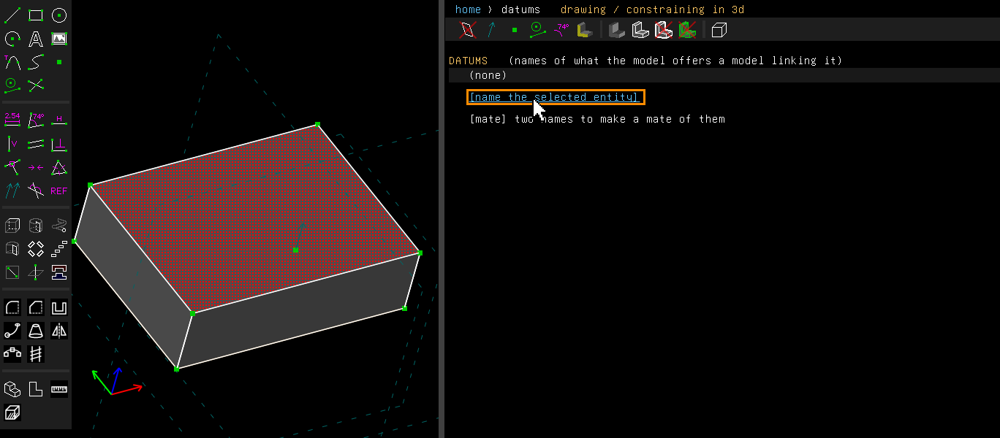
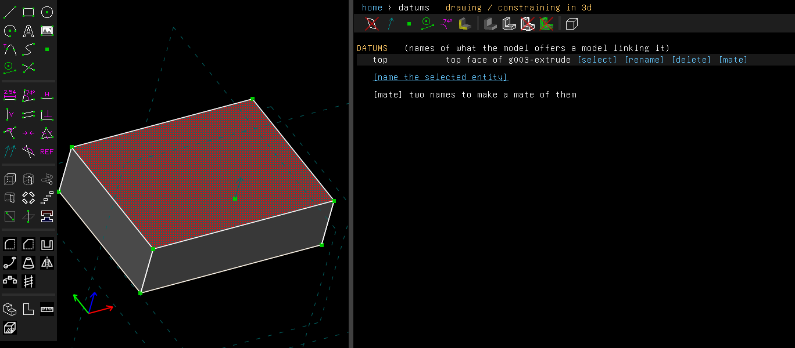
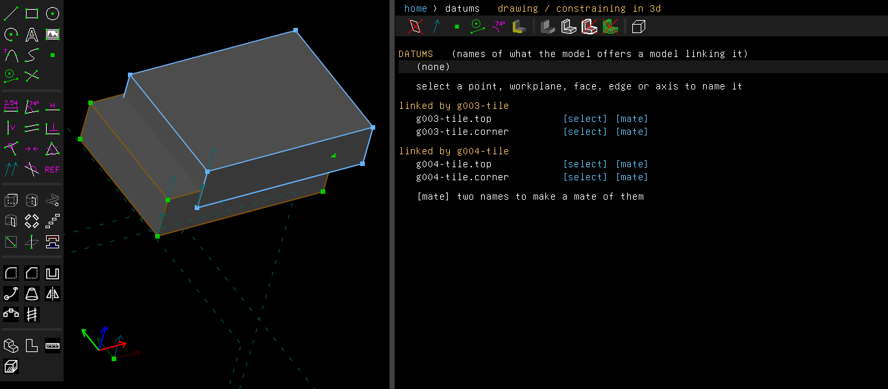
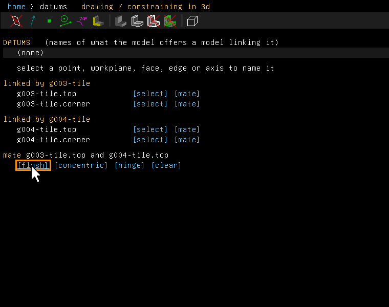
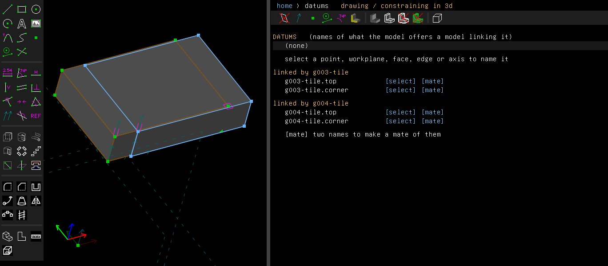

# Datums

Examples: [`examples/scripts/datums`](../../examples/scripts/datums/datums.go), a block's top and
bottom named, and two blocks mated by those names;
[`examples/scripts/datums_solid`](../../examples/scripts/datums_solid/datums_solid.go), a plate
whose fillet's face is named, and two plates mated by it;
[`examples/scripts/datums_freeform`](../../examples/scripts/datums_freeform/datums_freeform.go),
a lens-shaped block whose curved wall and rim are named, and two blocks laid wall to wall.

A datum is a name that a part gives to something it offers other parts: a point, a workplane, a
face, or a line, circle or arc used as an axis. An assembly that links the part finds the datum
as `link.name`. So a mate holds by what the part declares, not by where things happen to be.

## Step by step

Name a block's top, then lay two linked tiles' tops in one plane by their names:

1. Draw a rectangle (R), press Esc, and extrude it (Shift+X). Click its top face, then choose
   Edit > Datums. The screen offers to name the selection.

   

2. Click "[name the selected entity]" and type `top`. The datum is listed with
   "[select]", "[rename]", "[delete]" and "[mate]". Save the part, and a model that links it
   finds the face as `<link>.top`.

   

3. In another model, link a part twice with Assembly > Link / Assemble. Here it is a tile with
   datums `top` and `corner`, and the second copy has been dragged aside. Edit > Datums lists
   each link's datums under its group's name.

   

4. Click "[mate]" on `g003-tile.top`, then on `g004-tile.top`. The screen offers the mates of
   the two names.

   

5. Click "[flush]". The second tile moves so that its top lies in the plane of the first's.
   The first tile, named first, stays where it is.

   

These pictures are made by [`scenarios/datums.scenario`](scenarios/datums.scenario).

## Naming things

Edit > Datums lists the part's own datums, and the datums of each model it links. With something
selected on the model, the screen offers to name it:

- **An entity**: a point, a workplane, a face that an entity makes, or a line, circle or arc.
  The link is **[name the selected entity]**.
- **A face or an edge of the solid that no entity makes**, such as a fillet's face, a face a
  Boolean left, or an edge of the solid. The link is **[name the selected face of the solid]**
  or **[name the selected edge of the solid]**. This adds a workplane after the active group.
  The workplane follows the face or edge each time the model changes:
  - In a flat face, it lies in the face.
  - On a face that turns about an axis (a cylinder, a cone, a fillet), and on a circular edge,
    its normal runs along the axis and its origin is on the axis.
  - On a straight edge, its normal runs along the edge from the edge's start.
  - On any other face, such as a loft's, a blend's or a sphere's, it touches the face where you
    clicked, with its normal pointing out of the solid.
  - On any other edge, such as a cubic's or a helix's, its normal runs along the edge where you
    clicked.

  The place you clicked is kept as a share of the face's extent each way, or as a share of the
  edge's length from its start. So the workplane moves with the face or edge when the model
  changes. A face or edge picked from a list, such as a feature's screen, is taken at its
  middle. The datum names that workplane, and the screen says which kind it is: `plane`,
  `axis`, `line`, `face-point` or `edge-point`.

Each datum row has **[select]**, **[rename]**, **[delete]** and **[mate]**.

## Mates by name

Press **[mate]** on two names, your own or a linked model's. The part named first stays where it
is. The screen then offers **[flush]**, **[concentric]** and **[hinge]**: the same mates the
Assembly menu makes from a selection, made from the two names instead.

The Assembly menu's Mate Flush and Mate Concentric also take two such workplanes, or the normals
of linked datums, selected on the model. A workplane mates as a face when flush, and as an axis
when concentric. Through a link, a datum on a solid comes as the workplane's normal through its
origin, which mates the same way. Two cases are refused: a flat face's datum as an axis (its
normal runs through a corner of the face), and an edge's line, straight or curved, as a plane.

From a script:

```go
corner := doc.Datums.NameFace("corner", filleted.Solid().FaceAt(api.V(38, 28, 5)))
doc.Datums.NameEdge("front", filleted.Solid().EdgeAt(api.V(20, 0, 0)))
// a lens's wall, touched low down near one end rather than at its middle
doc.Datums.NameFaceAt("foot", lens.Solid().FaceAt(api.V(10, 6, 2.5)), api.V(4.53125, 4.5, 1.25))
// in the assembly
doc.Assembly.Concentric(doc.Datums.Get("a.corner"), doc.Datums.Get("b.corner"))
```

`NameEdgeAt` keeps a picked point on an edge, as `NameFaceAt` does on a face. For a flat or round
face, or a straight or round edge, the point changes nothing: the plane or axis is the same
wherever it is picked.

## Datums after the active group

A datum on a solid follows its face even when its group comes after the active one. Each
regeneration makes the groups up to the last such datum, though the groups after the active one
stay hidden. So a mate, or a model that links the saved part, finds the datum where the face is.

## Not yet

**[mate]** on the datums screen makes flush, concentric and hinge mates only. A screw mate is made
from the Assembly menu, on the rims themselves ([Mates](bill-of-materials.md#mates)). A datum
picked from a list rather than on the model is taken at the middle of its face or edge.
