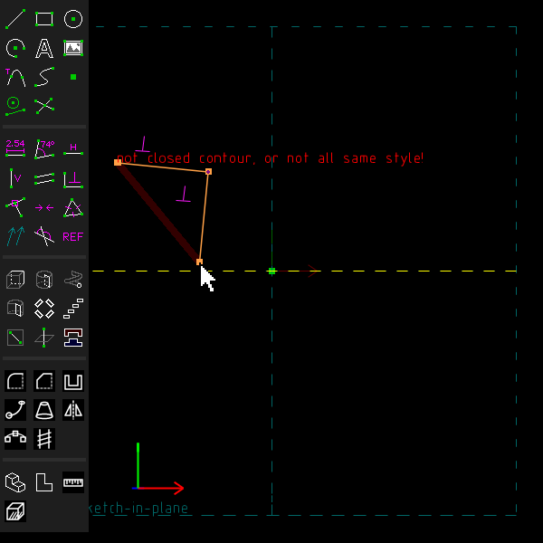
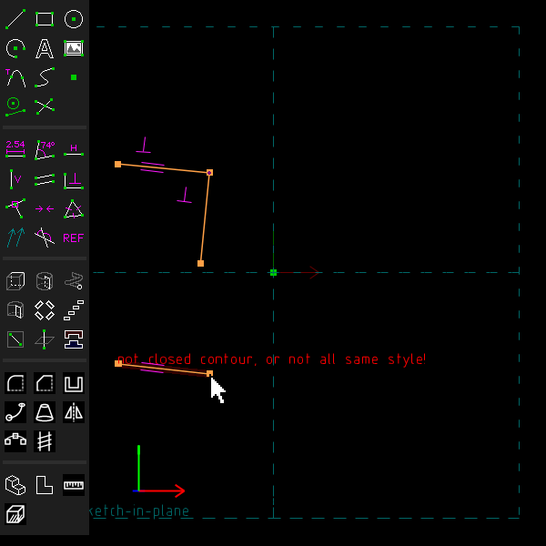
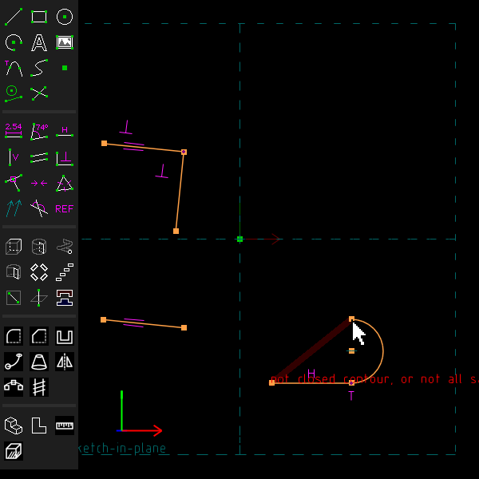

# Constraints while drawing

Example: [`examples/scripts/autoconstrain`](../../examples/scripts/autoconstrain/autoconstrain.go),
which draws a slot of two lines and two arcs, and a ring of circles, roughly, and lets the
constraints the window would add square them up.

## Step by step

Draw two lines square to each other, a third parallel to the first, and an arc tangent to a
line:

1. Press S for a line segment. Click its start, then click its end a little off horizontal.
   Move the mouse to where the second line should end, nearly square to the first. Both lines
   show the perpendicular sign: the constraint that will be added. Click to place the point,
   then press Esc.

   

2. Press S again and draw a line at nearly the same angle as the first. The two lines show the
   parallel sign, and the line is made parallel when you click its end.

   

3. Draw a line, press Esc, then press A for an arc. Click the line's end, and move the arc's
   other end so that the line between the arc's ends is square to the line. The arc shows the
   tangent sign, and is made tangent when you click.

   

These pictures are made by [`scenarios/drawing.scenario`](scenarios/drawing.scenario).

## What is offered

SolveSpace makes a line horizontal or vertical when you draw it nearly so. TeleSAPR offers more
constraints while you draw. It tries them in this order and offers the first that fits.

While you draw a line segment in a workplane:

- **tangent** to an arc the line starts on, when the line leaves along the arc's tangent;
- **perpendicular** to a line it starts on, when it is nearly square to that line;
- **parallel** to another line of the sketch, the nearest one, when it is nearly parallel;
- **equal length** to another line, when it is within one percent of that line's length.

While you draw an arc in a workplane:

- **tangent** at either end to a line or another arc that ends there, when the arc leaves along
  it. An arc is drawn as a half circle on the line between its ends. So this happens when that
  line is square to the line the arc starts from;
- otherwise the **same radius** as an arc or a circle of the sketch, the nearest in size, when
  it is within one percent.

While you draw a circle: the **same radius** as an arc or a circle, as for arcs.

The constraint that would be added is drawn on the entity as it follows the mouse. It is added
when you place the point, unless it would be redundant. "Nearly" means within about one degree,
the same as for horizontal and vertical. Hold Ctrl while drawing to get no offers. The setting
"enable automatic line constraints" on the configuration screen turns all of them off.

From a script, `Constrain.Auto` adds to a line, an arc or a circle of the active group what the
window would add when it is placed. It says whether it added one:

```go
c := doc.Sketch.Circle(V(30, 0, 0), 8.03)
if con, ok := doc.Constrain.Auto(c); ok {
	fmt.Println(con) // c004-eq-radius
}
```

## Not yet

Cubic splines, points and text get no offers. A line or an arc that ends on the middle of
another entity is not made tangent or perpendicular there. A circle is not made tangent to a
line.
