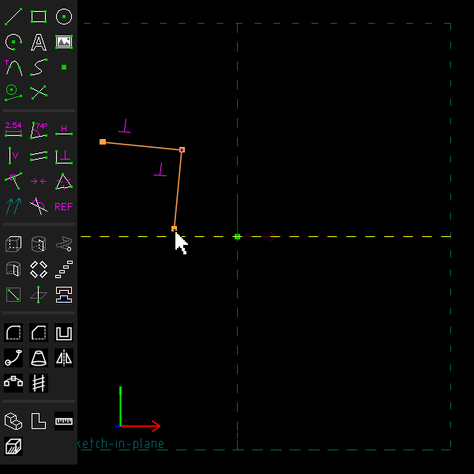
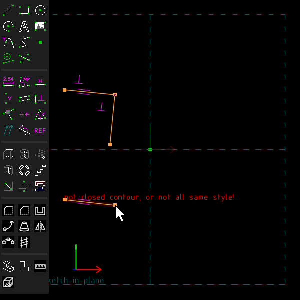
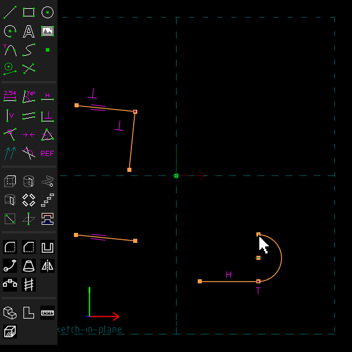

# Constraints while drawing

Example: [`examples/scripts/autoconstrain`](../../examples/scripts/autoconstrain/autoconstrain.go),
which draws a slot of two lines and two arcs, and a ring of circles, roughly, and lets the
constraints the window would add square them up.

## Step by step

Draw two lines square to each other, a third parallel to the first, and an arc tangent to a
line:

1. Press S for a line segment. Click its start, then click its end a little off horizontal.
   Move the mouse to where the second line should end, nearly square to the first. Both lines
   show the perpendicular sign: the constraint that will be added. Click to place the point,
   then press Esc.

   

2. Press S again and draw a line at nearly the same angle as the first. The two lines show the
   parallel sign, and the line is made parallel when you click its end.

   

3. Draw a line, press Esc, then press A for an arc. Click the line's end, and move the arc's
   other end so that the line between the arc's ends is square to the line. The arc shows the
   tangent sign, and is made tangent when you click.

   

These pictures are made by [`scenarios/drawing.scenario`](scenarios/drawing.scenario).

## What is offered

SolveSpace makes a line horizontal or vertical when you draw it nearly so. TeleSAPR offers more
constraints while you draw in a workplane. It tries them in this order and offers the first
that fits:

| Drawing | Offered | When |
|---|---|---|
| a line segment | tangent to the arc it starts on | it leaves along the arc's tangent |
| | perpendicular to the line it starts on | it is nearly square to that line |
| | parallel to the nearest line of the sketch | it is nearly parallel to it |
| | equal length to another line | its length is within one percent of that line's |
| an arc | tangent, at either end, to a line or an arc that ends there | it leaves along it |
| | the same radius as the nearest-sized arc or circle | its radius is within one percent |
| a circle | the same radius as an arc or a circle | as for an arc |

An arc is drawn as a half circle on the line between its ends. So it is tangent to the line it
starts from when that line between its ends is square to the line.

- The constraint on offer is drawn on the entity as it follows the mouse. It is added when you
  place the point, unless it would be redundant.
- "Nearly" means within about one degree, as for horizontal and vertical.
- Hold Ctrl while drawing to get no offers.
- The setting "enable automatic line constraints" on the configuration screen (Edit >
  Preferences) turns them all off.

## From a script

`Constrain.Auto` adds to a line, an arc or a circle of the active group what the
window would add when it is placed. It says whether it added one:

```go
c := doc.Sketch.Circle(V(30, 0, 0), 8.03)
if con, ok := doc.Constrain.Auto(c); ok {
	fmt.Println(con) // c004-eq-radius
}
```

## Not yet

- Cubic splines, points and text get no offers.
- A line or an arc that ends on the middle of another entity is not made tangent or
  perpendicular there.
- A circle is not made tangent to a line.
