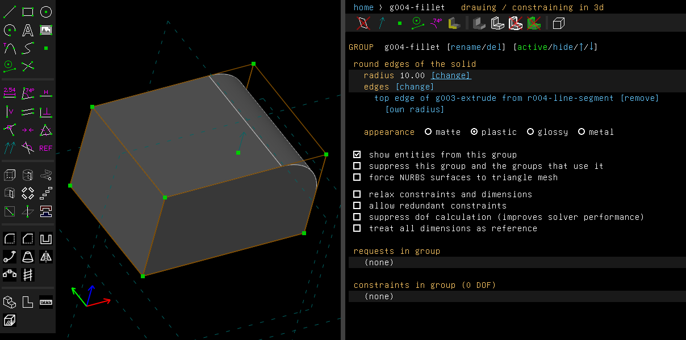
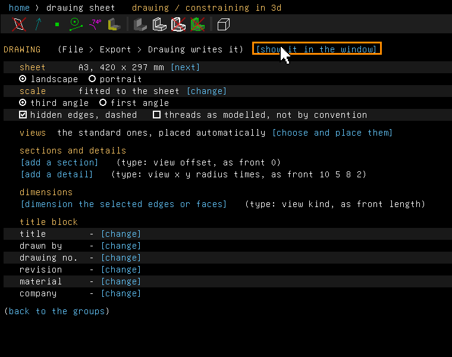
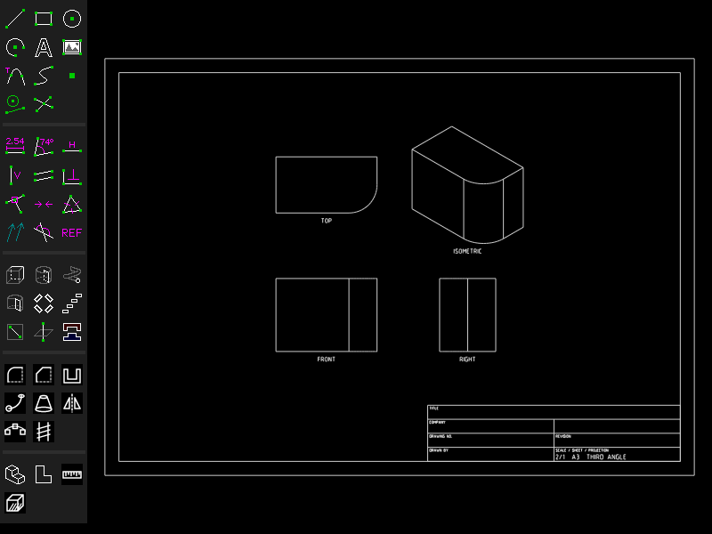
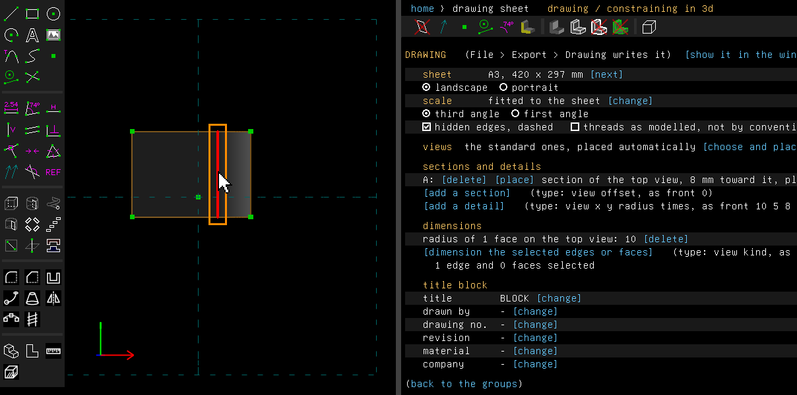
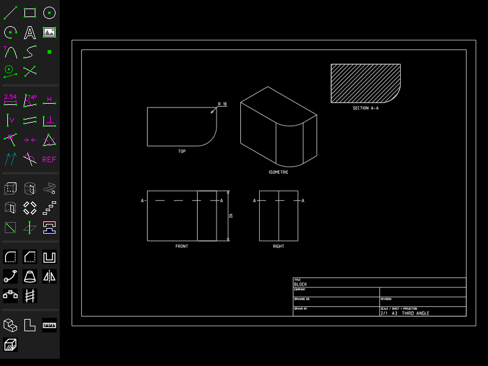

# Drawings

Example: [`examples/scripts/drawing`](../../examples/scripts/drawing/drawing.go), an L-shaped
bracket and its drawing on an A3 sheet.

A drawing is a sheet of paper with views of the solid of the active group: front, top, a side
view and an isometric view. The views are placed as the projection puts them, at one scale, in a
frame with a title block. The drawing is part of the model and is saved with it. Each time the
sheet is written, the views are made from the solid again, so the drawing follows the model.

## Step by step

Draw a block with one rounded edge, then give it a drawing with a section and two dimensions:

1. Press R and click two corners for a rectangle, press Esc, then Shift+X to extrude it. Click
   the rectangle's right edge, choose Features > Fillet Edges, and set the radius to 10 (see
   [Fillets](fillet.md)).

   

2. Choose View > Drawing Sheet. The property browser shows the drawing's screen. Click
   `[show it in the window]`.

   

3. The window now shows the sheet beside the toolbar: A3, fitted, third angle, with the top,
   front, right and isometric views and the title block. The scale is 2:1, the largest at which
   the views fit; the title block writes it 2/1.

   

4. Click `[change]` beside **title** and type BLOCK. Click `[add a section]` and type `top 8`:
   a section through the top view, 8 mm toward the viewer from the middle.
5. While the sheet is shown, the mouse picks nothing in the model. Click `[show the model]`.
   Click the rounded face, then `[dimension the selected edges or faces]`, and type
   `top radius`. Click the edge where the rounded face meets the top. The screen counts it as
   "1 edge and 0 faces selected". Click `[dimension the selected edges or faces]` again and type
   `front length 12`, which draws the dimension 12 mm out from the edge.

   

6. Click `[show it in the window]` again. The sheet has the title, SECTION A-A with its cut face
   hatched beside the views, R 10 on the top view and 26 on the front view. The cutting plane is
   drawn dashed across the front and right views, with an A past each end, clear of the
   dimension and of the views' names.

   

These pictures are made by [`scenarios/drawings.scenario`](scenarios/drawings.scenario).

## The drawing's screen

View > Drawing Sheet opens the drawing's screen in the property browser. It has these rows:

- **sheet**: A4 up to A0, Letter or Tabloid, in landscape or portrait. `[next]` steps through
  the sizes.
- **scale**: "fitted to the sheet" to begin with. That is the largest of 10:1, 5:1, 2:1, 1:1,
  1:2, 1:5 and so on down at which the views, and the sections and details placed beside them,
  fit above the title block. Or type one with
  `[change]`, as `1:2`, `2:1` or a plain number.
- **projection**: third angle (the top view above the front view, the right view on its right),
  or first angle as ISO has it (the top view below, the left view on the right).
- **hidden edges, dashed**: draws the edges behind the material, dashed, in the orthographic
  views.
- **threads as modelled, not by convention**: how a screw thread (Features > Screw Thread) is
  drawn. Unticked, the thread is drawn the way drafting convention shows it. Ticked, the ridge is
  drawn turn by turn. In a script this is `d.ModelledThreads`.
- **views**: the standard views, placed automatically. `[choose and place them]` lets you tick
  which views the sheet shows and `[move]` each one. `[back to the standard ones]` undoes that.
- **sections and details**, see below.
- **dimensions**, see below.
- the **title block**: title, drawn by, drawing no., revision, material and company. The scale,
  sheet and projection are filled in for you.

### How a thread is drawn by convention

A thread drawn by convention is a plain cylinder at its crest, with solid lines at its ends. Its
root is drawn in thin lines along it in a view across the axis or at a slant to it. With a
run-out, a solid line marks where the full thread ends, and the root's lines slant out from there
to the crest. In a view along the axis, three quarters of a thin circle shows the root. A nut's
root is inside the part, so it is hidden like any edge behind material. What another group cut
into the thread, as a hole across it, is drawn on the crest's cylinder. In a section, the cut
face reaches the crest and is hatched up to it, with the root a thin line on it.

### Sections and details

- `[add a section]` asks for a view and an offset, as `top 0`. The solid is cut by the plane
  square to that view's direction, through the solid's middle, moved the offset in mm toward the
  viewer. The half beyond the plane is drawn, with its cut face hatched every 3 mm on the sheet.
  It is labelled SECTION A-A. The cutting plane is drawn dashed and lettered on the views that
  see it edge on: a letter past each end of the line, or beside the end when a dimension's text
  is there. A view's name that a letter or a dimension would cover is moved down below it.
- `[add a detail]` asks for a view, the point it enlarges (in mm right and up from the view's
  middle), a radius and how many times larger, as `front 10 5 8 2`. What lies within that circle
  is drawn enlarged, inside a circle, labelled DETAIL B with its scale. The circle is drawn
  dashed and lettered on the view.

Sections and details are lettered A, B, ... in the order they were added. They are placed in
columns to the right of the views, unless `[place]` on their row, or a script's `X` and `Y`,
gives them a place. `[delete]` on a row takes one away.

### Dimensions

With the drawing's screen shown, select one or two edges or faces of the solid in the model.
The screen stays open and counts what is selected. Where a line of a sketch lies along an
edge, a click picks the line, which the count leaves out: click the edge where no line is
drawn, or pick a face. Then click `[dimension the selected edges or faces]` and type the view
and the kind, as `front length`, or `front distance 15` with how far out the dimension is
drawn, in mm. Without that number it is drawn on what it measures. The view is front, back,
top, bottom, left, right or iso, or a section or a detail by its letter, as `A diameter`.

A dimension keeps the edges' names and the faces' identities. Each time the drawing is made it
finds them in the solid as it now is and measures them. The kinds are:

- **length** of a straight edge, as seen in the view. On the isometric view it is the edge's
  own length, not the foreshortened one. An edge inside the view's outline has its dimension
  drawn out past the outline: in an orthographic view out from the view's middle, in the
  isometric on whichever side the outline is nearer.
- **distance** from a straight edge to another edge, square to the first, as the view shows it.
  With faces: between two parallel flat faces, or from a straight edge to a flat face it runs
  parallel to. It is drawn out to the side of what it measures.
- **diameter** (DIA) or **radius** (R) of a circular edge, or of a face's largest circular
  edge, as a hole's wall or a cylinder's end. It has a leader when the circle faces the view,
  and is drawn across the circle when it is seen edge on.

The screen lists each dimension with what it measures now. A dimension whose edge or face is
gone, is seen end on or at a slant, lies outside its detail, or is between faces that are not
parallel, says why and is not drawn.

## Seeing the sheet in the window

View > Show Drawing Sheet, or `[show it in the window]` on the drawing's screen, shows the sheet
in the window in place of the model, fitted to it. Choose it again, or `[show the model]`, to go
back. The sheet follows each change made on the drawing's screen and to the model. While it is
shown, the mouse picks nothing in the model. This is a view setting, not saved with the file.
From a script, `doc.Drawing.Show(true)` shows it, and `doc.File.Render(path, w, h, "window")`
takes a picture of it.

## Writing the sheet to a file

File > Export > Drawing writes the sheet as PDF, EPS or PostScript, SVG, DXF, HPGL (`.plt`) or
G-code (`.ngc`). The canvas is the sheet's size in millimetres. Lines are weighted as the 0.35 mm
group of ISO 128 has them: the views' visible edges at 0.35 mm, the frame at 0.5 mm, and
0.18 mm for a thread's root, hidden edges, hatching, dimensions, text and the title block's rows.

Without a window:

    telesapr-cli export-drawing -o sheet.pdf model.tlspr

## From a script

```go
d := doc.Drawing.Get()
d.Sheet, d.Scale, d.FirstAngle = "A2", 0.5, true
d.Title, d.Number = "BRACKET", "TS-0001"
doc.Drawing.Set(d)
must(doc.Drawing.Export("bracket.pdf"))   // in the application
```

- `doc.Drawing.AddDimension("front", "length", 10, edge)` adds a dimension by edges of the
  solid.
- `doc.Drawing.AddFaceDimension("top", "distance", 10, upper, lower)` adds one by faces.
- `doc.Drawing.AddEdgeFaceDistance("top", 10, edge, face)` adds the distance from an edge to a
  face.
- `doc.Drawing.Dimensions()` measures them all.
- `d.Sections` and `d.Details` hold the section and detail views.
- `d.Views` places views where you want them, each by its kind and the sheet position of its
  middle, in millimetres from the bottom left. Left empty, the standard views are placed for you.

The example [`examples/scripts/drawing`](../../examples/scripts/drawing/drawing.go) dimensions
faces and the isometric view.

## Not yet

- Dimensions of vertices or angles, and between curved faces, are not done. A distance from a
  face to a curved edge is refused.
- A section's far half is drawn with hidden edges as the drawing has them. A section is always
  of the whole solid: there is no broken-out or offset section.
- The text is the vector font's, which has no colon. The title block writes a scale of 1:2 as
  1/2.
