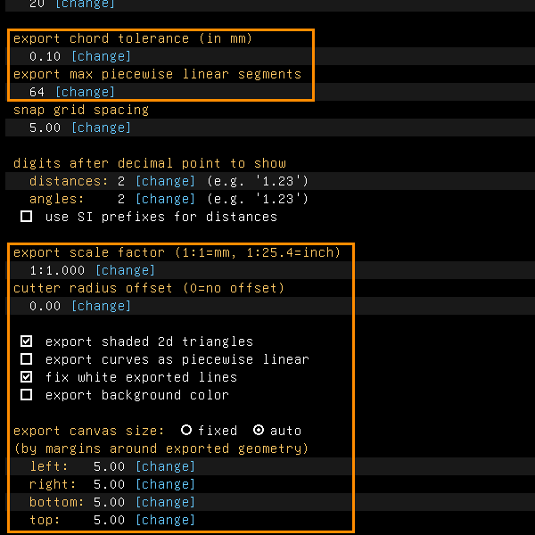

# Export and import

Examples: [`examples/scripts/meshquality`](../../examples/scripts/meshquality/meshquality.go),
a cylinder exported as a fine, strictly checked STL;
[`dxfsection`](../../examples/scripts/dxfsection/dxfsection.go), a plate imported from a DXF
file, extruded, and its section written to SVG; [`gltf`](../../examples/scripts/gltf) for glTF;
[`exportscript`](../../examples/scripts/exportscript) for a model written as a script
([Scripts](scripts.md)).

## Export

File > Export has one entry for each kind of file:

| Entry | Formats | Script |
|---|---|---|
| Image | `.png` | `File.Render(path, w, h, view)` |
| 2d View | `.pdf`, `.eps`, `.svg`, `.dxf`, `.plt`, `.ngc` | `File.Export` |
| 2d Section | the same | `File.ExportSection` |
| 3d Wireframe | `.step`, `.dxf` | `File.ExportAs(ExportWireframe, …)` |
| Triangle Mesh | `.stl`, `.3mf`, `.glb`, `.obj`, `.html`, `.js`, `.wrl` | `File.Export` |
| Surfaces | `.step` | `File.Export` |
| Script | `.go` | `File.ExportScript` |
| Drawing | as 2d View | see [Drawings](drawings.md) |

`File.Export` tells from the extension what to write. Every export is of the model as it is at
the active group.

### Mesh quality

A triangle mesh follows the curved faces only so closely. Triangle Mesh asks for three settings
that say how closely, and offers them as presets:

| Preset | Chord tolerance | Angular tolerance | Segments per curve |
|---|---|---|---|
| draft | 0.5 mm | none | 32 |
| standard (default) | 0.1 mm | none | 64 |
| fine | 0.02 mm | 10° | 256 |

The chord tolerance is how far a facet may stray from the true surface. The angular tolerance
bounds the turn between neighbouring facets, so small radii are followed as closely as large
ones. **Strict** refuses to write a mesh that has naked edges or self-intersections. Without it,
such a mesh is written with a warning. Facets of no area are left out.

In the window, File > Export > Triangle Mesh first shows a dialog, Export Triangle Mesh. It has
**Quality** (Draft, Standard, Fine or Custom), **Chord tolerance** in mm, **Angular tolerance**
in degrees (0 for none), **Max linear segments**, and the check box **Refuse a mesh that isn't
watertight or crosses itself**, which is Strict. Choosing a quality fills in the three values;
changing a value by hand makes it Custom. **Export...** then asks for the file, and **Cancel**
writes nothing. The dialog keeps what you chose for the next export. The chord tolerance and the
segments are also on the preferences screen (below).

```go
doc.File.SetMeshQuality(api.MeshFine)
o := doc.File.ExportOptions()
o.StrictMesh = true
doc.File.SetExportOptions(o)
doc.File.Export("part.stl")
```

A `.glb` file carries each face's colour, with lengths in metres ([Appearance](appearance.md)).

### 2d Section

2d Section writes the outline where a plane cuts the solid. In the window, the plane comes from
what is selected:

- nothing selected: the active workplane;
- a face: the plane through that face;
- a point and two line segments: the plane through the point, parallel to the lines.

From a script, `File.ExportSection` uses the section view's plane when the section view is on
([Section view](section-view.md)), and otherwise the active workplane. A plane that misses the
solid writes nothing and says so.

The scale, page size and margins of the 2d exports are set on the preferences screen: Edit >
Preferences, or **configuration** on the home screen of the property browser. From a script
they are `ExportOptions`'s `Scale`, `Canvas` and `Margin`.



The upper box holds the mesh's chord tolerance and segments, as the Triangle Mesh dialog sets
them. The lower one holds the 2d exports' settings: the scale factor, the cutter radius offset,
whether shaded triangles are written, whether curves are written as straight pieces, whether
white lines are written black, whether the background is written, and the canvas, fixed or sized
by margins round what is exported. Each value is
changed with its `[change]`. Below them are the depth, passes and feeds of G-code.

This picture is made by [`scenarios/export-import.scenario`](scenarios/export-import.scenario).

## Import

File > Import takes a DXF file into the active group's workplane. When the file has entities off
its XY plane, they come in as construction entities in 3d. Entities of kinds it doesn't know are
left out and counted. Choosing a `.dwg` file says that DWG is not supported, so save the drawing
as DXF first.

Edit > Rotate Imported 90° turns a linked part a quarter turn (`AsLink().Rotate90` in a script).

SolveSpace's `.slvs` files are imported as new `.tlspr` models. Importing one replaces the model
you have open.

```go
ignored, err := doc.File.ImportDXF("plate.dxf")
```

STEP, STL and OBJ files are linked rather than imported: see [STEP links](step-links.md).

## The command line

`telesapr-cli` exports without a window. Its commands are `thumbnail`, `export-view`,
`export-section`, `export-wireframe`, `export-mesh`, `export-surfaces`, `export-drawing` and
`export-script`, and `convert` for `.slvs` files. Some flags:

- `--group` exports the model up to a group (every export command but `export-drawing`);
- `export-mesh` takes `--quality draft|standard|fine`, `--angle-tol`, `--max-segments` and
  `--strict`;
- `export-section --plane z=15` cuts square to an axis, or `--plane x,y,z,nx,ny,nz` through a
  point with a normal.

`telesapr-cli --help` lists them all.

    telesapr-cli export-mesh --quality fine --strict --output part.stl part.tlspr
    telesapr-cli export-section --plane z=5 --output cut.svg part.tlspr

## Not yet

DXF is the only 2d format imported. A STEP file can't be imported as editable geometry.
