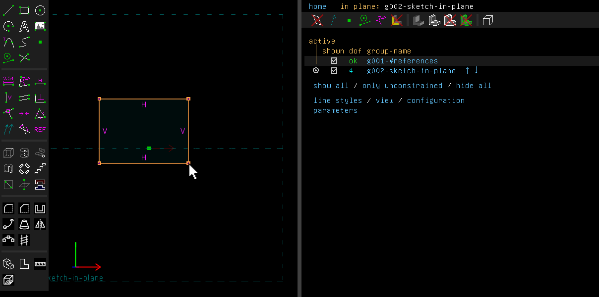
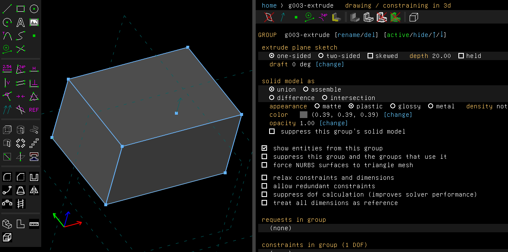
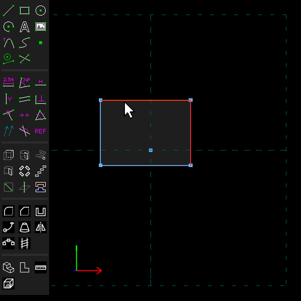
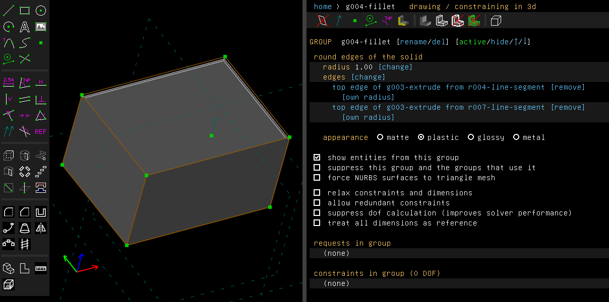
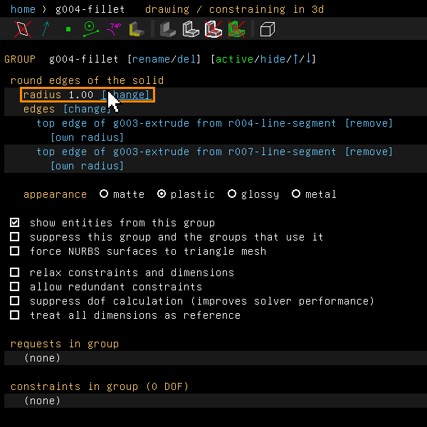
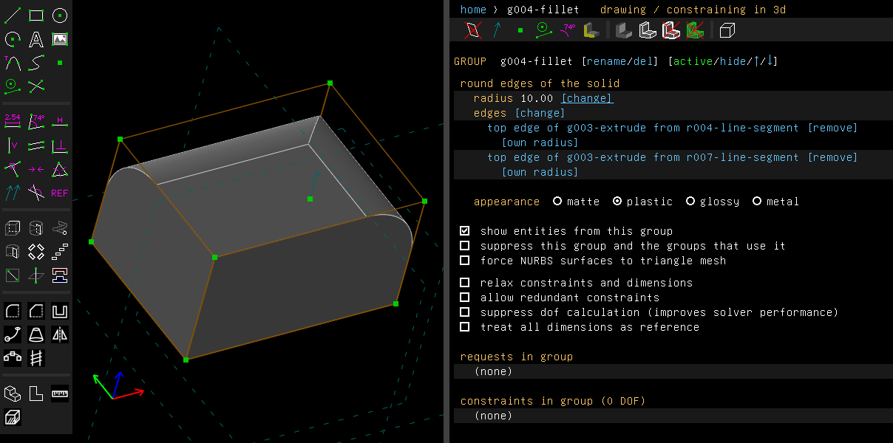
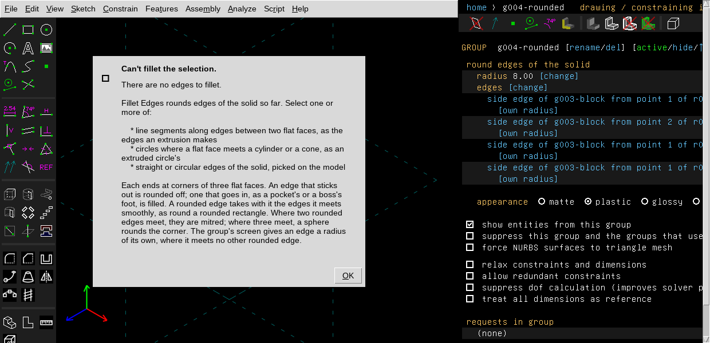

# Fillet

A fillet rounds an edge. A convex edge (one that sticks out) is rounded off. A concave edge
(one that goes in, like the floor of a pocket or the foot of a boss) is filled in.

Examples:

- [`examples/scripts/fillet`](../../examples/scripts/fillet/fillet.go): a block with its upright
  edges rounded.
- [`roundbox`](../../examples/scripts/roundbox), [`tray`](../../examples/scripts/tray),
  [`ramp`](../../examples/scripts/ramp), [`plinth`](../../examples/scripts/plinth),
  [`spinner`](../../examples/scripts/spinner) and [`rib`](../../examples/scripts/rib): corners,
  filled edges, and edges with a radius of their own.
- [`soap`](../../examples/scripts/soap): a rim rounded all the way round.
- [`knob`](../../examples/scripts/knob): a fillet beside a chamfer.
- [`casing`](../../examples/scripts/casing): two radii in one fillet.

## Step by step

Round two top edges of a block. The video shows the steps below from start to end:

<video src="videos/fillet-edges.webm" controls muted loop playsinline style="width:100%"></video>

([fillet-edges.webm](videos/fillet-edges.webm), where the page shows no video.)

1. Press R for a rectangle and click two corners.

   

2. Press Esc, then Shift+X to extrude it. The left-hand window is the model, the right-hand
   one the property browser, which shows the new group.

   

3. Click the two edges to round. They are drawn in red when selected.

   

4. Choose Features > Fillet Edges. The edges are rounded at 1 mm, mitred where they meet, and
   the property browser lists them.

   

5. Click "[change]" beside the radius and type a new one, here 10.

   

   

These pictures are made by [`scenarios/fillet.scenario`](scenarios/fillet.scenario), which
replays the same clicks on the program (`scripts/regen-doc-images.sh`).

## In the window

Choose Features > Fillet Edges (Shift+F). It rounds edges of the solid built so far. The radius
starts at 1 mm. Select the same kind of things as for a chamfer:

- line segments that lie along edges between two flat faces;
- circles where a flat face meets a cylinder or a cone, or where a cylinder and a cone, or two
  cones, meet about one axis, such as a frustum turned on a shaft;
- straight or circular edges of the solid, picked on the model.

With nothing it can round selected, it says what it takes:



The radius takes a number or an expression. A radius too large for the faces is a problem on
the group, named on its screen, and the solid passes through unrounded. So is a fillet whose
result would not be a closed solid where the solid before it was one: the message says the
rounded solid would not be closed and to make it a little smaller or larger.

The group's screen lists the edges. Under each edge, "[own radius]" gives that edge a radius of
its own, and "[remove]" takes the edge out of the fillet. "[change]" beside the list takes the
current selection as the fillet's edges instead. With nothing suitable selected, it activates
the group before the fillet, whose solid the edges are rounded on, says what to pick, and the
link reads "[take the selection]" until you do. An edge's own radius stays with it through such
a change.

From a script:

```go
f := doc.Features.Fillet(edges, 8, "")
f.AsFillet().SetRadius(6)
f.AsFillet().SetEdgeRadius(1, 3) // the second edge alone
doc.Features.FilletSolid([]api.SolidEdge{s.EdgeAt(api.V(15, 0, 5))}, 1.5, "")
```

## What it makes

- A convex edge is rounded by an exact cylinder, or by a torus round a circle. A concave edge
  is filled.
- A circle's fillet whose foot reaches past the flat face it lies on, as round a rod through a
  narrow plate, is cut by the planes of the face's flat sides it runs into, and those sides grow
  up by its sections. Where the foot just reaches a side, the face is pinched to a point there,
  two faces touching. A fillet whose foot runs past a side by less than about a hundredth of its
  radius stands above the face there by less than the program can tell apart, so it is made at
  the nearest size that the program can cut and that is within the chord tolerance of the one
  asked for, and says so: the group is marked "(note)" in the list of groups, and its screen,
  and `Group.Note()` in a script, say "made at radius 2 mm, the nearest the kernel can cut
  to 2.001 mm". At a chord tolerance too fine for that it is refused (make it a little smaller
  or larger). One is refused where the solid goes on beyond the side.
- A rounded edge takes with it the edges it meets smoothly, as round a rounded rectangle.
- Where two rounded edges meet, they are mitred. Where three meet at the corner of a block, a
  sphere rounds the corner.
- The foot of a rib or a boss with sharp edges can be filled all round. Where two of the foot's
  fillets meet below a sharp convex edge, they are mitred outside the rib, beyond that edge.
  Where they turn by different angles, as below a sloping top, the sloping face grows out to the
  mitre. The sharp edge is shortened to where the fillets reach up it.
- A rib's top edges can be rounded after its foot was filled, in a fillet of their own. Where an
  upright or a slope's edge runs down onto the foot's fillets, its fillet is cut short (set
  back), the foot's two fillets are cut at their sections too, and patches tangent to the three
  fillets, the two faces and the floor fill the corner: the setback corner below of the three
  edges that met there before the foot was filled. OpenCASCADE fills those corners with smaller
  patches: its top's fillets take 1.4 r³ to 4.8 r³ less in all, the most where a low slope meets
  the floor at a sharp angle. The foot's fillets must be straight, of one radius between flat
  faces; a chamfered foot is not taken.

**Edges of different radii, or of both kinds.** Where edges of different radii meet, or convex
edges meet concave ones, the fillet rounds them one radius and one kind at a time, the larger
radius first. The later edges go on round the corners the earlier ones rounded. For example, a
block's upright edges at 8 mm and its top edges at 3 mm: the top's fillet follows the arcs the
upright fillets cut in the top face, with a torus at each. A boss's sides and the foot that joins
it to a plate work the same way.

**Setback corners.** Sometimes the later edges can't go on round the corner: a top ring larger
than the upright edges, three edges of three radii at a corner, or more than three rounded edges
at a corner (a pyramid's apex). Then each fillet is cut short of the corner (set back), and the
hole is filled by patches tangent to the fillets and the faces round it. The setback is half the
largest radius past where the fillets' tangent lines cross. Corners with radii up to about 3 to 1
are always filled. Where radii of 5 or 6 to 1 sit side by side, the patches can fold, and the
corner is refused at its point. Example:
[`examples/scripts/setback`](../../examples/scripts/setback/setback.go).

**A convex and a concave edge meeting, the third edge left sharp.** Take a ledge's top edge with
the inside upright below it, or a rib's upright with one of its foot edges. The two fillets are
blended there by one patch, tangent to both fillets and the face, and the sharp edge ends in its
corner. Where one fillet's radius is several times how far the other reaches along the face, the
patch would fold, and the corner is refused at its point.

**All three rounded, two of one kind with different radii.** For example, a ledge's two top
edges at 1 and 2 mm over the inside upright, or a rib's two foot edges under its upright. The
edge of the other kind is rounded first. The two then go on round the arc it leaves, with a
radius that changes from one's to the other's along it, tangent all round.

**Four or more edges of both kinds at a corner.** Take the middle of a saddle, where two ridges
and two valleys meet, all rounded. Each fillet is set back and the hole is filled by patches,
as at a corner of three radii.

Round three of the saddle's four edges and leave the fourth sharp, and the two fillets beside
the sharp edge run up to it and are cut there, the third is set back, and patches fill the
hole, their surface turning from one fillet to the other where the sharp edge ends. Where the
two fillets beside the sharp edge have different radii they reach it at two points: the
smaller one stops short of the edge, its face runs on beside the edge up to where the larger
one reaches it, and the patches fill the rest. Steep saddles are made too.
Chamfers of three of the four edges are cut the same way: the two beside the sharp edge are
cut up to it, the third is set back, and curved patches fill the corner between them. A
steep saddle chamfered at one distance is cut in two goes, the ridges and the valleys apart.

Round one of the saddle's four edges alone and its fillet runs on into the two faces across the
middle, ending where its surface meets their planes, as a fillet ends on the face at a box's
corner. Round its two ridges, or its two valleys, with the other two left sharp, and the two
fillets meet in a mitre in the plane of the two sharp edges. At different radii their ends lie
apart in that plane, and the plane between them is a flat step from the smaller fillet's end to
the larger's (OpenCASCADE blends the two instead, with a curved patch). Chamfers are cut the same
way.
Round a ridge and a valley side by side, with the other two left sharp, and each fillet runs
up to the sharp edge beside it; patches fill the corner between the two cuts and the sharp
edges, which stay sharp. Chamfers are cut the same way.

**Refused.** Two top edges of different radii over an upright edge that stays sharp are refused,
and the message names the radii: the blend would need a crease. Round the upright edge too, or
give the two edges one radius.

## Between two curved faces

Two curved faces can meet along an edge that is not a circle about a shared axis: a branch pipe
on a pipe, a spout on a pot, a rod through a ball, a band's side on a cone. There the fillet
rolls a ball of its radius along the edge, touching both faces. The rounded face is the surface
the ball sweeps. It is fitted through the ball's arcs to within a tenth of the chord tolerance
(how far a mesh may stray from the true surface, set on the configuration screen). The faces
are cut back along the curves where the ball touches them. A chamfer is made the same way, with
straight sections between the points at its distance along each face from the edge.

Such an edge, and an edge that ends on a curved face (below), is rounded on its own. When it is
picked together with other edges whose fillets don't reach it, the others are rounded first,
then each such edge alone. A lid's four upright edges picked together are done this way. Where
its fillet meets another picked edge's fillet at a corner whose third edge stays sharp, as a lid's
upright edge meets the bottom edge, the two are mitred there, chamfers the same as fillets.
Fillets of different radii are mitred too: the smaller ends against the larger on its own wall,
and the larger's end turns there onto that wall, down to the corner, at each of its ends,
whatever the radii beyond. Chamfers of different distances are mitred alike. Any other meeting
at a vertex the two share is refused there, with the message "pick it alone".

An edge along a crease that fades out, as a loft's crease from a corner of its square foot up to
where its sides meet smoothly, is rounded or chamfered up to where its faces turn by almost
nothing, and ends there. Where the crease turns back above that, its faces meeting at an angle
the other way, that part is rounded too, by a fillet that widens from nothing where the first
ended and narrows to nothing where the crease fades out again; where it only fades out, the edge
goes on above as it is.

**Where the edge ends.** The edge may close on itself, as such joints do. Or it may end where it
meets a flat face at each end, as a band's side on a cone ends at the base and at the band's end.
There the fillet ends in the flat face's plane, along the curve where that plane cuts the ball's
swept surface, and the flat face takes that curve as its edge. Where one of the faces goes on
past the flat face's plane (the cone above the band's end), the flat face grows by the fillet's
section up to where the plane cuts that face.

The fillet's end may run off one face past the end of its edge with the flat face, as a wide
chamfer of the band's side does past the band's top. If the face it runs onto is flat, the fillet
goes on to that face: its plane cuts the fillet too, and both the end face and that face grow by
the fillet's end. If the face it runs onto is curved, as a band's rounded top, that surface is
carried on past its edge with the face the fillet ran off, it cuts the fillet, and it grows over
the fillet's end, sharing with the end face the line or curve where the end face's plane meets
that surface, or where the end face's own surface meets it when that is curved too. Where the fillet's end only just runs off onto a curved face, within two chord
tolerances of its edge, the end is taken to that edge's corner, so the face doesn't grow by a
sliver too thin to mesh.

Both ends may run off this way, as a chamfer of a short plate's foot on a rod does past both
slopes of the plate's gabled top. Each end cuts the fillet on its own; where the two cuts would
fall on one piece of the fillet's surface, that surface is split between them first. Where the
fillet is so large that it reaches over the plate's side all along, above one slope or the other,
it takes the side whole: both slopes cut it, meeting across it on the line of the ridge carried
on, each slope grows over the fillet up to that line, and the side goes. This holds however large
the blend: where an end's section reaches above the far slope carried on past the ridge, it is
above the near slope there too, which cuts that part away.

The fillet is refused at the place in these cases:

- the ball can't touch both faces (the radius is too large for the room beside a hole);
- the fillet's end runs off both faces;
- a fillet that takes material away runs off onto the next face.

**A curved end face.** The end face may be curved too, as a box's upright edge between flat walls
ends at the top on a domed lid. The ball's sweep is cut by the dome, and the fillet's end is a
curve of degree 5 fitted to where the two meet, the dome's edge as well, keeping to both within
half the chord tolerance. Where the dome bends too much across a wide fillet for one such curve,
the fillet is refused at the place with "make it smaller". A chamfer ends on a curved face the
same way, its end fitted to where it meets it. So does a chamfer of a loft's foot edge where the
sides meet in creases. Where a side's face goes on past the curved face, as the cone past a
band's rounded top, the curved face grows by the fillet's end up to where the side's face meets
its surface carried on, as a flat end face does. A chamfer ending this way is refused where its
end can't be fitted.

Examples: [`examples/scripts/tee`](../../examples/scripts/tee/tee.go),
[`examples/scripts/bandfillet`](../../examples/scripts/bandfillet/bandfillet.go).

## Not yet

These are refused with a message:

- A fillet between curved faces along an edge that ends at a curved face which the side faces go
  on past.
- Chamfers meeting above an edge left sharp that they would cut at two points, or at a corner
  where their distances are too unlike for a face to close it ([Chamfer](chamfer.md) says what
  is made).
- A corner where a convex edge meets a concave one at a vertex that the stages can't round while
  some edge there is left sharp, but for one, two opposite or three of a saddle's four edges as
  above, fillets or chamfers, and a ridge and a valley side by side.
- A blend that takes material away and runs off onto the next face, and a chamfer whose end
  runs off both its faces onto the next one (the end lies wholly past the next face).

Also:

- A fillet whose radius stops its chain at a rounded corner names the curved face in its message
  rather than saying that the radius is the problem.
