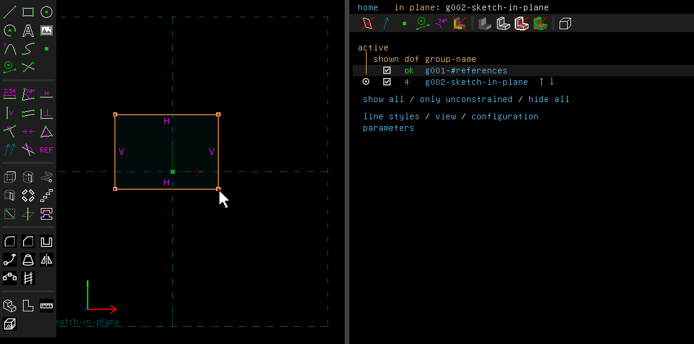
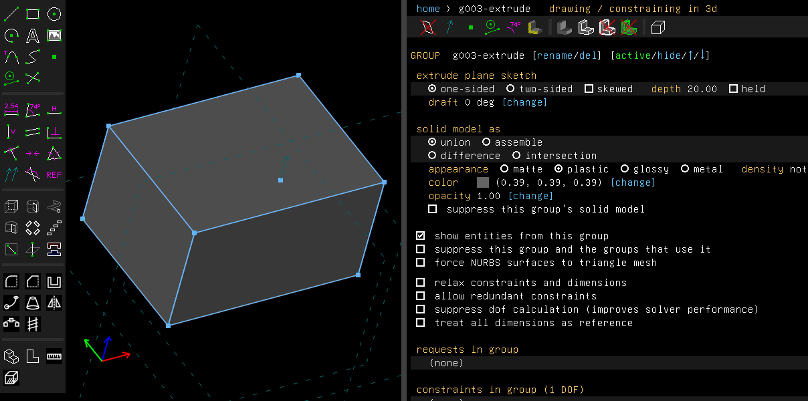
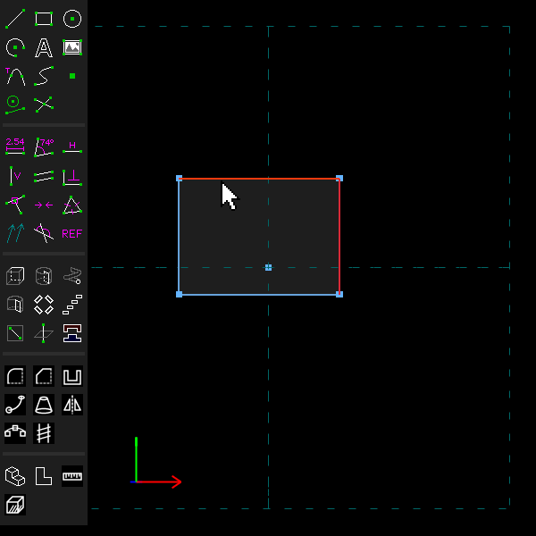
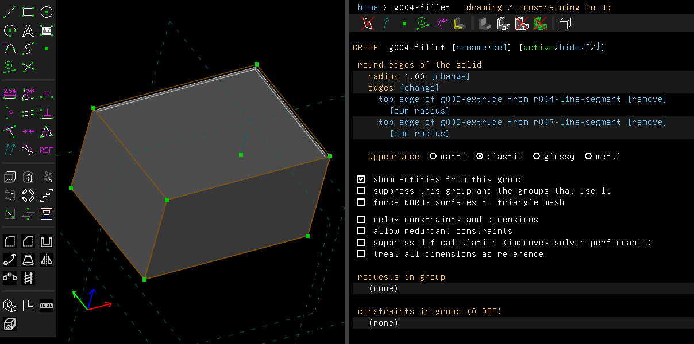
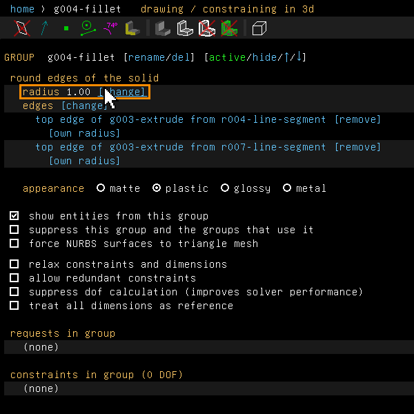
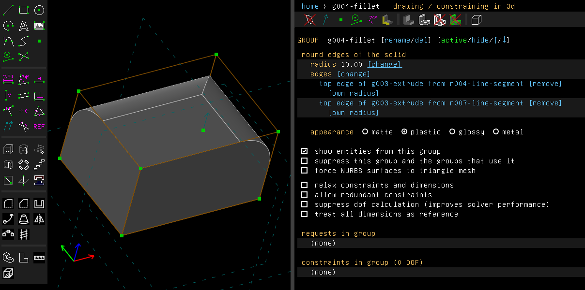
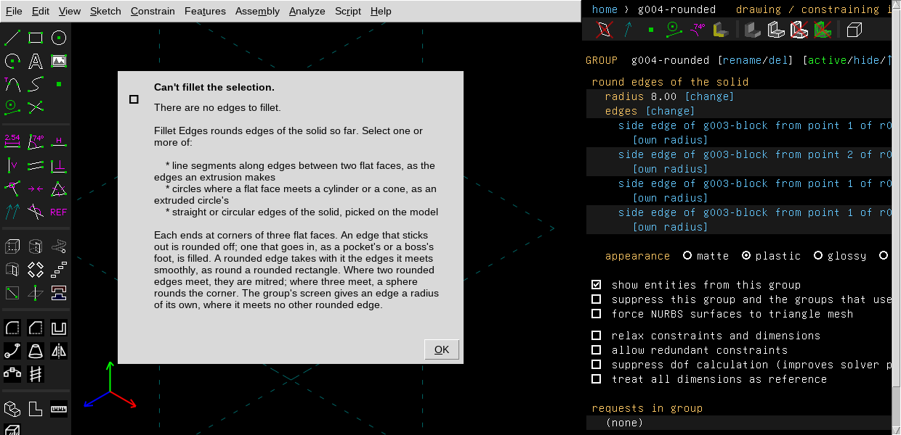

# Fillet

A fillet rounds an edge. A convex edge (one that sticks out) is rounded off. A concave edge
(one that goes in, like the floor of a pocket or the foot of a boss) is filled in.

Examples:

- [`examples/scripts/fillet`](../../examples/scripts/fillet/fillet.go): a block with its upright
  edges rounded.
- [`roundbox`](../../examples/scripts/roundbox), [`tray`](../../examples/scripts/tray),
  [`ramp`](../../examples/scripts/ramp), [`plinth`](../../examples/scripts/plinth),
  [`spinner`](../../examples/scripts/spinner) and [`rib`](../../examples/scripts/rib): corners,
  filled edges, and edges with a radius of their own.
- [`soap`](../../examples/scripts/soap): a rim rounded all the way round.
- [`knob`](../../examples/scripts/knob): a fillet beside a chamfer.
- [`casing`](../../examples/scripts/casing): two radii in one fillet.
- [`setback`](../../examples/scripts/setback/setback.go): a corner of three radii.
- [`tee`](../../examples/scripts/tee/tee.go) and
  [`bandfillet`](../../examples/scripts/bandfillet/bandfillet.go): fillets between curved faces.

## Step by step

Round two top edges of a block. The video shows the steps below from start to end:

<video controls muted loop playsinline style="width:100%">
<source src="videos/fillet-edges.webm" type="video/webm">
<source src="videos/fillet-edges.mp4" type="video/mp4">
</video>

([fillet-edges.webm](videos/fillet-edges.webm), [fillet-edges.mp4](videos/fillet-edges.mp4), where the page shows no video.)

1. Press R for a rectangle and click two corners.

   

2. Press Esc, then Shift+X to extrude it. The left-hand window is the model, the right-hand
   one the property browser, which shows the new group.

   

3. Click the two edges to round. They are drawn in red when selected.

   

4. Choose Features > Fillet Edges. The edges are rounded at 1 mm, mitred where they meet, and
   the property browser lists them.

   

5. Click "[change]" beside the radius and type a new one, here 10.

   

   

These pictures are made by [`scenarios/fillet.scenario`](scenarios/fillet.scenario), which
replays the same clicks on the program (`scripts/regen-doc-images.sh`).

## In the window

Select the edges, then choose Features > Fillet Edges (Shift+F), or right-click an edge and
choose Fillet Edges. It rounds edges of the solid built so far. You can select:

- line segments along edges between two flat faces;
- circles where a flat face meets a cylinder or a cone, or where two such faces meet about one
  axis (a frustum turned on a shaft);
- edges of the solid itself, picked on the model, including edges between curved faces.

To take every edge round a face, right-click the face and choose Select Face Edges. With
nothing it can round selected, Fillet Edges says what it takes:



The group's screen:

- The radius starts at 1 mm. "[change]" takes a number or an expression.
- Under each edge, "[own radius]" gives that edge a radius of its own; "[the fillet's]" takes
  it off again. "[remove]" takes the edge out of the fillet.
- "[change]" beside the list takes the current selection as the edges instead. With nothing
  suitable selected, it activates the group before the fillet, says what to pick, and the link
  reads "[take the selection]" until you do. An edge keeps its own radius through the change.

When the fillet can't be made, the group shows a problem that says why and where, and the solid
passes through unrounded. A radius too large for the faces is one such problem. So is a result
that would not be a closed solid: the message says "the rounded solid would not be closed" and to
make it a little smaller or larger.

Sometimes a size very close to the one asked for is made instead, as when a fillet's foot just
misses a side by a hair. The group is then marked "(note)" in the list of groups, and its screen
says the size it was made at, as "made at radius 2 mm, the nearest the kernel can cut to
2.001 mm". The size made is within the chord tolerance of the one asked for.

## From a script

```go
round := doc.Features.Fillet(edges, 8, "")   // line segments and circles
round.AsFillet().SetRadius(6)
round.AsFillet().SetEdgeRadius(1, 3)         // the second edge alone; 0 gives it the fillet's again
s := block.Solid()                           // edges of the solid, by name or by a point on them
doc.Features.FilletSolid([]api.SolidEdge{s.EdgeAt(api.V(15, 0, 5))}, 1.5, "")
```

`SetEdgeRadiusExpr` gives an edge's radius as an expression. `SetEdges(entities, solidEdges)`
changes which edges are rounded. `Problem()` and `Note()` on the group read its problem and its
note.

## What it makes

- A convex edge is rounded by a cylinder, or by a torus round a circle. A concave edge is
  filled.
- A rounded edge carries on round the edges it meets smoothly, as round a rounded rectangle.
- Two rounded edges that meet are mitred. Three at the corner of a block meet in a sphere.
- The foot of a rib or a boss can be filled all round. Its top edges can be rounded later, in a
  fillet of their own; the corners where they come down onto the foot are set back (below).
  This needs a foot filled with one radius between flat faces, not a chamfered one.

### Edges of different radii, or of both kinds

The fillet rounds them in stages, one radius and one kind at a time, the larger radius first.
The later edges go on round the corners the earlier ones made. For example, a block's upright
edges at 8 mm and its top edges at 3 mm: the top's fillet follows the arcs the uprights cut.

### Corners

| At the corner | What is made |
|---|---|
| Two rounded edges of different radii, the third edge left sharp | One fillet ends on the other. Where neither can, it is refused: "fillets of radius 1 and 2 meet here above an edge left sharp ... round that edge too, or give the fillets one radius". |
| A convex and a concave edge, the third left sharp (a ledge's top edge over the inside upright) | One patch blends the two fillets. |
| All three rounded, two of one kind at different radii | The other kind first; the two then go round its arc with a radius that changes from one to the other. |
| Edges that can't go round each other (three radii, a pyramid's apex, a large top ring over small uprights) | Each fillet is set back from the corner and patches fill the hole. |
| A saddle (two ridges and two valleys), all four rounded | Set back, as above. |
| A saddle with some edges left sharp: one, two opposite, three, or a ridge and a valley side by side | Made, the fillets ending at the sharp edges or meeting in a mitre. |

A set-back corner is filled when its radii differ by up to about 3 to 1. At 5 or 6 to 1 side by
side the patches can fold, and the corner is refused at its point. So is a convex-and-concave
corner whose one radius is several times the other.

## Between two curved faces

Two curved faces can meet along an edge that is not a circle about a shared axis: a branch pipe
on a pipe, a spout on a pot, a rod through a ball. There the fillet rolls a ball of its radius
along the edge, touching both faces, and the rounded face is the surface the ball sweeps. It
follows the true surface to within a tenth of the chord tolerance (set on the configuration
screen). A chamfer of such an edge is made the same way.

- Such an edge is rounded on its own. Picked with other edges, the others are rounded first,
  then each such edge.
- Where two of its fillets meet at a corner whose third edge stays sharp, as a lid's upright edge
  meets its bottom edge, they are mitred, also at different radii. Any other meeting at a shared
  corner is refused with "pick it alone".
- A pocket's rim can be rounded all round, or any of its edges, in a flat or a curved face (a
  dish), at one radius or several. At the inside corners the fillets meet in a mitre, or a patch
  fills between them.
- The foot and the top edges of a band raised on a cylinder or a cone with
  [Wrap](wrap.md) are rounded all round, all their edges picked together.
- An edge along a crease that fades out, as up a loft's side, is rounded up to where the crease
  fades and ends there.

Where the edge ends at a flat face, the fillet ends in that face's plane and the face grows to
meet it. Where the fillet's end runs past the edge onto the next face, flat or curved, that
face cuts it and grows over its end. A curved end face, as a domed lid, cuts the fillet too;
where it bends too much across a wide fillet, it is refused with "make it smaller".

## Not yet

These are refused with a message:

- The ball can't touch both faces, as a radius too large for the room beside a hole.
- A fillet between curved faces whose edge ends at a curved face that the side faces go on past.
- A fillet whose end runs off both its faces at once where the faces past them meet across its
  end; one that runs off both faces at both ends, or whose two ends' cuts pass each other.
- A circle's fillet whose foot runs into a side leaning more than about 53° off square, or a side
  whose plane runs on above the face into the solid.
- A fillet of a hole's rim near a side standing on a ledge, where its cut into the ledge reaches
  past the side, or only just meets the side's foot.
- A corner of both kinds that the stages can't round while an edge there is left sharp, other
  than the saddle cases above. [Chamfer](chamfer.md) lists the chamfer corners it refuses.
- At a corner of a band raised on a cylinder: a seam of the face that passes less than about
  half a millimetre from the corner without going through it (move the band a little), and
  chord tolerances finer than about 0.01%.

Also:

- A fillet whose radius stops its chain at a rounded corner names the curved face in its
  message, rather than saying that the radius is the problem.
