# Getting started

This page makes a first part from start to end: a plate 40 × 25 × 10 mm with a hole of 10 mm
through it and its top edges rounded. It shows how a sketch is held by dimensions, how a sketch
becomes a solid, and how the solid is changed, checked and saved. The
[tour of the window](interface.md) says more about each part of the window.

## Step by step

1. Start TeleSAPR, or choose File > New (Ctrl+N). The left-hand window is the graphics window,
   where you draw. The toolbar runs down its left side. The right-hand window is the property
   browser. It lists the groups of the model, which are the steps of its history. A new model
   has two: `g001-#references`, which holds the three planes and the origin, and
   `g002-sketch-in-plane`, a sketch in the XY plane. The dot in the "active" column marks the
   group you are drawing in. The top line says "in plane", because what you draw now lies in
   that plane.

   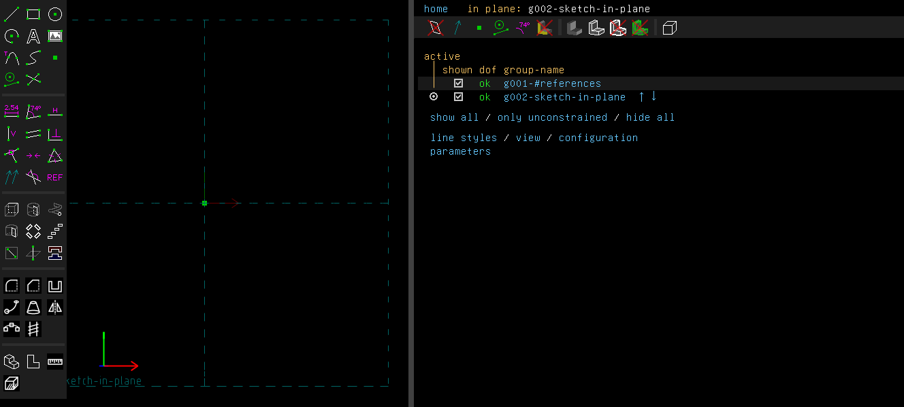

2. Press R for a rectangle. Click the origin, where the two dashed axes cross, then click the
   opposite corner up and to the right. The first click lands on the origin point, so that corner
   is held there. Press Esc to stop drawing.

   The colours say how much of the sketch is still free. A blue line or point can still move in
   some ways; an orange one can move every way; a white one is held. Here the corner on the
   origin is held, the opposite corner is free, and the sides are partly free. The rectangle
   came with its own constraints, shown as H (horizontal) and V (vertical). The property browser
   shows 2 in the "dof" column: two degrees of freedom are left, the width and the height.

   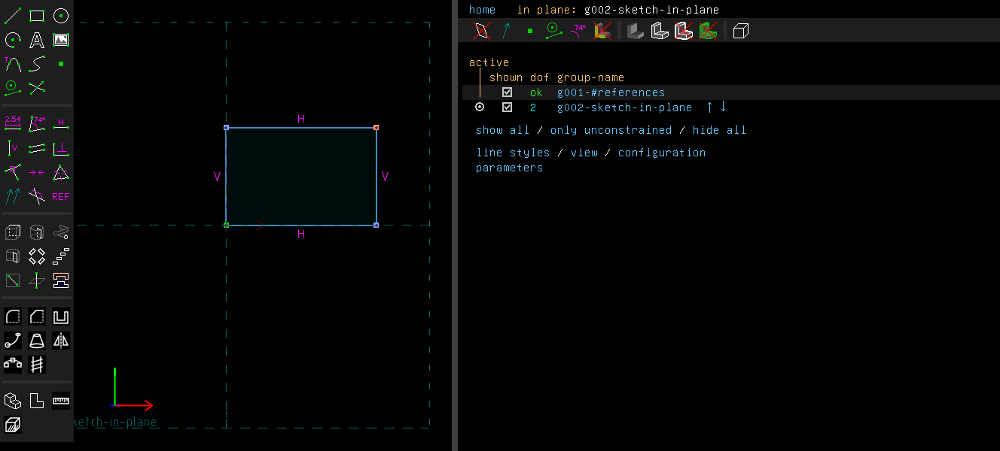

3. Click the top side to select it, and press D (Constrain > Distance / Diameter). A box opens
   over the new dimension with the side's length in it. Type 40 and press Enter. The width is
   now held.

   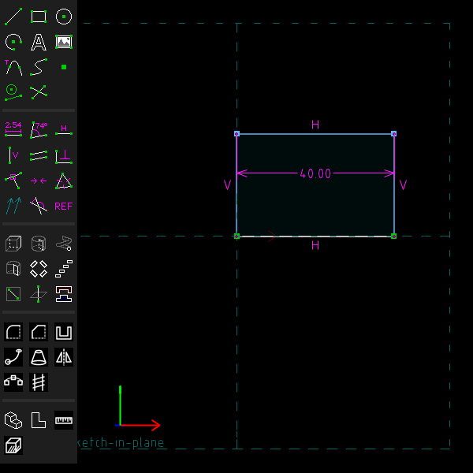

4. Click the right-hand side, press D, type 25 and press Enter. Everything is white now, and the
   "dof" column says "ok": the sketch is fully held. A sketch need not be fully held to make a
   solid, but one that is fully held can't change shape by accident.

   A dimension's value can be changed later: double-click it and type a new one. Drag its label
   to move it out of the way.

   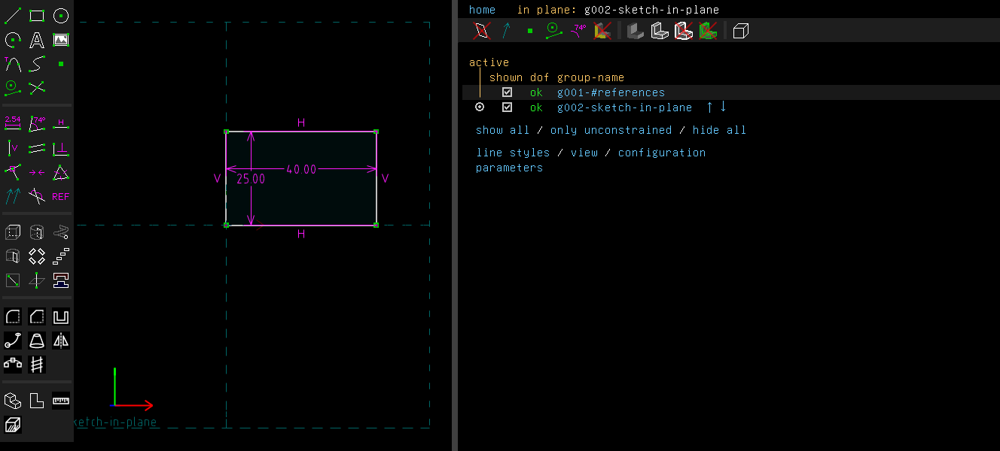

5. Press Shift+X (Features > Extrude). A new group, `g003-extrude`, turns the sketch into a solid,
   and the property browser shows that group's screen. To see the solid from the side, turn the
   view: drag with the middle mouse button.

   The depth starts at 20 mm, the sketch's shorter side, 25 mm, rounded. It is set on the
   group's screen (the marked row). Tick "held", click "[change]" beside the depth, type 10 and press
   Enter. View > Zoom To Fit (F) fits the solid in the window.

   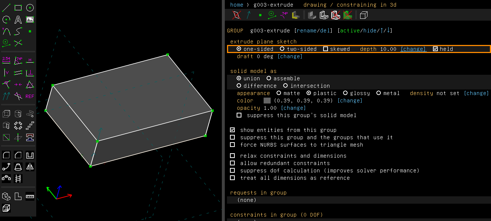

6. Click the top face of the plate to select it. A face is drawn with a dotted pattern when it is
   selected.

   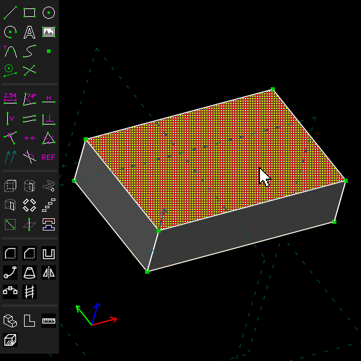

7. Choose Features > Sketch On Face (Shift+B). A new sketch group starts in the plane of that
   face, and the view turns to look straight at it. Press F (View > Zoom To Fit) if the face is
   off the window, and - (View > Zoom Out) for room round it. The face's outline is drawn for you
   to constrain against. The group's screen says the sketch lies in the top face of
   `g003-extrude`.

   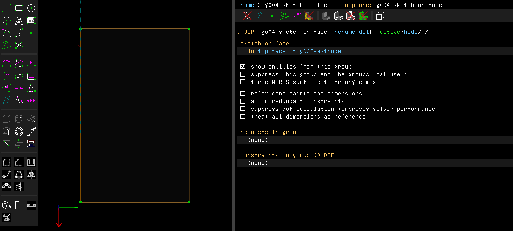

8. Press C for a circle. Click its centre, then click a point on its rim, and press Esc. Then hold
   it with three dimensions:

   - Click the circle, press D, and type 10. That is its diameter.
   - Click the circle's centre, then the face's edge at the top, press D, and type 20. A point and
     a line give the distance between them.
   - Click the centre again, then the face's edge at the left, press D, and type 12.5.

   The "dof" column says "ok" again.

   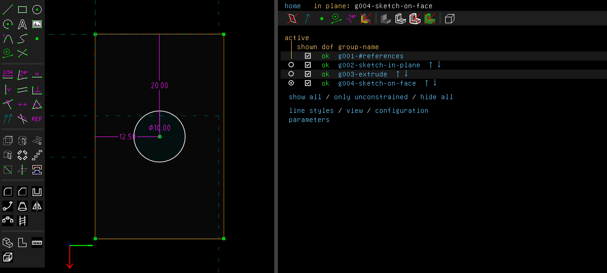

9. Press Shift+X to extrude the circle. On the group's screen, click "difference" under "solid
   model as": the extrusion now takes material away instead of adding it, and its depth turns
   into the plate. It reads -10.00, as deep as the circle is wide and the plate is thick, so the
   hole goes through. A negative depth goes into the plate, against the face's normal. To keep
   it there, tick "held", click "[change]" beside the depth and type -10.

   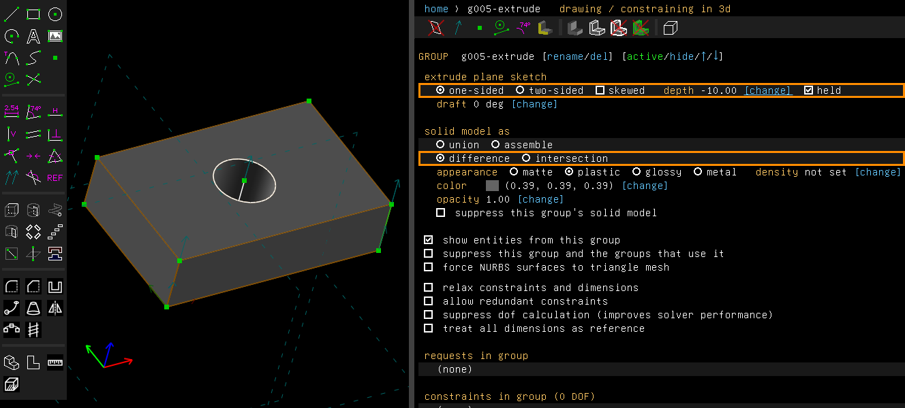

10. Click the four top edges of the plate. Selected edges are drawn in red. Clicking another
    thing adds it to the selection; clicking empty space, or pressing Esc, clears it.

    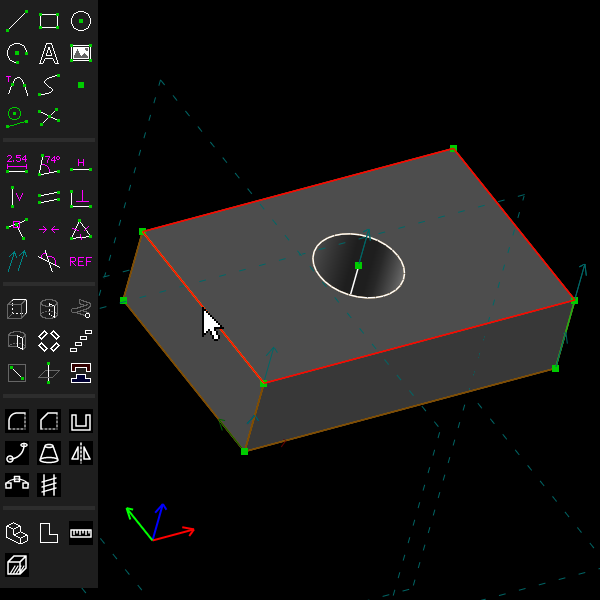

11. Press Shift+F (Features > Fillet Edges). The edges are rounded at 1 mm. Click "[change]"
    beside the radius on the fillet's screen, type 3 and press Enter. The screen lists the four
    edges by name, such as "top edge of g003-extrude from r004-line-segment".

    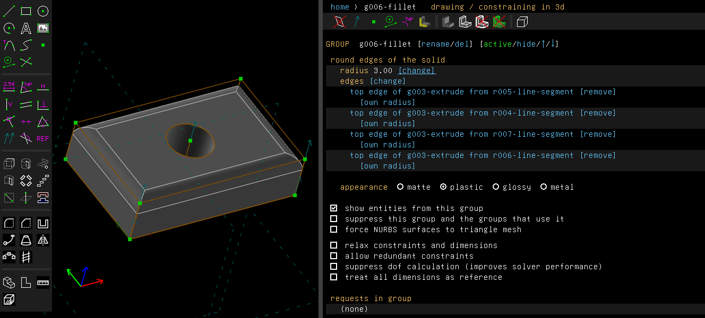

12. Check the part. Analyze > Check Solid (Ctrl+Shift+O) says whether the solid is sound. For
    this plate it says "The solid is sound." and lists 11 faces, a volume of 8.97 cm³, the
    centre of mass and the extent, 40.00 × 25.00 × 10.00. Analyze > Measure Volume
    (Ctrl+Shift+V) gives the volume alone.

    To measure one thing, choose Analyze > Measure Selection (Ctrl+Shift+E), or the ruler at the
    bottom of the toolbar, and click it. The value is drawn beside it. Here the hole's rim reads
    "radius 5.00". Choose the entry again to stop measuring.

    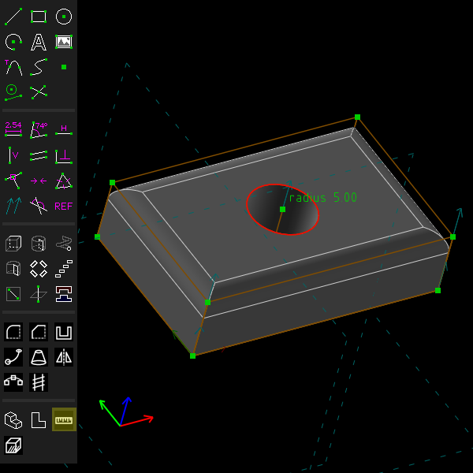

13. Save the model with File > Save (Ctrl+S). The file is a `.tlspr` file. To print the part,
    choose File > Export > Triangle Mesh and give the file a `.stl` name. A dialog first asks
    how fine the mesh is to be ([Export and import](export-import.md) explains the options).

Ctrl+Z undoes each step, and Ctrl+Y (or Ctrl+Shift+Z) redoes it.

These pictures are made by [`scenarios/getting-started.scenario`](scenarios/getting-started.scenario),
which replays the same clicks on the program (`scripts/regen-doc-images.sh`).

## What to try next

- Click a group's name in the property browser to open its screen. Change a value there, or a
  dimension in the first sketch, and every later group follows.
- The [tour of the window](interface.md) lists the toolbar, the menus and the mouse keys.
- [Parameters and units](parameters-and-units.md) names values that drive dimensions.
- [Fillet](fillet.md) and [Chamfer](chamfer.md) say what edges can be rounded or cut.
- [Scripts](scripts.md) builds the same kind of part from Go code.
