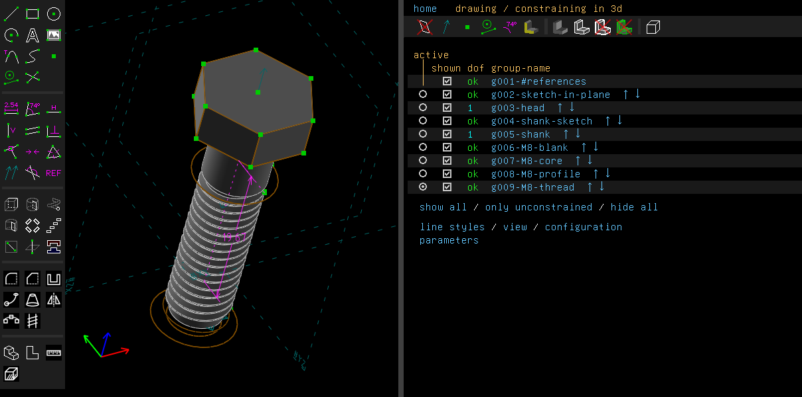
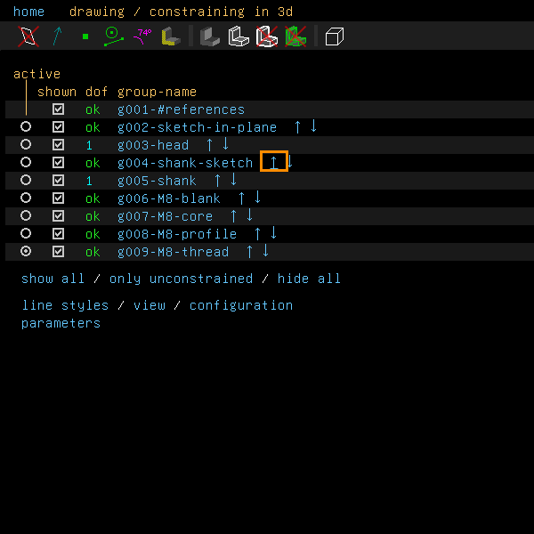
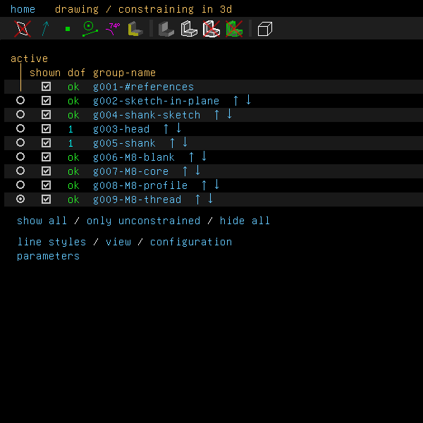
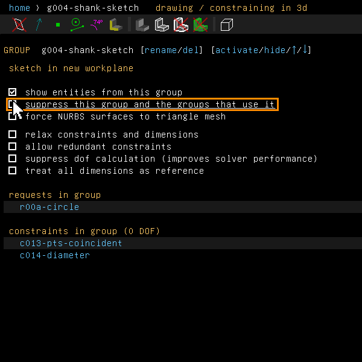
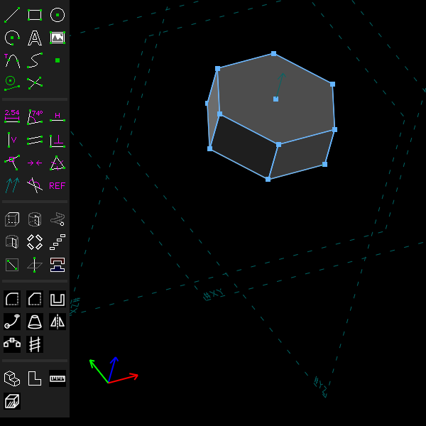
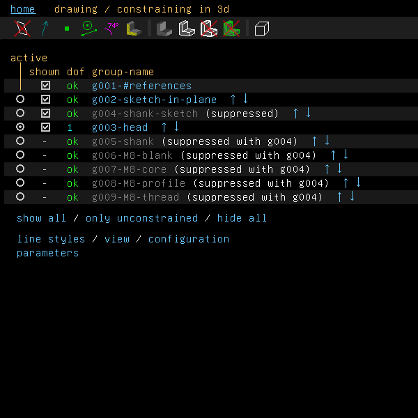
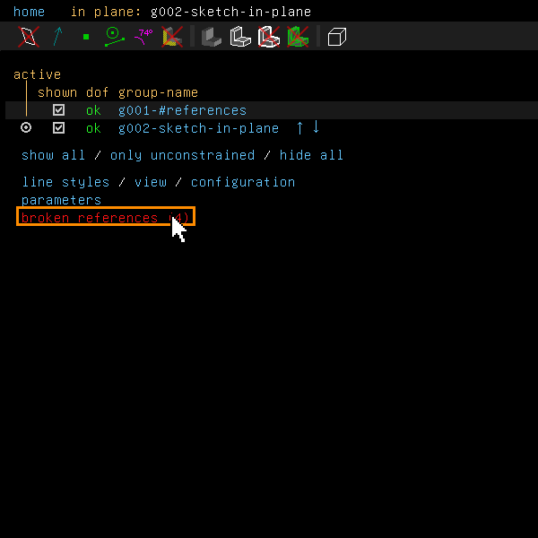
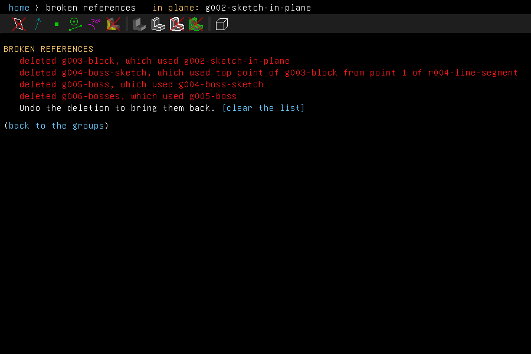

# History

Example: [`examples/scripts/history`](../../examples/scripts/history/history.go), a block with
a boss and copies of it, whose history is edited step by step.

Every group is a step in the model's history. The home screen of the text window lists the
groups in order. A group may use earlier groups: an extrusion uses its sketch, and a sketch on
a face uses the group that made the face.

## Step by step

A bolt's history: a sketch and the head extruded from it, a sketch and the shank, then the
groups of its thread.

1. The home screen of the property browser lists the groups in order. The radio button before
   a name makes that group active, the box shows or hides it, and the arrows after it move it.

   

2. Click the up arrow after g004-shank-sketch. The shank's sketch uses only the references, so
   it can go before the head. It moves up one place.

   

   

   The same arrow on g003-head is refused: the head can't go before the sketch it extrudes. A
   message names both groups.

3. Click the name g004-shank-sketch to open its screen. Tick "suppress this group and the
   groups that use it".

   

   The shank and the thread are left out with the sketch, and only the head is left. Nothing is
   deleted: clear the box, or undo, and they come back.

   

4. Click "home". The group list greys the groups left out and says why: "(suppressed)" on the
   sketch, "(suppressed with g004)" on the groups that use it.

   

5. The `history` example ends by deleting the block's sketch. The groups that used it, and the
   groups that used those, are deleted too. The home screen then links to the list of what was
   taken.

   

6. Click "broken references (4)". The list names each deleted group and what it used. Undo
   brings them back; "[clear the list]" empties it.

   

These pictures are made by [`scenarios/history.scenario`](scenarios/history.scenario).

## Moving a group

The arrows after a group's name in the group list move it one place up or down. Features >
Move Group Earlier and Move Group Later move the active group. A move that would put a group
ahead of a group it uses is refused, and the message names both groups.

Features > Move Group to End moves the active group to the end of the history. The groups that
only it needs go with it, in their order: an extrusion takes its sketch, and that sketch takes
its own workplane. A sketch that another group also uses stays where it is. In a script,
`GroupHistory.MoveToEndWithSources` and `GroupHistory.MoveWithSourcesBefore` do the same.
`GroupHistory.MoveToEnd` moves the one group alone.

When you delete the active group, or a group it uses (which deletes it too), the last remaining
group before it becomes active. So the next new group still goes at the end of the history.

## Inserting a group

A new group goes in after the active one. To insert a group in the middle of the history, make
an earlier group active (the radio button before its name on the home screen) and add the new
group. The groups after it are regenerated on top of it.

While an earlier group is active, everything after it is hidden and can't be picked. So nothing
new can refer to it. A script is held to the same rule: a constraint on an entity of a later
group, or a new group that would use one, is refused. The message names the later group. The
file keeps which group is active.

```go
doc.Activate(block)
doc.Features.Chamfer(edges, 2, "")   // between block and what followed it
```

From a script:

```go
fmt.Println(boss.History().DependsOn(), sketch.History().UsedBy())
must(in3d.History().MoveBefore(sketch))
must(in3d.History().MoveToEnd())
```

## Suppressing

A group's screen has two boxes that leave it out of the model:

- "suppress this group's solid model" keeps the group's sketch but leaves its solid out, as
  SolveSpace does.
- "suppress this group and the groups that use it" leaves out the group and every group that
  uses it. Nothing is deleted. The group list says what is left out and why. A group left out
  can't be made active.

Undo, or clearing the box, brings everything back.

From a script: `group.SetSuppress(api.SuppressWhole)`, `api.SuppressSolid` or
`api.Unsuppressed`.

## Broken references

Deleting a group deletes the groups that use it. A constraint goes with the entities it held.
Features > Broken References... lists each thing a deletion took, with what it used. The home
screen links to the list while it is not empty. Undo brings them back.

From a script: `doc.Features.BrokenReferences()` and `doc.Features.ClearBrokenReferences()`.

A damaged file, one that refers to things it doesn't hold, opens as far as it can. The
reference workplanes, which every model has, are put back if it lacks them; a group, request or
constraint that uses something missing is left out. A message says what on opening, and Broken
References lists it, the workplanes put back under "mended when the file was opened". Nothing
undoes it, the file never having held what was missing.

What was left out is kept in the file: Broken References lists it under "left out of the
model, kept in the file", and saving writes it back as the file held it, so that it is left out
again when the file is opened. A chamfer's or a fillet's edge, or a piece of a sweep's path,
that the file names and doesn't hold is left out of its group the same way: the group goes
without it, its screen says so, and a save writes it back where it was in the list, with its own
distance or radius. Editing the group's edges lets it go.

To bring it back, give it what it lacks. Under the list, Broken References names each point,
workplane or edge the file lacks: select one of the model's in its place (a point for a point,
a workplane for a workplane, a curve for an edge) and click **[use the selected]**. Clicked
with nothing selected, the screen waits while you pick, and the link reads **[take the
selection]**. What then has all it uses comes back into the model, in one step of Undo. Or mend
the file in a text editor and open it again. To be rid of it, click **[discard them]**: the next
save no longer writes it, and Undo takes the discard back.

From a script, `doc.Features.Mended()` lists what was put back, `doc.Features.LeftOut()` what was
left out and kept, `doc.Features.LeftOutMissing()` what it lacks,
`doc.Features.MendLeftOut(missing, with)` gives it in place of one of those, and
`doc.Features.DiscardLeftOut()` discards it; `telesapr-cli convert` reports both as warnings.

## Not yet

A group can't be moved ahead of a group it uses, even when the reference could be redirected.

Of what a damaged file leaves out, only a group's origin, a request's workplane, a constraint's
points and workplane and a feature's edges can be given from the window; a group or a
constraint's line, circle or face that the file lacks is mended in the file, by hand.
