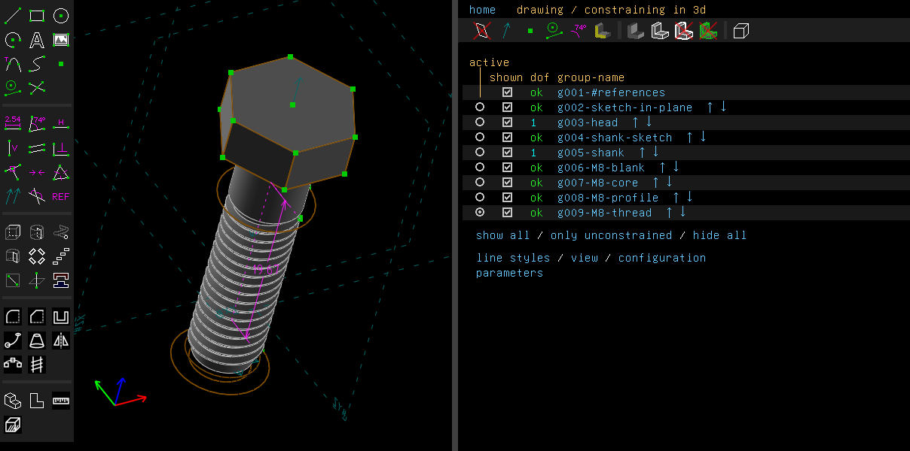
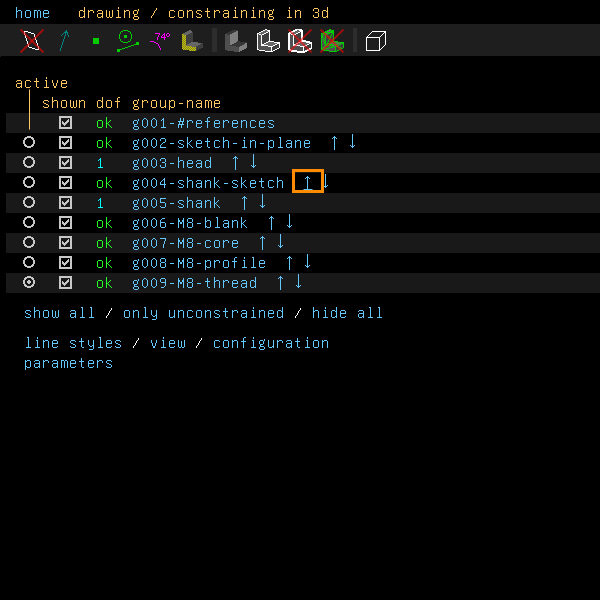
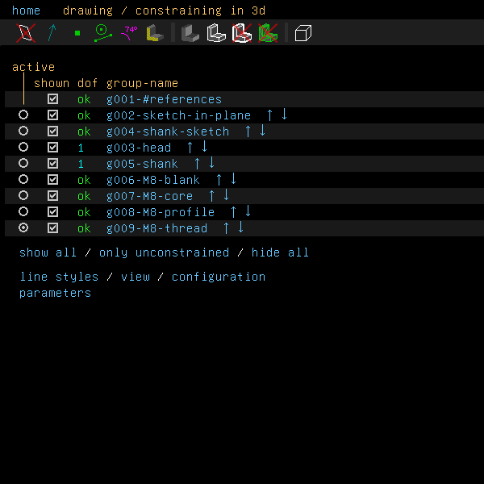
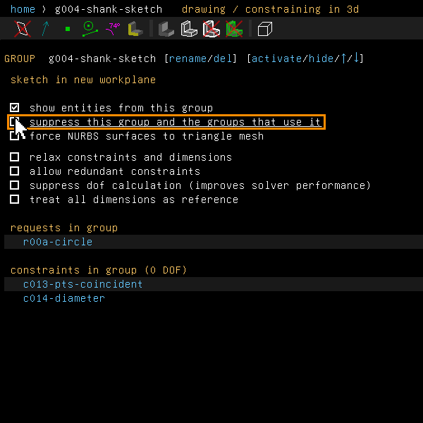
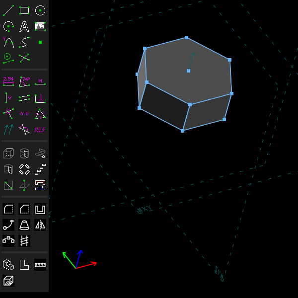
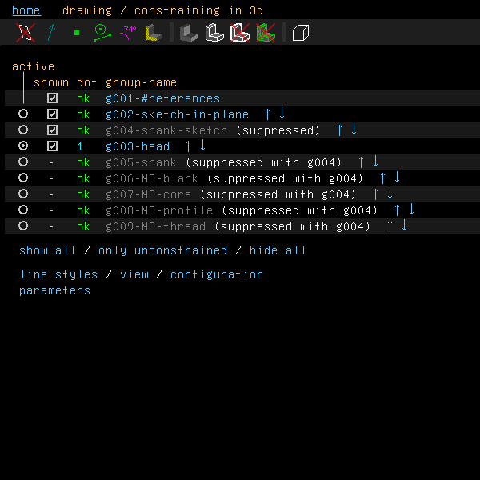
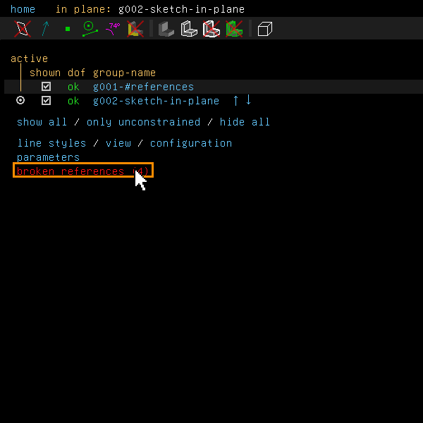
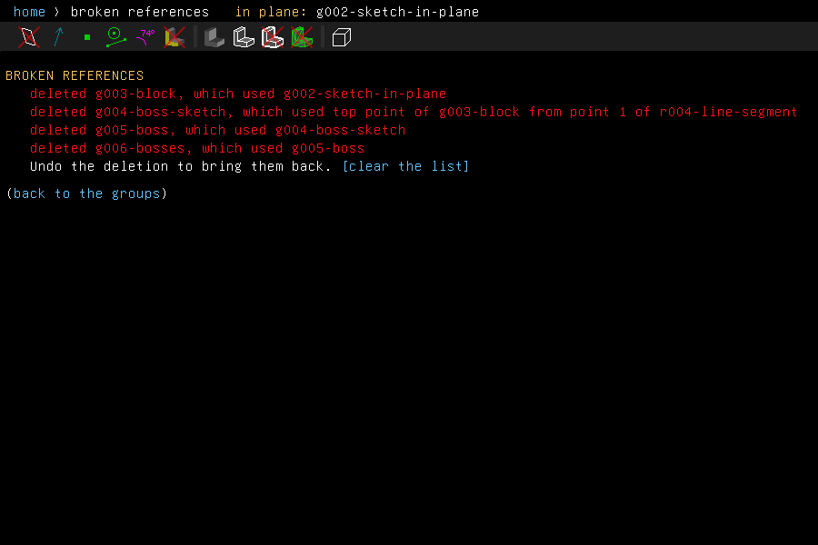

# History

Example: [`examples/scripts/history`](../../examples/scripts/history/history.go), a block with
a boss and copies of it, whose history is edited step by step.

Every group is a step in the model's history. The home screen of the property browser lists
the groups in order. A group may use earlier groups: an extrusion uses its sketch, and a sketch
on a face uses the group that made the face.

## Step by step

A bolt's history: a sketch and the head extruded from it, a sketch and the shank, then the
groups of its thread.

1. The home screen lists the groups in order. The radio button before a name makes that group
   active, the box shows or hides it, and the arrows after it move it.

   

2. Click the up arrow after g004-shank-sketch. The shank's sketch uses only the references, so
   it can go before the head. It moves up one place.

   

   

   The same arrow on g003-head is refused: the head can't go before the sketch it extrudes. A
   message names both groups.

3. Click the name g004-shank-sketch to open its screen. Tick "suppress this group and the
   groups that use it".

   

   The shank and the thread are left out with the sketch, and only the head is left. Nothing is
   deleted: clear the box, or undo, and they come back.

   

4. Click "home". The group list greys the groups left out and says why: "(suppressed)" on the
   sketch, "(suppressed with g004)" on the groups that use it.

   

5. The `history` example ends by deleting the block's sketch. The groups that used it, and the
   groups that used those, are deleted too. The home screen then links to the list of what was
   taken.

   

6. Click "broken references (4)". The list names each deleted group and what it used. Undo
   brings them back; "[clear the list]" empties it.

   

These pictures are made by [`scenarios/history.scenario`](scenarios/history.scenario).

## Moving a group

- The arrows after a group's name in the group list move it one place up or down.
- Features > Move Group Earlier and Move Group Later move the active group.
- Features > Move Group to End moves the active group to the end of the history, with the
  groups that only it needs, in their order: an extrusion takes its sketch, and that sketch its
  own workplane. A sketch that another group also uses stays where it is.

A move that would put a group ahead of a group it uses is refused, and the message names both
groups.

When you delete the active group, or a group it uses (which deletes it too), the last group
left before it becomes active. So the next new group still goes at the end of the history.

From a script:

```go
fmt.Println(boss.History().DependsOn(), sketch.History().UsedBy())
must(in3d.History().MoveBefore(sketch))
must(in3d.History().MoveToEnd()) // the group alone
moved, err := boss.History().MoveToEndWithSources() // with what only it needs
```

`GroupHistory.MoveWithSourcesBefore` moves a group, with what only it needs, before another.
Both return the groups they moved.
Analyze > Group Dependencies shows what a group uses and what uses it.

## Inserting a group

A new group goes in after the active one. To insert a group in the middle of the history, make
an earlier group active (the radio button before its name on the home screen) and add the new
group. The groups after it are made again on top of it.

```go
doc.Activate(block)
doc.Features.Chamfer(edges, 2, "")   // between block and what followed it
```

While an earlier group is active:

- Everything after it is hidden and can't be picked, so nothing new can refer to it. A script is
  held to the same rule: a constraint on an entity of a later group, or a new group that would
  use one, is refused, and the message names the later group.
- A change is made only as far as the active group. The home screen marks each later group
  "old". Its screen says it was not made since the change, and offers **[make it now]**, which
  makes it as the model now is and leaves the active group as it was. Making a later group
  active makes it too.
- A script that reads a later group (its volume, its check, its problem, its description) gets
  it as the model now is: the groups up to it are made first. `doc.Describe()` makes nothing past
  the active group and marks such a group "old", as the home screen does; `Group.Old()` says the
  same.

The file keeps which group is active.

## Suppressing

A group's screen has two boxes that leave it out of the model:

- "suppress this group's solid model" keeps the group's sketch but leaves its solid out, as
  SolveSpace does.
- "suppress this group and the groups that use it" leaves out the group and every group that
  uses it. The group list says what is left out and why. A group left out can't be made active.

Nothing is deleted. Undo, or clearing the box, brings everything back. The Group submenu of a
right click has the second as Suppress with What Uses It.

From a script: `group.SetSuppress(api.SuppressWhole)`, `api.SuppressSolid` or
`api.Unsuppressed`.

## Broken references

Deleting a group deletes the groups that use it. A constraint goes with the entities it held.
Features > Broken References... lists each thing a deletion took, with what it used. The home
screen links to the list while it is not empty. Undo brings them back.

From a script: `doc.Features.BrokenReferences()` and `doc.Features.ClearBrokenReferences()`.

## Damaged files

Example: [`examples/scripts/damaged`](../../examples/scripts/damaged/damaged.go), a file that
lacks a workplane, opened, saved, mended and its leftovers discarded.

A damaged file refers to things it doesn't hold. It opens as far as it can:

- The reference workplanes, which every model has, are put back if it lacks them. Broken
  References lists them under "mended when the file was opened".
- A group, request or constraint that uses something missing is left out of the model. Broken
  References lists it under "left out of the model, kept in the file".
- A chamfer's or fillet's edge, or a piece of a sweep's path, that the file names and doesn't
  hold is left out of its group. The group is made without it, and its screen says so.

A message says what on opening. Undo can't take this back, as the file never held what was
missing.

What was left out stays in the file: a save writes it back as the file held it. To bring it
back, give it what it lacks:

- **A missing entity.** Broken References names each one with the kind it must be, as "a
  point", "a workplane", "a line or a normal" for a lathe's axis, "a workplane or a planar face"
  for a mirror's plane, or "a circle or an arc" for a diameter. Select one of that kind on the
  model and click **[use the selected]**. With nothing selected, the link reads **[take the
  selection]** and waits while you pick.
- **A missing group**, as the group a request is in, or an extrusion's sketch. Click **[choose
  a group]** and click one of the groups listed, as **[use g002-sketch-in-plane]**. An operand
  must come before the group that uses it, and the references group is never taken.

What then has all it uses comes back into the model, in one undo step. Or mend the file in a
text editor and open it again. To be rid of what was left out, click **[discard them]**: the
next save no longer writes it, and Undo takes the discard back. Editing a feature's edges drops
the missing ones too.

From a script:

| Call | Does |
|---|---|
| `doc.Features.Mended()` | what was put back on opening |
| `doc.Features.LeftOut()` | what was left out and kept |
| `doc.Features.LeftOutMissing()` | the entities it lacks |
| `doc.Features.LeftOutMissingKind(missing)` | the kind each must be |
| `doc.Features.MendLeftOut(missing, with)` | gives an entity in place of a missing one |
| `doc.Features.LeftOutMissingGroups()`, `doc.Features.MendLeftOutGroup(missing, with)` | the same for groups |
| `doc.Features.DiscardLeftOut()` | discards what was left out |

`telesapr-cli convert` reports what was mended and what was left out as warnings.

## Not yet

- A group can't be moved ahead of a group it uses, even where the reference could be
  redirected.
