# A tour of the window

The window has two parts. The graphics window, on the left, shows the model; you draw and pick
there. The property browser, on the right, shows text screens: the list of groups, a group's
settings, what is selected. Its links are clicked like a web page's. View > Show Property
Browser (Tab) hides and shows it.

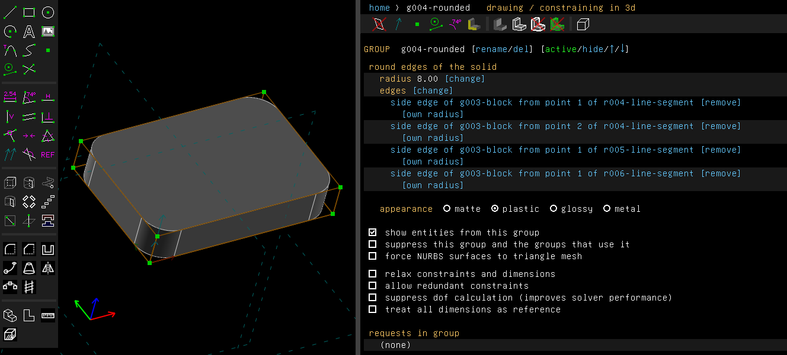

The model in these pictures is made by
[`examples/scripts/fillet`](../../examples/scripts/fillet/fillet.go): a block with its upright
edges rounded. [Getting started](getting-started.md) makes a part step by step.

## The toolbar

The toolbar runs down the left side of the graphics window. Hover a button to see what it does
and its key. It has five blocks, from the top:

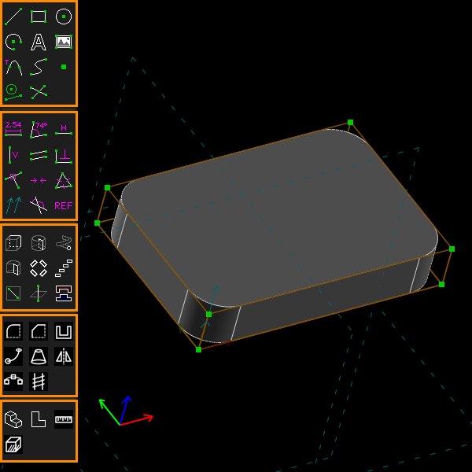

1. **Sketch**: line segment, rectangle, circle, arc, text in a TrueType font, image, tangent arc
   at a point, cubic Bezier spline, datum point, toggle construction, and split curves where
   they cross.
2. **Constrain**: distance, diameter or length; angle; horizontal; vertical; parallel or
   tangent; perpendicular; point on a line, curve, plane or point; symmetric; equal length,
   radius or angle; same orientation; other supplementary angle; and toggle reference dimension.
3. **New groups**: extrude, lathe, helix and revolve the active sketch; step and repeat rotating
   and translating; a sketch in a new workplane; a sketch in 3d; and link or assemble a file.
4. **Features that take a selection**: fillet and chamfer edges, shell open at faces, sweep along
   a path, loft to profiles, mirror in a plane, pattern along a path, and screw thread.
5. **View and measure**: nearest isometric view, align the view to the active workplane, measure
   the selection, and section view. The measure and section buttons stay lit while they are on.

When the window is too short for two columns, the toolbar takes three. View > Show Toolbar
(Ctrl+Tab) hides and shows it.

## The property browser

### The home screen

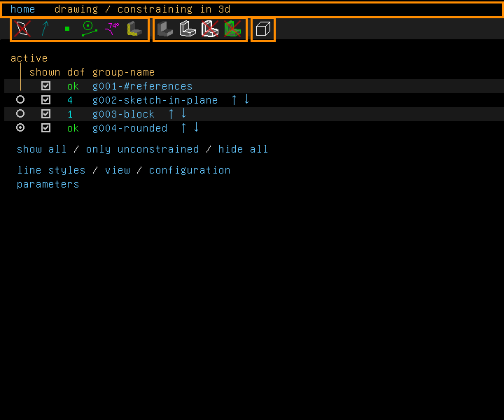

The first line (marked at the top) says where you are. "home" is a link back to this screen from
any other. After it comes the screen's place, as "home › g003-block", then the mode: "in plane:"
and the workplane's name while you draw in a workplane, or "drawing / constraining in 3d".

The icons below it show and hide things in the graphics window. A red cross on an icon means
that thing is hidden. The same switches are under View > Show. From the left:

- workplanes of inactive groups, normals, points, construction entities;
- constraints and dimensions, which cycles through all of them, dimensions only, and none;
- whether faces can be picked with the mouse;
- then the solid: shaded, its edges, its outline, its triangle mesh;
- last, how hidden lines are drawn: not at all, stippled, or as visible lines.

The home screen lists the groups in the order they are made:

- **active**: click the circle to make a group active. You draw in the active group, and the
  groups after it are left out of the model until you go back.
- **shown**: the box hides or shows the group. A "-" marks a group after the active one.
- **dof**: "ok" when the group is fully held, or how many degrees of freedom are left. "err"
  means the group has a problem, as an extrusion of a sketch whose outline is not closed (and
  that sketch with it; a sketch no solid is made from, as a sweep's path, may be open), and
  "ERR" that it could not be solved. Click the value to see how the group was solved.
- **group-name**: click it to open the group's screen. The arrows move the group earlier or
  later in the history.

Below the list, "show all" and "hide all" show or hide every group at once, and "only
unconstrained" shows only the groups with degrees of freedom left. The links "line styles",
"view", "configuration" and "parameters" open those screens. The configuration screen is also
Edit > Preferences.

### A group's screen

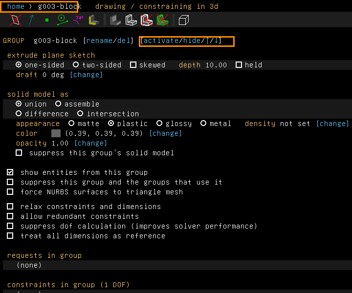

A group's screen holds its settings: here an extrusion's sides and depth, whether it adds or
takes away material, its appearance. The first line reads "home › g003-block". The links on the
"GROUP" line rename or delete the group, and make it active, hide it, or move it earlier (↑)
or later (↓).

## Picking things

**Hover.** Whatever is under the pointer is drawn in yellow before you click it. A face is
drawn with a dotted pattern.

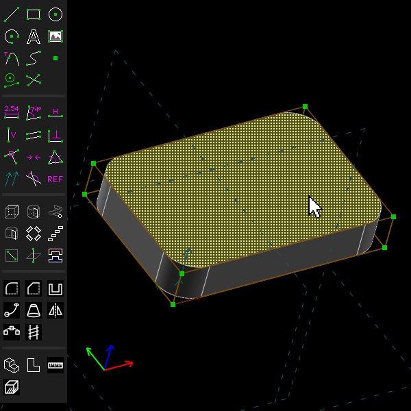

**Click** selects what is hovered. Selected things are drawn in red, and the property browser
describes them: here a flat face, its normal and a point on it, and its group. Each further click
adds to the selection. Ctrl+click takes a thing out of it. A click on empty space, or Esc (Edit >
Unselect All), clears it.

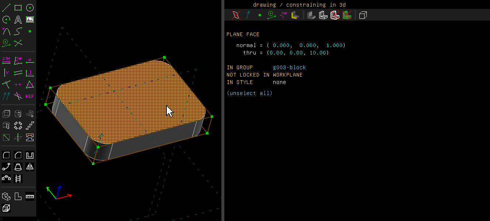

**A box (marquee).** Drag from empty space to draw a box. It selects only in the active group.

- Dragged from left to right, the box is drawn in the hover colour and selects what lies
  wholly inside it. Here: the rectangle's left side and its two ends.

  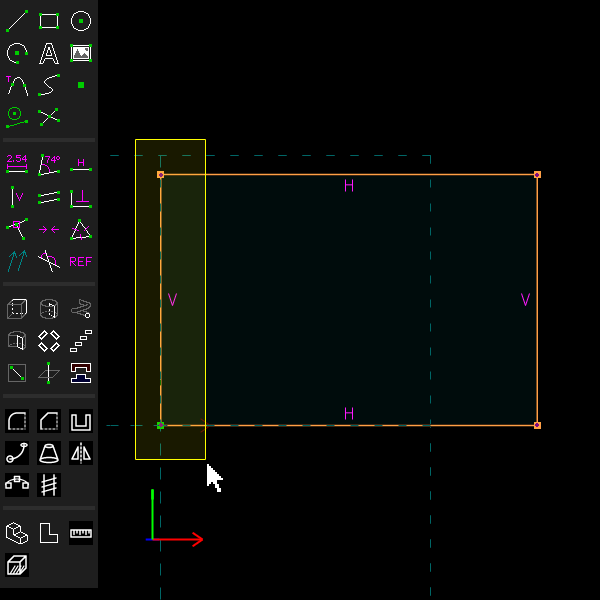

  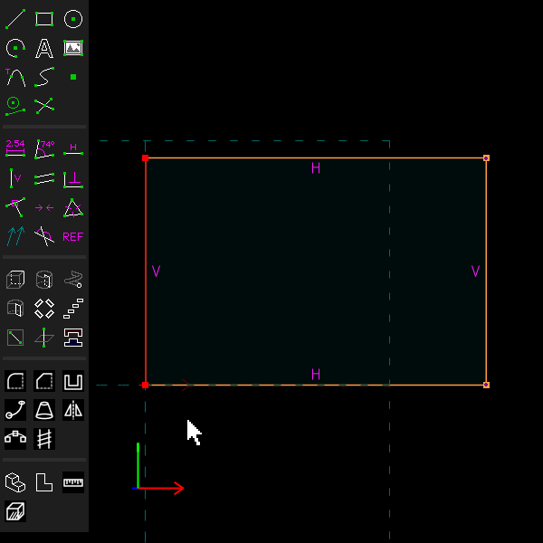

- Dragged from right to left, the box is drawn in the selection colour and selects whatever it
  crosses. The same box now takes the top and bottom sides too.

  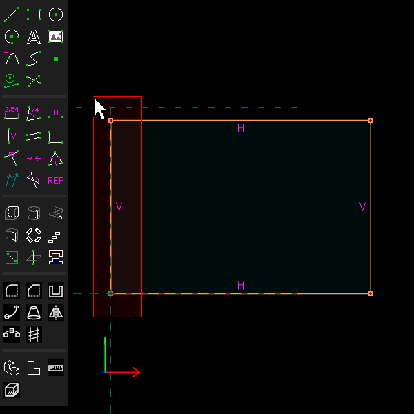

  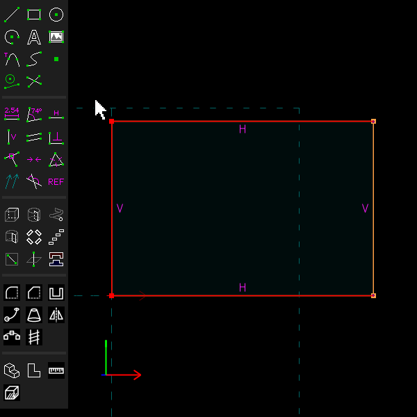

Edit > Select All (Ctrl+A) selects everything shown in the active group. Edit > Select Edge
Chain (Ctrl+E) adds the lines and curves of the active group joined end to end with those
selected.

**Dragging.** Drag a point or a line to move it; what is not held follows. Drag a dimension's
label to move the label. The arrow keys move what is selected by one pixel, ten with Shift.
Delete removes what is selected.

## The context menu

A right click (without dragging) selects what is under the pointer and opens a menu of what
applies to it. On a face of the solid it offers, among others, Shell Solid Open Here, Mirror in
This Plane, Select Face Edges, Sketch On Face, an Appearance submenu and Measure Selection. On an
edge it offers Fillet Edges, Chamfer Edges and Sweep Along Edges. On a dimension it offers Edit
Value. A Group submenu activates, hides, suppresses or deletes the group the thing belongs to.
The entries are listed in [the guide's first page](README.md). Right-clicking empty space offers
Select All. The menu is not shown in the pictures here.

While you draw lines or arcs, a right click stops drawing, as Esc does.

## Moving the view

| To | Do |
|---|---|
| Turn the view | Drag with the middle button, or with Shift and the right button |
| Move (pan) the view | Drag with the right button, or with Shift and the middle button |
| Turn about the line of sight | Drag with Ctrl and the middle button |
| Zoom about the pointer | Scroll the wheel; with Shift, in finer steps |
| Zoom in or out about the middle of the window | + or - (View > Zoom In, Zoom Out) |
| Fit the model in the window, beside the toolbar | F (View > Zoom To Fit) |
| Look straight at the active workplane | W (View > Align View to Workplane) |
| Snap to the nearest view along an axis | F2 (View > Nearest Ortho View) |
| Snap to the nearest isometric view | F3 (View > Nearest Isometric View) |
| Center the view at a point | Select the point, F4 (View > Center View At Point) |

The configuration screen has two switches for the mouse: "use turntable mouse navigation" keeps
the Z axis upright while turning, and "use camera mouse navigation" turns the view the other
way, as if you moved the camera instead of the model.

## The View menu

Besides the view moves above, the View menu has:

- **Show**: the switches of the property browser's icons, and reference dimensions and comments
  apart from the other constraints.
- **Show Snap Grid** (>), **Darken Inactive Solids**, **Use Perspective Projection** (`` ` ``),
  and **Show Exploded View** (\\).
- **Section View** (Ctrl+Shift+X): cut the model open ([Section view](section-view.md)).
- **Show Drawing Sheet** and **Drawing Sheet...** ([Drawings](drawings.md)).
- **Dimension Units**: millimetres, metres, inches, or feet and inches.
- **Show Toolbar** (Ctrl+Tab), **Show Property Browser** (Tab), and **Full Screen** (Ctrl+F11).

## Finding a command

Edit > Find Command (Ctrl+K) opens a search in the property browser. Type words of a menu
entry's name and press Enter: the entries that match are listed, with their keys. Enter again
runs the first one, marked "(Enter)", or click any of them. If only one entry matches, it runs at
once. Entries that can't run now are listed last, with the reason.

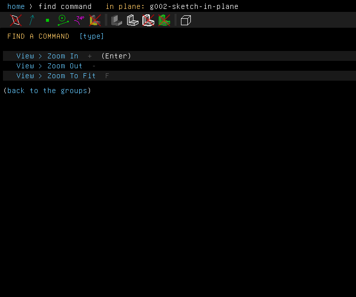

## Undo

Edit > Undo (Ctrl+Z) takes back the last step: a line drawn, a constraint, a group made, a value
changed. Edit > Redo (Ctrl+Y or Ctrl+Shift+Z) puts it back. Edit > Regenerate All (Space) solves
and rebuilds the whole model again.

These pictures are made by [`scenarios/interface.scenario`](scenarios/interface.scenario), which
replays the same clicks on the program (`scripts/regen-doc-images.sh`).
