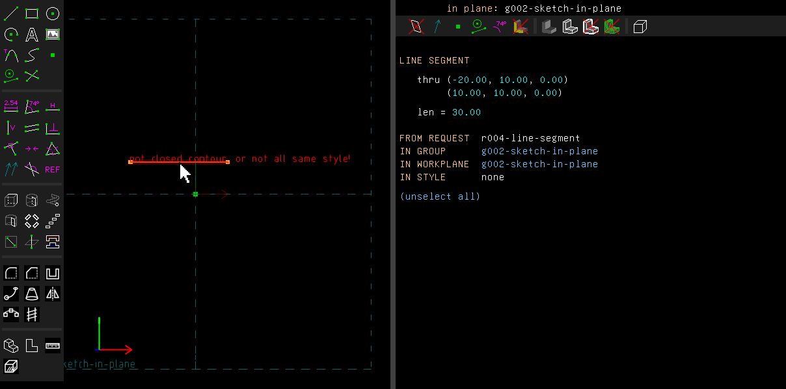
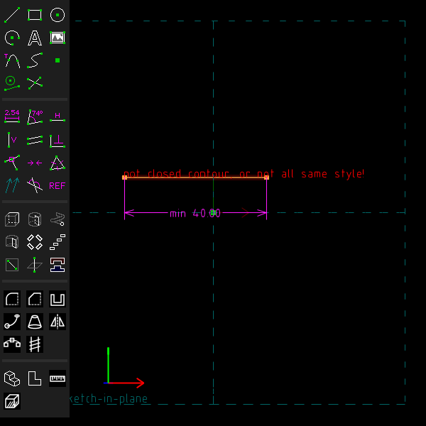
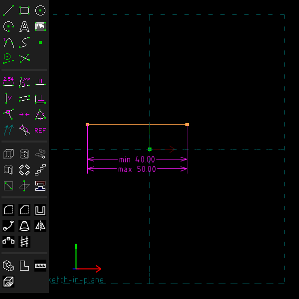
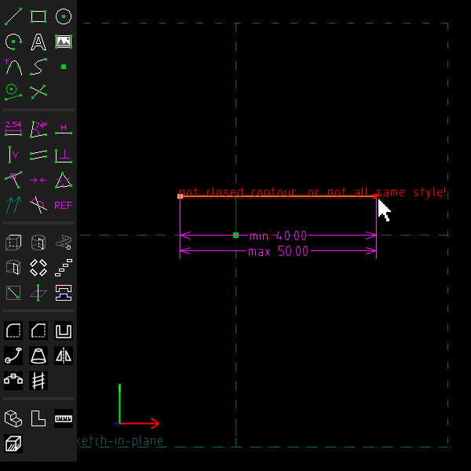
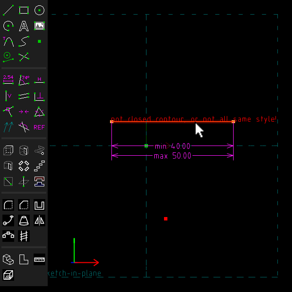
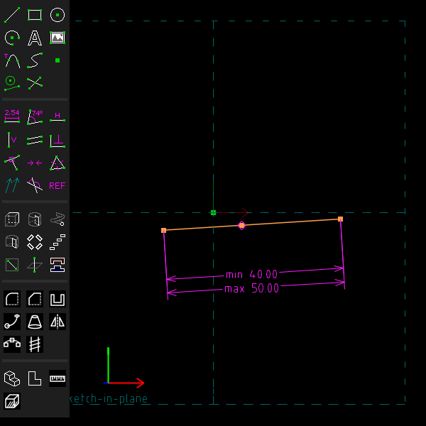

# Minimum and maximum dimensions, and a point on a segment

Example: [`examples/scripts/limits`](../../examples/scripts/limits/limits.go), a telescopic rod
held between a shortest and a longest length, with its end riding in a slot.

A bound is a dimension that holds from one side only: "at least 30" or "at most 30".

## Step by step

Keep a line between 40 and 50 mm long, then put a point on it:

1. Draw a line segment (S), press Esc, and click the line to select it. The property browser
   shows its length, here 30 mm.

   

2. Choose Constrain > Minimum Dimension. The bound is made at the length the line has now, and
   its editor opens. Type 40 and press Enter. The line grows to 40 mm, and the label reads
   "min 40.00".

   

3. Select the line again and choose Constrain > Maximum Dimension. Type 50. The line is already
   shorter than that, so nothing moves. The new label is drawn below the first, clear of it.

   

4. Drag the line's right end out. The line grows to 50 mm and no further. Here its other end
   is free, so it follows the mouse instead.

   

5. Draw a point (P) below the line and press Esc. Select the point and the line.

   

6. Choose Constrain > On Segment. The point and the line move to meet, with the point between
   the line's ends.

   

These pictures are made by [`scenarios/limits.scenario`](scenarios/limits.scenario).

## In the window

Constrain > Minimum Dimension and Constrain > Maximum Dimension make one. Select what Distance
/ Diameter or Angle takes: two points, a line, a point and a line, a workplane or a face, a
circle or an arc, two lines or normals. The bound is made at the value the sketch has now,
labelled "min 30.00" or "max 30°", and its editor opens so that you can type the bound in. The
editor takes expressions and names, as a dimension's does.

With a dimension selected, the same menu entries turn it into a bound. If it is already that
bound, they turn it back into a dimension. A distance from a line or a plane keeps to its side,
as the dimension does, and the bound is on how far.

A turn about an axis takes a bound too: the `turn` of a screw mate, or a part's turn about a
hinge's pin. A negative turn is a turn the other way, not the other side, and its minimum is
the least turn, as for a positive one. So a hinge can be kept between 0 and 90°.

Constrain > On Segment keeps a point on a line segment, between its ends. On Point / Curve /
Plane, by contrast, lets the point go anywhere along the segment's line.

How a bound behaves:

- A bound holds only where the sketch would cross it. Inside the bound it takes no degree of
  freedom: the points move as they would without it, and the property browser counts the
  freedom they have.
- Dragged against it, the sketch stops at the bound. The bound then takes one degree of freedom,
  as a dimension of that value would. A point on a segment that is stopped at an end is fixed
  there.
- Two bounds that can't both hold, or a bound beyond a dimension, fail to solve. The property
  browser names the bound.
- A bound made at the value a dimension already holds, such as a maximum of 40 on a line 40
  long, is no conflict. It is not counted as taking the freedom the dimension took.

From a script:

```go
rod := doc.Sketch.Line(api.V(0, 0, 0), api.V(30, 0, 0))
doc.Constrain.MinDistance(rod, api.Entity{}, 20) // or two points, a point and a line, a plane, a face
doc.Constrain.MaxDistance(rod, api.Entity{}, 40)
doc.Constrain.Angle(a, b, 30).SetLimit(api.Minimum)
doc.Constrain.Radius(circle, 4).SetLimit(api.Maximum)
doc.Constrain.OnSegment(slider, slot)
```

`Constraint.SetLimit(api.NoLimit)` makes a bound a dimension again. `Constraint.Set` and
`Constraint.SetExpr` change a bound's value as they change a dimension's.

## Not yet

Ratios and differences of lengths can't be bounds. A bound is labelled "min" and "max", because
the drawing's font has no ≥ or ≤. A DXF export of the drawing writes a bound as the dimension it
bounds.
