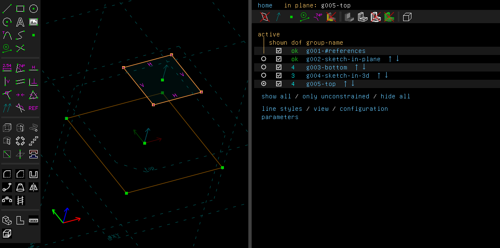
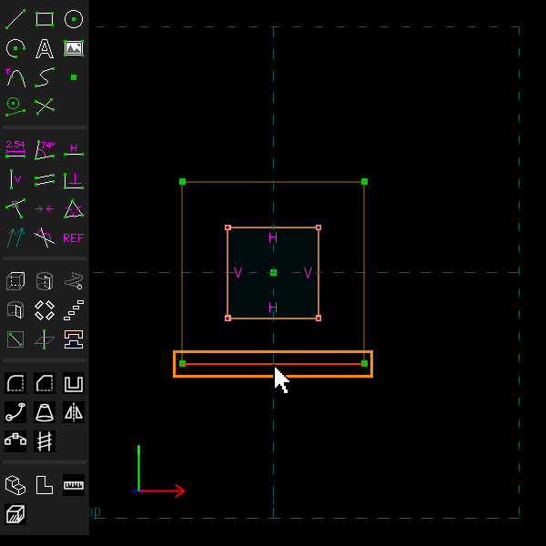
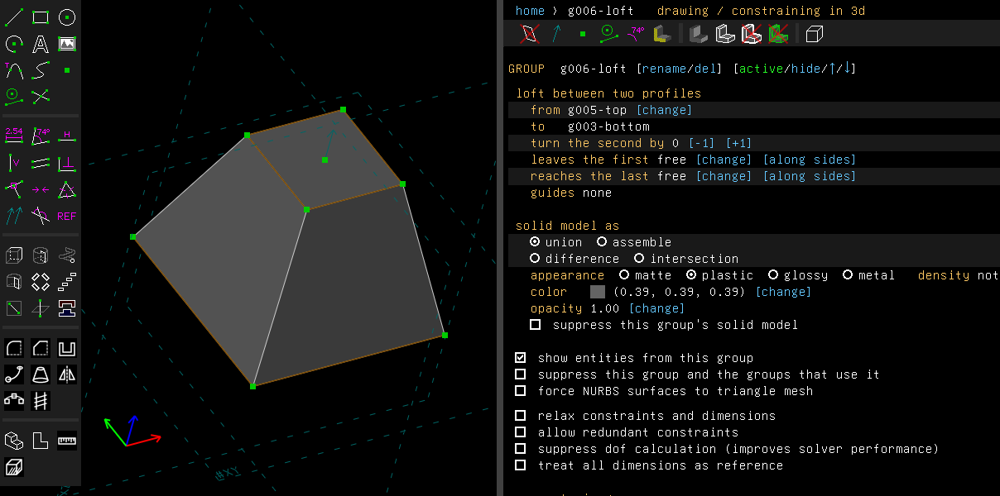
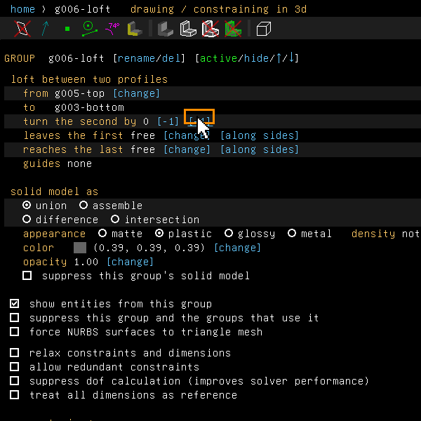
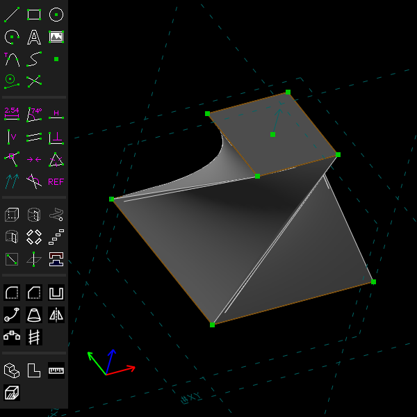
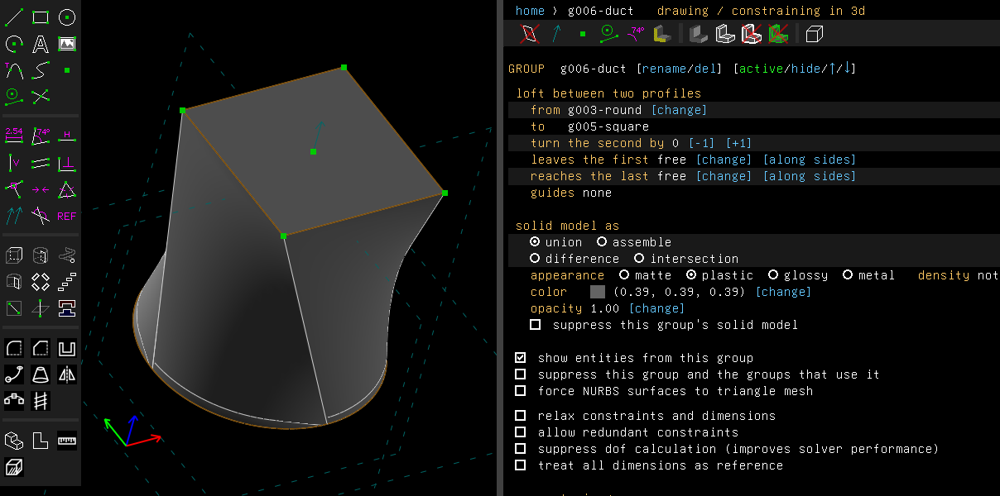
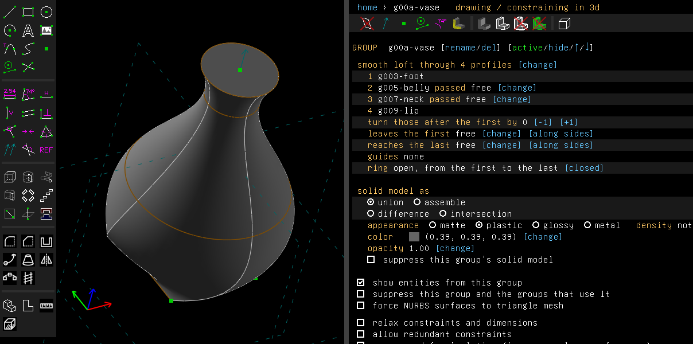

# Loft

Examples: [`examples/scripts/loft`](../../examples/scripts/loft/loft.go), a round-to-square
duct adapter; [`examples/scripts/vase`](../../examples/scripts/vase/vase.go), a vase lofted
smoothly through four profiles; [`examples/scripts/ring`](../../examples/scripts/ring/ring.go),
a ring closed on itself.

A loft joins the closed loop of one sketch to the closed loops of other sketches, and makes a
solid between them. Each sketch is a *profile*, drawn in a workplane.

## Step by step

Loft a small square down to a larger one below it:

1. Draw the two squares, each in a sketch of its own, in workplanes one above the other. Keep
   the upper square's sketch active. Here it is g005-top, and the radio button before it on the
   home screen is set.

   

2. Click a line of the other square. It is drawn in red when selected.

   

3. Choose Features > Loft To Selected Profile (Shift+O). Ruled faces join the two squares, and
   the property browser shows the new loft group.

   

4. Click "[+1]" on the "turn the second by" row. The second square is turned by one side, so
   each side of one square is joined to the next side of the other. The faces become saddles.
   "[-1]" turns it back.

   

   

## Ruled and smooth

Two profiles are joined by ruled faces, one face per curve. The `loft` example joins a circle to
a square this way: the circle counts as four arcs, and each arc is joined to one side of the
square by a ruled face.



Three profiles or more are joined by one smooth surface. The `vase` example lofts a square foot
through three circles. The property browser lists the profiles in order, each with how the
loft passes it.



These pictures are made by [`scenarios/loft.scenario`](scenarios/loft.scenario).

## In the window

1. Activate one of the profile sketches.
2. Select any entity of each other profile.
3. Choose Features > Loft To Selected Profile (Shift+O).

With one other sketch picked, the two loops are joined by ruled faces, curve by curve. With two
or more, one smooth surface goes through all the loops. The profiles are taken in the order of
the history, from the active sketch, which must be the first or the last of them. The window
shows only the groups up to the active one, so activate the last profile and pick the earlier
ones.

The loops need not have the same number of curves. A circle counts as four arcs. A loop with
fewer curves has its longest curve split in two until the counts match, so a triangle lofts to
a square.

The group's screen shows:

- the profiles, with "[change]" to loft through the sketches of the selected entities instead;
- "turn the second by [-1] [+1]" (for a smooth loft, "turn those after the first by"), which
  shifts which curve of one loop is joined to which of the next. A square turned by one side
  has saddle faces. A large turn can fold the surface through itself, which Analyze > Check
  Solid reports;
- how the loft leaves the first profile and reaches the last ([Square to the ends](#square-to-the-ends));
- its guides ([Guide curves](#guide-curves));
- for a smooth loft, how it passes each middle profile, and whether it is closed into a ring.

The smooth surface passes exactly through each profile. Arcs stay exact, so circles about one
axis loft to a true surface of revolution. Where a profile has a corner, the surface has a
crease there, which fades out toward smooth profiles; the window draws it as an edge.

## From a script

```go
l := doc.Features.Loft(bottom, top, "duct")
l.AsLoft().SetTurn(1)

v := doc.Features.LoftThrough([]api.Group{foot, belly, neck, lip}, "vase")
v.AsLoft().Profiles() // foot, belly, neck, lip
```

## Square to the ends

The rows "leaves the first" and "reaches the last" say how the loft meets its end profiles:

- **free**: the surface is shaped by the profiles alone;
- **square to it, n**: the surface leaves along the profile's normal. The number is how long
  that direction is held: the slope across the end is n times the loft's length. 1 is a natural
  curve; more holds the normal longer. "[change]" sets it, and 0 frees it again.

A loft of two profiles with an end set is one smooth surface, not ruled faces. Example:
[`examples/scripts/nozzle`](../../examples/scripts/nozzle/nozzle.go), a square duct turning
into a round one, square to both ends.

```go
loft.AsLoft().SetTangency(1, 1) // square to both ends
loft.AsLoft().SetTangency(0, 0) // free again
```

### Along a solid's sides

A profile may be drawn on a face of the solid made before the loft, along that face's edges.
Click "[along sides]" beside that end, and the loft leaves along the solid's side faces instead
of square to the profile ("[square]" puts it back). The side carries on into the loft without a
crease: where the sides lean, as on a drafted extrusion or a cone, the loft follows the lean.
The number means the same as for square ends.

A profile that is not on the edges of a side face is a problem on the group. Example:
[`examples/scripts/spire`](../../examples/scripts/spire/spire.go), a spire on a tapered post.

```go
loft.AsLoft().SetAlongSides(true, false) // leave the first profile along the sides
```

## Guide curves

A guide is a chain of line segments, arcs and cubics, drawn in a sketch before the loft, joined
end to end. It runs from a point of the first profile through every profile to the last.

Activate the loft, select the curves and choose Features > Guide Loft by Selected Curves. The
loft's screen says how many curves guide it, and "[none]" takes them away.

- One guide moves the loft's sections across: the loft runs along the guide where it would have
  run straight.
- Two guides move, turn and scale the sections: the loft widens and narrows between them.

The loft still goes through every profile. A guide that misses a profile, or does not start and
end on the end profiles, is a problem on the group, and the message says how far it is off. A
guided loft can also leave its ends along a solid's sides. Example:
[`examples/scripts/horn`](../../examples/scripts/horn/horn.go), a horn flared by two guides.

```go
loft.AsLoft().SetGuides([]api.Entity{right, left}) // two guides
loft.AsLoft().SetGuides(nil)                       // none again
```

## Square to a profile between the ends

Each middle profile's row on a smooth loft's screen says how the loft *passed* it: free, or
square to it by a number. "[change]" sets the number, and 0 frees it again. Held square, the
loft runs straight through the profile for a stretch, where free it would bend through it. A
guided loft can hold middle profiles too. Example:
[`examples/scripts/waist`](../../examples/scripts/waist/waist.go), a column running straight up
through its waist.

```go
loft.AsLoft().SetProfileTangency(waist, 0.5) // square to the waist
loft.AsLoft().SetProfileTangency(waist, 0)   // free again
```

## Closed into a ring

A smooth loft of three profiles or more can go on from its last profile back to its first. Click
"[closed]" on its screen's last row ("[open]" undoes it). The ring has no caps, and it is as
smooth where it closes as anywhere else.

- The profiles must go once round the ring, in their order. They may be any distance apart:
  three bunched on one side still make the whole ring. Profiles out of order, or on a line, are
  a problem on the group.
- Any profile can be held square, the first and last by the rows that set an open loft's ends.
- Guides hold a ring too. Each goes round the ring through every profile and closes on itself;
  a guide with ends is a problem on the group.
- A ring cannot turn its profiles or leave along a solid's sides: both are problems on the
  group. A profile drawn on a solid's face goes on into the solid; hold it square instead.

Examples: [`examples/scripts/ring`](../../examples/scripts/ring/ring.go), a ring that swells
and narrows, running straight through its narrow profiles;
[`examples/scripts/wavering`](../../examples/scripts/wavering/wavering.go), a ring held by a
guide waving up and down over it;
[`examples/scripts/billow`](../../examples/scripts/billow/billow.go), a ring held by a guide
swelling up between its profiles and square to every other one.

```go
ring := doc.Features.LoftThrough(profiles, "ring")
ring.AsLoft().SetClosed(true)
ring.AsLoft().SetGuides(guide) // cubics round the ring, end to end
```

## Not yet

A loft takes two guides at most; three or more are refused.
