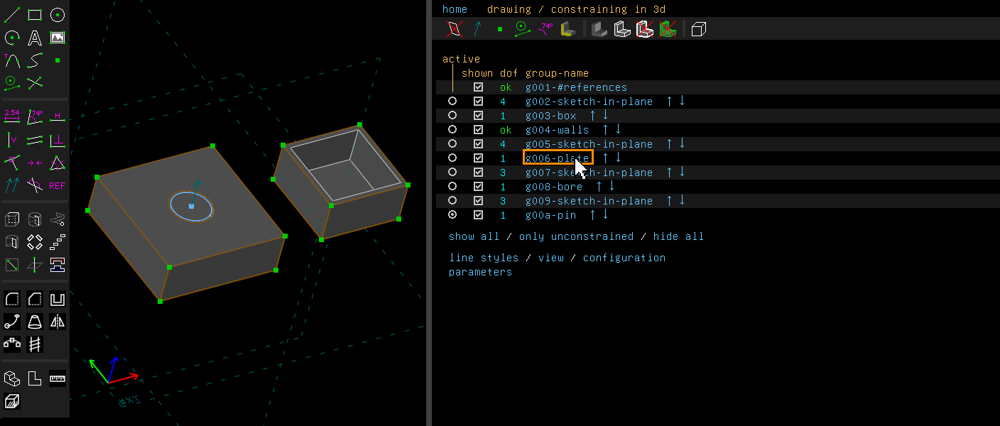
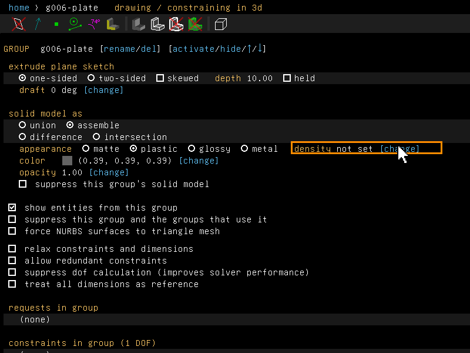
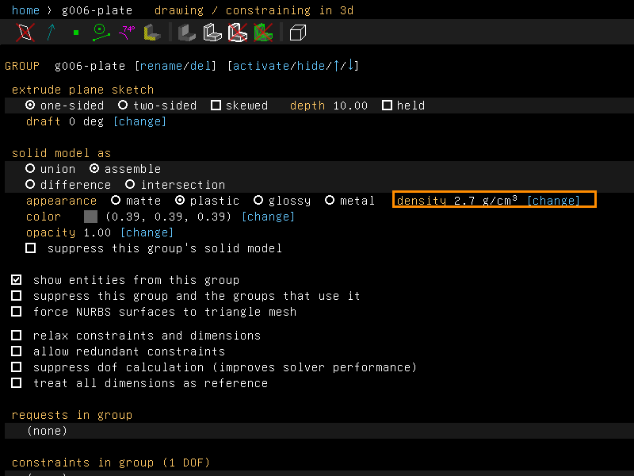

# Density and mass

Example: [`examples/scripts/mass`](../../examples/scripts/mass/mass.go), a steel shaft in an
aluminium housing. The script prints the mass, centre of mass and inertia of each part and of
the whole.

## Step by step

Give two parts a density and weigh the model. The model is the one of
[`examples/scripts/clearance`](../../examples/scripts/clearance/clearance.go): a hollowed box,
a plate with a bore and a pin in it. The plate and the pin are assembled, so each is a part.

1. On the home screen, click the plate's group, g006-plate.

   

2. At the end of the appearance row, click [change] beside "density not set".

   

3. Type the density in g/cm³, here 2.7 for aluminium. The row now reads "density 2.7 g/cm³".
   Do the same for the pin's group, g00a-pin, with 7.85 for steel.

   

4. Choose Analyze > Measure Volume (Ctrl+Shift+V). The message gives the mass of the model,
   28.43 g, centred at (1.79, 0.00005, 4.94). Then it lists each part: g004-walls (the box)
   1.274 g at 1 g/cm³, g006-plate 22.19 g at 2.7 g/cm³, and g00a-pin 4.964 g at 7.85 g/cm³. It
   ends: "Where no density is set, 1 g/cm³ is taken: set it in the group's screen."

These pictures are made by [`scenarios/mass.scenario`](scenarios/mass.scenario). The property
browser is wider than usual in them, so that the whole appearance row shows.

## What it does

A density belongs to a part, not to a feature: once two features' solids are joined, nothing
says which volume was whose. The parts are the ones Show Interfering Parts takes:

- each group set to **assemble** is a part, at its own density;
- the solid made before the first of them is one part, at the density last set among its
  groups;
- a model that assembles nothing is one part.

A group that cuts the assembly after the parts cuts each part it reaches before it is weighed.

## In the window

A group's screen sets the density at the end of its appearance row: `density not set
[change]`. The unit is g/cm³: steel is about 7.85, aluminium 2.7, PLA 1.24. An empty field
clears it.

Only a group that adds a solid of its own has a density: an extrusion, lathe, revolve, helix,
sweep, loft or link. A fillet or a shell changes a solid that has one already, and a step and
repeat copies it. Setting a density changes no geometry, so nothing regenerates. It is one step
of undo, and it is saved with the model.

Analyze > Measure Volume (Ctrl+Shift+V) then gives:

- the mass of the model up to the active group, and its centre of mass;
- the mass of each part, where there are several.

A part with no density is taken at 1 g/cm³, water's, and the message says so. With no density
set anywhere, Measure Volume gives the volume alone.

## From a script

```go
housing.SetDensity(2.7) // aluminium, g/cm³; 0 clears it
shaft.SetDensity(7.85)  // steel
r := shaft.Analyze().MassProperties()
for _, p := range r.Parts {
	fmt.Println(p.Group, p.Volume, p.Density, p.DensitySet, p.Mass, p.CenterOfMass)
}
fmt.Println(r.Mass, r.CenterOfMass, r.Inertia[2][2], r.DensityUnset())
```

`Density` reads it back. Masses are in g, lengths in mm. `Inertia` is the inertia tensor in g·mm²
about the centre of mass: the moments about the x, y and z axes through it on the diagonal, the
products of inertia, negated, off it. Each part's tensor is about its own centre of mass, the
whole's about the whole's.

The [bill of materials](bill-of-materials.md#bill-of-materials) gives each linked part's mass,
at the density set on its link group.

## Not yet

- Masses come from the solid's triangles, so a curved part is a little short of its true volume.
  For the last fractions of a percent, set the chord tolerance smaller in Edit > Preferences.
  Analyze > [Ray-Cast Check](check-solid.md#ray-cast-check) measures volume and inertia without
  the mesh, at a density of one, for the models it can rebuild.
- A density set in a part's own file is not carried into a model that links it. Set it on the
  link group.
- One density per part: a part of two materials joined is not split by them.
- Analyze > Show Center of Mass, and `Analyze().CenterOfMass()`, take the whole model at one
  density. Measure Volume's centre of mass uses the densities.
