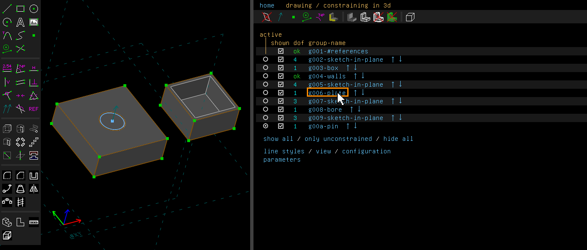
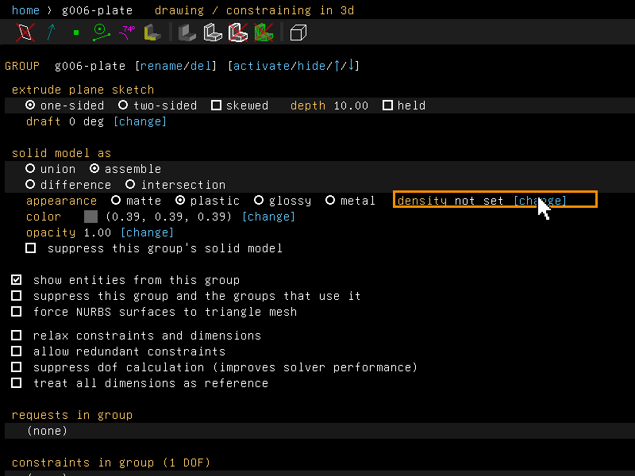
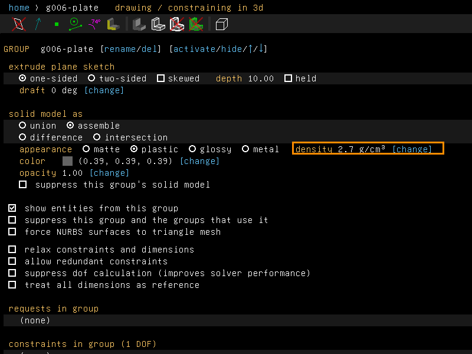

# Density and mass

Example: [`examples/scripts/mass`](../../examples/scripts/mass/mass.go), a steel shaft in an
aluminium housing. The script prints the mass, centre of mass and inertia of each part and of
the whole.

## Step by step

Give two parts a density and weigh the model. The model is the one of
[`examples/scripts/clearance`](../../examples/scripts/clearance/clearance.go): a hollowed box,
a plate with a bore and a pin in it. The plate and the pin are assembled, so each is a part.

1. On the home screen, click the plate's group, g006-plate.

   

2. At the end of the appearance row, click [change] beside "density not set".

   

3. Type the density in g/cm³, here 2.7 for aluminium. The row now reads "density 2.7 g/cm³".
   Do the same for the pin's group, g00a-pin, with 7.85 for steel.

   

4. Choose Analyze > Measure Volume (Ctrl+Shift+V). The message gives the mass of the model,
   28.43 g, centred at (1.79, -0.00, 4.94), then each part: the box 1.274 g at 1 g/cm³, the
   plate 22.19 g at 2.7 g/cm³ and the pin 4.962 g at 7.85 g/cm³. It ends: "Where no density is
   set, 1 g/cm³ is taken: set it in the group's screen."

These pictures are made by [`scenarios/mass.scenario`](scenarios/mass.scenario). The property
browser is wider than usual in them, so that the whole appearance row shows.

## What it does

A density belongs to a part, not to a feature. Once two features' solids are joined, nothing
says which volume was whose. The parts are the same ones Show Interfering Parts takes:

- each group assembled into the model is a part, at its own density;
- the solid made before the first of them is one part, at the density last set among its
  groups;
- a model that assembles nothing is one part.

A group that cuts the assembly after them cuts each part it reaches before it is weighed, a part
made of triangles (forced to a triangle mesh, or linked as a mesh) as well.

## In the window

A group's screen sets the density at the end of its appearance row: `density not set
[change]`. The unit is g/cm³. Steel is about 7.85, aluminium 2.7, PLA 1.24. An empty field
clears it.

Only a group whose solid joins the model, or is assembled into it, has a density: an
extrusion, lathe, revolve, helix, sweep, loft or link. A fillet or a shell edits a solid that
has one already, and a step and repeat copies it.

Setting a density changes no geometry, so nothing regenerates. It is one step of undo, and it
is saved with the model.

Analyze > Measure Volume (Ctrl+Shift+V) then gives the mass of the model up to the active group
and its centre of mass, and the mass of each part where there are several. A part with no
density set is taken at 1 g/cm³, water's, and the message says so. With no density set
anywhere, it gives the volume alone, as before.

## From a script

```go
housing.SetDensity(2.7) // aluminium, g/cm³; 0 clears it
shaft.SetDensity(7.85)  // steel
r := shaft.Analyze().MassProperties()
for _, p := range r.Parts {
	fmt.Println(p.Group, p.Volume, p.Density, p.DensitySet, p.Mass, p.CenterOfMass)
}
fmt.Println(r.Mass, r.CenterOfMass, r.Inertia[2][2], r.DensityUnset())
```

Masses are in g, lengths in mm. `Inertia` is the inertia tensor in g·mm² about the centre of
mass. On the diagonal are the moments about the axes through it along x, y and z. Off the
diagonal are the products of inertia, negated. The whole's tensor is about the whole's centre
of mass.

The [bill of materials](bill-of-materials.md#bill-of-materials) gives each linked part's mass,
at the density set on its link group.

## Not yet

- Masses come from the solid's triangles, so a curved part is short of its true volume by the
  chord tolerance (how far the mesh may stray from the true surface). For the last fractions of
  a percent, set the chord tolerance smaller on the configuration screen. Analyze >
  [Ray-Cast Check](check-solid.md#ray-cast-check) measures the volume and inertia without the
  mesh, at a density of one, for the models it can rebuild.
- A density set in a part's own file is not carried into a model that links the part. Set it on
  the link group.
- One density per part. A part made of two materials joined is not split by them.
- Analyze > Show Center of Mass, and `Analyze().CenterOfMass()` in a script, still take the
  whole model at one density. Measure Volume's centre of mass uses the densities.
