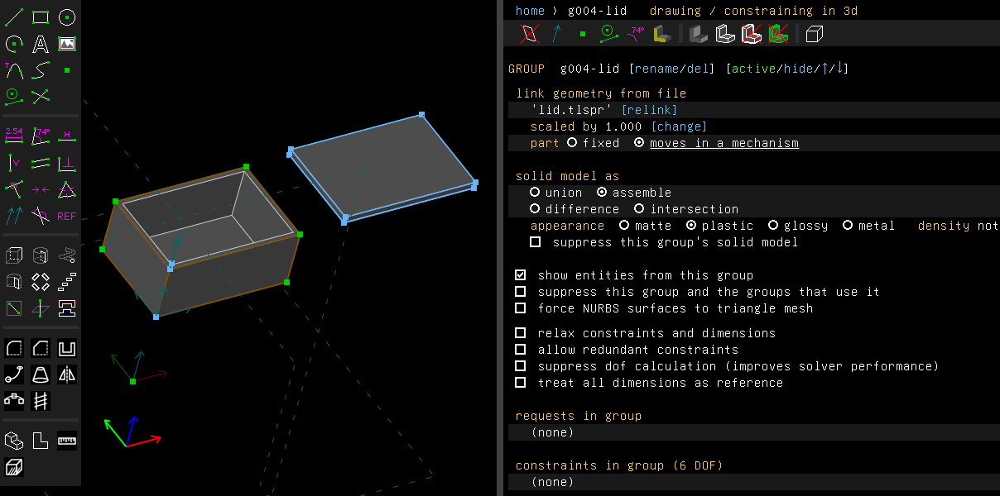
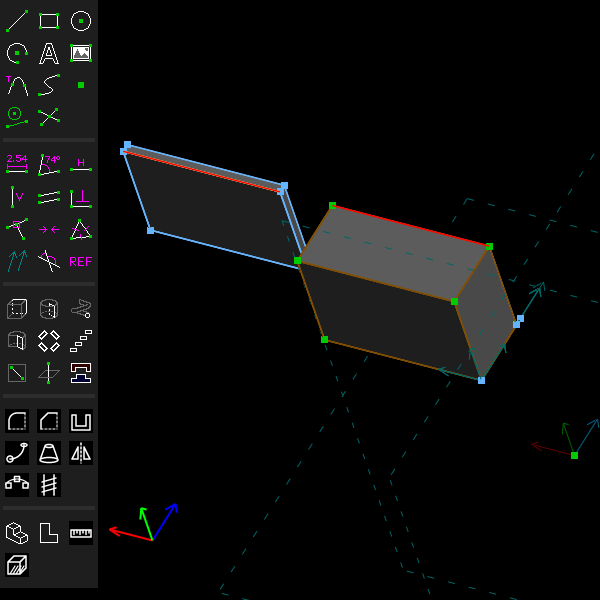
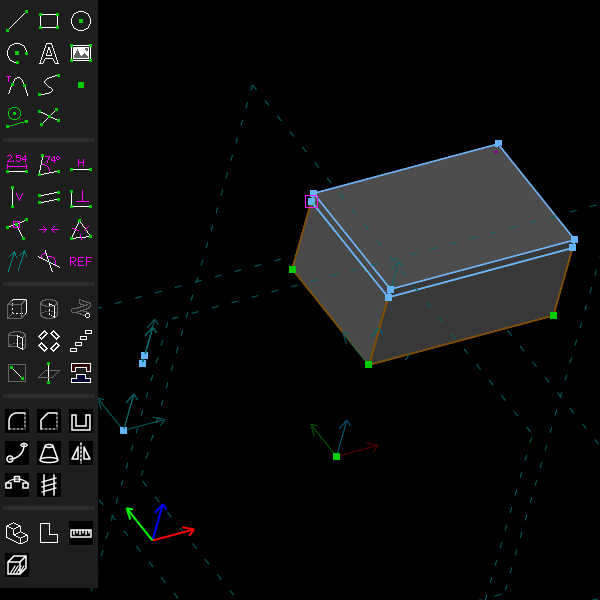
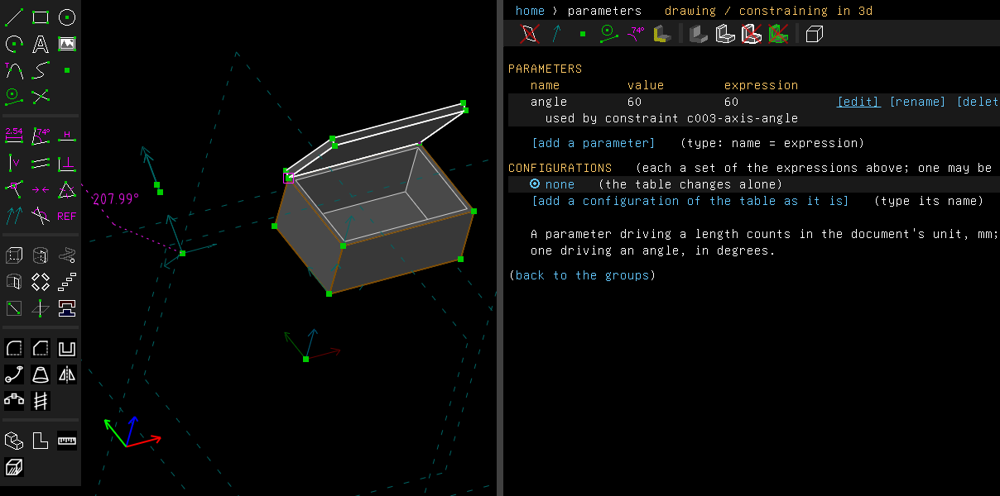

# Mechanisms

> **Experimental.** There is no switch to turn mechanisms on: you set a linked part's **part**
> row to `moves in a mechanism`, and that part joins a mechanism. What is experimental is how
> they behave. The menus, the **part** and **freedom** rows and the script calls (`SetMoves`,
> `HingeDriven`, `ConcentricDriven`, `SetRange`, `Freedom`) may change in a later version, and a
> drag may move the parts otherwise than it does now. A model saved with moving parts
> (`link-moves` in the file) opens in later versions, but its parts may come to rest elsewhere.
> Check what a mechanism does before relying on it.

Examples: [`examples/scripts/lid`](../../examples/scripts/lid/lid.go), a box with a hinged lid
that opens up to 110°; [`examples/scripts/engine`](../../examples/scripts/engine/engine.go), an
engine's crank, connecting rod and piston turned round by the crank.

A mechanism is linked parts, joined by mates, that move together: a lid on its hinge, or a
crank, a connecting rod and a piston. Pull one part and the parts joined to it move as their
joints let them. Drive one joint by a parameter, and a motion study runs the whole mechanism.

Ordinarily each group is solved alone, with every group before it held still. A mate then moves
only the part its own group places, a loop of parts can't close, and a dragged part snaps back.
A mechanism solves its parts together, as one system, and a drag moves them as their mates
allow. The parts are rigid: there are no forces, contact or collisions.

## Step by step

Hinge a lid on a box and open it:

1. Link the box (Assembly > Link / Assemble...), then the lid. The box is the ground, held where
   it is. On the lid's group screen, set **part** to `moves in a mechanism`. Here the lid's file
   has it lying beside the box at the height of the box's rim.

   

2. The hinge runs along the back edges: the box's top one and the lid's bottom one. Turn the view
   to see them from behind (drag with the middle button), select the box's edge, then the lid's.

   

3. Choose Assembly > Mate Hinge. The lid's edge is put on the box's, which slides the lid onto
   the box, closed. It can only turn about the hinge now, and its group screen counts one degree
   of freedom.

   

4. Drag the lid's front edge up. The lid swings open about the hinge, as far as you drag it. A
   part that doesn't move in a mechanism would snap back instead.

   

5. To open it by a number instead, undo the drag and the hinge, select the two edges again and
   choose Assembly > Mate Hinge, Driven. The hinge now makes a parameter, `angle`, the lid's
   opening in degrees, 0 where it is closed. In Edit > Parameters, `[edit]` it to 60: the lid
   opens 60°. The hinge's dimension on the drawing reads another number: it counts the turn from
   its own frame, so it is the closed turn plus `angle`.

   

These pictures are made by [`scenarios/mechanisms.scenario`](scenarios/mechanisms.scenario).

## Parts that move together

A link group's **part** row is `fixed` by default. Set it to `moves in a mechanism`:

- Flagged link groups that stand next to each other in the list of groups make one mechanism.
  Their constraints, mates included, are solved together.
- Unflagged links, and every group before the mechanism, are the ground and stay still.
- A group of another kind between two flagged links (a 3D sketch with a datum, say) ends the
  mechanism there. Put such groups before or after it.

Every group of a mechanism reports the same result: solved or not, and the degrees of freedom
of the whole mechanism. A hinged lid keeps one; an engine's crank, rod and piston keep one, the
crank's turn. The flag is one step of undo and is saved in the file.

## Joints

A joint is the mates that hold two parts together:

- **A hinge on an edge**: Mate Hinge, with an edge of each part along the hinge line.
- **A pin in its hole**: Mate Concentric on the two circles puts them on one axis. Add Mate
  Flush of a face on the face beside it, so the pin can't slide along the axis. The
  [engine](../../examples/scripts/engine/engine.go)'s crank, rod and piston are joined so.
- **A slide**: a point of the part on a line (Constrain > On Point / Curve / Plane), with a line of the part kept
  parallel to it, so it slides without turning, as the piston's pin on the cylinder's axis.

Where the parts lie stacked at different heights, as an engine's do, make a slide's point on a
line in the XY workplane (Sketch > In Workplane). In the workplane the point only has to lie
on the line as seen from above; in 3D it would have to reach the line's height, which a part
at another height can't.

## Closing a loop

The crank, rod and piston make a loop with the frame; the piston's slide closes it. A four-bar
linkage closes its loop with a last hinge. That hinge repeats something the other hinges already
hold (that the axes are parallel). A mechanism accepts such a repeat: it solves, keeps its
freedom, and marks the repeated constraints `(implied)` in the group's list of constraints.

Still refused:

- a dimension that repeats another: it is made a reference dimension, as in any sketch;
- a loop that can't close, as a chain too short for its gap: it doesn't solve.

Put the parts roughly where they go before the last joint closes the loop. From full stretch, all
in one straight line, the solve can't close it.

## How each part can move

For a part that moves in a mechanism, the link group's screen shows two more rows: the
mechanism's size and freedom (`mechanism of 3 parts, 1 DOF`), and how this part can move,
counted from its mates:

| The screen says | For example |
|---|---|
| `fixed` | a part that can't move |
| `turns about the axis through (x, y, z) along (dx, dy, dz)` | a part on a hinge, a pin flush in its hole |
| `turns about and slides along the axis ...` | a pin in a hole, not held flush |
| `screws along the axis ..., 2.00 a turn` | a part on a screw mate |
| `moves in the plane through ... normal to ...` | a part flush on a face |
| `slides in the plane through ... normal to ...` | a part that slides on a face but can't turn |
| `slides along (dx, dy, dz)` | the engine's piston |
| `turns about the point (x, y, z)` | a ball joint: a point of the part on a point |
| `turns about an axis that moves with the mechanism` | a four-bar's coupler, an engine's rod |
| `free`, or a count such as `turns 1 way and slides 1 way` | nothing stays put |

A driven joint adds `driven by angle`. The count is what the mates allow with the drive and any
limits let go, so a driven lid still `turns about` its hinge. It is counted where the parts are
now.

## Dragging

Drag a point or a line of a mechanism's part, or move one from a script (`Entity.MoveTo`,
`Entity.MoveBy`). The part turns and slides as its mates let it, the parts joined to it follow,
and the point stops as near where it was sent as they can bring it.

- Where a mate lets a part both slide and turn, it slides.
- A minimum or maximum on a dimension of the mechanism stops the drag there.
- A mechanism with no freedom left doesn't move.

The drag follows the mouse in the view's plane. A hinged part dragged along its hinge line hardly
moves: turn the view so that the plane the part turns in faces you.

## Driven joints

A driven joint is turned or slid by a parameter, which a motion study then drives:

- **Mate Hinge, Driven**: the hinge of Mate Hinge, with the second part's turn held by a new
  parameter, `angle`, in degrees from where the part is. With two line segments it hinges on the
  first line; with two circles or arcs, a pin and its hole, it puts them on one axis and drives
  the turn about it. A positive angle turns anticlockwise seen from the line's end looking back to
  its start, or from the side the first circle's normal points to.
- **Mate Concentric, Driven**, with two circles or arcs: the concentric mate, with the second
  circle's distance along the axis held by a new parameter, `travel`. The part may still turn:
  hold that with another mate.

A second driven joint gets `angle2` or `travel2`, and so on. Both mates are made in 3D. Dragging
a driven joint's parts moves nothing; editing its parameter in Edit > Parameters does.

Assembly > Motion Study on `angle` turns the joint through a range, saving a picture or a mesh at
each step ([motion study](parameters-and-units.md#motion-study)). The engine's crank driven from 0
to 360 runs the piston up and down its stroke.

To keep a joint within a range, select its dimension and choose Constrain > Minimum Dimension or
Maximum Dimension. On a driven dimension the bound is added beside the drive. A parameter value
past the bound fails to solve, and a motion study marks that step unsolved, as the lid's past
110°. See [limits](limits.md).

## From a script

```go
lid.AsLink().SetMoves(true)                          // moves in a mechanism
mate := doc.Assembly.HingeDriven(boxEdge, lidEdge)   // makes the parameter angle
mate.SetRange(0, 110)                                // two bounds beside the driven angle
frames, err := doc.Assembly.MotionStudy(mate.Param, 0, 140, 14, "f%02d.png")

front.MoveTo(api.V(30, 0, 60))                       // an undriven hinge: pulled open
crank := doc.Assembly.HingeDriven(bearing, mainHole) // a pin in its hole, driven
doc.Assembly.Flush(frameTop, crankBottom)            // the crank kept from sliding off it
doc.Sketch.InWorkplane(doc.Workplane("XY"))
doc.Constrain.On(pistonPin.Center(), cylinderAxis)   // the piston's slide, in the plane
doc.Constrain.Parallel(pistonAxis, cylinderAxis)
doc.Sketch.Anywhere3D()
fmt.Println(piston.AsLink().Mechanism(), piston.Dof())
```

`Moves` reads the flag back, and `Mechanism` lists the groups of the link's mechanism, in order.
`Group.Implied` lists the constraints a closed loop repeats. `Freedom` says how the part can
move, as the screen does:

```go
f := piston.AsLink().Freedom()
fmt.Println(f.Text)                 // slides along (0, 1, 0), driven by angle
fmt.Println(f.Turns, f.Slides)      // 0 1
fmt.Println(f.Invariant, f.Dir)     // direction (0, 1, 0)
```

| Field | What it holds |
|---|---|
| `Turns`, `Slides` | how many ways the part turns and slides |
| `Invariant` | what stays put: `"point"`, `"axis"`, `"plane"`, `"direction"` or `"none"` |
| `Point`, `Dir` | where the invariant is, and its direction |
| `Lead` | a screw's travel in one turn |
| `Moving` | the part turns about an axis that moves |
| `DrivenBy` | the parameters that drive it |

## Not yet

- A motion study drives one parameter. Two driven joints moved together need an expression
  tying one to the other.
- A drag doesn't write back into a driving parameter.
- A 3D sketch can't be part of a mechanism.
- No ball, cylindrical, planar or slot mate of its own. A point on a point makes a ball joint,
  Mate Concentric alone a cylindrical one.
- Parts need a start position near where they go: a loop can't close from full stretch.
- Turning a part with Shift or Ctrl while dragging, or by its normal, doesn't follow the
  mechanism's freedom: the part is put where it is turned, then solved.
- Dragging an assembly with a Boolean among its groups (a cut through two parts) is slower: the
  assembly is meshed again at every step.
- Edges that lie on each other, as a closed lid's on its box's, can't both be picked: you get the
  active group's. Link the part where its edge is clear, or turn the view.
