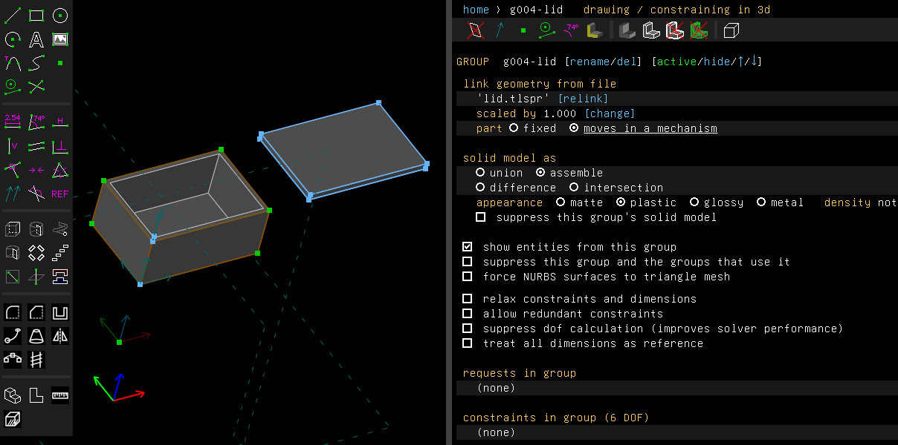
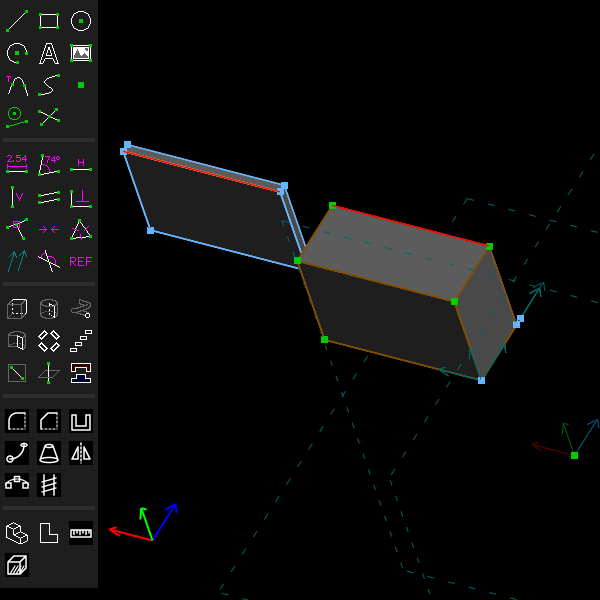
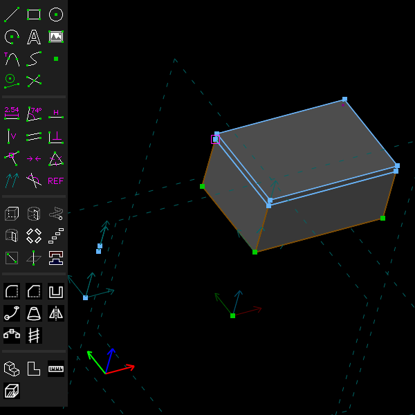
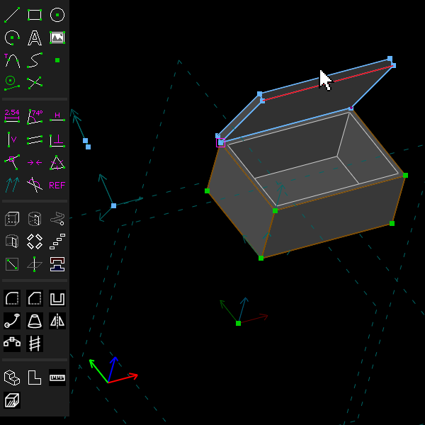
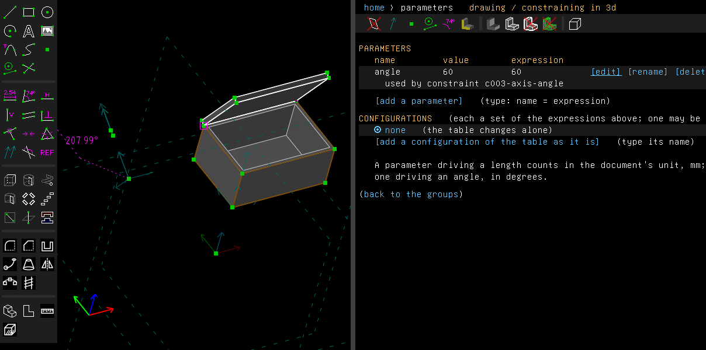

# Mechanisms

> **Experimental.** Mechanisms are new and still being worked on. What the menus, the group
> screen's **part** row and the script calls (`SetMoves`, `HingeDriven`, `ConcentricDriven`,
> `SetRange`) do may change in a later version, and a drag may move the parts otherwise than it
> does now. A model saved with parts that move in a mechanism (`link-moves` in the file) opens in
> later versions, but its parts may come to rest elsewhere. Check what a mechanism does before
> relying on it, and say where it goes wrong.

Examples: [`examples/scripts/lid`](../../examples/scripts/lid/lid.go), a box with a hinged lid
that opens up to 110°; [`examples/scripts/engine`](../../examples/scripts/engine/engine.go), an
engine's crank, connecting rod and piston turned round by the crank.

A mechanism is linked parts joined by mates that move together: a lid on its hinge, a crank, a
connecting rod and a piston. Pull one part and the parts joined to it move as their joints let
them. Drive one joint by a parameter, and a motion study turns the whole mechanism.

Ordinarily each group is solved alone, with every group before it held where it is. A mate in
the active group then moves only the part that group places, a loop of parts can't be closed,
and a linked part dragged in the window snaps back to where its mates hold it. A mechanism
solves its parts together instead, as one system, and a drag moves them as their mates allow.
It is the same constraints and the same solver: only which parts are solved together, and how a
drag moves them, change. There are no forces, no contact and no collisions: the parts are rigid
and held by their constraints alone.

## Step by step

Hinge a lid on a box and open it:

1. Link the box (Assembly > Link / Assemble...), then the lid. The box is the ground, held where
   it is. On the lid's group screen, set **part** to `moves in a mechanism`. Here the lid's file
   has it lying beside the box at the height of the box's rim.

   

2. The hinge runs along the back edges: the box's top one and the lid's bottom one. Turn the view
   to see them from behind (drag with the middle button), select the box's edge, then the lid's.

   

3. Choose Assembly > Mate Hinge. The lid's edge is put on the box's, which slides the lid onto
   the box, closed. It can only turn about the hinge now, and its group screen counts one degree
   of freedom.

   

4. Drag the lid's front edge up. The lid swings open about the hinge, as far as you drag it. A part
   that doesn't move in a mechanism would snap back: the hinge can bring its edge back only by
   moving the lid, never by turning it.

   

5. To open it by a number instead, undo the drag and the hinge, select the two edges again and
   choose Assembly > Mate Hinge, Driven. The hinge now makes a parameter, `angle`, the lid's
   opening in degrees, 0 where it is closed. In Edit > Parameters, `[edit]` it to 60: the lid
   opens 60°. The hinge's dimension on the drawing counts the turn from its own frame, so it reads
   another number, the turn closed plus `angle`.

   

These pictures are made by [`scenarios/mechanisms.scenario`](scenarios/mechanisms.scenario).

## Parts that move together

On a link group's screen, **part** is `fixed` by default. Set to `moves in a mechanism`, the
link group joins the link groups so flagged that stand next to it in the list of groups: those
are one mechanism. Their constraints, the mates among them included, are solved as one system,
so a mate in any of them moves the others. Unflagged links, and every group before the
mechanism, are the ground, held where they are. A group of another kind between two flagged
links, a 3D sketch with a datum too, ends the mechanism there: put such groups before the
mechanism or after it.

Every group of a mechanism reports the same result: solved or not, and the degrees of freedom
left in the whole mechanism. A hinged lid keeps one; an engine's crank, rod and piston keep one,
the crank's turn. A change in any of its groups solves all of them again. The flag is one step
of undo, and is saved in the file (`link-moves`); a file without it is solved as before.

## Joints

A joint is the mates that hold two parts together:

- **A hinge on an edge**: Mate Hinge, with an edge of each part along the hinge's line, as the lid
  above.
- **A pin in its hole**: Mate Concentric, with the hole's circle and the pin's (or the other
  hole's), puts them on one axis; the part may still slide along it, which Mate Flush of a face on
  the face beside it holds. The crank on its bearing, the rod on the crank pin and the piston on
  its pin in the [engine](../../examples/scripts/engine/engine.go) are each joined so.
- **A slide**: a point of the part on a line, as the piston's pin on the cylinder's axis, with a
  line of the part kept parallel to it, so that it slides without turning.

Where the parts lie in layers, one above the other, as an engine's do, a slide's point on a line
is made in the XY workplane (Sketch > In Workplane): there it holds in the plane what the parts,
stacked at different heights, couldn't hold in 3D.

## Closing a loop

The crank, the rod and the piston make a loop with the frame: the last joint, the piston's slide,
closes it. In 3D a loop of hinges about parallel axes has more equations than it needs: a last
hinge would be redundant, and the mechanism would fail to solve. Close the loop with a point on a
line instead, or a slide made in a workplane, which give as many equations as the loop needs. Or
allow redundant constraints in one group of the mechanism, which then holds for all of it.

Put the parts roughly where they go before the last joint closes the loop. Parts lying in one
straight line are at full stretch, where the loop's end can't move along it at first, and the
solve can't close the loop from there.

## Dragging

Drag a point or a line of a mechanism's part, or move one from a script (`Entity.MoveTo`,
`Entity.MoveBy`), and it is pulled along the mechanism's freedom: the part turns and slides as
its mates let it, the parts joined to it move with it, and the point stops as near where it was
sent as they can bring it. Where a mate lets a part both slide and turn, it slides. A minimum or
maximum on a dimension of the mechanism stops the pull there. A mechanism with no freedom left
doesn't move. A point of any other part is put where it is sent, and its constraints then move
it, as before.

The pull follows the mouse in the view's plane. A hinge holds its part in the plane square to its
line: dragged along the line, the part hardly moves. Turn the view so that the plane the part
turns in faces you.

While a linked part is dragged, an assembly is drawn from each part's mesh moved where its link
places it, and meshed again when the drag ends.

## Driven joints

A driven joint is turned or slid by a parameter, which a motion study then drives:

- **Mate Hinge, Driven**, with two line segments, makes the hinge Mate Hinge makes, and holds the
  second part's turn about the first line by a new parameter, `angle`, in degrees from where
  the part is, starting at 0. With two circles or arcs, a pin and its hole, it puts them on one
  axis as Mate Concentric does and drives the turn about the first one's axis. A second driven
  hinge gets `angle2`, and so on. A positive angle turns the part anticlockwise seen from the
  line's end looking back to its start, or from the side the first circle's normal points to.
- **Mate Concentric, Driven**, with two circles or arcs, makes the concentric mate, and holds the
  second circle's distance along the first one's axis by a new parameter, `travel`, from where it
  is. The part may still turn about the axis: hold that with another mate.

A driven joint leaves no freedom: dragging its parts moves nothing, while the parameter, edited in
the parameter table, does. Both mates are made in 3D. Assembly > Motion Study on `angle` turns the
joint through a range, saving a picture or a mesh of each step
([motion study](parameters-and-units.md#motion-study)): the engine's crank driven from 0 to 360
turns round and runs the piston up and down its stroke, twice the crank's throw.

To keep a joint within a range, select its dimension and choose Constrain > Minimum Dimension or
Maximum Dimension. On a dimension that a parameter drives, the bound is put beside it rather than
in its place, and a value of the parameter past it fails to solve: a motion study marks such a
step unsolved, as the lid's past 110°. A turn about an axis takes a bound as a distance does
([limits](limits.md)).

## From a script

```go
lid.AsLink().SetMoves(true)                          // moves in a mechanism
mate := doc.Assembly.HingeDriven(boxEdge, lidEdge)   // makes the parameter angle
mate.SetRange(0, 110)                                // two bounds beside the driven angle
frames, err := doc.Assembly.MotionStudy(mate.Param, 0, 140, 14, "f%02d.png")

front.MoveTo(api.V(30, 0, 60))                       // an undriven hinge: pulled open
crank := doc.Assembly.HingeDriven(bearing, mainHole) // a pin in its hole, driven
doc.Assembly.Flush(frameTop, crankBottom)            // the crank kept from sliding off it
doc.Sketch.InWorkplane(doc.Workplane("XY"))
doc.Constrain.On(pistonPin.Center(), cylinderAxis)   // the piston's slide, in the plane
doc.Constrain.Parallel(pistonAxis, cylinderAxis)
doc.Sketch.Anywhere3D()
fmt.Println(piston.AsLink().Mechanism(), piston.Dof())
```

`Moves` reads the flag back, and `Mechanism` lists the groups of the link's mechanism, in order.

## Not yet

- A motion study drives one parameter: two driven joints moved together need an expression
  tying one to the other.
- Turning a mechanism's part with Shift or Ctrl while dragging, or by its normal, puts it where
  it is turned and solves, as for any part: it doesn't follow the mechanism's freedom.
- A drag of an assembly with a Boolean among its groups (a cut through two parts) meshes the
  assembly again at every step, which is slower.
- A 3D sketch can't be a part of a mechanism, and a drag doesn't write back into a driving
  parameter.
- Edges that lie on each other, as a closed lid's on its box's, can't both be picked where they
  are: the one of the active group is. Link a part where its edge is clear, as the lid beside the
  box, or turn the view.
