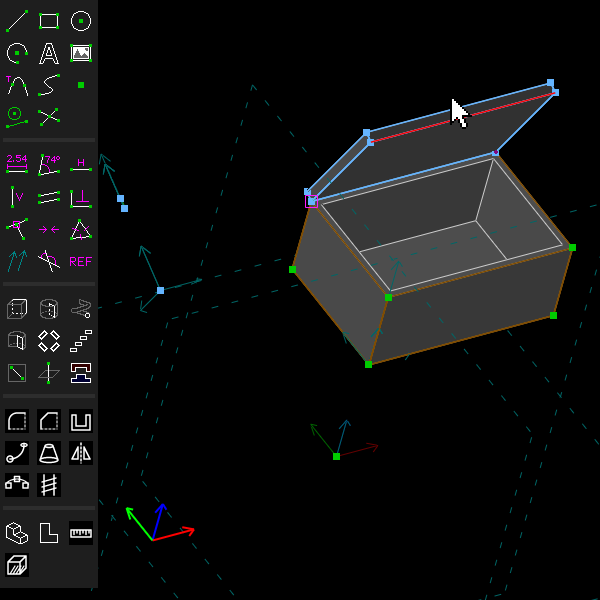
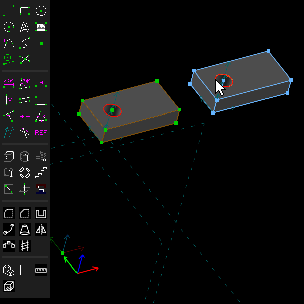
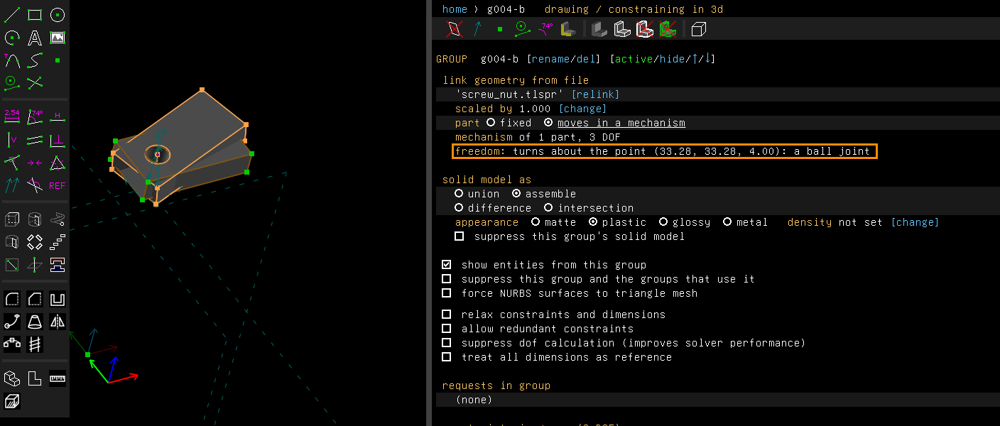
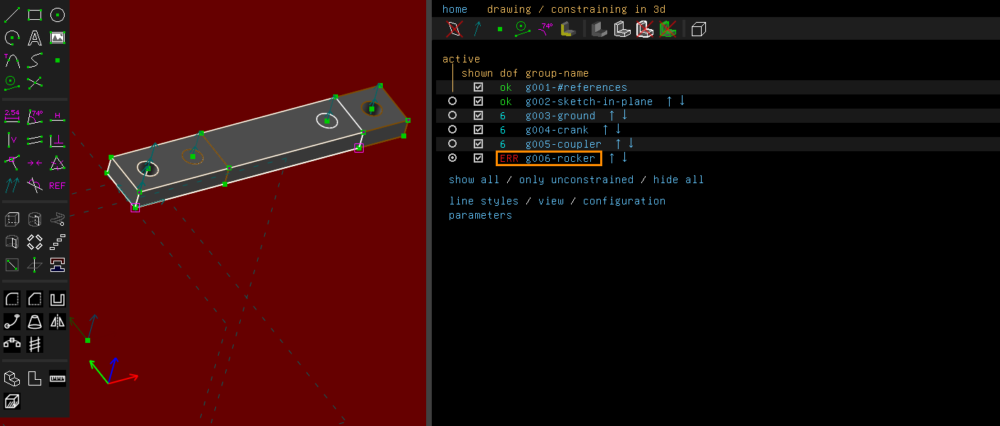
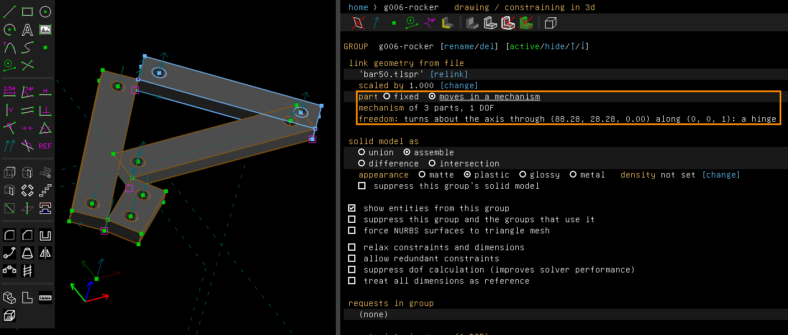
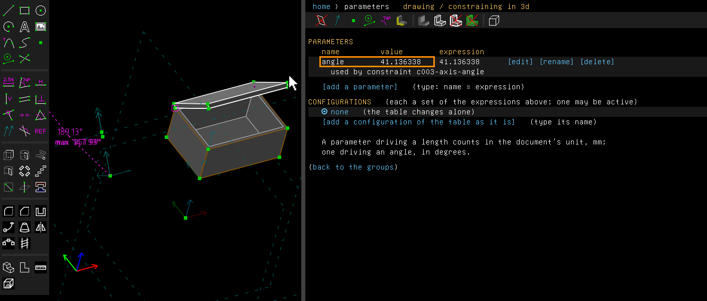
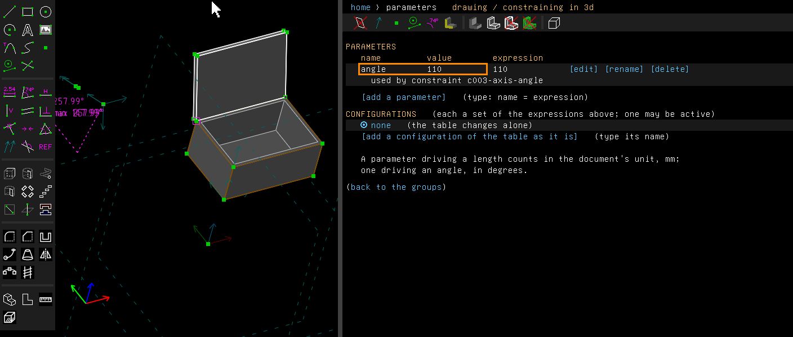
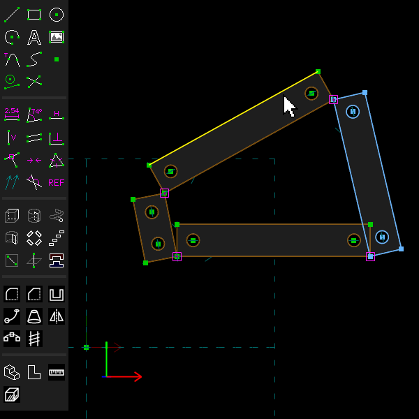
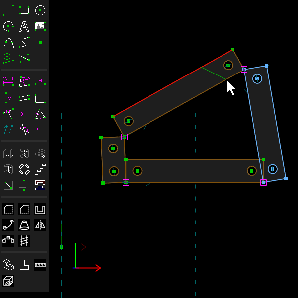

# Mechanisms

> **Experimental.** There is no switch to turn mechanisms on: you set a linked part's **part**
> row to `moves in a mechanism`, and that part joins a mechanism. What is experimental is how
> they behave. The menus, the **part** and **freedom** rows and the script calls (`SetMoves`,
> `HingeDriven`, `ConcentricDriven`, `SetRange`, `Freedom`) may change in a later version, and a
> drag may move the parts otherwise than it does now. A model saved with moving parts
> (`link-moves` in the file) opens in later versions, but its parts may come to rest elsewhere.
> Check what a mechanism does before relying on it.

Examples: [`examples/scripts/lid`](../../examples/scripts/lid/lid.go), a box with a hinged lid
that opens up to 110°; [`examples/scripts/engine`](../../examples/scripts/engine/engine.go), an
engine's crank, connecting rod and piston turned round by the crank;
[`examples/scripts/joints`](../../examples/scripts/joints/joints.go), plates joined by a ball,
a cylindrical, a planar and a slot joint;
[`examples/scripts/flaps`](../../examples/scripts/flaps/flaps.go), a box with two flaps that one
motion study opens together; [`examples/scripts/fourbar`](../../examples/scripts/fourbar/fourbar.go),
a four-bar linkage assembled from four bars that lie on top of each other.

A mechanism is linked parts, joined by mates, that move together: a lid on its hinge, or a
crank, a connecting rod and a piston. Pull one part and the parts joined to it move as their
joints let them. Drive one joint by a parameter, and a motion study runs the whole mechanism.

Ordinarily each group is solved alone, with every group before it held still. A mate then moves
only the part its own group places, a loop of parts can't close, and a dragged part snaps back.
A mechanism solves its parts together, as one system, and a drag moves them as their mates
allow. The parts are rigid: there are no forces, contact or collisions.

## Step by step

Hinge a lid on a box and open it:

1. Link the box (Assembly > Link / Assemble...), then the lid. The box is the ground, held where
   it is. On the lid's group screen, set **part** to `moves in a mechanism`. Here the lid's file
   has it lying beside the box at the height of the box's rim.

   

2. The hinge runs along the back edges: the box's top one and the lid's bottom one. Turn the view
   to see them from behind (drag with the middle button), select the box's edge, then the lid's.

   

3. Choose Assembly > Mate Hinge. The lid's edge is put on the box's, which slides the lid onto
   the box, closed. It can only turn about the hinge now, and its group screen counts one degree
   of freedom.

   

4. Drag the lid's front edge up. The lid swings open about the hinge, as far as you drag it. A
   part that doesn't move in a mechanism would snap back instead.

   

5. To open it by a number instead, undo the drag and the hinge, select the two edges again and
   choose Assembly > Mate Hinge, Driven. The hinge now makes a parameter, `angle`, the lid's
   opening in degrees, 0 where it is closed. In Edit > Parameters, `[edit]` it to 60: the lid
   opens 60°. The hinge's dimension on the drawing reads another number: it counts the turn from
   its own frame, so it is the closed turn plus `angle`.

   

These pictures are made by [`scenarios/mechanisms.scenario`](scenarios/mechanisms.scenario).

## Parts that move together

A link group's **part** row is `fixed` by default. Set it to `moves in a mechanism`:

- Flagged link groups that stand next to each other in the list of groups make one mechanism.
  Their constraints, mates included, are solved together.
- Unflagged links, and every group before the mechanism, are the ground and stay still.
- A group of another kind between two flagged links (a 3D sketch with a datum, say) ends the
  mechanism there. Put such groups before or after it.

Every group of a mechanism reports the same result: solved or not, and the degrees of freedom
of the whole mechanism. A hinged lid keeps one; an engine's crank, rod and piston keep one, the
crank's turn. The flag is one step of undo and is saved in the file.

## Joints

A joint is the mates that hold two parts together:

- **A hinge on an edge**: Mate Hinge, with an edge of each part along the hinge line.
- **A pin in its hole**: Mate Concentric on the two circles puts them on one axis. Add Mate
  Flush of a face on the face beside it, so the pin can't slide along the axis. The
  [engine](../../examples/scripts/engine/engine.go)'s crank, rod and piston are joined so.
- **A slide**: a point of the part on a line (Constrain > On Point / Curve / Plane), with a line of the part kept
  parallel to it, so it slides without turning, as the piston's pin on the cylinder's axis.
- **A ball joint**: Mate Ball, with a point of each part, or a circle or arc for its centre. The
  part turns every way about the point.
- **A rod in a bore**: Mate Cylindrical, with two line segments, circles, arcs or datum axes. The
  part turns about the axis and slides along it. Of two circles it makes what Mate Concentric
  makes; it also takes an edge for an axis.
- **A block on a table**: Mate Planar, with two faces. The part slides two ways on the face and
  turns about its normal. It is Mate Flush under the joint's name.
- **A pin in a groove**: Mate Slot, with a line segment and a point, or a circle or arc for its
  centre, in either order. The point slides along the line and the part turns every way about it.

Ball, Cylindrical and Slot are made in 3D: choose Sketch > Anywhere In 3d first. Two axes that are
far from parallel can't be made so: turn the part nearer first.

To join two plates by a ball joint:

1. Choose Sketch > Anywhere In 3d. Click the top circle of the hole in the plate that stays, then
   the one in the plate that moves.

   

2. Choose Assembly > Mate Ball. The second plate's hole centre is put on the first's.
3. Open the second plate's group (click its name in the list of groups) and set **part** to
   `moves in a mechanism`. Its **freedom** row says how it can move now: it turns about the
   point, a ball joint.

   

Mate Cylindrical, Mate Planar and Mate Slot are made the same way, each from what its entry takes.

### What each mate is made of

Each mate is ordinary constraints, in the terms of Kramer's degrees of freedom analysis: a
*marker* is a point with a direction on a part, and a mate holds two markers together in one of
a few ways.

| Mate | Markers | Constraints | The part keeps |
|---|---|---|---|
| Mate Ball | coincident | a point on a point | 3 turns |
| Mate Slot | in-line | a point on a line | 3 turns, 1 slide |
| Mate Cylindrical, Mate Concentric | in-line and parallel | axes parallel, a point of one on the other | 1 turn, 1 slide |
| Mate Planar, Mate Flush | in-plane and parallel | faces parallel, a point of one in the other | 1 turn, 2 slides |
| Mate Hinge | in-line twice | the starts together, the second's end on the first's line | 1 turn |
| Mate Screw | in-line and helical | concentric, with the turn tied to the travel | 1 turn, which screws |

Two mates on one part add up: Mate Concentric and Mate Flush on a pin leave it 1 turn, a hinge.
The part's **freedom** row says what is left (below).

Where the parts lie stacked at different heights, as an engine's do, make a slide's point on a
line in the XY workplane (Sketch > In Workplane). In the workplane the point only has to lie
on the line as seen from above; in 3D it would have to reach the line's height, which a part
at another height can't.

## Closing a loop

The crank, rod and piston make a loop with the frame; the piston's slide closes it. A four-bar
linkage closes its loop with a last joint, of either kind:

- a hinge, Mate Hinge on the edges at the last pin;
- a pin in its hole, Mate Concentric on the two hole circles. The closing pin needs no Mate Flush:
  the parts before it already hold its height.

That last joint repeats something the other joints already hold (that the axes are parallel). A
mechanism accepts such a repeat: it solves, keeps its freedom, and marks the repeated constraints
`(implied)` in the group's list of constraints. A mate is kept whole whether its parts are set to
move before it is made or after: what a mate makes is never turned into a reference dimension.

Still refused:

- a dimension that repeats another: it is made a reference dimension, as in any sketch;
- a loop that can't close, as a chain too short for its gap: it doesn't solve.

The parts need no start position. Each part is put in place from the ground out, by its mates,
and a loop is closed by searching the turns the parts before it leave free. A four-bar drawn at
full stretch, all in one straight line, or with every part on top of the ground where its link
put it, assembles. Of two ways to close a loop (the rod above the crank or below it), you get the
one nearest where the parts are, and a motion study keeps to it from step to step.

For example, a four-bar whose bars were all linked where their files put them:

1. Here the ground, the crank, the coupler and the rocker lie on top of each other, hinged in a
   loop. Their **part** rows are still `fixed`, so each group is solved alone. The rocker's group
   can't close the loop and shows `ERR` in the list of groups.

   

2. Click `g004-crank` in the list of groups and set **part** to `moves in a mechanism`. Do the same
   for the coupler and the rocker. The three now solve together: the bars swing apart into a
   closed four-bar. The mechanism has one degree of freedom, and the rocker's screen says it
   turns about its pin on the ground, a hinge.

   

Where they are still matters:

- The mechanism comes to rest as near as it can to where the parts are. Drawn exactly at a dead
  centre, as an engine's crank pointing straight up the cylinder, it stays there, and the part's
  freedom (below) can't be counted at that position. Turn the crank a little off it.
- A part held only by points (a ball joint, a slot) is turned too, as far as its other mates
  need: a bar on a ball with its far end on a face is turned down onto the face.
- A mechanism with a constraint other than a mate in it, as a distance between two parts, is
  solved from where the parts are, as before.

## How each part can move

For a part that moves in a mechanism, the link group's screen shows two more rows: the
mechanism's size and freedom (`mechanism of 3 parts, 1 DOF`), and how this part can move,
counted from its mates:

| The screen says | For example |
|---|---|
| `fixed` | a part that can't move |
| `turns about the axis through (x, y, z) along (dx, dy, dz): a hinge` | a part on a hinge, a pin flush in its hole |
| `turns about and slides along the axis ...: a cylindrical joint` | a pin in a hole, not held flush; Mate Cylindrical |
| `screws along the axis ..., 2.00 a turn: a screw` | a part on a screw mate |
| `moves in the plane through ... normal to ...: a planar joint` | a part flush on a face; Mate Planar |
| `slides in the plane through ... normal to ...` | a part that slides on a face but can't turn |
| `slides along (dx, dy, dz): a slide` | the engine's piston |
| `turns about the point (x, y, z): a ball joint` | Mate Ball, or a point of the part on a point |
| `turns about a point that slides along the line through ... along ...: a slot` | Mate Slot |
| `turns about an axis that moves with the mechanism` | a four-bar's coupler, an engine's rod |
| `free`, or a count such as `turns 1 way and slides 1 way` | nothing stays put |

The name after the colon is the joint the part's freedom amounts to, whichever mates made it.
A driven joint adds `driven by angle`. The count is what the mates allow with the drive and any
limits let go, so a driven lid still `turns about` its hinge. It is counted where the parts are
now.

## Dragging

Drag a point or a line of a mechanism's part, or move one from a script (`Entity.MoveTo`,
`Entity.MoveBy`). The part turns and slides as its mates let it, the parts joined to it follow,
and the point stops as near where it was sent as they can bring it.

- Where a mate lets a part both slide and turn, it slides.
- A minimum or maximum on a dimension of the mechanism stops the drag there.
- A part held by a driven joint turns or slides by its drive: the drag writes the new value into
  the drive's parameter, as if you had typed it in Edit > Parameters, and stops at the joint's
  range. Dragging the driven lid opens it, and `angle` reads how far.
- A mechanism with no freedom left, and no drive, doesn't move.

To open a driven lid by hand: here the box and lid of step 5, with a range of 0 to 110 on the
hinge (see Driven joints, below).

1. Drag the lid's front corner up. The lid opens about its hinge. Open Edit > Parameters:
   `angle` holds how far it opened.

   

2. Drag on, up and over the box. The lid stops at 110°, the top of the range set on the hinge
   (Constrain > Maximum Dimension, or `SetRange` from a script), and `angle` reads 110.

   

Each drag is one step of undo, which puts the lid and `angle` back.

The drag follows the mouse in the view's plane. A hinged part dragged along its hinge line hardly
moves: turn the view so that the plane the part turns in faces you.

To turn a part, drag one of its points with Shift held (it turns out of the screen's plane) or
with Ctrl (in the screen's plane, about the point), or drag its normal. A part of a mechanism
turns as its mates let it, and the parts joined to it follow:

- A lid on its hinge turns about the hinge, by as much of your turn as is about the hinge.
- A part on a driven joint turns its drive with it, as a drag does, within the joint's range; one
  with no freedom left doesn't turn.
- A part with no mate yet turns about the point, as any linked part does.

To turn the coupler of a four-bar, seen from above:

1. Point at one of the coupler's long edges. It is drawn highlighted.

   

2. Hold Ctrl and drag. The coupler turns in the screen's plane as far as its hinges let it; the
   crank and the rocker turn with it, and the loop stays closed.

   

Drag with Shift instead and the coupler turns out of the screen's plane; it takes only the part
of that turn that is about its hinges' pins.

From a script, `Entity.Turn(axis, degrees)` turns the part of a point about that point, and
`Entity.SetOrientation` on a circle or a normal of the part turns it to that orientation, both
as the window does. `LinkGroup.SetOrientation` and `LinkGroup.Rotate` place a part: they put it
where it is turned, then solve.

A long drag or turn, and a large step of a driven joint, keep the mechanism as it was put
together. A slider-crank's crank stays on its side of the slide, and a four-bar's elbow stays
bent the same way: a large change is solved in smaller steps, each from the one before.

A drag moves the parts the way they are put together (above): it changes the turns and slides
their mates leave free, and the drives, and puts each part in place from the ground out. The
parts stay exactly on their mates and the drag is quicker, some five times for a chain of ten
bars, twenty for the engine. Where the parts can't be put together so (a limit that isn't a
driven joint's range, a part that no mate holds, a constraint other than a mate), the drag
works as before: the same motion, only slower.

## Driven joints

A driven joint is turned or slid by a parameter, which a motion study then drives:

- **Mate Hinge, Driven**: the hinge of Mate Hinge, with the second part's turn held by a new
  parameter, `angle`, in degrees from where the part is. With two line segments it hinges on the
  first line; with two circles or arcs, a pin and its hole, it puts them on one axis and drives
  the turn about it. A positive angle turns anticlockwise seen from the line's end looking back to
  its start, or from the side the first circle's normal points to.
- **Mate Concentric, Driven**, with two circles or arcs: the concentric mate, with the second
  circle's distance along the axis held by a new parameter, `travel`. The part may still turn:
  hold that with another mate.

A second driven joint gets `angle2` or `travel2`, and so on. Both mates are made in 3D. Dragging
a driven joint's part turns or slides it all the same, and writes the new value into its
parameter; the drag is one step of undo. A parameter whose expression names other parameters is
not a drive a drag changes.

Assembly > Motion Study on `angle` turns the joint through a range, saving a picture or a mesh at
each step ([motion study](parameters-and-units.md#motion-study)). The engine's crank driven from 0
to 360 runs the piston up and down its stroke. Two driven joints move together when the study
drives both parameters, each through its own range. Saved as "glTF animation of the whole study",
the study is one `.glb` or `.gltf` file: the lid opens, or the engine turns, in a glTF viewer.

To keep a joint within a range, select its dimension and choose Constrain > Minimum Dimension or
Maximum Dimension. On a driven dimension the bound is added beside the drive. A parameter value
past the bound fails to solve, and a motion study marks that step unsolved, as the lid's past
110°. See [limits](limits.md).

## From a script

```go
lid.AsLink().SetMoves(true)                          // moves in a mechanism
mate := doc.Assembly.HingeDriven(boxEdge, lidEdge)   // makes the parameter angle
mate.SetRange(0, 110)                                // two bounds beside the driven angle
frames, err := doc.Assembly.MotionStudy(mate.Param, 0, 140, 14, "f%02d.png")
_, err = doc.Assembly.MotionStudy(mate.Param, 0, 110, 22, "lid.glb") // one glTF animation
lidFront.MoveTo(api.V(30, 40, 60))                    // the driven lid pulled open: angle written
lidFront.Turn(api.V(-1, 0, 0), 30)                   // turned about the hinge's direction: angle takes 30
// Two flaps' drives, angle and angle2, through their own ranges over the same 6 steps.
frames, err = doc.Assembly.MotionStudyOf([]api.Drive{{Param: "angle", From: 0, To: 90},
	{Param: "angle2", From: 0, To: 60}}, 6, "")
fmt.Println(frames[6].Values) // [90 60]

front.MoveTo(api.V(30, 0, 60))                       // an undriven hinge: pulled open
crank := doc.Assembly.HingeDriven(bearing, mainHole) // a pin in its hole, driven
doc.Assembly.Flush(frameTop, crankBottom)            // the crank kept from sliding off it
doc.Sketch.InWorkplane(doc.Workplane("XY"))
doc.Constrain.On(pistonPin.Center(), cylinderAxis)   // the piston's slide, in the plane
doc.Constrain.Parallel(pistonAxis, cylinderAxis)
doc.Sketch.Anywhere3D()
fmt.Println(piston.AsLink().Mechanism(), piston.Dof())
```

A mechanism needs no start position (see [closing a loop](#closing-a-loop)): link the parts,
flag them, and mate them where they landed. The four-bar's bars, all at the origin, are
assembled by their hinges alone. Here `pf`, `pc`, `pb` and `pr` are the frame's, crank's,
coupler's and rocker's pin edges by their distance along the bar, found before anything moves:

```go
doc.Sketch.Anywhere3D()
mate := doc.Assembly.HingeDriven(pf[0], pc[0])      // the crank on the frame's first pin
doc.Assembly.Hinge(pc[20], pb[0])
doc.Assembly.Hinge(pb[50], pr[0])
doc.Assembly.Hinge(pf[60], pr[40])                  // closes the loop: implied
fmt.Println(rocker.Solved(), rocker.Dof())          // true 0
```

[`examples/scripts/fourbar`](../../examples/scripts/fourbar/fourbar.go) checks that every hinge's
pins meet and the bars keep their lengths, then runs the crank round.

`Moves` reads the flag back, and `Mechanism` lists the groups of the link's mechanism, in order.
`Group.Implied` lists the constraints a closed loop repeats. `Freedom` says how the part can
move, as the screen does:

```go
f := piston.AsLink().Freedom()
fmt.Println(f.Text)                 // slides along (0, 1, 0): a slide, driven by angle
fmt.Println(f.Turns, f.Slides)      // 0 1
fmt.Println(f.Invariant, f.Dir)     // direction (0, 1, 0)
fmt.Println(f.Joint)                // slide
```

The joints of their own take what the menu entries take, the part that stays first:

```go
doc.Sketch.Anywhere3D()
doc.Assembly.Ball(socket.Center(), ball.Center())  // two points, or circles' centres
doc.Assembly.Cylindrical(boreEdge, rodEdge)        // lines, circles, arcs or datum axes
doc.Assembly.Planar(tableTop, blockBottom)         // two faces
doc.Assembly.Slot(groove, pinEnd)                  // a line and a point, either way round
```

[`examples/scripts/joints`](../../examples/scripts/joints/joints.go) makes each of the four and
prints what it leaves the part.

| Field | What it holds |
|---|---|
| `Turns`, `Slides` | how many ways the part turns and slides |
| `Invariant` | what stays put: `"point"`, `"axis"`, `"plane"`, `"direction"`, `"line"` (a slot's) or `"none"` |
| `Joint` | the joint that is: `"hinge"`, `"screw"`, `"cylindrical"`, `"ball"`, `"planar"`, `"slide"`, `"slot"`, or `""` |
| `Point`, `Dir` | where the invariant is, and its direction |
| `Lead` | a screw's travel in one turn |
| `Moving` | the part turns about an axis that moves |
| `DrivenBy` | the parameters that drive it |

## Not yet

- A motion study's glTF animation needs an assembly of linked parts only, each read as a solid.
- A 3D sketch can't be part of a mechanism.
- Dragging an assembly with a Boolean among its groups (a cut through two parts) is slower: the
  assembly is meshed again at every step.
- Edges that lie on each other, as a closed lid's on its box's, can't both be picked: you get the
  active group's. Link the part where its edge is clear, or turn the view.
