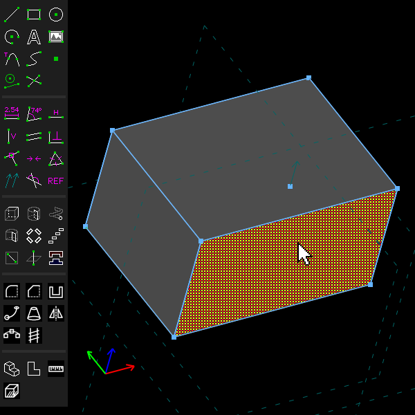
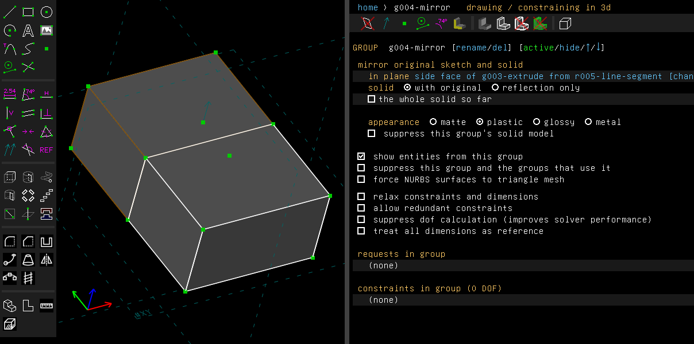
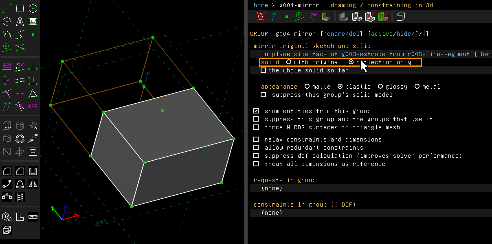
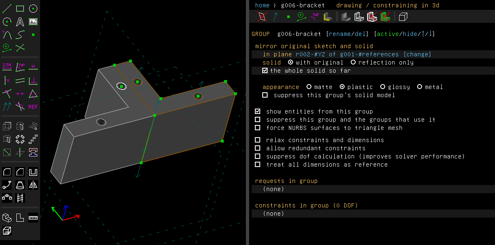
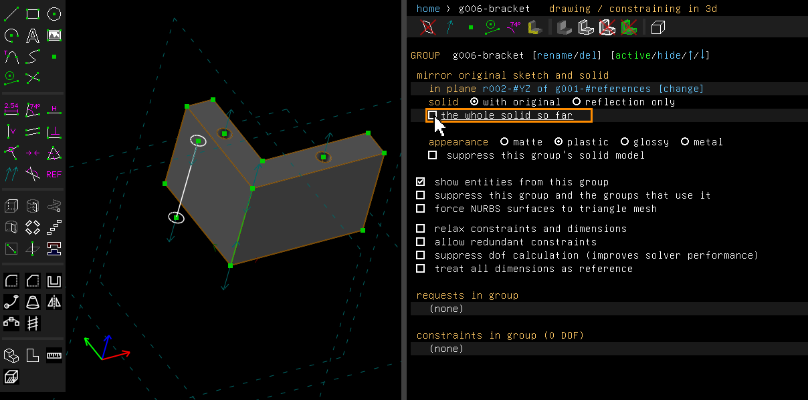

# Mirror

Example: [`examples/scripts/mirror`](../../examples/scripts/mirror/mirror.go), a symmetric
bracket: one half drawn and extruded, the other half made by a mirror.

A mirror reflects the active group in a plane and joins the reflection to the solid.

## Step by step

Reflect a block in one of its faces:

1. Press R for a rectangle and click two corners. Press Esc, then Shift+X to extrude it. Turn
   the view and click the face to reflect in. It is drawn hatched when selected.

   

2. Choose Features > Mirror. The block is reflected in the face and joined to its reflection.
   The property browser names the plane.

   

3. Click "reflection only" to leave the block out. Only the reflection is left; the block's
   outline is still drawn.

   

The `mirror` example reflects a bracket's half in the YZ workplane, with the box "the whole
solid so far" checked. The half is made by two groups: an extrusion, and a bore cut down its
upright by a group of its own. The mirror was made with the bore's group active, so with the box
checked the whole half is reflected, bore and all:



With the box clear, the mirror reflects only its own group, the bore, and the other half is
gone:



These pictures are made by [`scenarios/mirror.scenario`](scenarios/mirror.scenario), which
replays the same clicks on the program (`scripts/regen-doc-images.sh`).

## In the window

1. Make the group to reflect active.
2. Select the plane: a workplane, or a flat face of the solid.
3. Choose Features > Mirror (Shift+Y). A right click on a flat face offers the same as Mirror
   in This Plane.

The reflection follows its group: change the half, and the other half changes with it. The
sketch's entities are reflected too, so a circle's copy can be constrained and measured.

The group's screen names the plane, with "[change]" to reflect in the selected workplane or
face instead. It has:

- **solid**: "with original" or "reflection only";
- the box **the whole solid so far**. A mirror reflects its source group, the one that was
  active when the mirror was made. With the box checked, it reflects the whole solid up to it
  instead. A body made of several groups needs this: a hole cut by a later group is then
  reflected too.

## From a script

```go
half := doc.Features.Extrude(8, "half")
m := doc.Features.Mirror(doc.Workplane("YZ"), "bracket")
m.AsMirror().SetKeepOriginal(false) // only the reflection
m.AsMirror().SetMirrorSolid(true)   // the whole solid so far
```

## Not yet

A part symmetric about the plane is kept as it is, because it is its own reflection. A part
that only partly coincides with its reflection, a face here and there, can fail as a Boolean.
