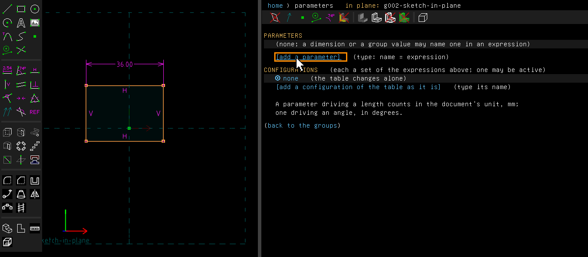
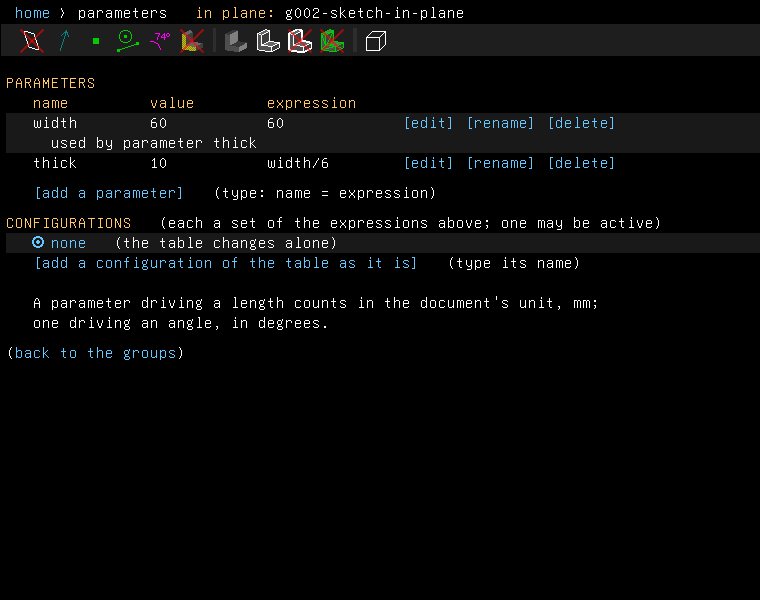
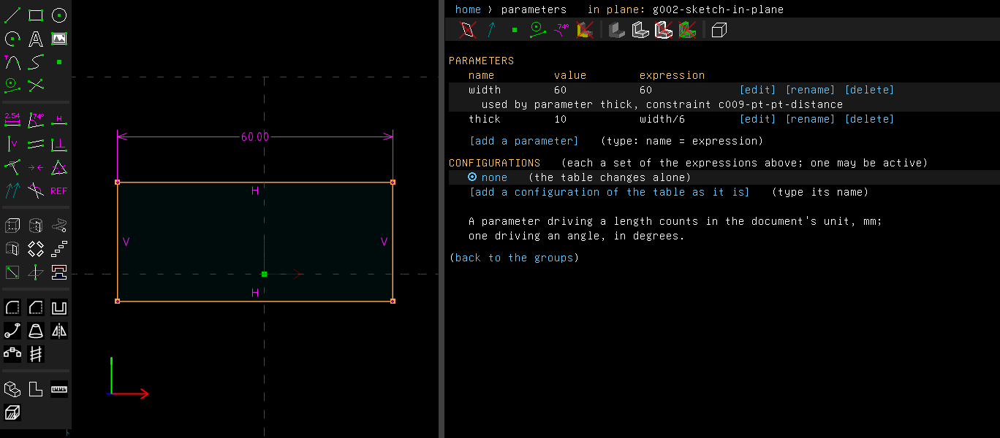
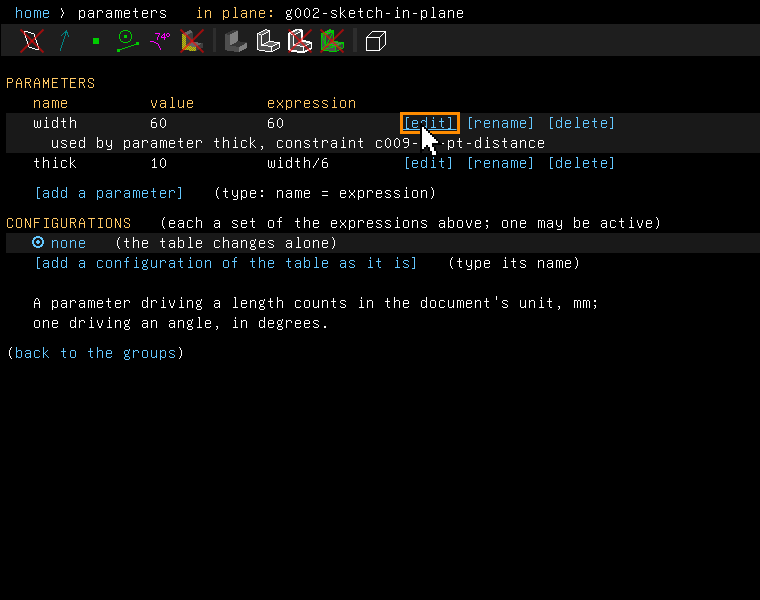
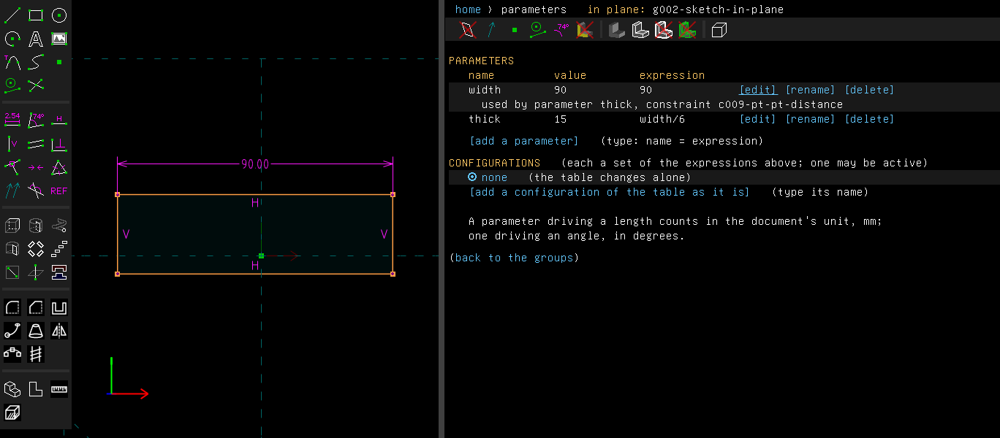
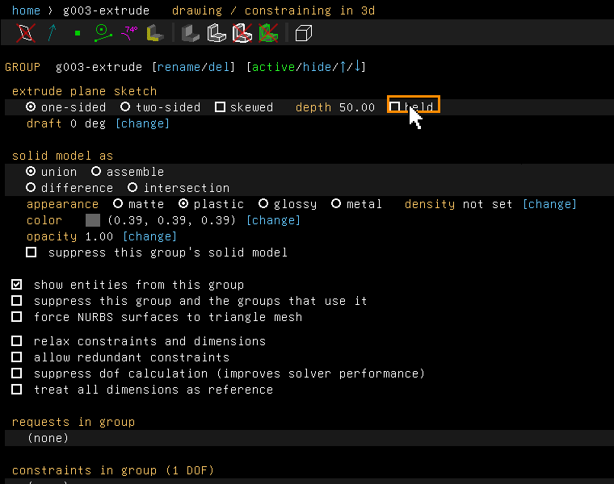
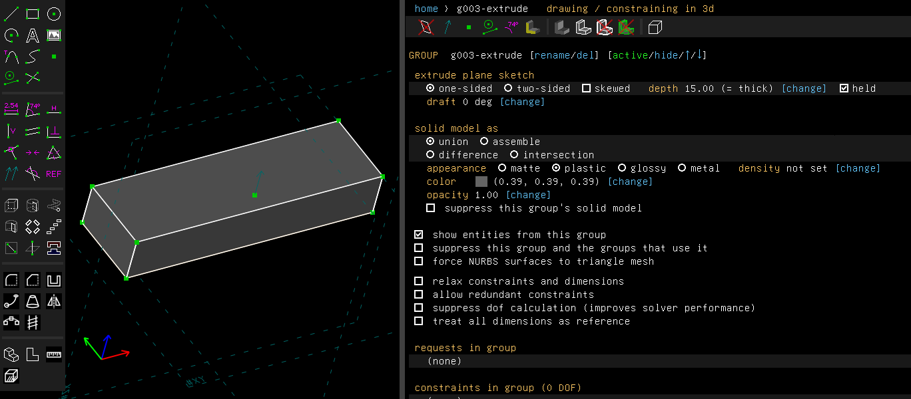

# Parameters and units

Examples: [`examples/scripts/plate`](../../examples/scripts/plate/plate.go), a mounting plate
whose sizes all come from a table of parameters, and
[`examples/scripts/feedback`](../../examples/scripts/feedback/feedback.go), which shows units,
measuring and what a sketch can tell you about itself.

## Step by step

Size a rectangle and its extrusion from two parameters:

1. Draw a rectangle (R), press Esc, click its top side and press D for a dimension. Press Esc
   to leave its editor. Then choose Edit > Parameters (Ctrl+Shift+M). The property browser
   shows the table, empty.

   

2. Click "[add a parameter]" and type `width = 60`. Click it again and type `thick = width/6`.
   The table shows each parameter's value and expression, and what uses it.

   

3. Double-click the dimension and type `width`. The rectangle becomes 60 mm wide. The table
   now says that the dimension uses `width`.

   

4. Click "[edit]" on the row of `width` and type 90.

   

   The rectangle follows, and so does `thick`, now 15.

   

5. Press Esc, then Shift+X to extrude. The depth starts at 50 mm: half the width, which is more
   than the height, rounded. On the extrusion's screen, click "held" beside the depth.

   

6. Click "[change]" beside the depth and type `thick`. The depth is 15 mm, and the screen shows
   "(= thick)".

   

These pictures are made by
[`scenarios/parameters-and-units.scenario`](scenarios/parameters-and-units.scenario).

## Parameters

A parameter is a name for a value, such as `width = 60` or `margin = height/5`. A dimension can
be an expression of parameters. When a parameter changes, the dimension changes, and so does
everything built on it.

In the window:

- **Edit > Parameters** (Ctrl+Shift+M) opens the table. There you add a parameter, give it an
  expression, rename it or delete it. A parameter's expression may use parameters made before it.
- Double-click a dimension and type an expression, such as `width - 2*margin`, instead of a
  number. The next time you open the editor, it shows the expression again.
- A group's own values, such as an extrusion's depth or a fillet's radius, take expressions on
  the group's screen.
- Renaming a parameter rewrites every expression that uses it. Deleting a parameter that is
  still used is refused, and the message says what uses it.

From a script:

```go
must(doc.Params.Set("width", "60"))
must(doc.Params.Set("height", "width*2/3"))
must(doc.Constrain.Length(side, 60).SetExpr("width"))
must(chamfer.SetExpr(sketch.GroupPitch, "c*2"))
for _, p := range doc.Params.List() {
	fmt.Println(p.Name, p.Expr, p.Value)
}
```

`doc.Params.Rename` and `doc.Params.Delete` do what the table does. `doc.Params.Errors()` lists
the expressions that could not be evaluated.

## An extrusion's depth and a revolve's angle

Example: [`examples/scripts/extent`](../../examples/scripts/extent/extent.go), a plate whose
depth is the parameter `thick`, and an arc of a ring turned by the parameter `arc`.

An extrusion's depth is free until something holds it. The same goes for a revolve's angle and
a helix's angle. Two things can hold it: a dimension on the solid, or the group's own value.

A new extrusion made in the window starts at the shorter side of its sketch's bounding box, or
half the longer side if that is more, rounded to 1, 2 or 5 times a power of ten: a 40 by 25
rectangle starts 20 mm deep, a 90 by 10 one 50 mm, a circle 10 mm across 10 mm.
It goes along the workplane's normal, towards you, or away if you look at the sketch from behind.

The group's screen shows the depth or angle it has now, on the row of its sides, with a **held**
box beside it:

- Checked, the value is held where it is. Dragging no longer moves the far end. `[change]`
  takes a number or an expression of the parameters, such as `thick`. A dimension that also held
  it is now redundant.
- Unchecked, the value is free again. You can drag it or dimension it.

A revolve turns by 360 degrees at most. An extrusion of a sketch drawn in 3d has no normal to
hold its depth along, so it can't be held.

```go
must(plate.SetExpr(sketch.GroupExtent, "thick"))
plate.AsExtrude().SetDepth(6)    // held at 6 mm; FreeDepth frees it
ring.AsRevolve().SetAngle(120)   // degrees; FreeAngle frees it
fmt.Println(plate.AsExtrude().Depth(), plate.AsExtrude().DepthHeld(), ring.AsRevolve().AngleHeld())
```

## Configurations

Example: [`examples/scripts/configurations`](../../examples/scripts/configurations/configurations.go),
one plate in three sizes.

A configuration is a named set of expressions for the parameters. It lets you keep the same
model in a small size and a large size, from one table filled in two ways.

On the parameters screen, under CONFIGURATIONS:

- `[add a configuration of the table as it is]` makes a new one and makes it active. While it
  is active, every change to the table is also a change to the configuration.
- Choosing another configuration writes its expressions into the table, and the model follows.
- Choosing `none` leaves the table as it is. Changes then go to the table alone.

A parameter renamed is renamed in every configuration. A parameter that an inactive
configuration still uses can't be deleted. The file keeps the configurations and which one is
active.

```go
must(doc.Params.AddConfiguration("small"))
must(doc.Params.AddConfiguration("large"))
must(doc.Params.Set("w", "100"))   // large's w
must(doc.Params.ActivateConfiguration("small"))
```

## Motion study

Example: [`examples/scripts/motion`](../../examples/scripts/motion/motion.go), a plate grown
through a range of widths, with a mesh saved at each step.

Assembly > Motion Study drives one parameter through a range of values. Its screen takes the
parameter, the value to start from, the value to end at, and the number of steps.

- `[run]` regenerates the model at each step. It lists the value, whether every group solved,
  and the volume of the solid.
- `[run, saving each step...]` asks for a file name and saves one frame per step beside it,
  numbered. For `.png` it saves a picture of the view as the window shows it, which makes an
  animation. For `.stl`, `.3mf` and `.glb` it saves a mesh.

Afterwards the parameter gets its own expression back. The `turn` parameter of a
[screw mate](bill-of-materials.md#mates) is such a parameter: a study of it runs a nut up its
screw. So are the `angle` of a driven hinge and the `travel` of a driven concentric mate
([mechanisms](mechanisms.md), experimental): a study of an engine's crank angle from 0 to 360
turns the crank round and runs the piston up and down. A step past a range set on the joint,
as a lid's past its 110°, is marked unsolved.

```go
frames, err := doc.Assembly.MotionStudy("w", 20, 80, 6, "frames/plate-%02d.stl")
for _, f := range frames {
	fmt.Println(f.Value, f.Solved, f.Volume, f.File)
}
```

Pictures need the application's window. `telesapr-cli` saves meshes only.

## Dimensions by name

Example: [`examples/scripts/dimensions`](../../examples/scripts/dimensions/dimensions.go), a
plate whose height and hole read its width dimension by name.

A dimension can have a name. Expressions then read its value by that name, as they read a
parameter. Double-click the dimension and type `width = 60`. The label shows `width = 60.00`,
and another dimension can now be `width*2/3`.

- The value read is the one the label shows, in the document's unit. A distance is read without
  the sign of its side. A diameter shown as a radius is read as the radius.
- Typing a new name renames every use of the old one. Typing `= 60` takes the name away, which
  is refused while something still uses it.
- Parameters and named dimensions share one set of names.
- A reference dimension only measures, so it can't be named.
- Changing the document's unit keeps the lengths that read a named length.

```go
doc.Constrain.Length(sides[0], 60).SetName("width")
must(doc.Constrain.Length(sides[1], 40).SetExpr("width*2/3"))
must(doc.Dimension("width").SetExpr("90"))
```

## The document's unit

View > Dimension Units sets the unit the document is in: millimetres, metres, inches, or feet
and inches. The unit belongs to the document and is saved with it.

Lengths typed in the window, and lengths in expressions, are in that unit. In an inch document,
`1/4` is a quarter of an inch, and is kept and saved as you typed it. Changing the unit keeps
every size: each expression is rewritten to give the same length. The change is one undo step.

From a script, `doc.View.SetUnits(core.UnitInches)` does the same, and `doc.View.Units()` reads
the unit. Script methods that take plain numbers, such as `doc.Constrain.Length(line, 50.8)`,
always take millimetres. Only text, as in `SetExpr("2")`, is in the document's unit.

## What a sketch says about itself

- **Freedom.** Entities are drawn in one colour when the constraints fix them, and in another
  while they can still move. From a script, `entity.Free()` is `sketch.FreedomFixed`,
  `sketch.FreedomPartly` or `sketch.FreedomFree`.
- **Conflicts.** When a group does not solve, its screen lists the constraints to blame, and
  the canvas marks them. When the constraints cannot all hold, these are the ones left
  unsatisfied. When they say again what others say (two horizontal lines also made parallel),
  the screen lists the whole set that over-determines itself, and any one of the set can go.
  A group can hold more than one such set; the screen then lists each set under its own
  heading, and one constraint of each set is to go. From a script, `group.Conflicts()` lists
  every constraint to blame, and `group.Redundancies()` the sets.
- **Measure.** Analyze > Measure Selection shows the length, radius, distance or angle of what
  you selected on the canvas, without adding a constraint. From a script,
  `doc.Analyze.Measure(a, b)`.
- **Find Command.** Edit > Find Command (Ctrl+K) finds any menu command when you type part of
  its name. From a script, `api.Commands()` lists them and
  `doc.Edit.RunCommand("View > Zoom To Fit")` runs one.

## Not yet

A parameter that reads a named length changes with the document's unit. When you change the
unit, the window lists such parameters, so that you can check them. A configuration holds the
parameters' expressions only: not a group's own values, and not which groups are suppressed.
