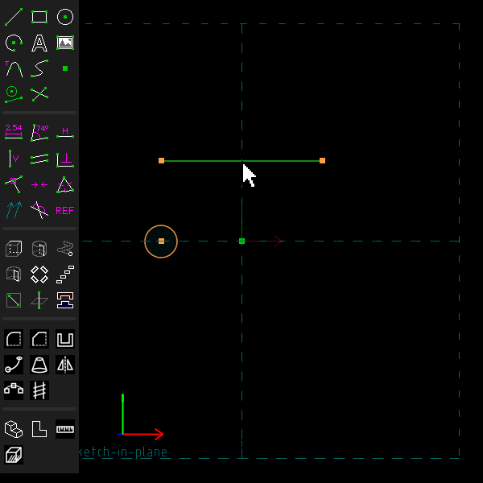
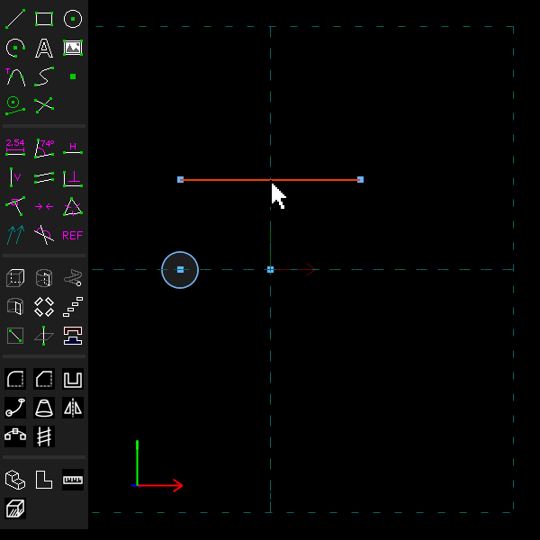
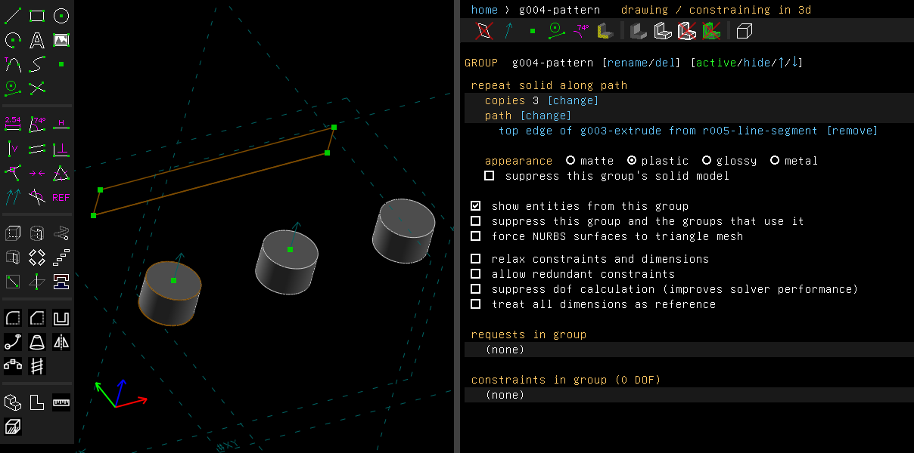
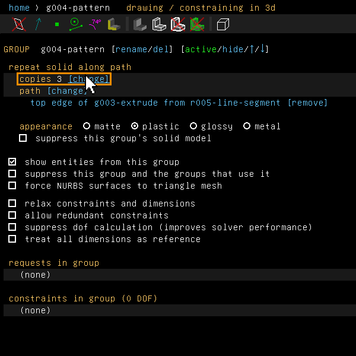
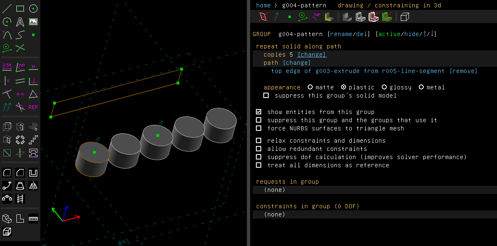
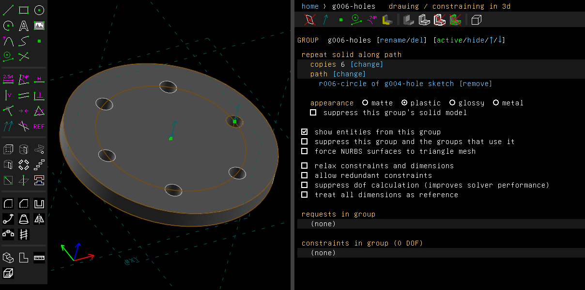

# Pattern along a path

Examples: [`examples/scripts/pattern`](../../examples/scripts/pattern/pattern.go), pegs along a
rail of a straight run, a bend and another run, and
[`examples/scripts/flange`](../../examples/scripts/flange/flange.go), bolt holes round a pitch
circle.

A pattern repeats a group's solid along a path. The path is line segments and arcs, joined end
to end and meeting tangent, as a sweep's path is.

## Step by step

Repeat a post along a line:

1. Press C for a circle and click its centre and a point on it: that is the post. Press S for
   a line and click its two ends: that is the path. Select the line and press G to make it
   construction, so that it is not extruded into a wall.

   

2. Press Shift+X to extrude the circle into a post. Click the path to select it.

   

3. Choose Features > Pattern Along Path. There are three posts: the first where the post is,
   the last at the far end of the line, one half way.

   

4. Click "[change]" beside the copies and type a new number, here 5.

   

   

The `flange` example repeats a bolt hole round a circle, a closed path: six holes, shared out
evenly all round it.



These pictures are made by [`scenarios/pattern.scenario`](scenarios/pattern.scenario), which
replays the same clicks on the program (`scripts/regen-doc-images.sh`).

## In the window

1. Make the group whose solid is to be repeated active.
2. Select the pieces of the path.
3. Choose Features > Pattern Along Path.

There are three copies to begin with: the first where the solid is, the last at the far end of
the path, and the rest spaced evenly by length along it. Each copy is turned with the path, as
a sweep turns its profile. The path starts at its end nearest the solid. Copies that overlap are
joined.

The group's screen lists the path, with "[change]" to repeat along the selection instead and
"[remove]" on each piece's row. It takes the number of copies, as a number or an expression.

The path is an ordinary sketch, often construction lines, so its dimensions drive the pattern.

## Round a closed path

The path may close on itself: a circle, or lines and arcs that come back to where they began
and meet tangent there, as a rounded rectangle's sides do. The copies are then shared out
evenly all round it. The first is where the solid is, and the one after the last would be back
at the first. The path starts at its point nearest the solid, so the solid should sit on the
path, as a bolt hole sits on its pitch circle. A closed path with a corner is refused, as an
open one is.

## From a script

```go
pegs := doc.Features.PatternAlongPath([]api.Entity{run, bend, tail}, 7, "pegs")
pegs.AsRepeat().SetCopies(5)
fmt.Println(pegs.AsRepeat().Copies(), pegs.Edges())
```

## Not yet

The solid is repeated, not the sketch's entities, so the copies cannot be constrained or
dimensioned one by one. A group forced to a triangle mesh cannot be patterned.
