<!-- Written by TestReferencePages (pkg/ui/docref_test.go) from the program; regenerate with scripts/regen-golden.sh docref, don't edit. -->

# Toolbar

The buttons down the left of the graphics window, top to bottom. Hovering over a button shows its name. Each runs the menu entry beside it.

| | Button | Menu entry | Keys |
|---|---|---|---|
| 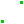 | Sketch line segment | Sketch > Line Segment | <kbd>S</kbd> |
|  | Sketch rectangle | Sketch > Rectangle | <kbd>R</kbd> |
|  | Sketch circle | Sketch > Circle | <kbd>C</kbd> |
|  | Sketch arc of a circle | Sketch > Arc of a Circle | <kbd>A</kbd> |
|  | Sketch curves from text in a TrueType font | Sketch > Text in TrueType Font | <kbd>T</kbd> |
|  | Sketch image from a file | Sketch > Image |  |
|  | Create tangent arc at selected point | Sketch > Tangent Arc at Point | <kbd>Shift</kbd>+<kbd>A</kbd> |
|  | Sketch cubic Bezier spline | Sketch > Bezier Cubic Spline | <kbd>B</kbd> |
| 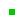 | Sketch datum point | Sketch > Datum Point | <kbd>P</kbd> |
| 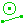 | Toggle construction | Sketch > Toggle Construction | <kbd>G</kbd> |
| 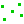 | Split lines / curves where they intersect | Sketch > Split Curves at Intersection | <kbd>I</kbd> |
| 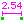 | Constrain distance / diameter / length | Constrain > Distance / Diameter | <kbd>D</kbd> |
| 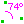 | Constrain angle | Constrain > Angle / Equal Angle | <kbd>N</kbd> |
| 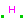 | Constrain to be horizontal | Constrain > Horizontal | <kbd>H</kbd> |
| 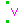 | Constrain to be vertical | Constrain > Vertical | <kbd>V</kbd> |
| 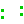 | Constrain to be parallel or tangent | Constrain > Parallel / Tangent | <kbd>L</kbd> |
| 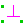 | Constrain to be perpendicular | Constrain > Perpendicular | <kbd>[</kbd> |
| 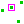 | Constrain point on line / curve / plane / point | Constrain > On Point / Curve / Plane | <kbd>O</kbd> |
| 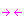 | Constrain symmetric | Constrain > Symmetric | <kbd>Y</kbd> |
| 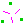 | Constrain equal length / radius / angle | Constrain > Equal Length / Radius | <kbd>Q</kbd> |
| 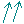 | Constrain normals in same orientation | Constrain > Same Orientation | <kbd>X</kbd> |
|  | Other supplementary angle | Constrain > Other Supplementary Angle | <kbd>U</kbd> |
|  | Toggle reference dimension | Constrain > Toggle Reference Dim | <kbd>E</kbd> |
|  | New group extruding active sketch | Features > Extrude | <kbd>Shift</kbd>+<kbd>X</kbd> |
| 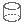 | New group rotating active sketch | Features > Lathe | <kbd>Shift</kbd>+<kbd>L</kbd> |
| 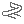 | New group helix from active sketch | Features > Helix | <kbd>Shift</kbd>+<kbd>H</kbd> |
|  | New group revolve active sketch | Features > Revolve | <kbd>Shift</kbd>+<kbd>V</kbd> |
|  | New group step and repeat rotating | Features > Step Rotating | <kbd>Shift</kbd>+<kbd>R</kbd> |
|  | New group step and repeat translating | Features > Step Translating | <kbd>Shift</kbd>+<kbd>T</kbd> |
| 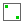 | New group in new workplane (thru given entities) | Features > Sketch In New Workplane | <kbd>Shift</kbd>+<kbd>W</kbd> |
| 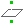 | New group in 3d | Features > Sketch In 3d | <kbd>Shift</kbd>+<kbd>3</kbd> |
|  | New group linking / assembling file | Assembly > Link / Assemble... | <kbd>Shift</kbd>+<kbd>I</kbd> |
|  | Fillet selected edges | Features > Fillet Edges | <kbd>Shift</kbd>+<kbd>F</kbd> |
|  | Chamfer selected edges | Features > Chamfer Edges | <kbd>Shift</kbd>+<kbd>Q</kbd> |
|  | Shell solid, open at selected faces | Features > Shell Solid | <kbd>Shift</kbd>+<kbd>G</kbd> |
|  | Sweep active sketch along selected path | Features > Sweep Along Path | <kbd>Shift</kbd>+<kbd>U</kbd> |
|  | Loft active sketch to selected profiles | Features > Loft To Selected Profile | <kbd>Shift</kbd>+<kbd>O</kbd> |
|  | Mirror in selected plane | Features > Mirror | <kbd>Shift</kbd>+<kbd>Y</kbd> |
|  | Pattern along selected path | Features > Pattern Along Path |  |
|  | Screw thread on selected face, edge or circle | Features > Screw Thread... | <kbd>Shift</kbd>+<kbd>E</kbd> |
|  | Nearest isometric view | View > Nearest Isometric View | <kbd>F3</kbd> |
|  | Align view to active workplane | View > Align View to Workplane | <kbd>W</kbd> |
|  | Measure selection | Analyze > Measure Selection | <kbd>Ctrl</kbd>+<kbd>Shift</kbd>+<kbd>E</kbd> |
|  | Section view | View > Section View | <kbd>Ctrl</kbd>+<kbd>Shift</kbd>+<kbd>X</kbd> |
