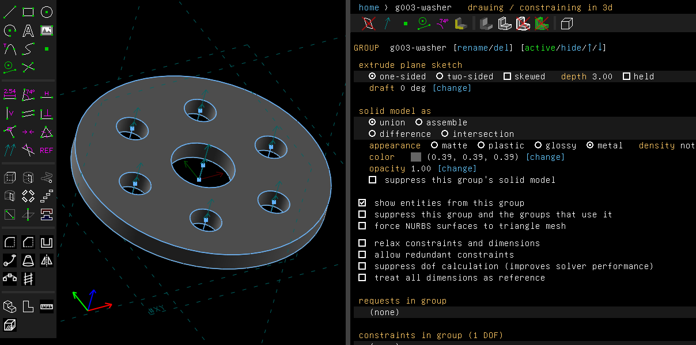
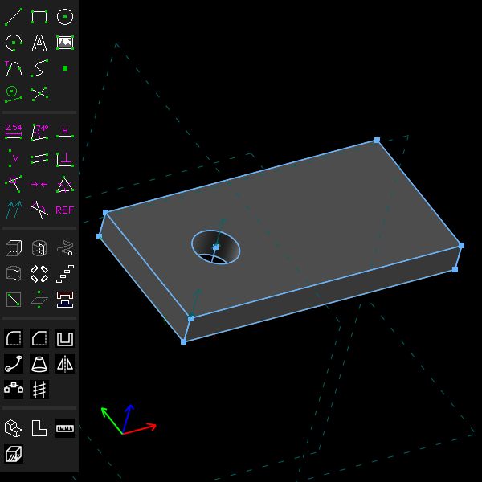

# Scripts

Every feature can be scripted in Go. The [README](../../README.md#scripting) says how a script
is written, and `help()` in the console lists what it can call. This page covers the console,
forms that ask for a script's values when it runs, a library of your own packages, and a model
written out as a script or in words.

A script runs:

- in the window: typed in the console, or a file from **Script > Run File** (Ctrl+Shift+R);
- at start-up: `telesapr model.tlspr --script part.go [argument...]`;
- without a window: `telesapr-cli run [model.tlspr] part.go [argument...]` runs a file,
  `telesapr-cli repl` reads lines as the console does, and `telesapr-cli eval '<code>'` runs
  the code it is given.

Nothing is saved unless the script saves.

## The console

**Script > Show Console** (Ctrl+Shift+K) opens the console in a window of its own. Output is
above, what you type is below, with Run, Stop and Clear buttons. The first time it opens it
runs `help()`. `telesapr-cli repl` at a terminal works the same way.

Lines are edited with readline's keys:

| Key | Does |
|---|---|
| Return | Runs what is typed. In an unfinished statement, as after `for i := 0; i < 3; i++ {`, starts a new line instead |
| Shift+Return | Starts a new line (window) |
| Tab, Shift+Tab | Completes the name before the cursor: a variable, a package, or after a dot what the value has (`doc.Active().Re` offers `Requests(`). Nothing is run to find them. With several matches, Tab again steps through them and Shift+Tab goes back |
| Up, Down, Control+P, Control+N | The entry before, the entry after |
| Control+R | Searches back through the entries. Escape puts back what you had typed |
| Control+A, Control+E | Start, end of the line |
| Alt+B, Alt+F | A word back, a word forward |
| Control+K, Control+U | Deletes to the end, to the start of the line |
| Control+W, Alt+Backspace, Alt+D | Deletes the word before the cursor (up to a space), the word before, the word after |
| Control+Y | Puts back what was deleted |
| Control+T, Control+H | Swaps two characters, deletes back |
| Control+L | Clears the console (window) |
| Control+C, Escape | Stops what runs, or drops a half-typed statement |

What you enter is kept in `telesapr/script_history` in your configuration folder, shared by the
window and `telesapr-cli repl`. At a terminal the keys are those of
[reeflective/readline](https://github.com/reeflective/readline), which reads `~/.inputrc`.

An error says what went wrong, where (line and column), and quotes the line:

```
error: plate.go:2:1: index out of range
    fmt.Println(gs[0].Requests()[0].Entity().Start().Pos())
```

The place starts with the file's name for a script file, `script` for a script an AI program
ran, and nothing for a console entry. For some errors the column is the start of the
statement rather than the exact call. A call of the scripting interface that can't do what it
is asked says why in its own words (`line r004-line-segment isn't a circle or an arc`).

Help:

- `help("Features.Thread")` describes one call; `help("Features > Fillet Edges")` says what a
  script calls in place of a menu entry.
- `help("ThreadOptions")` shows a type: its fields, with their types and what they are, and its
  methods. `help("ThreadOptions.Length")` describes one field.
- `help("examples")` lists the example scripts that come with TeleSAPR, and
  `help("example bolt")` shows one, with its script library if it has one. A name that isn't
  an example's gets the nearest ones. An example is a whole program; to try it at the console,
  enter the body of its `main`.

## Forms

A script can ask for its values when it runs. It declares them in an `api.Form`, a variable at
its top level:

```go
var Form = api.Form{
	Title: "Washer",
	Fields: []api.Field{
		{Name: "outer", Label: "Outer diameter (mm)", Value: 30.0},
		{Name: "slots", Label: "Slots round the bore", Value: 0},
		{Name: "finish", Label: "Finish", Value: "metal", Choices: []string{"matte", "plastic", "glossy", "metal"}},
		{Name: "save", Label: "Save washer.tlspr", Value: true},
	},
}
```

It reads them with `Form.Float("outer")`, `Form.Int("slots")`, `Form.Text("finish")` and
`Form.Bool("save")`. The literal written as `Value` says what the field takes: `0` a whole
number, `30.0` a number, `true` or `false` a check box, a quoted string text, or one of the
`Choices`. In a script of plain statements, as the console takes, write `var form = Form{...}`
without `api.`.

- **Script > Run File** shows the fields in a dialog, filled in with the script's values.
  **Run** runs it with what you leave there; **Cancel** doesn't run it. A value that doesn't
  fit its field (`many` slots) is refused with a message.
- `telesapr-cli run --set outer=40 --set slots=6 washer.go` gives values without a window.
- An AI program's `run_script` takes them as its `form` argument.

The values given are written into the script's text in place of its own, so the script runs the
same whichever way it got them. A field not given keeps its value. The example is
[`examples/scripts/form`](../../examples/scripts/form).

Its dialog is titled Washer, with six fields. Given 40 for the outer diameter, 6 slots, and
Save washer.tlspr unticked, the console shows

```
run …/examples/scripts/form/form.go
g003-washer: 6 slots, volume 3179 mm³
form.go done.
```

and the window shows the washer, its finish metal as the form gave it:



## The script library

A script can import packages of your own from the **script library folder**:
`import "gears"` reads the Go files in `<library>/gears`, and `import "shop/brackets"` those in
`<library>/shop/brackets`. Library packages import each other the same way, and import
`github.com/telesapr/telesapr/pkg/script/api` as any script does. They have no `doc` of their
own: they work on the `*api.Doc` they are given.

```go
// <library>/gears/gears.go
package gears

import "github.com/telesapr/telesapr/pkg/script/api"

func Blank(doc *api.Doc, teeth int, module, bore, width float64, name string) api.Group {
	...
}
```

```go
import "gears"

gears.Blank(doc, 24, 2, 8, 6, "gear")
```

Where the folder is:

- In the window, it is **script library folder** on the configuration screen. Left empty, it is
  `telesapr/library` in your configuration folder (`~/.config` on Linux, `%AppData%` on
  Windows, `~/Library/Application Support` on macOS). The console, Run File and AI connections
  all use it. A change takes effect at the next import.
- On the command line, `--lib <dir>` comes before the model and the script:
  `telesapr-cli run --lib ~/parts examples/scripts/library/library.go`. `repl`, `eval` and
  `mcp --headless` take it too. Without it, the default folder is used.

The go tool doesn't know the library, so `go build` and `go vet` fail on a file that imports
from it. Give such a file the build tag `telesapr`, which the interpreter has and the go tool
doesn't:

```go
//go:build telesapr

package main
```

The example is [`examples/scripts/library`](../../examples/scripts/library), with its library in
`lib`.

## A model as a script

Example: [`examples/scripts/exportscript`](../../examples/scripts/exportscript/exportscript.go),
a plate whose width is a parameter, written out as the program that builds it.

**File > Export > Script (.go)** writes the drawing as a Go program that builds it again on a new
drawing: the parameters, every group in build order (each made by its own call), the requests
of each sketch where they are solved to, the constraints with their values, names and
expressions, and the styles, images, splines, text, datum points and face appearances.

Edit the script, give it a form, and run it as any script. The same from elsewhere:

- `telesapr-cli export-script model.tlspr` writes `model.go` beside the model;
- a script calls `doc.File.ExportScript(path)`, or `doc.Script()` for the text and a list of
  what it left out;
- an AI program's `export` tool writes it for a path ending `.go`.

What to expect in the script:

- A variable is declared only where a later line uses it, and a name is set only where it
  differs from the one the call gives.
- Handles are numbered afresh, so things are named by what made them: `g3.Made(r4, 1002)` for
  what a group made from a request, `r4.Part(1)` for a request's point.
- A few things a DXF import makes have calls of their own: an arc drawn in 3d
  (`doc.Sketch.ArcIn3D`), a workplane in a workplane (`doc.Sketch.NewWorkplaneIn`), the same
  constraint twice (`doc.Constrain.Again`).
- An image whose file is missing is written as its frame (`doc.Sketch.ImageFrame`).
- A thread is made with its thread call, keeping its groups' names, colours, visibility and
  suppression. If its groups were moved apart in the history, the script moves them back to
  where they stood (`g8.History().MoveToEnd()`), so it is still one thread.
- A sketch on a face or datum whose face is gone is placed through a 3d sketch point of its own
  (`M8-end-origin`).
- What the script can't write is a comment starting `not written:`, and the window says so.

## A model in words

`doc.Describe()` returns the drawing in words: the unit, the parameters, each group with how it
solved, its degrees of freedom, its problems, and the volume and bounds of its solid. Then come
the active group's requests and constraints with their names and values. `Group.Describe()` does
the same for one group. This is what an AI program reads before it writes a script
([Drawing with an AI model](ai.md)).

A group after the active one that a change has left as it was made is shown as "old", with no
details: making it would mean regenerating the whole model. Reading that group itself, as
`Group.Describe()` does, makes it ([History](history.md)).

Example: [`examples/scripts/describe`](../../examples/scripts/describe/describe.go). It draws a
40 by 20 mm plate, 4 mm thick, with a 6 mm hole held in size but not in place:



```go
fmt.Println(doc.Describe())
```

Run from Script > Run File, it prints the drawing, then the sketch group `g002`:

```
sketch: unit mm, unsaved changes
groups, in the order the model is built:
    g002-sketch-in-plane, sketch-in-plane: solved, 2 DOF
    g003-plate, extrude: solved, 1 DOF, volume 3087.632 mm³, bounds (0, 0, 0) to (40, 20, 4); active
active group g003-plate, extrude: solved, 1 DOF, volume 3087.632 mm³, bounds (0, 0, 0) to (40, 20, 4)
g002-sketch-in-plane, sketch-in-plane: solved, 2 DOF
  requests:
    r004-line-segment: line (40, 0, 0) to (40, 20, 0)
    r005-line-segment: line (0, 0, 0) to (40, 0, 0)
    ...
    r008-circle: circle at (10, 10, 0), radius 3
  constraints:
    c001-pts-coincident, on r004-line-segment, r005-line-segment
    ...
    c00a-pt-pt-distance = 40, on r005-line-segment
    c00b-pt-pt-distance = 20, on r004-line-segment
    c00c-diameter = 6, on r008-circle
line r005-line-segment is 40 mm long
...
```

`Group.DescribeSolid()` lists the faces and edges of the solid up to a group, by the IDs and
names a script picks them by:

- first the number of faces, edges and vertices, and whether the solid is sound;
- each face: its ID (`Solid().Face(id)`), name, shape (flat with its normal, a cylinder or cone
  with its axis, a sphere, or curved), a point on it (`Solid().FaceAt`) and its number of edges;
- each edge: its name (`Solid().Edge(name)`), shape, length, ends and its two faces.

It lists at most 40 faces and 60 edges. On a larger solid, narrow the choice with
`Solid().EdgesAlong`, `EdgesBetween` or `FaceAt`. The example ends with it:

```
solid at g003-plate: 7 faces, 14 edges, 8 vertices; sound
faces, by the ID Solid().Face takes, with a point Solid().FaceAt finds them by:
    0x80030035 top face of g003-plate: flat, normal (0, 0, 1); at (20, 10, 4); 5 edges
    ...
    0x40030006 face 6 of g003-plate: cylinder, axis (0, 0, -1) through (10, 10, 4), radius 3; at (12.121, 12.121, 2); 2 edges
edges, by the name Solid().Edge takes:
    "edge 80030007 80030035 0 of 1": straight, 20 mm, (40, 20, 4) to (40, 0, 4); faces 0x80030035 and 0x80030007
    ...
    "edge 40030006 80030035 0 of 1": circle about (10, 10, 4), radius 3, 18.85 mm, closed; faces 0x80030035 and 0x40030006
    ...
the top is top face of g003-plate, with 5 edges
describe.go done.
```

`Doc.Description()`, `Group.Description()` and `Group.SolidDescription()` give the same as data,
for a program that reads numbers and names rather than text. An AI program's `get_drawing`
sends it beside the text.

File > Export > Script (.go) writes this plate back as a program. Its `main` begins:

```go
func main() {
	doc := api.Current()

	r4 := doc.Sketch.Line(api.V(40, 0, 0), api.V(40, 20, 0))
	r5 := doc.Sketch.Line(api.V(0, 0, 0), api.V(40, 0, 0))
	...
	r8 := doc.Sketch.Circle(api.V(10, 10, 0), 3)
	doc.Constrain.Raw(core.ConstraintPointsCoincident, r4.Part(1), r5.Part(2), api.Entity{}, api.Entity{}, false, false)
	...
	c12 := doc.Constrain.Raw(core.ConstraintDiameter, api.Entity{}, api.Entity{}, r8, api.Entity{}, false, false)
	c12.Set(6)
	...

	g3 := doc.Features.Extrude(4, "plate")
```

The pictures and the console's text are made by
[`scenarios/scripts.scenario`](scenarios/scripts.scenario).

## Not yet

- A form's fields are a flat list: no units that follow the document's, no bounds, no fields
  that depend on others.
- A library package is read once per interpreter. A library file changed while the console is
  open is seen after Script > Stop, or in a new window. Script > Run File starts a new
  interpreter each time, so it sees the change at once.
- There are no versions or downloads of packages: the library is a folder you keep.
- The interpreter, yaegi, has no `range` over an integer or a function: write
  `for i := 0; i < n; i++`.
- It has no `min`, `max` or `clear`. Use `math.Min` and `math.Max` for numbers with a fraction,
  an `if` for whole numbers, and a loop with `delete`, or a new map, for `clear`.
- It can't compile a method call on an element of a returned slice inside a struct literal
  without field names, as `P{gs[0].Name()}`. The error says to use a variable first:
  `n := gs[0].Name()`, then `P{n}`. In a slice, array or map literal it works.
- An AI program's scripts are kept to some folders ([Drawing with an AI model](ai.md#files));
  yours are not.
