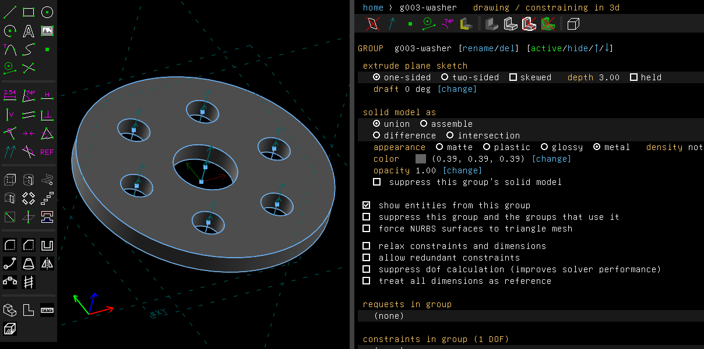
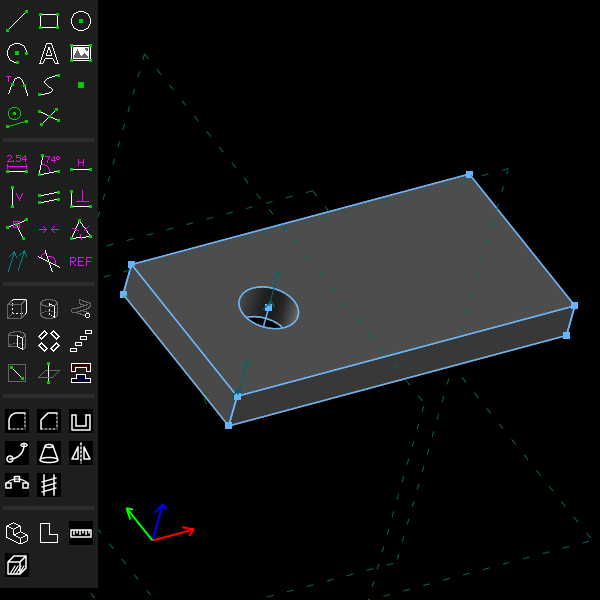

# Scripts

Every feature can be scripted in Go. The [README](../../README.md#scripting) says how a script
is written, and `help()` in the console lists what it can call. This page is about what helps
scripts be shared and reused: how the console is typed in, forms that ask for a script's values
when it runs, a library of packages of your own, and a model written out as a script.

## The console

Script > Show Console (Ctrl+Shift+K) opens the console in a window of its own. What was shown
so far is above, what you type is in the lower fifth, and there are Run, Stop and Clear buttons.
The first time it is shown it runs `help()`. `telesapr-cli repl` at a terminal starts the same
way. In both, you edit what you type with readline's keys:

| Key | Does |
|---|---|
| Return | Runs what is typed. In a statement that isn't finished, as after `for i := 0; i < 3; i++ {`, it starts another line instead |
| Shift+Return | Starts another line, indented like the one before (window) |
| Tab, Shift+Tab | Completes the name before the cursor: a variable, a package, or after a dot what the value or package has. This is worked out from the types without running anything (`doc.Active().Re` offers `Requests(`). With several matches it completes as far as they agree and lists them. Tab again puts each in place in turn, then what you typed, and Shift+Tab goes back (window; at a terminal, readline's own menu) |
| Up, Down, Control+P, Control+N | The entry before, the entry after. In an entry of several lines, the line above or below |
| Control+R | Searches back through the entries for what you type next. Again goes further back. Escape puts back what you had typed |
| Control+A, Control+E | The start, the end of the line |
| Alt+B, Alt+F | A word back, a word forward |
| Control+K, Control+U | Kills to the end, to the start of the line |
| Control+W, Alt+Backspace, Alt+D | Kills the word before the cursor (up to a space), the word before, the word after |
| Control+Y | Yanks back what was killed |
| Control+T, Control+H | Swaps two characters, deletes back |
| Control+L | Clears what the console shows (window) |
| Control+C, Escape | Stops what runs, or drops a statement half entered |

What you enter is kept between runs in `telesapr/script_history` in your configuration folder.
The window and `telesapr-cli repl` share it. At a terminal the keys are those of
[reeflective/readline](https://github.com/reeflective/readline), which reads `~/.inputrc`.

An error says what went wrong in plain words, where (line and column), and quotes the line it is
on, so that in an entry of several lines, or a script file, you see which statement failed:

```
error: plate.go:2:1: index out of range
    fmt.Println(gs[0].Requests()[0].Entity().Start().Pos())
```

The place starts with the file's name for a script file, `script` for one an AI program ran,
and nothing for an entry at the console. A one-line entry gives only the message, since the line
is the one you typed. What a call of the scripting interface can't do, it says in its own words
(`line r004-line-segment isn't a circle or an arc`).

## Forms

A script can ask for its values when it runs. It declares them with an `api.Form`, a variable at
its top level:

```go
var Form = api.Form{
	Title: "Washer",
	Fields: []api.Field{
		{Name: "outer", Label: "Outer diameter (mm)", Value: 30.0},
		{Name: "slots", Label: "Slots round the bore", Value: 0},
		{Name: "finish", Label: "Finish", Value: "metal", Choices: []string{"matte", "plastic", "glossy", "metal"}},
		{Name: "save", Label: "Save washer.tlspr", Value: true},
	},
}
```

It reads them with `Form.Float("outer")`, `Form.Int("slots")`, `Form.Text("finish")` and
`Form.Bool("save")`. In a script of plain statements, as the console takes them, write
`var form = Form{...}` without the package name. Each `Value` is written as a literal, and the
literal says what the field takes: `0` a whole number, `30.0` a number, `true` or `false` a check
box, a quoted string text, or one of the `Choices`.

- **Script > Run File** (Ctrl+Shift+R) shows the fields in a dialog before the script runs, with
  the values written in the script, and runs it with the values you leave there. **Cancel**
  doesn't run it. A value that doesn't fit its field (`many` slots) is refused with a message.
- `telesapr-cli run --set outer=40 --set slots=6 washer.go` gives the same values without a
  window.
- An AI program's `run_script` takes them as its `form` argument.

The values you give are written into the script's text in place of the ones it was written with.
So the script runs the same way whichever way it got them, and a field you don't give keeps its
value. The example is [`examples/scripts/form`](../../examples/scripts/form).

Run from Script > Run File, the example's dialog is titled Washer, with its six fields and the
buttons Run and Cancel. Given 40 for the outer diameter, 6 slots, and Save washer.tlspr
unticked, the console shows

```
run …/examples/scripts/form/form.go
g003-washer: 6 slots, volume 3179 mm³
form.go done.
```

and the window the washer, its finish metal as the form gave it:



## The script library

A script can import a package of your own by its path in the **script library folder**:
`import "gears"` reads the Go files in `<library>/gears`, and `import "shop/brackets"` those in
`<library>/shop/brackets`. Library packages import each other the same way, and import
`github.com/telesapr/telesapr/pkg/script/api` as any script does. They have no `doc` of their
own: they draw on the `*api.Doc` they are given.

```go
// <library>/gears/gears.go
package gears

import "github.com/telesapr/telesapr/pkg/script/api"

func Blank(doc *api.Doc, teeth int, module, bore, width float64, name string) api.Group {
	...
}
```

```go
import "gears"

gears.Blank(doc, 24, 2, 8, 6, "gear")
```

The folder is the same whichever way a script runs:

- In the window, it is the configuration screen's **script library folder**. Left empty, it is
  `telesapr/library` in your configuration folder (`~/.config` on Linux, `%AppData%` on
  Windows, `~/Library/Application Support` on macOS). The console, Script > Run File and AI
  connections all use it. A change takes effect at the next import.
- On the command line, give `--lib <dir>` before the model and the script:
  `telesapr-cli run --lib ~/parts examples/scripts/library/library.go`. The same goes for
  `repl`, `eval` and `mcp --headless`. Without it, the default folder above is used.

The go tool doesn't know the library, so a script file that imports from it can't be built with
`go build` or checked with `go vet`. Give such a file the build tag `telesapr`. The scripts'
interpreter has that tag and the go tool doesn't:

```go
//go:build telesapr

package main
```

The example is [`examples/scripts/library`](../../examples/scripts/library), with its library in
`lib`.

## A model as a script

Example: [`examples/scripts/exportscript`](../../examples/scripts/exportscript/exportscript.go),
a plate whose width is a parameter, written out as the program that builds it.

File > Export > Script (.go) writes the drawing as a Go program that builds it again on a new
drawing. It writes:

- the parameters;
- every group, in the order the model is built, each made by the call that makes a group of its
  kind;
- the requests of each sketch, where they are solved to;
- the constraints with their values, names and expressions;
- the styles, images, splines of any number of points (`doc.Sketch.Spline`,
  `doc.Sketch.PeriodicSpline`), kerned text, datum points in groups that aren't sketches, and
  faces' own appearances.

An image's file is named where it is, as a link's is. Edit the script, give it a form, and run it
as any script. `telesapr-cli export-script model.tlspr` does the same without a window. A
script calls `doc.File.ExportScript(path)`, or `doc.Script()` for the text and a list of what it
left out. An AI program's `export` tool writes it for a file ending `.go`.

Some things a DXF import draws can't be drawn in the window. They are written with calls of
their own: an arc drawn in 3d (`doc.Sketch.ArcIn3D`), a workplane drawn in a workplane
(`doc.Sketch.NewWorkplaneIn`) and the same constraint twice (`doc.Constrain.Again`). An image
whose file is missing is written as its frame (`doc.Sketch.ImageFrame`), and the window says
so. What the script can't write is a comment in it starting `not written:`, and the window
says so too. One such thing is a face's appearance on a face that no point finds. Handles are
numbered afresh, so the script names what a group made by what it was made from
(`g3.Made(r4, 1002)`), and a request's points by their number (`r4.Part(1)`).

## A model in words

`doc.Describe()` returns the drawing in words: the unit, the parameters, each group with how it
solved, its degrees of freedom and its problems, and the volume and bounds of the solid. Then
come the active group's requests and constraints with their names and values.
`Group.Describe()` does the same for one group. It is what an AI program reads before writing a
script ([Drawing with an AI model](ai.md)). Example:
[`examples/scripts/describe`](../../examples/scripts/describe/describe.go).

```go
fmt.Println(doc.Describe())
```

The example draws a 40 by 20 mm plate, 4 mm thick, with a 6 mm hole held in size but not in
place:



Run from Script > Run File, it prints this in the console, first the drawing, then the sketch
group `g002`:

```
sketch: unit mm, unsaved changes
groups, in the order the model is built:
    g002-sketch-in-plane, sketch-in-plane: solved, 2 DOF
    g003-plate, extrude: solved, 1 DOF, volume 3087.632 mm³, bounds (0, 0, 0) to (40, 20, 4); active
active group g003-plate, extrude: solved, 1 DOF, volume 3087.632 mm³, bounds (0, 0, 0) to (40, 20, 4)
g002-sketch-in-plane, sketch-in-plane: solved, 2 DOF
  requests:
    r004-line-segment: line (40, 0, 0) to (40, 20, 0)
    r005-line-segment: line (0, 0, 0) to (40, 0, 0)
    ...
    r008-circle: circle at (10, 10, 0), radius 3
  constraints:
    c001-pts-coincident, on r004-line-segment, r005-line-segment
    ...
    c00a-pt-pt-distance = 40, on r005-line-segment
    c00b-pt-pt-distance = 20, on r004-line-segment
    c00c-diameter = 6, on r008-circle
line r005-line-segment is 40 mm long
...
```

`Group.DescribeSolid()` lists the faces and edges of the solid up to a group, by the IDs and
names a script picks them by: first how many faces, edges and vertices there are and whether the
solid is sound, then each face with its ID (`Solid().Face(id)`), its name, its shape (flat with
its normal, a cylinder or a cone with its axis, a sphere, or curved), a point on it that
`Solid().FaceAt` finds it by and its number of edges, then each edge with its name
(`Solid().Edge(name)`), its shape, its length and ends in mm, and its two faces. It lists at most
40 faces and 60 edges; on a larger solid, narrow the choice with `Solid().EdgesAlong`,
`EdgesBetween` or `FaceAt`. The example ends with it, for the plate:

```
solid at g003-plate: 7 faces, 14 edges, 8 vertices; sound
faces, by the ID Solid().Face takes, with a point Solid().FaceAt finds them by:
    0x80030035 top face of g003-plate: flat, normal (0, 0, 1); at (20, 10, 4); 5 edges
    ...
    0x40030006 face 6 of g003-plate: cylinder, axis (0, 0, -1) through (10, 10, 4), radius 3; at (12.121, 12.121, 2); 2 edges
edges, by the name Solid().Edge takes:
    "edge 80030007 80030035 0 of 1": straight, 20 mm, (40, 20, 4) to (40, 0, 4); faces 0x80030035 and 0x80030007
    ...
    "edge 40030006 80030035 0 of 1": circle about (10, 10, 4), radius 3, 18.85 mm, closed; faces 0x80030035 and 0x40030006
    ...
the top is top face of g003-plate, with 5 edges
describe.go done.
```

`Doc.Description()`, `Group.Description()` and `Group.SolidDescription()` are the same as data,
for a script or a program that reads numbers and names rather than text: the groups with how
they solved, their volume and bounds, the requests with their points, the constraints with their
values and what they are on, the faces with their shapes and points and the edges with their
lengths and ends, rounded as the text rounds them. The AI connection's `get_drawing` sends it
beside the text.

File > Export > Script (.go) writes this plate back as a program. Its `main` begins:

```go
func main() {
	doc := api.Current()

	g2 := doc.Active()
	r4 := doc.Sketch.Line(api.V(40, 0, 0), api.V(40, 20, 0))
	r5 := doc.Sketch.Line(api.V(0, 0, 0), api.V(40, 0, 0))
	...
	r8 := doc.Sketch.Circle(api.V(10, 10, 0), 3)
	c1 := doc.Constrain.Raw(core.ConstraintPointsCoincident, r4.Part(1), r5.Part(2), api.Entity{}, api.Entity{}, false, false)
	...
	c12 := doc.Constrain.Raw(core.ConstraintDiameter, api.Entity{}, api.Entity{}, r8, api.Entity{}, false, false)
	c12.Set(6)

	g3 := doc.Features.Extrude(4, "plate")
```

The pictures and the console's text are made by
[`scenarios/scripts.scenario`](scenarios/scripts.scenario).

## Not yet

- A form's fields are a flat list: no units that follow the document's, no bounds, no fields
  that depend on others.
- A package is read once per interpreter. A library file changed while the console is open is
  seen after Script > Stop has stopped a script, or in a new window. A script file run from the
  menu starts a new interpreter each time, and sees the change at once.
- There are no versions or downloads of packages: the library is a folder you keep.
- An AI program's scripts are kept to some folders ([Drawing with an AI model](ai.md#files));
  yours are not.
