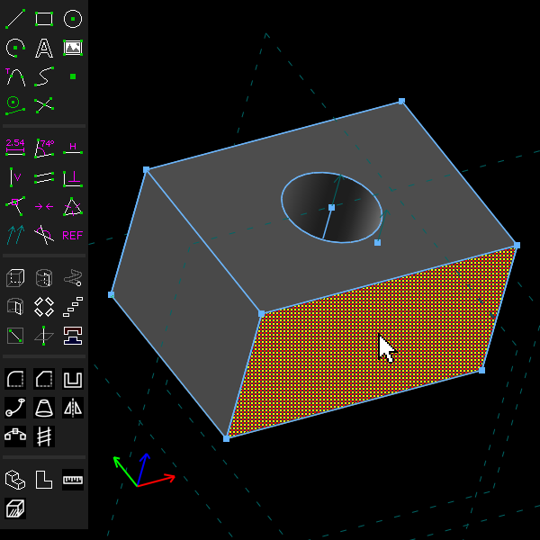
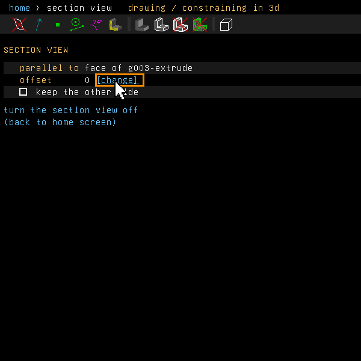
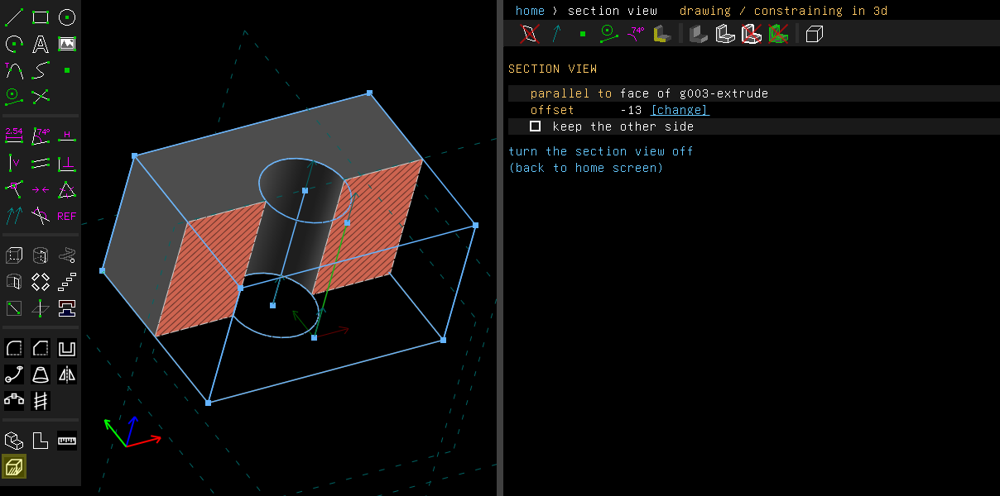

# Section view

Example: [`examples/scripts/section`](../../examples/scripts/section/section.go), a block with
a stepped bore, cut through the bore's axis.

The section view cuts the model open so that you can look inside. View > Section View
(Ctrl+Shift+X) cuts the model by a plane parallel to the selected workplane or flat face, and
draws the cut face closed. With nothing selected while you are sketching in a workplane, it cuts
in that workplane. Otherwise it says what to select.

Its screen in the property browser sets two things: how far from the face or workplane the plane
lies (an expression, in the document's unit), and which side is kept. Choosing the same menu
entry again turns the section view off.

## Step by step

Cut a block open through its bore:

1. Draw a rectangle (R) and a circle (C) inside it, and extrude them (Shift+X). Click the face
   to cut parallel to. It is drawn hatched when selected.

   

2. Choose View > Section View. The plane starts on the face itself, at an offset of 0. Click
   [change] beside the offset.

   

3. Type how far to move the plane: here -13, half the way to the opposite face, which puts it
   through the bore's axis. A negative offset goes into the solid, since a face's normal points out of
   it. The cut face is hatched, and the bore shows cut in half.

   

Tick **keep the other side** to see the other half. Click **turn the section view off**, or
choose View > Section View again, to close it.

These pictures are made by [`scenarios/section-view.scenario`](scenarios/section-view.scenario).

From a script:

```go
doc.View.SetSection(face, "20", false) // offset, flip
s := doc.View.Section()
doc.View.ClearSection()
```

`doc.File.Render` draws the view, cut, to a PNG file.

The cut face is filled and hatched in the colour of the SectionCap line style (Line Styles on
the home screen). The hatch runs at 45 degrees, with a line every 10 pixels.

## Not yet

The section is part of the view, not of the model. It is not saved in the file, and undo does
not change it.
