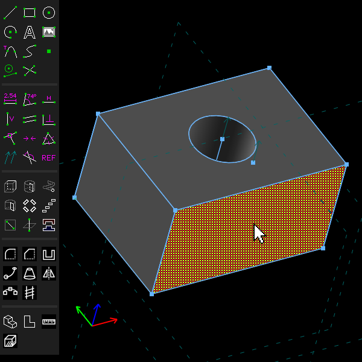
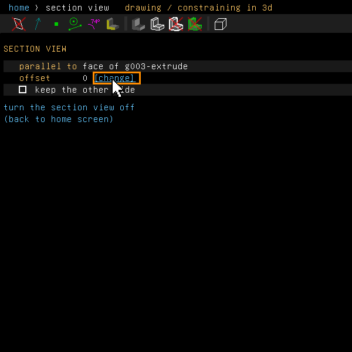
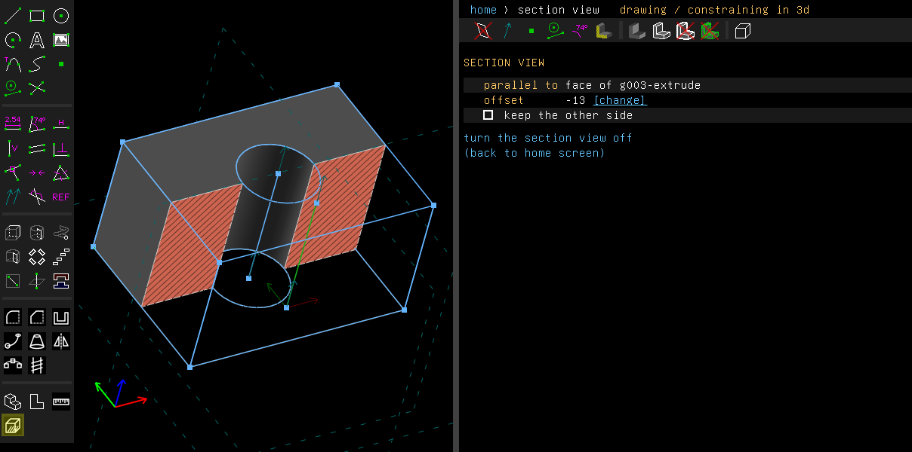

# Section view

Example: [`examples/scripts/section`](../../examples/scripts/section/section.go), a block with
a stepped bore, cut through the bore's axis.

The section view cuts the model open so that you can look inside. View > Section View
(Ctrl+Shift+X) cuts the model by a plane parallel to the selected workplane or flat face, and
draws the cut face closed. With nothing selected while you sketch in a workplane, it cuts in
that workplane. Otherwise it says what to select.

## Step by step

Cut a block open through its bore:

1. Draw a rectangle (R) and a circle (C) inside it, and extrude them (Shift+X). Click the face
   to cut parallel to. It is drawn hatched when selected.

   

2. Choose View > Section View. The plane starts on the face itself, at an offset of 0. Click
   [change] beside the offset.

   

3. Type how far to move the plane: here -13, half way to the opposite face, which puts it
   through the bore's axis. A negative offset goes into the solid, since a face's normal points
   out of it. The cut face is hatched, and the bore shows cut in half.

   

These pictures are made by [`scenarios/section-view.scenario`](scenarios/section-view.scenario).

## In the window

The section view's screen in the property browser has:

- **parallel to**: the face or workplane the plane is parallel to;
- **offset**: how far the plane is from it, a number or an expression in the document's unit;
- **keep the other side**: shows the other half;
- **turn the section view off**, as does choosing View > Section View again.

The cut face is filled and hatched at 45 degrees in the colour of the SectionCap line style
(Line Styles on the home screen).

The screen warns when the cut goes wrong:

- "The section can't cut: ..." when the plane is gone, as after its face was deleted;
- "The solid is not closed where it is cut, so the cap may be partial."

## From a script

```go
doc.View.SetSection(face, "20", false) // offset, flip
s := doc.View.Section()
fmt.Println(s.On, s.PlaneName, s.Offset, s.Area, s.Closed)
doc.View.ClearSection()
```

`s.Area` is the area of the cut face in mm², and `s.Closed` is false where the solid is open
there. `doc.File.Render` draws the view, cut, to a PNG file.

## Not yet

- The section is part of the view, not of the model: it is not saved in the file, and undo does
  not change it.
