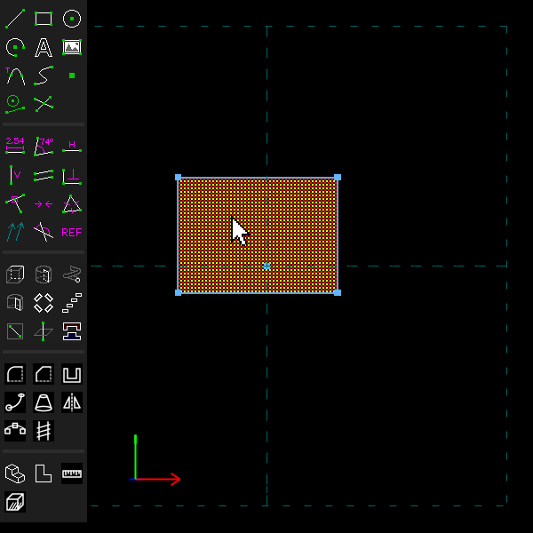
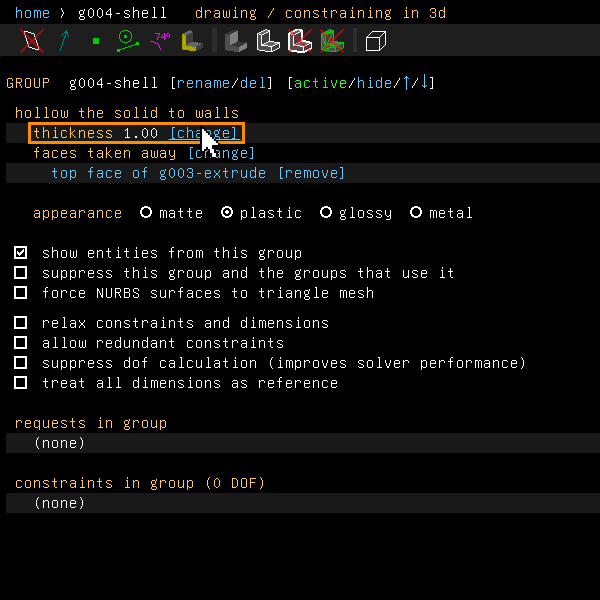
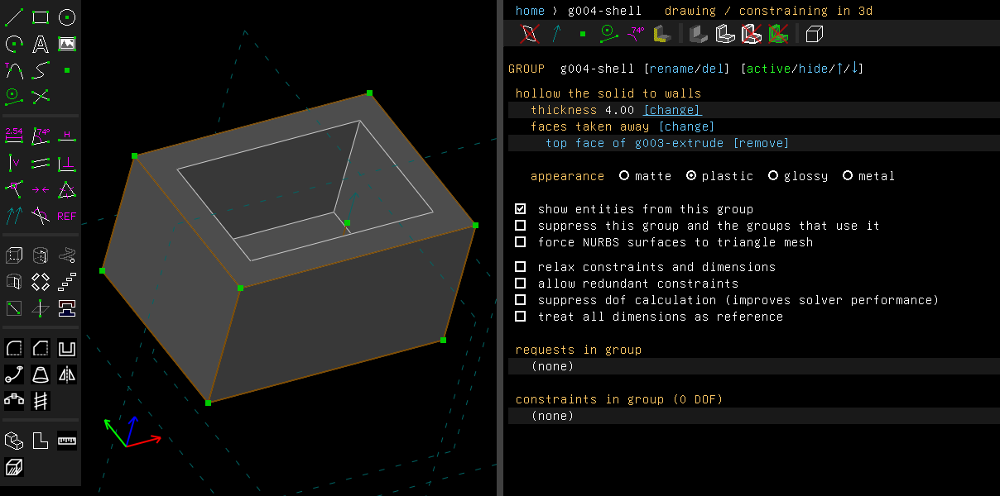
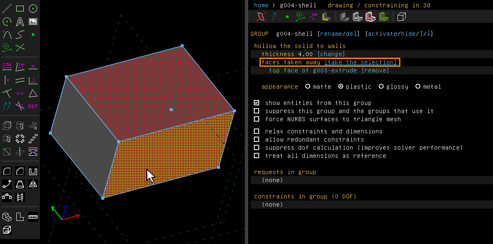
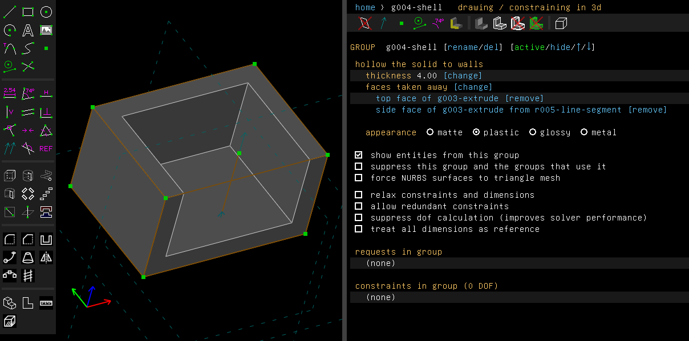
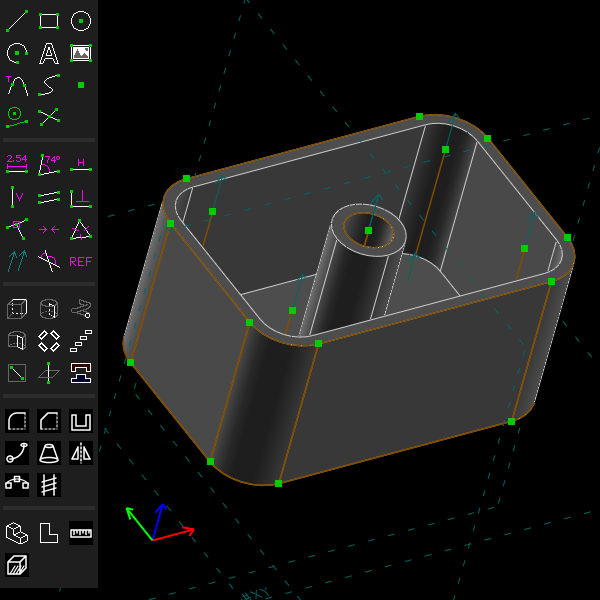

# Shell

A shell hollows a solid out, leaving walls of one thickness. It is open wherever you take a face
away.

Examples:

- [`examples/scripts/shell`](../../examples/scripts/shell/shell.go): an enclosure, a block
  hollowed to 2 mm walls and open at the top.
- [`examples/scripts/pot`](../../examples/scripts/pot/pot.go): a pot with rounded corners and a
  drain hole.
- [`examples/scripts/bowl`](../../examples/scripts/bowl/bowl.go): a turned bowl whose wall is a
  zone of a sphere.
- [`examples/scripts/housing`](../../examples/scripts/housing/housing.go): a turned housing
  with a square boss out of its side, hollowed as one.

## Step by step

Hollow a block, open at the top:

1. Press R for a rectangle and click two corners. Press Esc, then Shift+X to extrude it.
   Click the top face. It is drawn hatched when selected.

   

2. Choose Features > Shell Solid. The block is hollowed to walls 1 mm thick, open at the top,
   and the property browser lists the face taken away.

   

3. Click "[change]" beside the thickness and type a new one, here 4.

   

   

4. To open a side as well, click "[change]" beside the faces with nothing selected. A message
   says what to pick, and the extrusion becomes active, so its faces can be picked. Pick the top
   and a side. The link now reads "[take the selection]".

   

5. Click "[take the selection]". The extrusion is still active, so click "activate" on the
   shell's screen to see the shell again. It is open at the top and at the side.

   

These pictures are made by [`scenarios/shell.scenario`](scenarios/shell.scenario), which
replays the same clicks on the program (`scripts/regen-doc-images.sh`). Its last picture is the
`pot` example:



## In the window

Select one or more faces of the solid to take away, then choose Features > Shell Solid
(Shift+G). A right click on a face offers the same as Shell Solid Open Here.

The group's screen lists the faces taken away and takes the thickness, as a number or an
expression. "[change]" beside the faces takes the current selection as the faces to take away
instead (with nothing suitable selected it activates the group before the shell, says what to
pick, and reads "[take the selection]" until you do). "[remove]" on a face's row keeps that face
as a wall again. A thickness at which the walls would meet is a problem on the group, and the
solid passes through unchanged.

From a script:

```go
box := doc.Features.Extrude(25, "box")
top := box.Solid().FaceAt(api.V(30, 20, 25))
sh := doc.Features.ShellSolid([]api.SolidFace{top}, 2, "")
sh.AsShell().SetThickness(1.5)
```

## What it hollows

**A solid of flat faces** can be open at any of them.

**A prism** whose sides are flat or round, such as an extruded circle, a rounded rectangle, or a
block with a round hole, can be open at its ends. Its arcs keep their centres and lose or gain
the thickness on their radius. A round corner smaller than the thickness becomes a sharp corner
inside.

**A lathe or revolve** of lines and arcs, with no other solid before or after it, is hollowed by
its profile. So are several lathes about one axis joined to each other (a cup with a flange round
its foot, a groove turned out of a cylinder), drawn in any planes through the axis. The lathes'
profiles are joined, then the profile is offset into the material: each line is moved square to
itself, each arc gets a smaller or larger radius about its centre, and the result is turned
again. So a cone gets a coned inside and a sphere a spherical one, each wall exactly the
thickness. Such a solid can be open at any of its faces: a flat one, such as a cup's top, or a
curved one, such as a ring open all round its outer side, which leaves a channel. Where a curved
face taken away meets a flat face at an inside corner, as a stepped shaft's narrower part meets
the step, the inside steps along the flat face's plane round the corner, so the wall under the
step keeps its thickness. Beside a cone, a sphere or a torus at an inside corner, as a cylinder
standing on a coned or rounded shoulder, the wall under that face keeps its thickness too and
ends square to it at the corner. A revolve's flat ends are walls too, unless they are taken away. Where the ends of a
revolve of more than half a turn meet at the axis, the inside keeps the thickness from each end
and is rounded about the axis.

**A drafted extrusion whose sides are cones**, such as a drafted cylinder, ring or slot, with no
other solid before or after it, is hollowed by its profile too. Each side, plane or cone, is
moved in square to itself. The inside is the same draft of the profile, offset across by the
thickness divided by the cosine of the draft angle, between the ends moved in. It can be open
at its ends, or at a round side between outside corners, past which the inside runs out. A
two-sided draft's inside leans both ways from its neutral plane, as the solid does. (A drafted
extrusion of lines only has flat faces, and is hollowed like any solid of flat faces.)

**A union of such parts.** A solid joined by unions from lathes, revolves and extrusions,
drafted or not, each of which a shell could hollow alone, is hollowed as the union of the parts'
insides. Examples: a turned body with an extruded boss out of its side, a cup with a lug revolved
part of a turn round it, a block with a round boss. Each part's walls are moved in. But a face of
a part that lies inside the others, such as a boss's foot sunk into the body, is moved out by the
thickness instead. So the boss's inside runs into the body's with no wall between them, and the
walls round the joint keep the thickness. The ends of a revolve standing inside another part, such
as a ring on a block's side, move out the same way, whatever its turn. An end in the air beside
them is a wall, which runs on round the axis: on a half turn, whose two ends lie in one plane,
the inside steps there, the thickness past the axis. A prism's
sides move each as it lies: a round post half sunk into a block's side is walled all round, its
inside reaching into the block's. Where a part's foot moved out would carry its inside past the
wall of the part it stands in (a post sunk into a block's top just beside its side, standing out
of the block), the foot is kept as a wall there instead, the other part's wall. A top that two
parts share in one plane, as a block's and a round post's sunk into it as high as the block, can
be opened at the block's face or at both; the post's top is a wall unless it is opened too. Lathes about one axis are joined by their
profiles first, as above.

**Parts taken away or intersected.** Such parts can also be taken away from the solid before
them, or intersected with it: a round pocket or a groove lathed into a block, a cone or a ball
cut flat by a block. A part taken away takes away from the inside that part grown by the
thickness, every face moved out, so a wall of the thickness stands round the pocket and over its
floor. A revolve of less than a whole turn taken away grows across its ends' planes too. A part
intersected with cuts the inside by that part moved in. The parts are taken in the order they
were made. A face taken away that lies on a part taken away (a pocket's floor, extruded or
turned) or intersected with (the flat cut down a cone's side, a lathe's top) opens the inside
through it.

## Not yet

- A solid with curved faces must be one of these: a prism whose sides all run one way, open
  only at its ends; one lathe or revolve; lathes about one axis; or a solid joined from such
  parts. A solid with a helix, or with a feature after those parts, is refused.
- In a union, a part whose inside would touch another's along a line or at a point (a round post
  sunk beside a block's side, as high as the block, its inside just meeting the block's) is
  refused: the walls either side would meet with no thickness, which is no closed solid. Move
  the post or change the thickness. So is a prism whose inside's outline would touch itself (the
  same post standing on the block's own bottom): the walls either side would meet along a line.
- A face moved out that would come out of the solid is refused. So is one that would leave a
  wall beyond it thinner than the thickness, where a part joined to another is thinner there than
  twice the thickness.
- A revolve's curved face opened at an inside corner beside a face that rises again within the
  thickness, as a step narrower than the thickness with a second rise beyond it, is refused: the
  inside would cut into the rise. So is one beside a cone, a sphere or a torus that is taken away
  too. A drafted extrusion's round side can be opened only between outside corners.
- A profile of curves other than lines and arcs is refused.
- Beside a round hole, walls thinner than about twice the chord tolerance (how far the mesh may
  stray from the true surface, set on the configuration screen) can come out unsound: the hole's
  chords and the wall's cross.
- Where four faces meet at a vertex and, moved in, don't meet at one point, as at an off-centre
  pyramid's apex, the inside gets a short new edge there. Five or more such faces are refused.
- Filleted and lofted solids can't be shelled yet. That waits for offsets of other kinds of
  surface.
