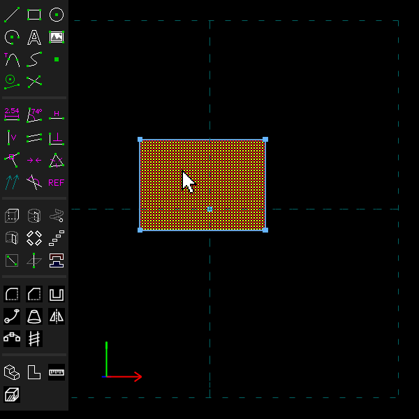
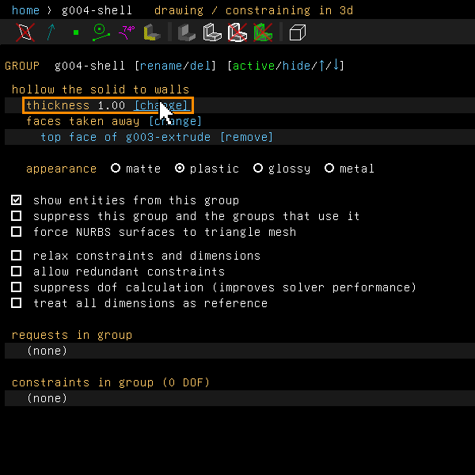
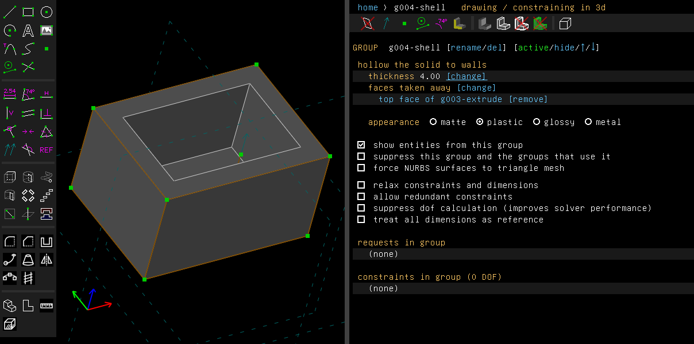
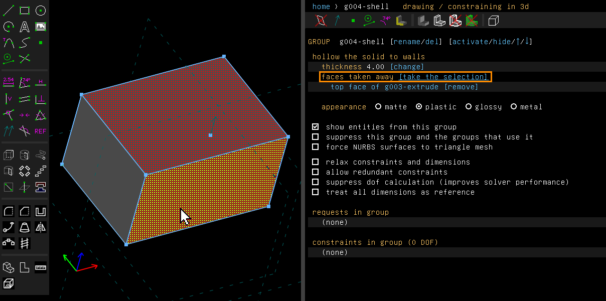
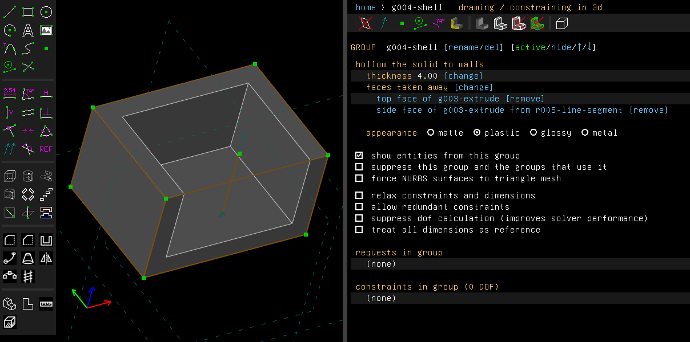
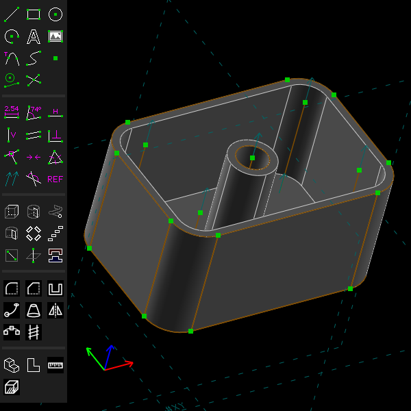

# Shell

A shell hollows a solid out, leaving walls of one thickness. It is open wherever you take a face
away.

Examples:

- [`examples/scripts/shell`](../../examples/scripts/shell/shell.go): an enclosure, a block
  hollowed to 2 mm walls and open at the top.
- [`examples/scripts/pot`](../../examples/scripts/pot/pot.go): a pot with rounded corners and a
  drain hole.
- [`examples/scripts/bowl`](../../examples/scripts/bowl/bowl.go): a turned bowl whose wall is a
  zone of a sphere.
- [`examples/scripts/housing`](../../examples/scripts/housing/housing.go): a turned housing
  with a square boss out of its side, hollowed as one.

## Step by step

Hollow a block, open at the top:

1. Press R for a rectangle and click two corners. Press Esc, then Shift+X to extrude it.
   Click the top face. It is drawn hatched when selected.

   

2. Choose Features > Shell Solid. The block is hollowed to walls 1 mm thick, open at the top,
   and the property browser lists the face taken away.

   

3. Click "[change]" beside the thickness and type a new one, here 4.

   

   

4. To open a side as well, click "[change]" beside the faces with nothing selected. A message
   says what to pick, and the extrusion becomes active, so its faces can be picked. Pick the top
   and a side. The link now reads "[take the selection]".

   

5. Click "[take the selection]". The extrusion is still active, so click "activate" on the
   shell's screen to see the shell again. It is open at the top and at the side.

   

These pictures are made by [`scenarios/shell.scenario`](scenarios/shell.scenario), which
replays the same clicks on the program (`scripts/regen-doc-images.sh`). Its last picture is the
`pot` example:



## In the window

Select one or more faces of the solid to take away, then choose Features > Shell Solid
(Shift+G). A right click on a face offers the same as Shell Solid Open Here.

The group's screen:

- The thickness starts at 1 mm. "[change]" takes a number or an expression.
- Each face taken away has a row. "[remove]" keeps that face as a wall again.
- "[change]" beside the faces takes the current selection as the faces to take away instead.
  With nothing suitable selected, it activates the group before the shell, says what to pick,
  and the link reads "[take the selection]" until you do.

A thickness at which the walls would meet, or a solid the shell can't hollow, is a problem on
the group that says why, and the solid passes through unchanged. Where the shell has to stop a
wall a little short of where it should, the group carries a note that says how far (`Note()` on
the group in a script).

From a script:

```go
box := doc.Features.Extrude(25, "box")
top := box.Solid().FaceAt(api.V(30, 20, 25))
sh := doc.Features.ShellSolid([]api.SolidFace{top}, 2, "")
sh.AsShell().SetThickness(1.5)
side := box.Solid().FaceAt(api.V(30, 0, 10))
sh.AsShell().SetFaces([]api.SolidFace{top, side}) // open at the front too
```

`Features.Shell` takes face entities instead, as `Group.Faces` gives an extrusion's.

## What it hollows

The walls are moved in square to themselves by the thickness: a flat face stays flat, a cylinder
or a cone keeps its axis and changes its radius, a sphere stays a sphere. Each wall is exactly the
thickness.

| Solid | Can be open at |
|---|---|
| A solid of flat faces | any face |
| A prism with round sides (an extruded circle, a rounded rectangle, a block with a round hole) | its ends |
| A lathe or revolve of lines and arcs, or several lathes about one axis joined | any face, flat or curved; a ring open all round its outer side leaves a channel |
| A drafted extrusion with round sides (a drafted cylinder, ring or slot), one-sided or two-sided | its ends, or a round side |
| A union of such parts (a turned body with a boss out of its side, a block with a round post) | any of the parts' faces |
| Such parts taken away from a solid or intersected with it (a round pocket, a groove, a ball cut flat) | any face, including a pocket's floor |

Details:

- A round corner smaller than the thickness becomes a sharp corner inside.
- In a union, the insides of the parts run into each other with no wall between them, and the
  walls round the joint keep the thickness.
- A part taken away leaves a wall of the thickness round the pocket and over its floor.
- A two-sided draft's side has a face above and one below the neutral plane; either can be
  opened alone.
- Where a drafted extrusion's round side is opened at an inside corner, as a round lobe on a
  block's edge, the inside wall beside it stops a little short of the corner. The group's note
  says how far, a few hundredths of the thickness at small drafts.
- Past a curved face taken away, the inside runs out a little beyond the solid, less where the
  solid comes back close outside it (across a narrow slot).

## Not yet

- A solid with curved faces must be one of the kinds above. A solid with a helix, or with a
  feature after those parts, is refused.
- Filleted and lofted solids can't be shelled yet.
- A profile of curves other than lines and arcs is refused.
- Where two parts' insides would touch along a line or at a point (a round post sunk just
  beside a block's side), or a prism's inside outline would touch itself, it is refused: move the
  part or change the thickness.
- A face moved out that would come out of the solid, or leave a wall beyond it thinner than the
  thickness, is refused.
- A revolve's curved face opened where the solid comes back within an eighth of the thickness
  outside it, as across a slot that narrow, is refused.
- A drafted extrusion's round side opened at an inside corner too tight for the wall to step
  round is refused.
- Five or more faces meeting at a vertex that, moved in, don't meet at one point, are refused.
  Four such faces (an off-centre pyramid's apex) get a short new edge inside.
- Beside a round hole, walls thinner than about twice the chord tolerance can come out unsound.
