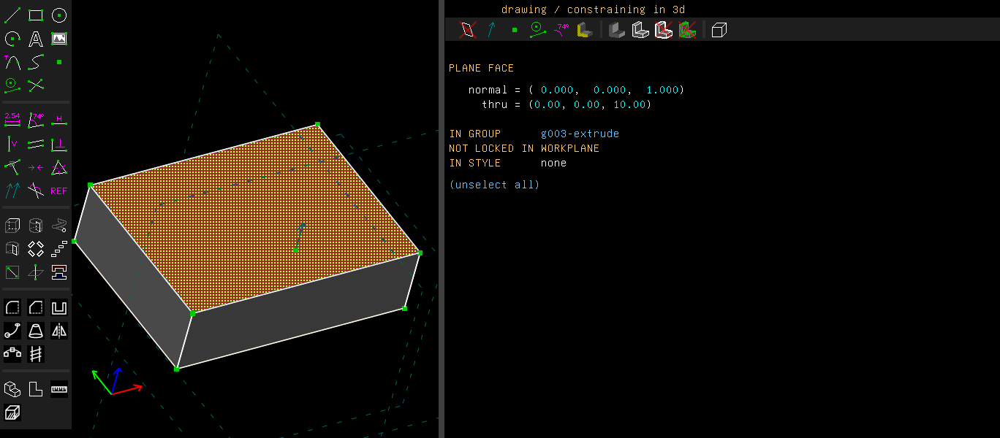
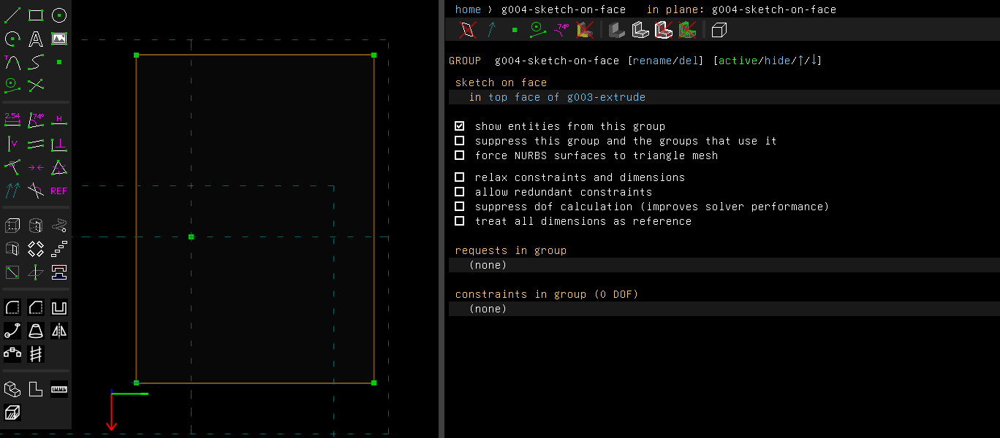
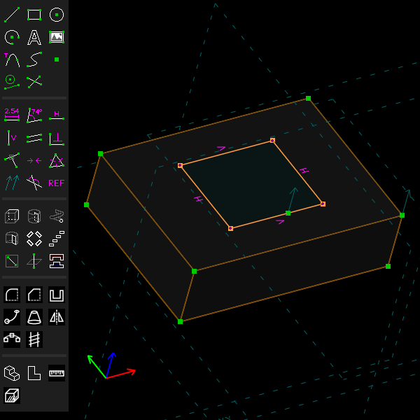
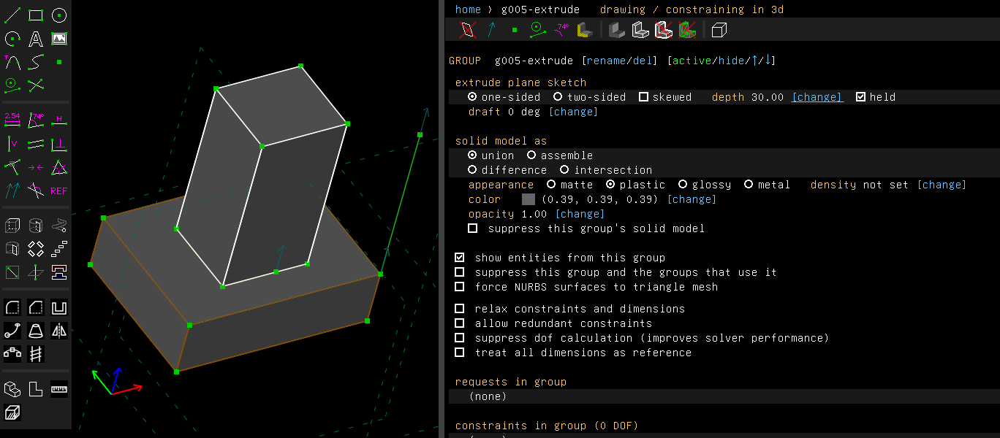
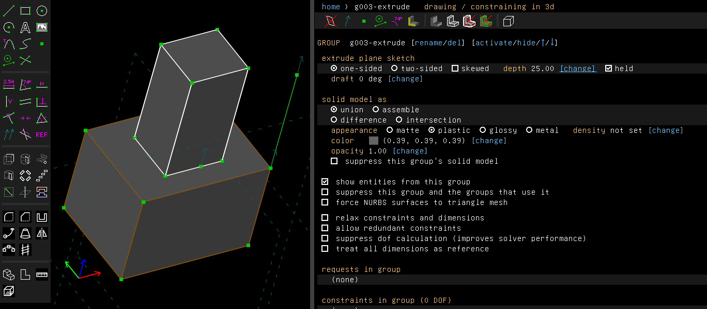

# Sketch on a face

Example: [`examples/scripts/pedestal`](../../examples/scripts/pedestal/pedestal.go), a base with a
column drawn on its top and a cap drawn on the column's top. When the base is made thicker, the
column and the cap go up with it.

## Step by step

Stand a column on a base, then make the base thicker:

1. Draw a rectangle (R), press Esc, and extrude it (Shift+X). Here its depth is held at 10 mm.
   Click the top face of the block. It is hatched when selected, and the property browser describes it.

   

2. Choose Features > Sketch On Face (Shift+B). A new sketch group starts in the face, and the
   view turns to look straight at it. The group's screen names the face it lies in.

   

3. Draw a rectangle inside the face and press Esc. Here the view is turned to show the sketch
   on the block.

   

4. Extrude it (Shift+X). The column stands on the base. Here its depth is held at 30 mm, as
   [Parameters and units](parameters-and-units.md#an-extrusions-depth-and-a-revolves-angle)
   says.

   

5. Make the base thicker: on the home screen click the base's extrusion, and change its depth,
   here from 10 to 25 mm. The sketch on the face and the column go up with the face.

   

These pictures are made by [`scenarios/sketch-on-face.scenario`](scenarios/sketch-on-face.scenario).

## In the window

Features > Sketch On Face (Shift+B) starts a sketch whose workplane lies in a flat face of the
solid so far. Select one face on the model. It may be a face an extrusion made, or one that no
entity stands for, such as a chamfer's face or a shell's. A right click on a face offers the
same entry. Sketch In New Workplane with a face selected does the same thing.

Where the workplane goes:

- Its normal points out of the solid.
- Its origin is on a corner of the face.
- Its first axis runs along one of the face's edges, and the face lies on the positive side of
  both axes, beside the origin.
- A face with no straight edge, such as a cylinder's cap, puts the origin at the centre of its
  circle.

The sketch follows the face. When an edit earlier in the history moves or turns the face (a
deeper extrusion, another draft angle), the workplane, what is drawn in it and the solids made
from it all move with the face, in the same regeneration. The corner and the edge are chosen by
the edges' names, not by where they are. So they stay the same corner and edge for as long as
the face keeps its edges.

When the face goes, for example when the group that made it is suppressed, the workplane stays
where it was, and the group says why. It follows the face again when the face comes back. The
group's screen names the face.

From a script:

```go
base := doc.Features.Extrude(8, "base")
doc.Features.SketchOnFace(base.Solid().FaceAt(api.V(30, 20, 8)), "")
doc.Sketch.Rect(api.V(20, 13, 8), api.V(40, 27, 8))
column := doc.Features.Extrude(12, "column")
```

`Solid.Face` takes a face by its identity instead of a point on it. `Group.Face` gives the face
a sketch lies in.

## Not yet

The face can't be changed on the group's screen. Delete the sketch and start it on the other
face. The corner and the edge are chosen for you. To draw from another corner, constrain the
sketch to the face's edges. An extrusion from the sketch whose depth is left free is kept as
near its old direction as the solver can. So when the face turns, that extrusion comes out a
little shorter. A dimension on the depth holds it.
