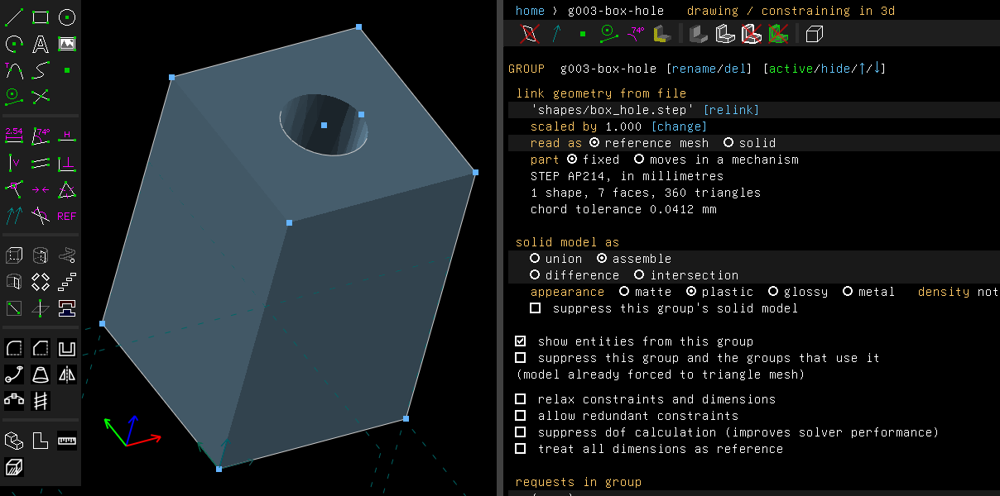
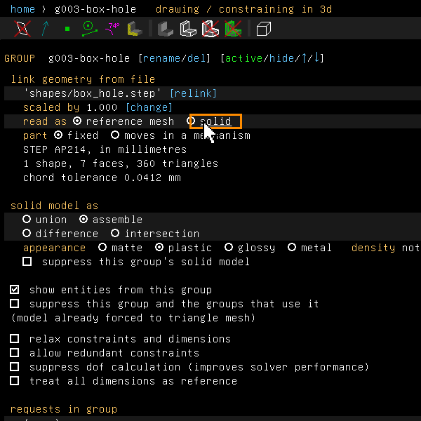
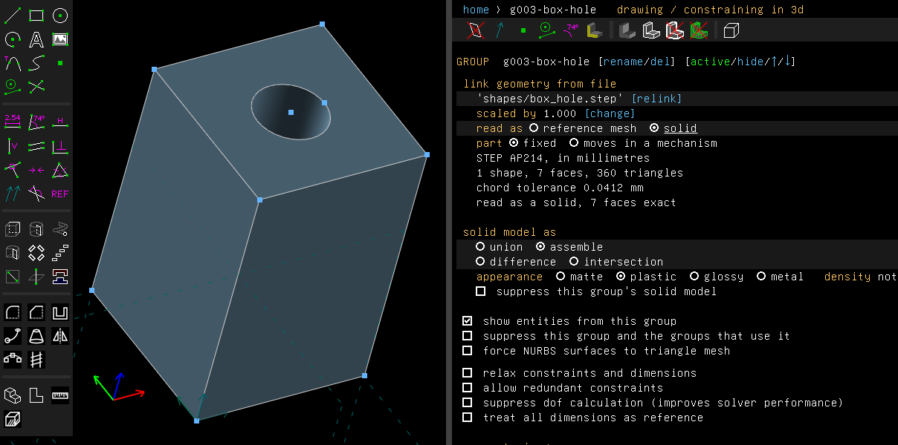

# STEP links

Examples: [`examples/scripts/step`](../../examples/scripts/step/step.go) links a STEP file and
prints what was read. Given no file, it exports a plate as STEP and links that back.
[`examples/scripts/stepsolid`](../../examples/scripts/stepsolid/stepsolid.go) links a STEP
file as a solid and cuts a slot across it.

## Step by step

Link a STEP file of a block with a hole, then read it as a solid:

1. Choose Assembly > Link / Assemble... (Shift+I) and pick the STEP file. The block comes in
   as a reference mesh, with a point at each vertex and at the hole's centre. Its screen says
   what was read: STEP AP214 in millimetres, 1 shape, 7 faces, 360 triangles, and the chord
   tolerance.

   

2. On the row **read as**, click **solid**.

   

3. The screen adds "read as a solid, 7 faces exact", and the hole is drawn smooth. Analyze >
   Check Solid now says "The solid is sound." with 7 faces of 11 patches.

   

These pictures are made by [`scenarios/step-links.scenario`](scenarios/step-links.scenario).

## What it does

Assembly > Link / Assemble... (Shift+I) brings another file into the model as a part. The file
can be:

| File | Comes in as |
|---|---|
| TeleSAPR model (`.tlspr`) | its solid, beside what is drawn |
| STEP (`.step`, `.stp`) | a reference mesh, or a solid (see [As a solid](#as-a-solid)) |
| STL (binary or text), Wavefront OBJ (`.stl`, `.obj`) | a mesh; an OBJ file's faces take the colours of its `.mtl` materials |
| IDF circuit board (`.emn`) | the board extruded from its outline, with its cutouts and holes |

A STEP file or a mesh comes in where it was drawn, in the file's own coordinates.

A linked STEP file has a point at each vertex and at each circle's centre. A linked mesh has a
point at its origin, at the corners of its bounding box, and at each vertex on its sharp edges.
Constrain and measure against these points.

The link group's screen says what was read from a STEP file:

- the file's schema and unit;
- how many shapes, faces and triangles it gave;
- the chord tolerance (how far the mesh may stray from the true surface);
- the entities it could not read, by name;
- whether the volume, area and centre the file declares for its parts agree with what was read.

A file with no shape the reader takes links as an empty mesh, and the screen says why.

### What the screen warns of

A STEP file may declare each part's volume, surface area and centre (its "validation
properties"). TeleSAPR writes them, and so do many other programs. When a linked file has them,
the screen says "volume, area and centre as the file declares for 1 part". When a part differs by
more than 1% (the centre: by more than 1% of the part's size), the screen says so in red, as
`"bracket" is not what the file declares it to be: volume 1100 mm³ declared, 1000 read`. Then the
part did not come across as it was made. A file that declares nothing says nothing.

The triangles of each solid are also checked, as Analyze > Check Solid checks a solid. A solid
whose triangles leave a gap or cross each other gives "the mesh of 1 solid has 3 naked edges,
so it is not closed". Try reading it as a solid, or ask for the file again. Touching parts of an
assembly, and open shells, are not warned of.

### Reading the file again

The link keeps the file's path. The file is read again on opening, and on undo and redo, so
changes to it show. A file that has not changed is read once, however many times it is linked.

A STEP file's triangles are kept on disk between sessions, in the user's cache folder
(`telesapr/step`), or under the folder `TELESAPR_CACHE_DIR` names. Deleting that folder is safe:
the files are triangulated again.

## Packed models

Saving a model as `.tlsprz` packs it into one zip file: the model, the files it links (and the
files those link), its pictures, and the kept triangles of its STEP files. Send it, and it opens
elsewhere as it was.

Opening a packed model unpacks it into a folder of its own, and its links name the files there.
To work on the parts, unpack the file somewhere of your own first. Any zip tool will do; the
model is `model.tlspr`.

## As a solid

A STEP link's screen has a row **read as**: **reference mesh** or **solid**.

Read as a solid, the file's faces are exact. The part then takes part in Booleans, fillets and
chamfers: a later group can cut it or join it, as it can a solid made here. The screen says
"read as a solid, n faces exact".

The reader takes:

- faces on planes, cylinders, cones, spheres, tori, surfaces of revolution and of extrusion,
  B-splines, and offsets of all of these;
- edges that are lines, circles, ellipses, parabolas, hyperbolas and B-splines.

A curve or surface of degree above 5 is converted to degree 5 in pieces, within 0.0001 mm.

Files are written to a tolerance, so their edges miss their faces a little. The reader accepts
edges up to 0.001 mm off their faces.

A file that can't be read as a solid comes in as the reference mesh instead, and the screen says
why: "read as a mesh, not a solid: ...".

## From a script

```go
g, err := doc.Assembly.Link("parts/bracket.step", "bracket")
fmt.Println(g.AsLink().Info(), g.AsLink().Problem())
fmt.Println(g.Analyze().Check().Volume)

part, err := doc.Assembly.LinkStep("parts/bracket.step", "bracket", true) // as a solid
part.AsLink().AsSolid()                                              // true
part.AsLink().SetAsSolid(false)                                      // back to a mesh
```

## Not yet

- CSG solids and swept solids in a STEP file are named on the screen and not read.
- A tessellated STEP file (triangles only) links as a mesh, never as a solid.
- A STEP file whose edges lie further than 0.001 mm from their faces is not read as a solid.
- An IDF file gives the board alone: the parts placed on it are not read.
- Validation properties of a part used in an assembly, when the part holds no shapes of its own
  (only sub-parts), are not compared; nor are a file's other properties (counts of faces, PMI).
