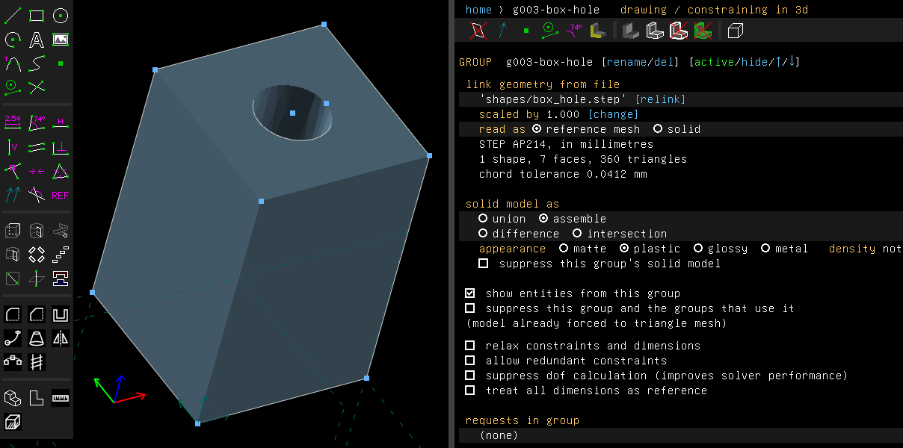
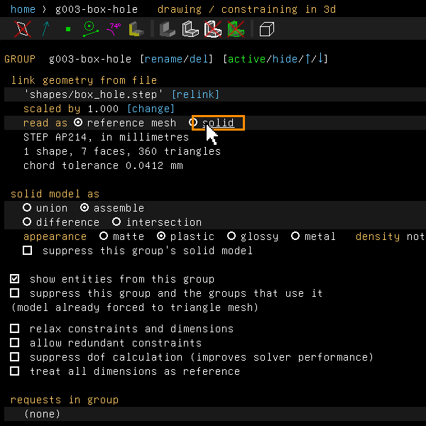
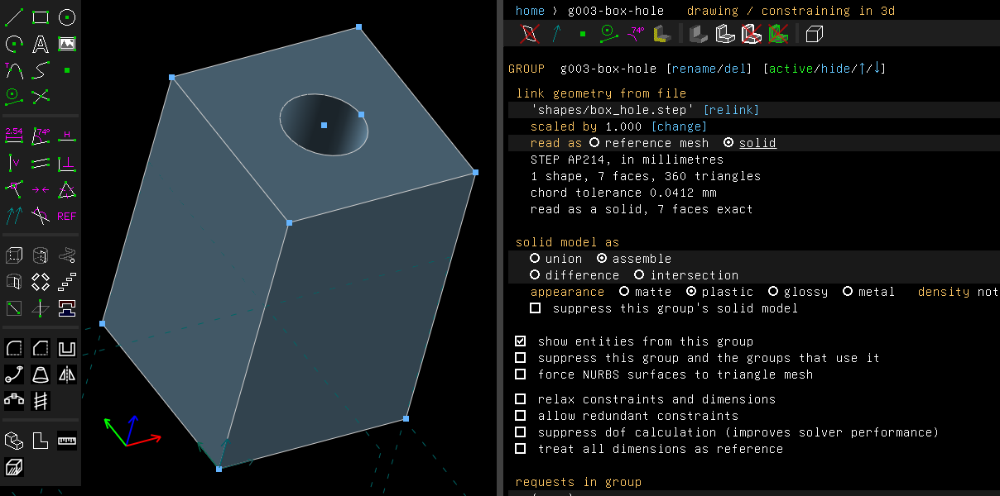

# STEP links

Examples: [`examples/scripts/step`](../../examples/scripts/step/step.go) links a STEP file and
prints what was read. Given no file, it exports a plate as STEP and links that back.
[`examples/scripts/stepsolid`](../../examples/scripts/stepsolid/stepsolid.go) links a STEP
file as a solid and cuts a slot across it.

## Step by step

Link a STEP file of a block with a hole, then read it as a solid:

1. Choose Assembly > Link / Assemble... (Shift+I) and pick the STEP file. The block comes in
   as a reference mesh, with a point at each vertex and at the hole's centre. Its screen says
   what was read: STEP AP214 in millimetres, 1 shape, 7 faces, 360 triangles, and the chord
   tolerance.

   

2. On the row **read as**, click **solid**.

   

3. The screen adds "read as a solid, 7 faces exact", and the hole is drawn smooth. Analyze >
   Check Solid now says "The solid is sound." with 7 faces of 11 patches.

   

These pictures are made by [`scenarios/step-links.scenario`](scenarios/step-links.scenario).

## What it does

Assembly > Link / Assemble... (Shift+I) brings another file into the model as a part. The file
can be:

- a TeleSAPR model (`.tlspr`);
- a STEP file (`.step`, `.stp`);
- a triangle mesh: an STL file, binary or text, or a Wavefront OBJ file. An OBJ file's faces
  take the colours of the materials its `.mtl` file gives.

A TeleSAPR model comes in beside what is drawn, off the middle of the view. A STEP file or a
mesh comes in where it was drawn, with the file's own coordinates.

A STEP file's solids are read and triangulated into a reference mesh. The mesh is placed in
the model with a point at each vertex and at each circle's centre, so you can constrain and
measure against it. A mesh file links with a point at its origin, at the corners of its
bounding box, and at each vertex on its sharp edges.

The group's screen says what was read from a STEP file: the file's schema and unit, how many
shapes, faces and triangles it gave, the chord tolerance it was triangulated to (how far the
mesh may stray from the true surface), and the entities it could not read, by name. A file with
no solid the reader supports links as an empty mesh, and the screen says why.

### Reading the file again

The link keeps the file's path. On opening, and on undo and redo, the file is read again, so a
changed file shows its changes. A file that has not changed (same size, same modification
time) is taken from memory, so a part linked many times is read once.

A STEP file's triangles are also kept on disk, in the user's cache folder (`telesapr/step`, or
the folder `TELESAPR_CACHE_DIR` names). So the next session does not triangulate it again.
Deleting that folder only costs that time.

## Packed models

Saving a model as `.tlsprz` packs it into one zip: the model, the files it links (and the
files those link, all in one folder), its pictures, and the kept triangles of its STEP files.
Such a file can be sent and opened elsewhere as it was.

Opening a packed model unpacks it into a folder of its own. Its links then name the files
there, so saving it packed again packs them again. Saving it as a `.tlspr` keeps those links
into that folder. To work on the parts, unpack the file somewhere of your own first. Any zip
tool will do; the model is `model.tlspr`.

## As a solid

A STEP link's screen has a row **read as**, with **reference mesh** and **solid**.

Read as a solid, the file's faces are exact: planes, cylinders, cones, spheres, tori, surfaces
of revolution and of extrusion, B-splines, and offsets of all of these. Each face is cut into
the kernel's patches along its knots (a quarter turn for a face that turns about an axis) and
trimmed by its edges. Edges may be lines, circles, ellipses, parabolas, hyperbolas and
B-splines.

A curve or surface of a degree above 5, the kernel's highest, is written at degree 5 in
pieces, within a ten-thousandth of a millimetre. So is an offset of a surface other than a
plane, cylinder, cone, sphere or torus; the offsets of those five are surfaces of the same
kind.

The linked part then takes part in Booleans. A later group can cut it or join it, as it can a
solid made here. The screen says "read as a solid, n faces exact". A file that can't be read
as a solid comes in as the reference mesh instead, and the screen says why: "read as a mesh,
not a solid: ...".

Files are written to a tolerance, and their edges miss their faces by up to it. The reader
allows a thousandth of a millimetre. The mesh of a face puts its edges' points where the edges
are, so faces that meet in the file meet in the mesh. An edge that runs along the line where
the pieces of a face's surface meet, within the tolerance of it, is put on that line. What the
reader can't take yet: edges further from their faces than the tolerance.

Of the files TeleSAPR is tested on, all read as sound solids: the 14 shapes made in FreeCAD,
the 6 of higher degrees, offsets and conics, and the 9 from other systems.

## From a script

```go
g, err := doc.Assembly.Link("parts/bracket.step", "bracket")
fmt.Println(g.AsLink().Info(), g.AsLink().Problem())
fmt.Println(g.Analyze().Check().Volume)

part, err := doc.Assembly.LinkStep("parts/bracket.step", "bracket", true) // as a solid
part.AsLink().AsSolid()                                              // true
part.AsLink().SetAsSolid(false)                                      // back to a mesh
```

## Not yet

- CSG solids, swept solids and tessellated STEP files are reported by name and not read.
- Booleans on imported solids fail where the kernel's own do: a cylinder cut through a
  cylinder, a cone through its apex.
