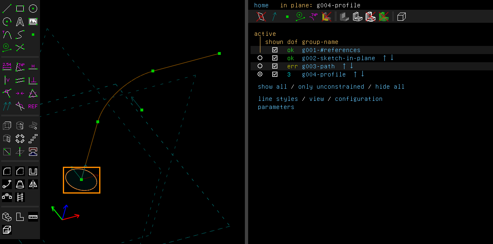
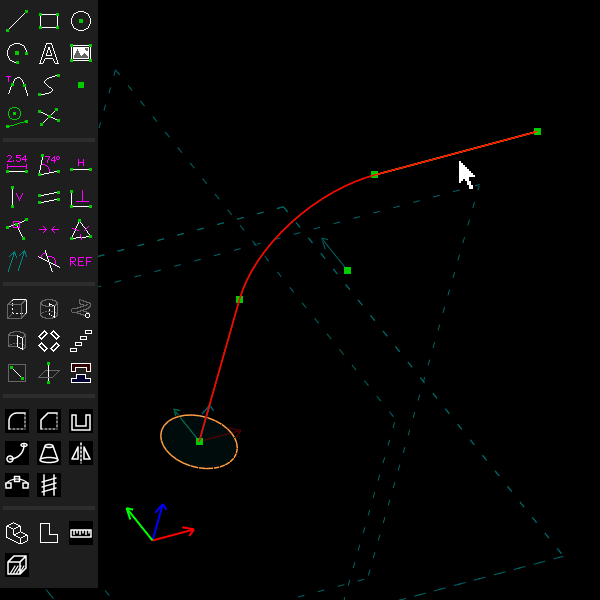
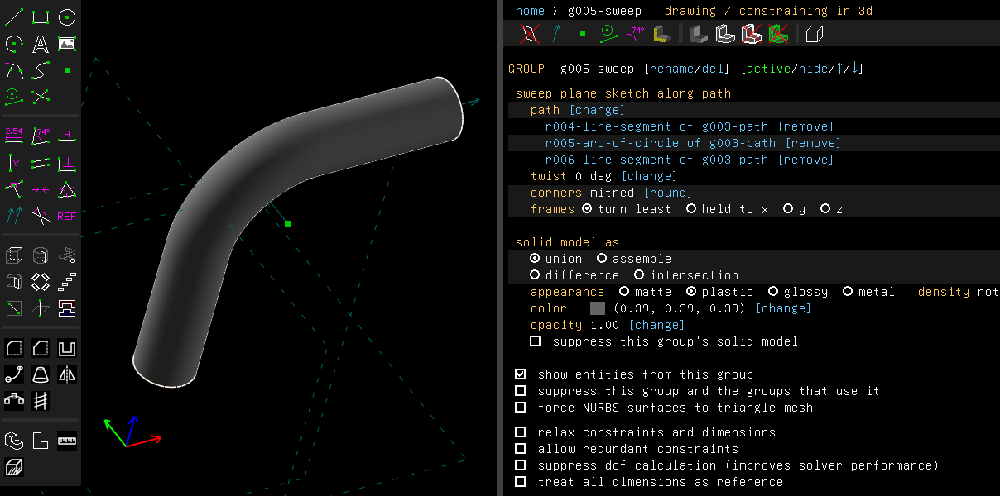
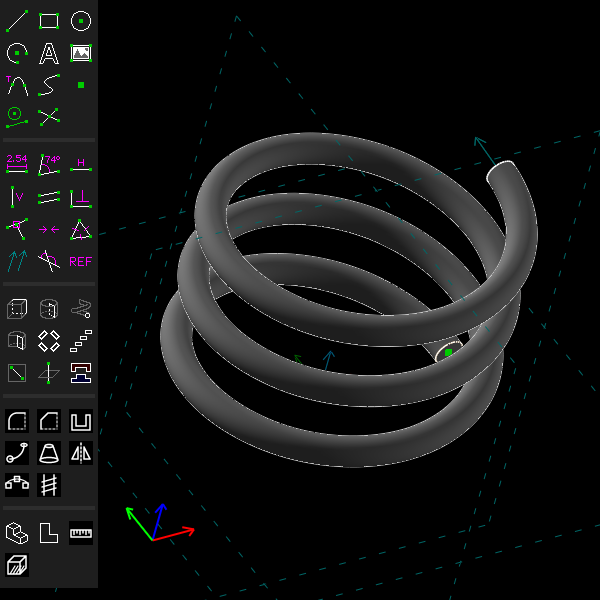
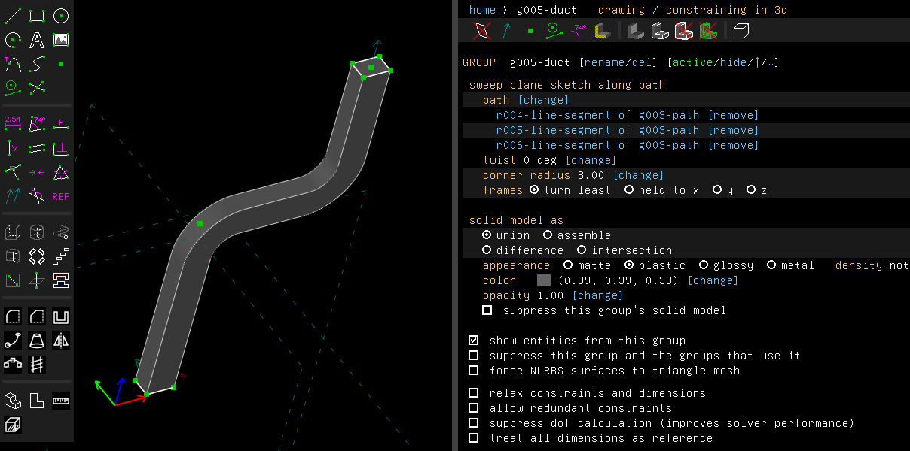
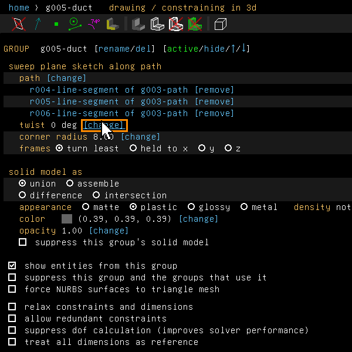
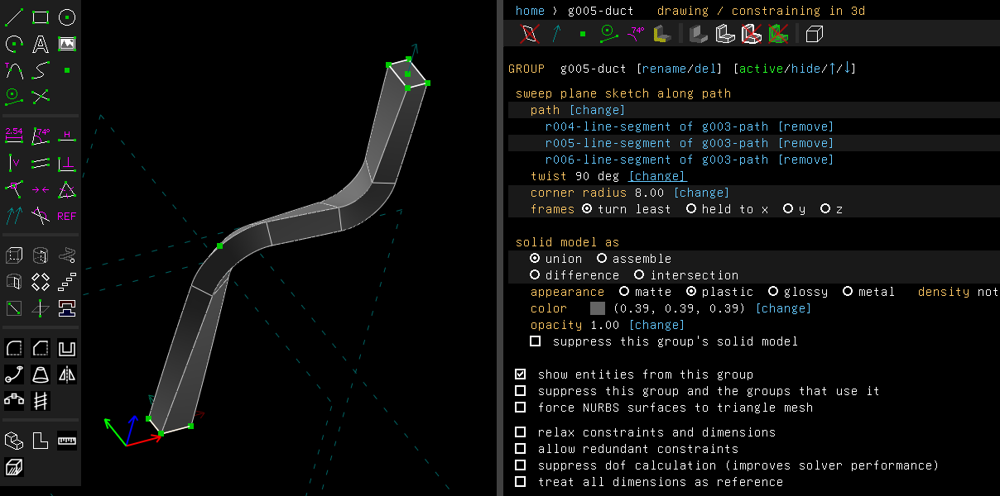

# Sweep

Examples: [`examples/scripts/sweep`](../../examples/scripts/sweep/sweep.go), a bent tube: a
ring swept along a straight, a bend and a straight;
[`examples/scripts/spring`](../../examples/scripts/spring/spring.go), a coil spring: a circle
swept along a helix drawn as cubics.

A sweep moves a sketch (the *profile*) along a path, and makes the solid it passes through.

## Step by step

Sweep a circle along a bent path:

1. Draw the path in one sketch: here a line, an arc and a line, tangent where they meet. Draw
   the profile, a circle, in a workplane across the path's start, and keep its sketch active.
   A path need not be a closed loop.

   

2. Click the three pieces of the path. They are drawn in red when selected.

   

3. Choose Features > Sweep Along Path (Shift+U). The circle is swept along the path into a
   bent tube, and the property browser lists the path's pieces.

   

Along a helix, as in the `spring` example, the profile keeps its attitude to the path, so the
wire does not spin about itself:



The `elbow` example sweeps a 6 by 4 mm rectangle along three lines, with a corner radius of
8 mm that rounds both corners. Click "[change]" beside the twist and type 90: the rectangle
turns a quarter turn about the path over its length, round the corners' arcs too.







These pictures are made by [`scenarios/sweep.scenario`](scenarios/sweep.scenario).

## In the window

1. Draw the path: line segments, arcs and cubics, joined end to end. They may lie in a
   workplane or anywhere in 3d. The path is an ordinary sketch, so its dimensions drive the
   sweep.
2. Draw the profile in a workplane, as closed loops, across the path, and make that sketch
   active (Sketch > In Workplane).
3. Select the pieces of the path and choose Features > Sweep Along Path (Shift+U).

The whole path is swept, from end to end. The profile may sit at the path's start or partway
along it; the solid passes through the profile where it is drawn. A profile drawn across a sharp
corner of the path is a problem on the group.

The profile turns with the path's direction and no more, so a ring swept along a helix does not
spin about the wire.

The group's screen lists the path, with "[change]" to sweep along the selection instead and
"[remove]" on each piece's row. Its settings:

- **twist** turns the profile about the path by that many degrees, evenly over the whole path.
  A square swept along a line and twisted by 90 is a twisted bar.
- **corners mitred [round]** gives every sharp corner of the path a radius (see
  [Corners](#corners-in-the-path)). The row then reads "corner radius ... [change]".
- **frames**: "turn least" is the default. "held to x", "y" or "z" keeps the profile's attitude
  to that axis instead. A thread's profile swept along a helix and held to the helix's axis
  keeps facing the axis. The path must never run along the axis it is held to, or the group
  says so.

Along lines and arcs, with no twist and no held axis, the faces are exact: cylinders, tori and
the like. Otherwise they are fitted to the true sweep, within the chord tolerance, and meet
smoothly where the sweep is smooth. Where the path's curvature jumps, as where a line meets an
arc, a twisted sweep has a crease, as the true one has.

## From a script

```go
path := []api.Entity{
	doc.Sketch.Line(api.V(0, 0, 0), api.V(0, 0, 30)),
	bend,
	doc.Sketch.Line(end, end.Plus(api.V(40, 0, 0))),
}
doc.Features.SketchIn(doc.Workplane("XY"), "ring")
doc.Sketch.Circle(api.V(0, 0, 0), 6)
tube := doc.Features.Sweep(path, "tube")
tube.AsSweep().SetTwist(90)               // degrees over the whole path
tube.AsSweep().SetSweepUp(api.V(0, 0, 1)) // frames held to z; zero turns them least again
tube.AsSweep().SetCornerRadius(8)         // round the corners; 0 mitres them again
```

## Corners in the path

Two pieces of the path may meet at an angle, a *corner*:

| Pieces at the corner | What the sweep does |
|---|---|
| Two lines | Mitres them, as a picture frame's moulding: each piece is cut by the plane that halves the corner. |
| A line and an arc, or two arcs, in the arc's plane | Joins them where their sides cross, and fills the outside of the turn. |
| A cubic beside a line or an arc | Sweeps each side up to the corner and fills the outside of the turn. With the cubic straight, that is a mitre. |

Example: [`examples/scripts/hook`](../../examples/scripts/hook/hook.go), a round bar up a shank
and round a bend that leaves it at a right angle;
[`examples/scripts/zigzag`](../../examples/scripts/zigzag/zigzag.go), a rail along a cubic and a
sharp corner, twisted bars round rounded and sharp corners, and a twisted hook.

With a twist, the twist is held still beside each corner and turns along the rest of the path.
With frames held to a direction, that direction must be the corner's axis (square to the plane
the two pieces lie in), and along an arc it must be the arc's axis.

A corner is a problem on the group when:

- the pieces' outer sides never meet past it, as an arc turning back against a corner of 150°
  or more;
- a piece is too short for the joint at its ends;
- a twisted sweep has no piece left to twist on, as two arcs about a very sharp corner;
- the frames are held to a direction other than the corner's axis;
- the pieces beside a cubic don't join into a closed solid: the message says to round the
  corner in the path, with an arc or a tangent cubic.

### Corner radius

"corners mitred [round]" takes a radius. Every corner is then rounded as a pipe is bent: the
pieces either side are cut back to an arc of that radius, tangent to both, and the profile turns
about that arc's axis. It works for any profile, beside lines and arcs alike, and it is the way
out of most of the problems above. A corner next to a cubic is left sharp.

A problem on the group: a radius too large for a piece, too small for the profile to clear the
arc's axis, or a corner out of the plane of the arc beside it.

Example: [`examples/scripts/elbow`](../../examples/scripts/elbow/elbow.go), a duct with two
rounded corners.

## Along edges of the solid

The path may be edges of the solid made so far, picked on the model, alone or with sketch
entities. A right click on an edge offers Sweep Along Edges. The sweep keeps the edges' names,
so it follows them when the model upstream changes. Example:
[`examples/scripts/bead`](../../examples/scripts/bead/bead.go), a bead along two top edges of a
block.

```go
bead := doc.Features.SweepEdges([]api.SolidEdge{front, right}, nil, "bead")
```

## Closed paths

A path that closes, a circle or pieces that come back to where they began, is swept round from
the profile and back to it, with no caps: a ring, a gasket, a picture frame.

- Draw the profile across the path where the path is smooth, not at a corner. A profile at a
  corner, or whose plane does not cross the path, is a problem on the group.
- Corners are mitred, joined or rounded as on an open path.
- A twist round a closed path must be whole turns, or the profile would not meet itself.
- A path out of a plane works too, such as four lines in 3d.

Examples: [`examples/scripts/frame`](../../examples/scripts/frame/frame.go), a picture frame
mitred at its four corners;
[`examples/scripts/skewframe`](../../examples/scripts/skewframe/skewframe.go), a square bar
round four lines in 3d.

```go
d.Features.SketchIn(d.Workplane("ZX"), "path")
ring := d.Sketch.Circle(api.V(10, 0, 0), 10)
d.Features.SketchIn(d.Workplane("XY"), "profile")
d.Sketch.Circle(api.V(0, 0, 0), 2)
d.Features.Sweep([]api.Entity{ring}, "o-ring")
```

## A path that comes back

A path may come back within the profile's reach of where it has been: an arc past a sharp
corner turning back over the line before it, or a loop. The sweep then makes the solid the
profile passes through, its overlapping passes joined. A hook whose end runs back into its shaft
becomes a ring.

Where the passes cannot be joined, the group is a problem that says the sweep passes through
itself, and makes no solid. Move the pieces apart or make the profile smaller.

Repeating a solid along a path, instead of sweeping a profile, is
[Pattern Along Path](pattern.md).

## Not yet

- A profile tilted far from square to an arc in the path is refused when one part of it goes
  forward through its own plane and another part back. The group's problem says so and marks
  the line between the two parts. Tilt the profile less, or keep it to one side of that line.
  A lathe, revolve or helix of such a profile is refused the same way.
- A lathe, revolve or helix refuses a profile that crosses its axis. The profile may touch the
  axis but must stay on one side of it: draw half a cross-section, not the whole. The problem
  marks the axis where the profile crosses it.
- A path that comes back over itself is refused about half the time round lines and arcs, and
  more often along a twisted, held or cubic path: a round profile held to a direction, a twisted
  closed path, a sharp corner beside an arc or a cubic.
- A corner whose pieces' outer sides never meet (an arc turning back against a corner of 150° or
  more) needs a corner radius.
- A sharp corner next to a cubic is made only where its pieces join. A twisted profile is
  refused where the cubic comes back over the line before the corner, so that no stretch of the
  path is clear to twist on.
