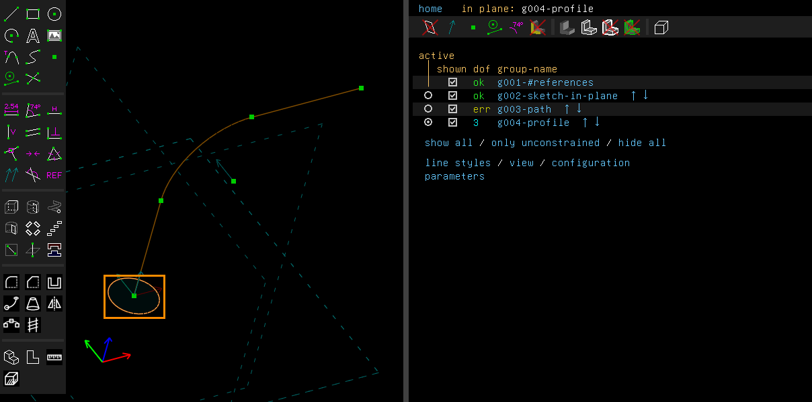
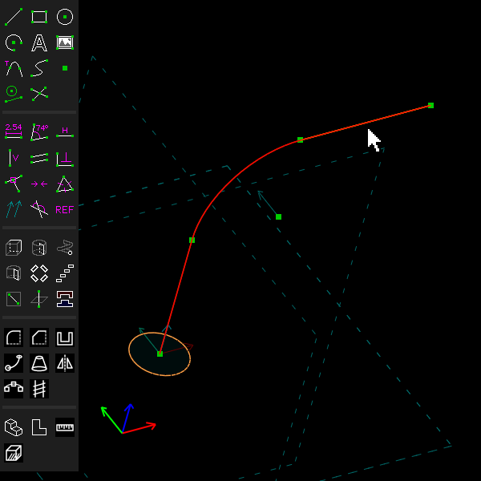
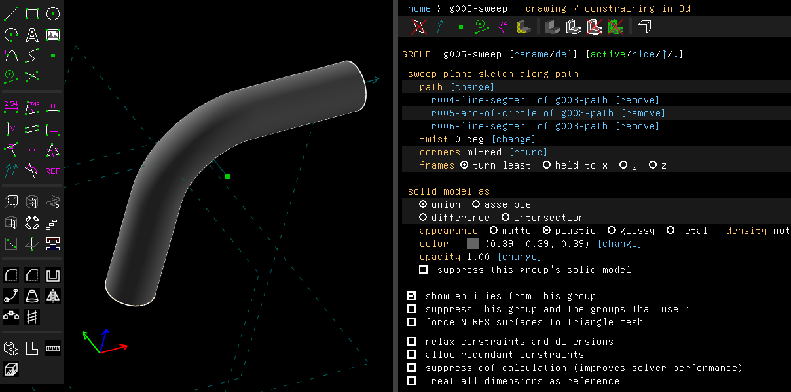
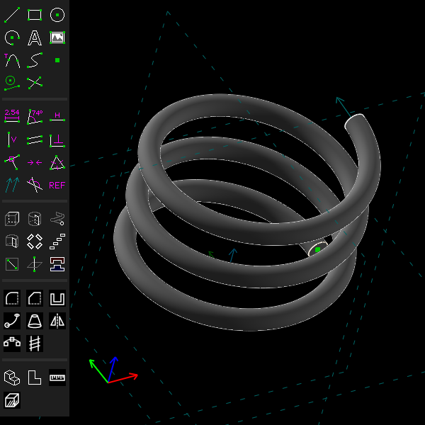
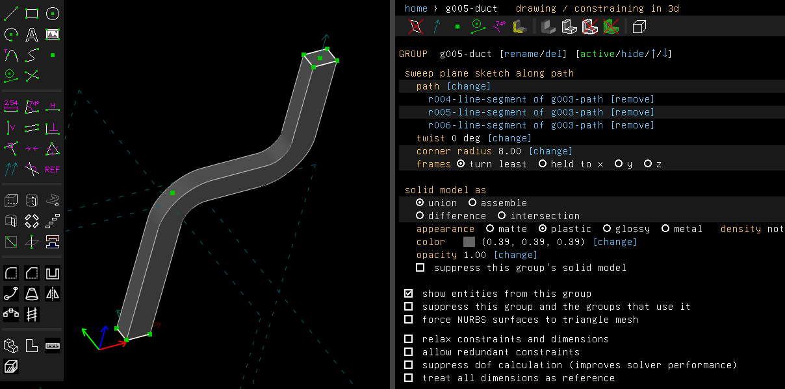
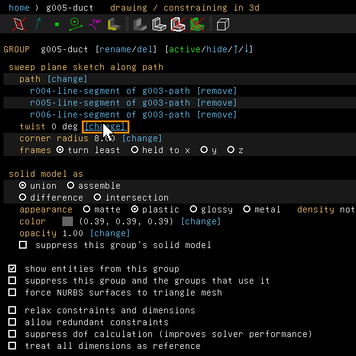
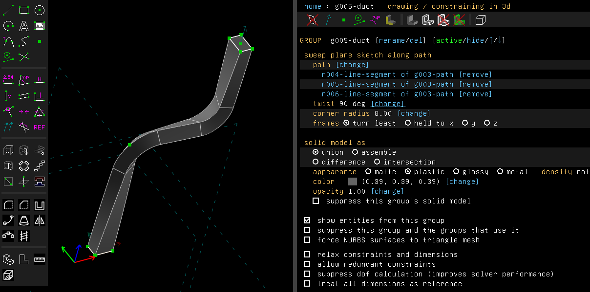

# Sweep

Examples: [`examples/scripts/sweep`](../../examples/scripts/sweep/sweep.go), a bent tube: a
ring swept along a straight, a bend and a straight;
[`examples/scripts/spring`](../../examples/scripts/spring/spring.go), a coil spring: a circle
swept along a helix drawn as cubics.

A sweep moves a sketch (the *profile*) along a path, and makes the solid it passes through.

## Step by step

Sweep a circle along a bent path:

1. Draw the path in one sketch: here a line, an arc and a line, tangent where they meet. Draw
   the profile, a circle, in a workplane across the path's start, and keep its sketch active.
   A path need not be a closed loop.

   

2. Click the three pieces of the path. They are drawn in red when selected.

   

3. Choose Features > Sweep Along Path (Shift+U). The circle is swept along the path into a
   bent tube, and the property browser lists the path's pieces.

   

The profile need not be at the path's end. Drawn across an open path partway along it, the
whole path is swept, from end to end, and the solid passes through the profile where it is
drawn. A profile drawn across a sharp corner of the path is a problem on the group: the
corner's mitre would cut it.

Along a helix, as in the `spring` example, the profile keeps its attitude to the path, so the
wire does not spin about itself:



The `elbow` example sweeps a 6 by 4 mm rectangle along three lines, with a corner radius of
8 mm that rounds both corners. Click "[change]" beside the twist and type 90: the rectangle
turns a quarter turn about the path over its length, round the corners' arcs too.







These pictures are made by [`scenarios/sweep.scenario`](scenarios/sweep.scenario).

## In the window

1. Draw the path: line segments, arcs and cubics, joined end to end and meeting tangent. They
   may lie in a workplane or anywhere in 3d. The path is an ordinary sketch, so its dimensions
   drive the sweep.
2. Draw the profile in a workplane, as closed loops, and make that sketch active (Sketch > In
   Workplane).
3. Select the pieces of the path and choose Features > Sweep Along Path (Shift+U).

The profile keeps its attitude to the path: it turns with the path's direction and no more
(*rotation-minimising frames*). So a ring swept along a helix does not spin about the wire.

The group's screen lists the path, with "[change]" to sweep along the selection instead and
"[remove]" on each piece's row. It has two settings:

- **twist** turns the profile about the path by that many degrees over the whole path, evenly
  along its length. A square swept along a line and twisted by 90 is a twisted bar.
- **frames**: "turn least" is the default. "held to x", "y" or "z" keeps the profile's attitude
  to that axis instead, as far as the path's direction allows. A thread's profile swept along a
  helix and held to the helix's axis keeps facing the axis. The path must never run along the
  axis it is held to, or the group says so.

Along lines and arcs alone, with no twist and no held axis, the surfaces are exact: cylinders,
tori and the like. Otherwise the surface is *fitted* to the true sweep: the profile is placed at
sections along each piece of the path, a surface is passed through them, and sections are added
until the surface is within a tenth of the chord tolerance of the true sweep everywhere between
them. (The chord tolerance is how far a mesh may stray from the true surface, set on the
configuration screen.) The pieces' surfaces meet tangent where the true sweep is smooth.

## From a script

```go
path := []api.Entity{
	doc.Sketch.Line(api.V(0, 0, 0), api.V(0, 0, 30)),
	bend,
	doc.Sketch.Line(end, end.Plus(api.V(40, 0, 0))),
}
doc.Features.SketchIn(doc.Workplane("XY"), "ring")
doc.Sketch.Circle(api.V(0, 0, 0), 6)
tube := doc.Features.Sweep(path, "tube")
tube.AsSweep().SetTwist(90)               // degrees over the whole path
tube.AsSweep().SetSweepUp(api.V(0, 0, 1)) // frames held to z; zero turns them least again
```

## Limits

A twisted sweep's sides of straight edges are twisted ruled faces. The mesher splits its cells
where the twist bends the face, so their mesh's volume is within about 0.05% of the solid's. Where the path's curvature jumps, as where a
line meets an arc, a twisted sweep has a crease, because the true one has.

## Corners in the path

Two pieces of the path may meet at an angle, a *corner*. What happens there depends on the
pieces.

**Two line segments.** The sweep is mitred: each piece is cut by the plane that halves the
corner, as a picture frame's moulding is.

**A line and an arc, or two arcs, in the arc's plane.** No plane can mitre them: a plane
through the corner cuts the arc's turned sides where the line's do not pass. Instead each point
of the profile is followed along both pieces, a line along the straight one and a circle round
the arc, and the sides meet where those cross. On the outside of the turn both pieces go on
past the corner to fill it. On the inside each stops where the other's side cuts it, as at a
mitre between lines. Example: [`examples/scripts/hook`](../../examples/scripts/hook/hook.go), a
round bar up a shank and round a bend that leaves it at a right angle.

A corner too sharp for that, where for some points of the profile the line's side passes
outside the arc's so the two never cross (a bar 2 wide round an arc of radius 12 at a corner of
150°), is made another way: the line and the arc are swept each on its own, up to the corner,
and the outside of the turn is filled by where the two, carried on past the corner, overlap
there, all joined into one solid (where an arc carried on comes back over the line far from the
corner, that overlap is left out). Round a closed path the same is done, the sweep going round from the
profile and back to it. Where the arc turns away from that overlap, it runs on as far as the
pieces are carried: their outer sides never meet, and the corner is a problem on the group.

These corners are problems on the group, which a corner radius (below) then rounds:

- a corner whose pieces' outer sides never meet past it (the arc turning against a corner of
  150° or more);
- a piece too short for the joint at its ends.

A sharp corner next to a cubic is made the same way: the path is cut at the corner, each side is
swept on its own, carried a little past the corner along its tangent, and the outside of the turn
is filled by where the two sides, carried on past it along their tangents, overlap, all joined.
With the cubic straight, that is the mitre two lines make. It is made on an open path with no
twist, no frames held to a direction and no corner radius (a radius rounds only corners between
lines and arcs). Where the pieces don't join into a closed solid, as along a round profile, whose
tubes meet tangent where they overlap, the corner is a problem on the group: round it in the path
with an arc or a tangent cubic.

**Along a cubic, or held to a direction.** Such a sweep is fitted, but a corner between two
lines is still mitred: along a line its frames do not turn, so the two straight runs are prisms
cut by the plane that halves the corner. Held to a direction, the frames must turn at the
corner as the path does, so the held direction must be the corner's axis (across the path's
plane). Held otherwise, the corner is a problem on the group. A corner beside an arc, in the
arc's plane, is joined as on a rigid sweep: the lines and arcs about it are swept rigidly, the
rest of the path is fitted, and the two meet on the section between them. Along an arc the
frames turn about its axis, so a held direction must be that axis, and a twist is held still
there.

**Twisted.** A twist would turn the frames along a line, and the mitre's two sides would not
meet. So a twisted sweep holds its twist still along each line beside a corner, over the
stretch the mitre spans (the profile's reach from the path over the cosine of half the turn,
and a tenth more). It turns along the rest of the path, and its rate climbs from nothing over
the profile's reach, so the twisted faces leave the mitred ones tangent. A corner beside an arc
is joined as on a rigid sweep, so the twist is held still along the arc and along each line
beside it as far as the joint reaches; a line goes on twisting past that. Where that leaves
nowhere to twist, as on a path of arcs and corners alone, each arc beside a corner is held only
as far as the joint reaches too, and twists along the rest. Where every piece is still held
whole, as two arcs about a corner so sharp that its joint takes them whole, there is nowhere
left to twist, and the corner is a problem on the group; a corner radius then rounds it, and
the twist runs round the corner's arc. Example:
[`examples/scripts/zigzag`](../../examples/scripts/zigzag/zigzag.go), a rail along a cubic and
a sharp corner, a twisted bar round a rounded corner and round a sharp one, and a twisted hook
up a line and sharply round an arc.

**Corner radius.** On the sweep's screen, "corners mitred [round]" takes a radius, and the row
then reads "corner radius ... [change]". Every corner on the path is rounded instead of mitred,
as a pipe is bent: the pieces either side are cut back to where an arc of that radius, tangent
to both, joins them, and the profile turns about that arc's axis. The solid is exact and no
surface is intersected, so it works for any profile, beside an arc as beside a line, and on a
fitted sweep as on a rigid one. A problem on the group: a radius too large for a piece, too
small for the profile to clear the arc's axis, or a corner out of the plane of the arc beside
it. Example: [`examples/scripts/elbow`](../../examples/scripts/elbow/elbow.go), a duct with two
rounded corners.

```go
duct := doc.Features.Sweep(path, "duct")
duct.AsSweep().SetCornerRadius(8)
```

## Along edges of the solid

The path may be edges of the solid made so far, picked on the model, alone or with sketch
entities. A right click on an edge offers Sweep Along Edges. A straight edge is a line, a
circular one an arc, any other a curve. The sweep keeps the edges' names, so it follows them
when the model upstream changes. Example:
[`examples/scripts/bead`](../../examples/scripts/bead/bead.go), a bead along two top edges of a
block.

```go
bead := doc.Features.SweepEdges([]api.SolidEdge{front, right}, nil, "bead")
```

## Closed paths

A path that closes, a circle or pieces that come back to where they began, is swept round from
the profile and back to it, with no caps: a ring, a gasket, a picture frame.

Draw the profile across the path where the path is smooth, not at a corner. The sweep starts
where the profile's plane crosses the path, at the crossing nearest the profile, so the joint
where the solid closes is smooth. The path's corners are mitred, or rounded by a corner radius,
as an open path's are. Example: [`examples/scripts/frame`](../../examples/scripts/frame/frame.go),
a picture frame mitred at its four corners.

- Round lines and arcs in a plane, the profile comes back as it left, and the surfaces are
  exact.
- Round a cubic, round lines and arcs out of a plane, or with a twist, the surface is fitted.
  The path's shape decides how far the frames have turned when they come back, and that turn
  is taken out evenly along the path. A twist must then be whole turns, or the profile would
  not meet itself. The turn is held still beside each sharp corner, so lines and arcs out of a
  plane take corners too: between two lines mitred, beside an arc joined if the corner is in
  the arc's plane, or rounded by a corner radius. A cubic in a plane takes corners between
  lines, mitred, as an open path's. Example:
  [`examples/scripts/skewframe`](../../examples/scripts/skewframe/skewframe.go), a square bar
  round four lines in 3d.
- A profile at a corner of the path, or whose plane does not cross the path, is a problem on
  the group.

```go
d.Features.SketchIn(d.Workplane("ZX"), "path")
ring := d.Sketch.Circle(api.V(10, 0, 0), 10)
d.Features.SketchIn(d.Workplane("XY"), "profile")
d.Sketch.Circle(api.V(0, 0, 0), 2)
d.Features.Sweep([]api.Entity{ring}, "o-ring")
```

## A path that comes back

A path that comes back within the profile's reach of where it has been, as an arc past a sharp
corner turning back over the line before it, or looping round across it, makes the solid the
profile passes through: its overlapping passes are joined, so a hook whose end runs back into
its shaft becomes a ring. This is done by sweeping the path in stretches that each stay clear
of themselves and joining them: round lines and arcs, open or closed, and along a fitted path,
twisted, held to a direction or round a cubic, whose stretches keep the frames, and so the
twist, of the whole path. Where that can't be done, the group is a problem that says the sweep
passes through itself, and makes no solid: move the pieces apart or make the profile smaller.

## Not yet

A sharp corner next to a cubic is made only on an open path with no twist, held frames or corner
radius, and only where its pieces join: along a round profile it is refused, and along one with
a corner where the turn's axis crosses it, as a diamond's, unless the cubic is straight.

A path that comes back over itself is refused where its stretches can't be cut clear of a
corner or don't join. Round lines and arcs that is about half of such paths: of the 1440 paths
of a line and an arc about a corner that the tests try (three profiles, corners of 30° to 150°
either way, arcs of 45° to 270°), 160 come back over themselves, and 81 are made in stretches
and 79 refused (2026-11-04). Along a fitted path more are refused: a round profile held to a
direction, or a square held with its sides lying in one plane where the path comes back, whose
stretches' fitted surfaces don't join; a twisted closed path; and a twisted or held path with a
sharp corner beside an arc or a cubic.
Repeating a solid along a path, instead of sweeping a profile, is
[Pattern Along Path](pattern.md).
