# Screw threads

Example: [`examples/scripts/bolt`](../../examples/scripts/bolt/bolt.go), a hexagon head bolt
with a thread of any designation, M8 unless you give another.

A screw thread is made on a circle: the rim of a rod or of a hole, or a cylindrical face of the
solid. A screw's thread turns the part down and sweeps a ridge round it. A nut's thread bores the
part out and sweeps the ridge inside.

## Step by step

Thread the end of a 10 mm rod:

1. Draw a circle 10 mm across and extrude it (Shift+X). The rod starts 10 mm long, as long as
   the circle is wide: too short for the 12 mm thread below. On the extrusion's screen, tick
   "held", click "[change]" beside the depth and type 20. In the view from above, click the
   circle at the rod's top end. It is drawn in red when selected.

   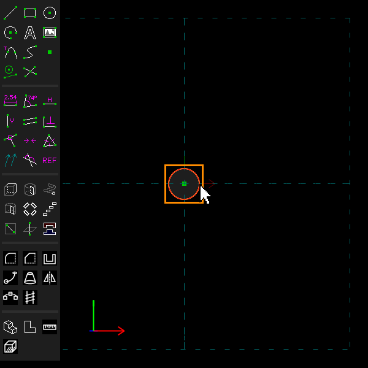

2. Choose Features > Screw Thread... (Shift+E). The property browser shows the thread's
   screen. It offers M10, the standard thread nearest the circle, 15 mm long.

   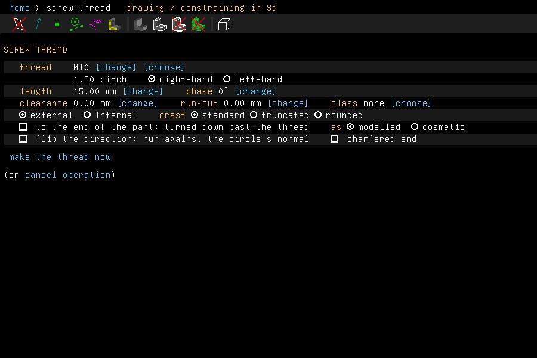

3. Click "[change]" beside the length and type 12. Tick "flip the direction": the top rim's
   normal points out of the rod, so the thread must run against it, down into the rod. Then
   click "make the thread now".

   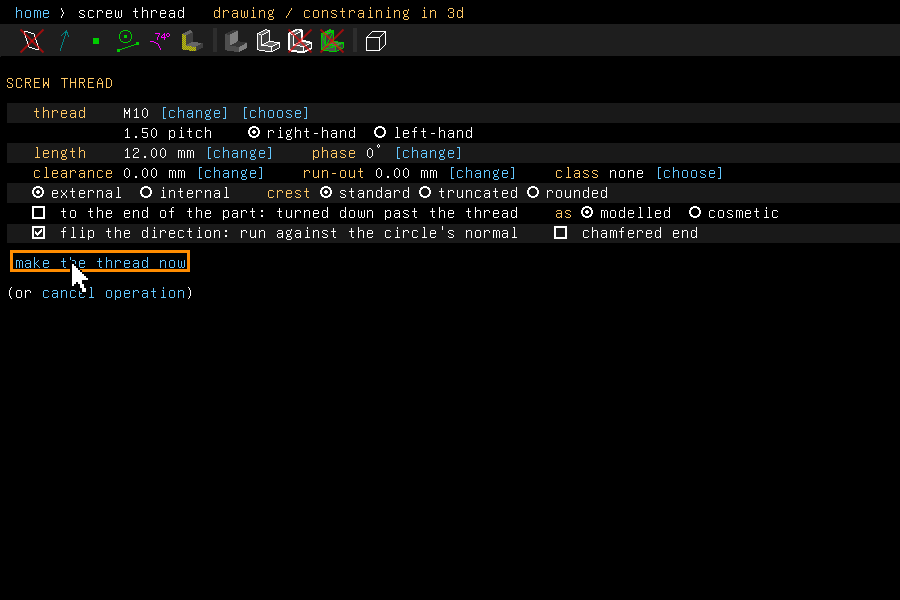

4. The rod is turned down and the ridge swept round it. The thread's screen says what was made
   and whether the solid came out sound.

   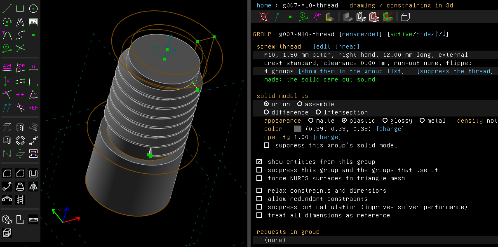

   Seen from the side:

   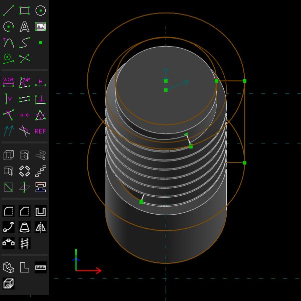

5. To change the thread, click "[edit thread]". The same screen opens, filled in from the
   thread. Change what you need and click "make the thread again now".

   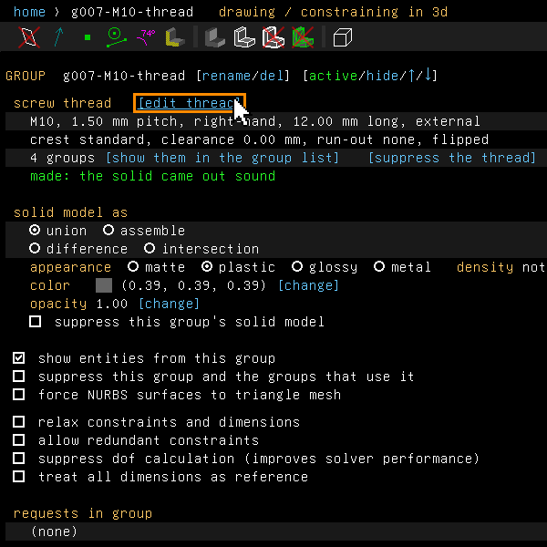

   Here the designation is changed to Tr10x2, a trapezoidal thread with a 2 mm pitch, then to
   S10x2, a metric buttress thread whose load flank is nearly square to the axis:

   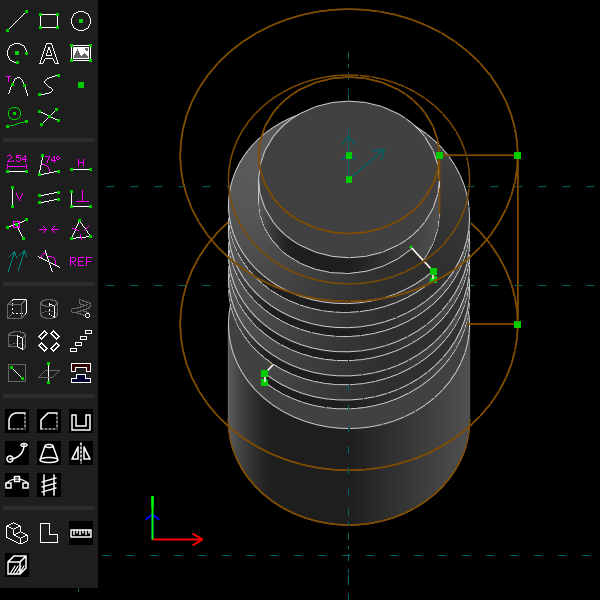

   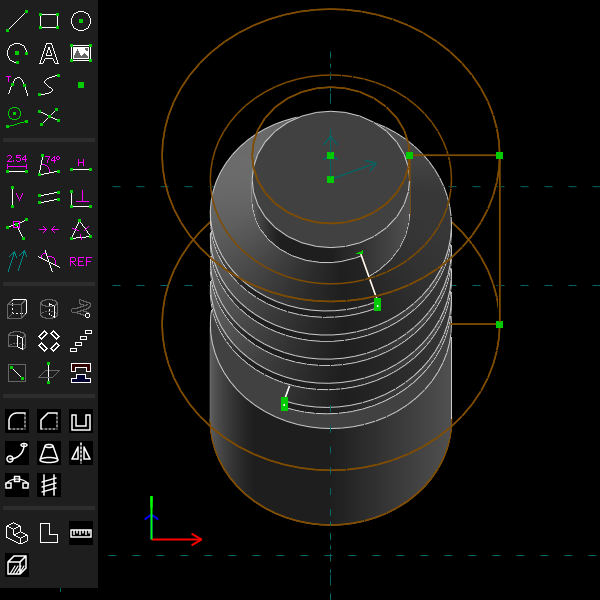

6. "[choose]" beside the designation lists the series. Pick a series to see its sizes, and a
   size to see its pitches. Here the metric series, with M10 picked.

   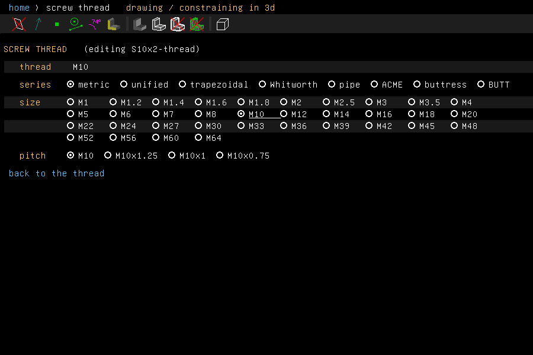

7. Click "cosmetic" on the "as modelled / cosmetic" row and make the thread again. The thread
   is now only recorded on the rod, which keeps its diameter. The window draws its turns as
   thin lines.

   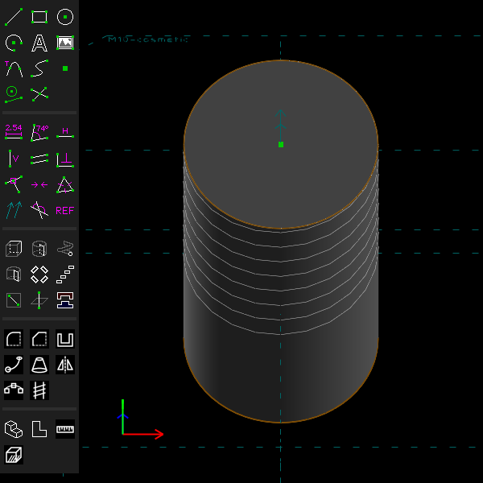

These pictures are made by [`scenarios/threads.scenario`](scenarios/threads.scenario).

## In the window

Select a circle or an arc, such as the rim of an extruded circle, and choose Features > Screw
Thread... (Shift+E). The screen offers the standard thread nearest the circle's diameter. Fill
in the rows below and click **make the thread now**.

With anything else selected, or nothing, it says what it takes:

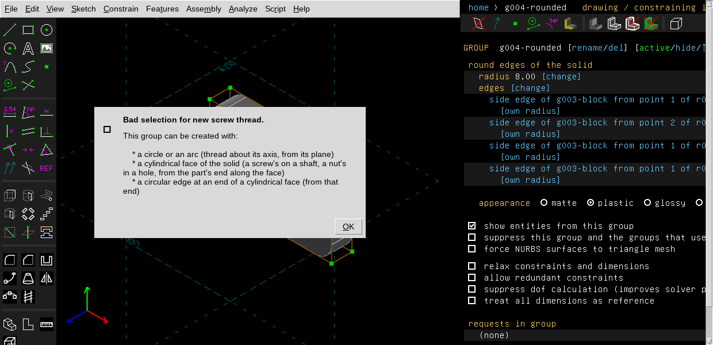

### The designation

The **thread** row holds the designation. These forms are read:

| Designation | Thread |
|---|---|
| `M8`, `M8x1` | ISO metric, coarse pitch or the pitch given |
| `M16xPh3P1.5` | ISO metric, 1.5 mm pitch, 3 mm lead (two starts) |
| `Tr20x4`, `Tr20x8(P4)` | ISO metric trapezoidal, 30° |
| `1/4-20 UNC`, `#10 UNF`, `1/2-13 UNC (2 starts)` | unified inch |
| `1/4 BSW`, `3/8 BSF`, `3/8-20 BSW` | Whitworth, 55° |
| `G1/2`, `G1 1/2` | parallel pipe thread (BSP, ISO 228-1) |
| `1/2-10 ACME`, `1/2 ACME-2G` | general purpose ACME, 29° |
| `S20x4`, `S40x14(P7)` | metric buttress (DIN 513), flanks at 3° and 30° |
| `1-12 BUTT`, `1 BUTT`, `1-12 PUSH-BUTT`, `2-4 BUTT-2A` | buttress inch (ASME B1.9), flanks at 7° and 45° |

`-LH` at the end makes any of them left-hand.

- **[choose]** lists the series: metric, unified, trapezoidal, Whitworth, pipe, ACME, buttress
  (DIN 513) and BUTT (ASME B1.9). Pick a series to see its sizes, and a size to see its
  standard pitches, coarse first: for M8, 1.25, then the fine pitches 1 and 0.75. A click keeps
  the starts and the hand.
- **[change]** takes any designation you type. If the thread is written another way, the screen
  says so: `'M8x1.25' is written M8`. A size the series does not have is refused, and the
  message offers a way out: `give its pitch, as in Tr21x4, or take the nearest, Tr20x4`.
- The S series takes its sizes from ISO 2902, from 10 mm up. The BUTT series has ASME B1.9's
  sizes, from 1/2 to 24 inches. A BUTT size given without its threads per inch takes the middle
  of the three that B1.9 prefers for that diameter: `1 BUTT` is 1-12 BUTT.

### The rows

| Row | What it does |
|---|---|
| **right-hand** / **left-hand** | The hand. |
| **length** | How far the thread reaches from the circle's plane. It starts at one and a half diameters. Takes a number or an expression of the parameters (Edit > Parameters), such as `2*d`; the thread then follows it. |
| **phase** | Turns the thread about its axis, in degrees. The ridges move along the axis by that part of the lead and are made a pitch shorter. Use it to fit a thread to another by hand. |
| **clearance** | Moves the thread away from its mate, as a radius. |
| **class** | The tolerance class (below). It sets the clearance. |
| **external** / **internal** | A screw's thread or a nut's. |
| **to the end of the part** | For a part that ends where the thread does: it is turned down or bored one pitch past the thread, with no shoulder. Otherwise the thread stops at a shoulder; if the part goes on, that pitch is a groove, and the window says so. |
| **flip the direction** | Runs the thread against the circle's normal. A rim at the top of a part points out of it, so tick this to run the thread down into the part. |
| **chamfered end** | Cuts the free end by a cone at 45° to the axis, from a little inside the root out past the crest (ISO 4753). A nut's mouth is countersunk. A thread to the end of the part is chamfered at both ends. |
| **crest** | **standard**, the flat crest of the standard; **truncated**, a quarter of the ridge's height lower; **rounded**, an arc tangent to both flanks. A printed thread is stronger and mates more easily without the point. |
| **rounded root** | B1.9 threads only: rounds the roots as the standard draws them. |
| **run-out** | How far before the shoulder the thread fades out, as a die leaves it. 0 is none. A thread to the end of the part has none. |
| **load flank back** | Buttress threads only: turns the ridge about (below). |
| **starts level** | Threads of several starts only: every start begins at the circle's plane, each with a ridge and a helix of its own. |
| **as modelled** / **cosmetic** | A thread with its turns, or one only recorded on the part (below). |

Whitworth crests and roots are flat, at the height of the standard's rounds. The **rounded**
crest comes close to the standard's.

The rounded root's arcs are small, 0.15 mm on a 1-12 BUTT. Where the model's chord tolerance
(Edit > Preferences) is too coarse for them, the thread and the part it is cut in are made at a
finer one of their own, and take longer. The groups after the thread keep the model's. Chamfered
threads and buttress nuts do the same.

### Tolerance classes

**[choose]** beside the class lists the classes of the thread's form and side. The first is the
default.

| Form | Screw | Nut |
|---|---|---|
| ISO metric (ISO 965-1) | 6g, 4h, 6e, 6f, 6h, 8g | 6H, 4H, 5H, 6G, 7H |
| Unified (ASME B1.1) | 1A, 2A, 3A | 1B, 2B, 3B |
| Trapezoidal (ISO 2903) | 7e, 8e | 7H, 8H |
| ACME (ASME B1.5) | 2G, 3G, 4G, 5G | 2G, 3G, 4G, 5G |
| Buttress inch (ASME B1.9) | 2A, 3A | 2B, 3B |
| Metric buttress (DIN 513-3) | 7e, 8e, 8c, 9c | 7H, 8H, 9H |
| Whitworth | none | none |

A class sets the clearance to the middle of its tolerance zone. So a 6g screw fits a 6H nut as
real parts do on average (M10: 0.049 and 0.044 mm). Typing a clearance sets the class to none.
Made internal, a screw's class becomes the nut's default.

- A DIN 513 nut (7H, 8H, 9H) is made larger than the basic size by the standard's axial play on
  its trailing flank. An S20x4 7H nut has 0.41 mm of clearance.
- An ACME nut of several starts gets more clearance, as ASME B1.5 asks: half of its class's
  allowance more for two starts, three quarters for three, all of it for four or more. The screw
  is the same as for one start.

### Buttress threads and the load flank

A buttress ridge leans. Its load flank, the one that carries the load, is nearly square to the
axis.

- As made, a screw's clearance flank leads, facing the end that goes into the nut. A nut's load
  flank faces the nut's mouth.
- **load flank back** turns the ridge about. A screw and a nut mate only when their load flanks
  face each other.
- ASME B1.9 names the way in the designation: `BUTT` (or `PULL-BUTT`) pulls, the clearance
  flank leading; `PUSH-BUTT` pushes, the load flank leading. Typing one sets **load flank back**
  to match.
- A DIN 513 designation says nothing about the way: set the box by hand.

Example: [`examples/scripts/buttress`](../../examples/scripts/buttress/buttress.go), a screw
jack's S20x4 spindle, its nut with the load flank turned back, and a 1-12 BUTT ring.

### What is refused

The thread must fit its part. These are refused before anything is made, and the message says
how far the part reaches:

- a thread longer than the part;
- a thread that runs off the part (the circle's normal pointing out of it: tick **flip the
  direction**);
- a screw's thread on a rod thinner than its root.

If the part is made shorter later, the thread's helix group shows the problem until the part is
long enough again.

A chamfer is refused on a thread too short for its chamfers, and on a screw so coarse for its
size that the cone would reach the axis (a Tr12x3).

If a thread does not come out sound, its screen says so. With a run-out, a run-out a little
longer or shorter usually puts it right.

## On a face

Select a cylindrical face of the solid, a shaft or a hole, or the circular edge at one of its
ends. Then choose Features > Screw Thread..., **Screw Thread...** on the right-click menu, or the
thread button on the toolbar. The face decides the rest:

- A shaft carries a screw's thread, and a hole a nut's.
- The thread starts at the part's end: a shaft's tip or a hole's mouth. If both ends are free, it
  starts at the upper one. If you picked an edge, it starts there.
- For a shaft the screen offers the nearest standard thread. For a hole it offers the thread the
  hole is drawn or drilled for: a hole of 8.5 mm (M10's tap drill) is offered M10.

In place of the external, internal, through and flip rows, the screen has:

- **the face's full length**: the thread runs the whole face, and through where the face reaches
  the part's end. It is on to begin with when one and a half diameters would reach past the face.
  The thread follows the face's length when the part changes: a rod made longer by a parameter
  carries a longer thread. Typing a length turns it off.
- **from the face's other end**: the thread starts at the other end.

The thread is drawn in a datum at the face's end, a group before the thread's own. It follows
the face when the part changes upstream. A hole wider than the thread's root, or a shaft thinner
than it, is refused.

```go
s := doc.Active().Solid()
doc.Features.ThreadOnFace(s.FaceAt(api.V(4, 0, 10)), api.ThreadOptions{Length: 12})
doc.Features.ThreadOnFace(hole, api.ThreadOptions{FullLength: true})     // a nut's thread
doc.Features.ThreadOnFace(stud, api.ThreadOptions{Reverse: true})        // from the other end
doc.Features.ThreadOnEdge(s.EdgeAt(api.V(0, 4, 0)), api.ThreadOptions{}) // from that rim
api.ThreadNearestForHole(8.5)                                            // "M10"
```

Example: [`examples/scripts/threadface`](../../examples/scripts/threadface/threadface.go).

## Cosmetic threads

A cosmetic thread is recorded on the part but has no turns. Drawings show a thread by the
drafting convention anyway, and most threads in an assembly need no more. It is quick to make
and to regenerate.

- A screw's shaft is left as it is at the thread's major diameter, and turned down to it when
  thicker.
- A nut's part is bored to the minor diameter, the tap drill's size, unless a hole at least that
  wide is already there.
- The window draws the turns as a thin helix on the part.
- Its class is kept as a record; the part stays at the nominal size.
- Crest and level starts apply only to a modelled thread.
- Exports write the part as it is: STL and STEP carry no thread, and mass, interference and
  clearance measure the part's own surfaces.

Switching between modelled and cosmetic is one step of undo, and later groups stay attached.

```go
c := doc.Features.ThreadOnFace(stud, api.ThreadOptions{Length: 12, Cosmetic: true}).AsThread()
o := c.Options()
o.Cosmetic = false
c = c.Edit(o) // now modelled; the helix group keeps it
```

Example: [`examples/scripts/threadcosmetic`](../../examples/scripts/threadcosmetic/threadcosmetic.go).

## Fitting a nut to its bolt

A thread is made from its circle whatever is to go on it. So a nut fits its bolt only where it
happens to sit a whole number and a half of pitches from the bolt's ridge. Anywhere else the
ridges collide.

A bolt and its nut are two parts linked into one model. **Assembly > Mate Screw**, on a rim of
each, fits them. When both carry threads of one size, pitch, starts and hand, one a screw's and
one a nut's, the mate takes the threads' lead. It first moves the nut along the axis, by less
than half a pitch, so that its ridges lie between the bolt's. Turning it by the mate's `turn`
parameter keeps them there.

Refused: mismatched threads (M8 on M10, or two screws), and two buttress threads whose load
flanks face the same way (make one with **load flank back**). A cosmetic thread gives the mate
its lead, but the part is not moved.

```go
o := api.ThreadOptions{Designation: "M10", Class: "6g", Length: 25, Reverse: true}
doc.Features.Thread(end, o)
mate := doc.Assembly.Screw(boltRim, nutRim, 0) // 0: the threads' lead, and fitted
api.ThreadClasses("M10", true)                 // "6H", "4H", "5H", "6G", "7H"
```

Example: [`examples/scripts/threadfit`](../../examples/scripts/threadfit/threadfit.go), a 6g
bolt and a 6H nut screwed down it, checked for interferences at each turn.

## The thread's groups

A thread is several groups: a sketch and a lathe that turn the part down or bore it, then a
ridge sketch and a helix that sweeps the ridge. Each further level start adds a ridge sketch and
a helix. A chamfer adds a sketch and a lathe at the end. A thread on a face has a datum group
before them. Undo takes them all away at once.

The group list shows the thread as one row, such as "g007-M8-thread (screw thread, 4 groups)":

- **[+]** shows its groups, **[−]** folds them.
- The row's box shows or hides them all, its arrows move the whole thread, its radio button
  makes its last group active, and its name opens the thread's screen.

The thread's screen has **[edit thread]**, **[show them in the group list]**, **[suppress the
thread]** (until **[bring the thread back]**) and **[delete the thread]**. The screen of each of
the thread's other groups has **[edit thread]** too.

Making the thread again keeps its groups, so later groups that use the thread stay attached. A
ridge taken away with a start is reported as a broken reference. You can edit the groups one by
one, but the next edit of the thread draws them again from its screen.

A group of the thread moved on its own (a bore moved past a later cut, with its row's arrows or
**Move Group to End**) leaves the thread apart: it is no longer edited as a thread. Moved back
together, it is a thread again. A file and File > Export > Script keep it either way.

## From a script

```go
doc.Features.Thread(rim, api.ThreadOptions{Designation: "M8", Length: 20})
doc.Features.Thread(hole, api.ThreadOptions{Internal: true, Through: true})
doc.Features.Thread(lead, api.ThreadOptions{Designation: "1/2-10 ACME", LeftHand: true})
doc.Features.Thread(rod, api.ThreadOptions{Designation: "M8", Length: 12, RunOut: 3})
doc.Features.Thread(lead, api.ThreadOptions{Designation: "M12xPh3P1", Length: 14, LevelStarts: true})
doc.Features.Thread(stud, api.ThreadOptions{Designation: "M10", Length: 20, Chamfer: true})

api.ThreadNearest(7.9)           // "M8"
api.ThreadSeries()               // "metric", "unified", ..., "BUTT"
api.ThreadSizes("pipe")          // "G1/16", "G1/8", ...
api.ThreadPitches("M8")          // "M8", "M8x1", "M8x0.75"
api.ThreadDesignation("m8x1.25") // "M8"

t := g.AsThread() // g, the helix group Features.Thread returns
o := t.Options()
o.Designation, o.Crest, o.LengthExpr = "M8x1", "rounded", "len"
t = t.Edit(o)      // as "make the thread again now"
t.Circle()         // the circle it is on
t.Finished()       // the last group, which holds the finished part

t, ok := anyGroup.ThreadOf() // the thread a group belongs to
t.SetVisible(false)          // the box of the thread's row
t.MoveBefore(other)          // all its groups together
t.SetSuppressed(true)        // [suppress the thread]
t.Delete()                   // [delete the thread]
```

`ThreadOptions` also has `Clearance`, `Class`, `Phase`, `Crest`, `RoundRoot`, `LoadFlankBack`,
`FullLength` and `Cosmetic`; `help("ThreadOptions")` in the console describes each.

Examples: [`examples/scripts/threadsizes`](../../examples/scripts/threadsizes/threadsizes.go),
[`examples/scripts/threadedit`](../../examples/scripts/threadedit/threadedit.go),
[`examples/scripts/threadrunout`](../../examples/scripts/threadrunout/threadrunout.go),
[`examples/scripts/threadchamfer`](../../examples/scripts/threadchamfer/threadchamfer.go).

## In drawings

Drawings show a thread, modelled or cosmetic, by the drafting convention. A chamfer shows as the
cone's outline at 45°, with the root's thin lines running to it.

## Not yet

- Tapered threads (NPT, BSPT) and a variable pitch: not planned.
- A thread that runs through to the part's end has no run-out.
- Without level starts, the first pitches of a thread of several starts have fewer ridges.
