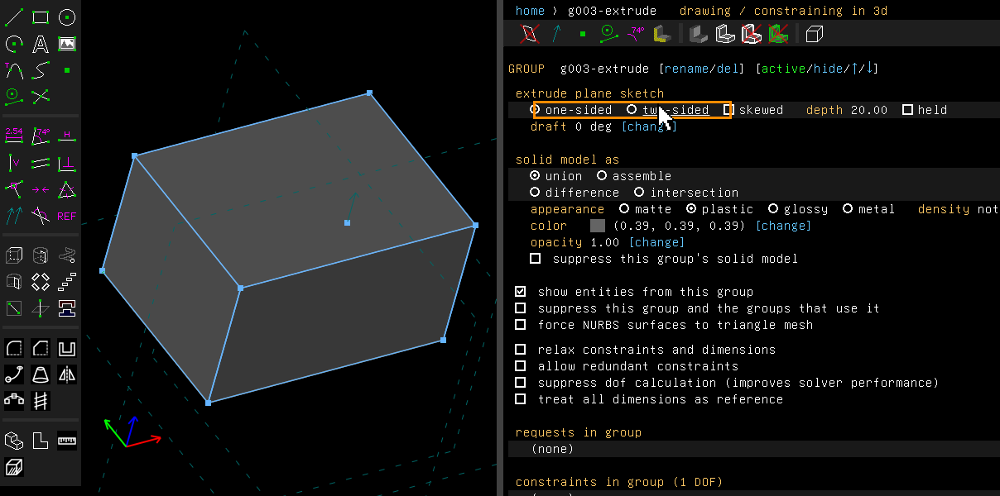
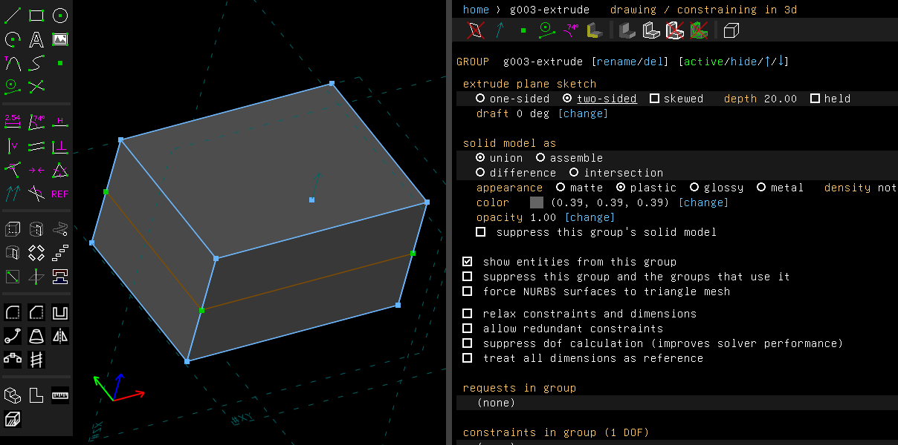
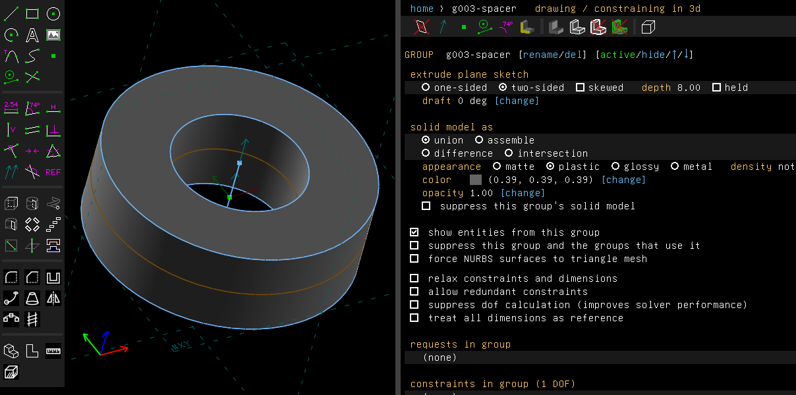

# Two-sided groups

Example: [`examples/scripts/spacer`](../../examples/scripts/spacer/spacer.go), a ring extruded
both ways from its sketch.

An extrusion's screen has "one-sided" and "two-sided". Two-sided runs the extrusion both ways
from its sketch, with the sketch in the middle, and keeps its whole depth: an extrusion of 8
runs from -4 to 4. One-sided puts it back.

## Step by step

1. Press R for a rectangle and click two corners. Press Esc, then Shift+X to extrude it. The
   extrusion runs one way from the sketch. Its screen shows "one-sided" and "two-sided".

   

2. Click "two-sided". The block keeps its depth, and the sketch's outline is now round its
   middle.

   

The `spacer` example extrudes a ring 8 mm two-sided, from -4 to 4:



These pictures are made by [`scenarios/two-sided.scenario`](scenarios/two-sided.scenario), which
replays the same clicks on the program (`scripts/regen-doc-images.sh`).

## Other groups

The same choice is on a revolve, a helix, and a step and repeat. A revolve or a helix turns as
far each way. A step and repeat lays its copies on both sides of the original.

```go
spacer := doc.Features.Extrude(8, "spacer")
spacer.SetTwoSided(true)
```

Leaning sides (`SetSkewed`) stay whichever way the group runs.

## Not yet

Nothing is missing from this feature.
