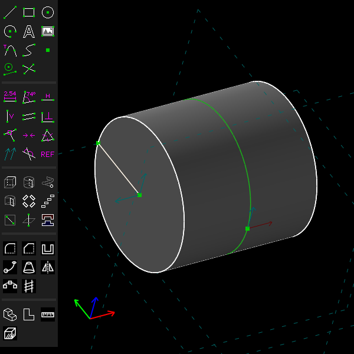
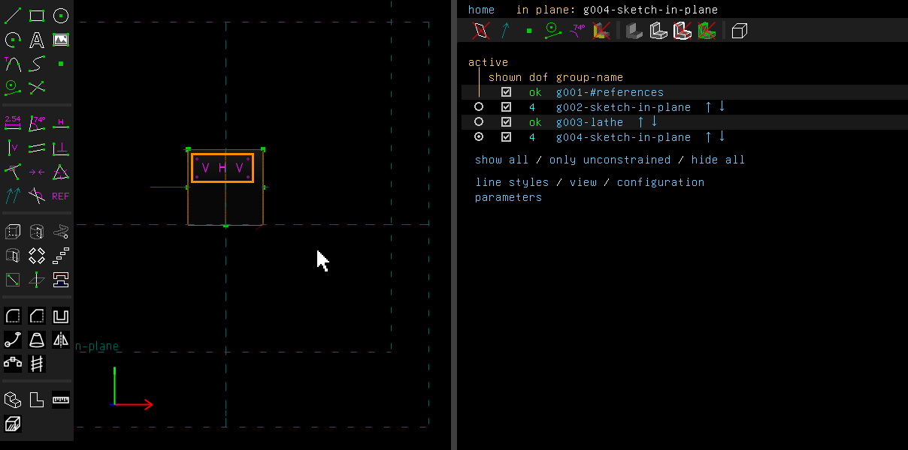
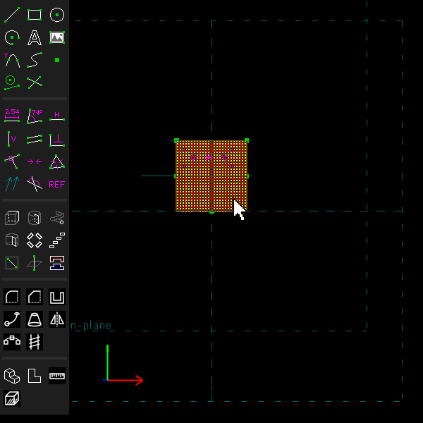
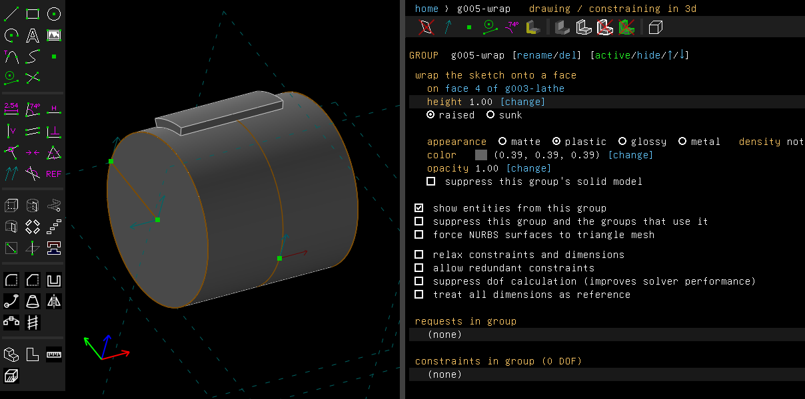
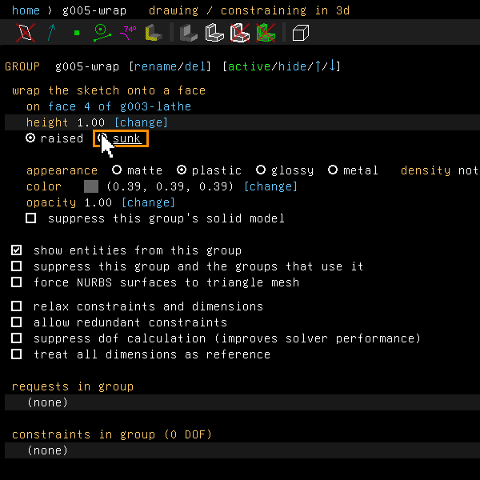
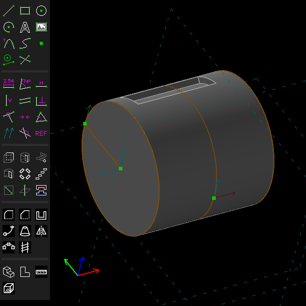
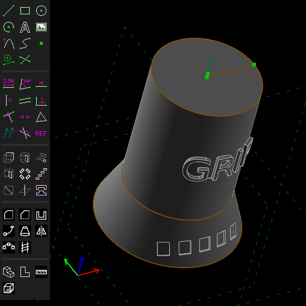

# Wrap and emboss

Example: [`examples/scripts/wrap`](../../examples/scripts/wrap/wrap.go), a handle turned from a
cone and a cylinder, a word raised on the cylinder and a band of squares sunk into the cone.

A wrap rolls a sketch onto a cylinder or a cone of the solid, as paper is rolled onto it. It then
raises the sketch from the face (an *emboss*) or sinks it into the face (an *engraving*).

## Step by step

Raise a rectangle on a cylinder, then sink it:

1. Draw a rectangle, select its lower side and press Shift+L to turn the rectangle about that
   side (Features > Lathe). It makes a cylinder.

   

2. In the view from above, select a corner of the first rectangle and press Shift+W
   (Features > Sketch In New Workplane). The new workplane goes through that point, parallel
   to the screen, so it holds the cylinder's axis. Draw a small rectangle in it.

   

3. Turn on View > Show > Selectable Faces, and click the cylinder. The face is drawn hatched
   when selected.

   

4. Choose Features > Wrap Sketch Onto Face. The rectangle is rolled onto the cylinder and
   raised by 1 mm. The property browser shows the face, the height, and raised or sunk.

   

5. Click "sunk". The rectangle is sunk 1 mm into the cylinder instead.

   

   

The `wrap` example raises a word on a cylinder and sinks a band of squares into a cone:



These pictures are made by [`scenarios/wrap.scenario`](scenarios/wrap.scenario).

## In the window

1. Draw the sketch as closed loops, in a workplane parallel to the face's axis. Text counts:
   each letter is a loop of its own.
2. Keep that sketch active (Sketch > In Workplane). Select one cylinder or cone of the solid.
   Faces cannot be picked while sketching unless View > Show > Selectable Faces is on.
3. Choose Features > Wrap Sketch Onto Face. A right click on the face offers the same as Wrap
   Sketch Onto This Face.

The sketch lands on the side of the face that faces it, and seen from there it looks as it was
drawn. Lengths in the sketch are lengths on the face: a word 30 mm long covers 30 mm round a
cylinder, whatever the radius. On a cone, the sketch is laid along the line of the cone that
faces it and rolled on from there. Lines across or along a cylinder's axis wrap exactly. Other
curves wrap within 1e-7 mm.

The group starts raised by 1 mm. Its screen shows the face, the **height**, which takes a number
or an expression of the parameters, and **raised** or **sunk**.

The band reaches a little through the face: into the wall under an emboss, or into the air over
an engraving. That way the Boolean crosses the face rather than touching it. The extra part is
hidden in the result. Where the wall is too thin for it, or the room before the solid starts
again is, the group says how thin and where.

## From a script

```go
cylinder := handle.Solid().FaceAt(api.V(12, 0, 25))
doc.Features.SketchAt(doc.Origin(), api.V(1, 0, 0), api.V(0, 0, 1), "word")
doc.Sketch.Text("GRIP", "", api.V(-9, 0, 22), 6)
word := doc.Features.Emboss(cylinder, 0.8, "raised")
word.AsWrap().SetHeight(1)
// a sketch of squares, then
doc.Features.Engrave(cone, 0.4, "sunk")
```

`AsWrap().Height()` and `Engraved()` read the group back. `SetExpr(sketch.GroupPitch, "h")`
gives the height an expression.

## Not yet

- Only cylinders and cones can be wrapped onto. Spheres, tori, lofts and other curved faces
  cannot.
- One loop with its holes, such as one letter, may go at most 350° round the axis. A row of
  letters may go further, because each letter is its own loop.
- An engraving as deep as the axis is refused, and so is a sketch on a cone that reaches past
  the cone's apex.
- Where the Boolean of a loop with the face fails at a corner of the loop, the group tries
  again loop by loop, reaching through the face by other amounts. Where none joins, the group
  is refused with a problem on it, and the solid so far passes through unchanged. A smaller
  height may join.
- The face cannot be changed on the group's screen. Delete the group and wrap again onto the
  other face.
